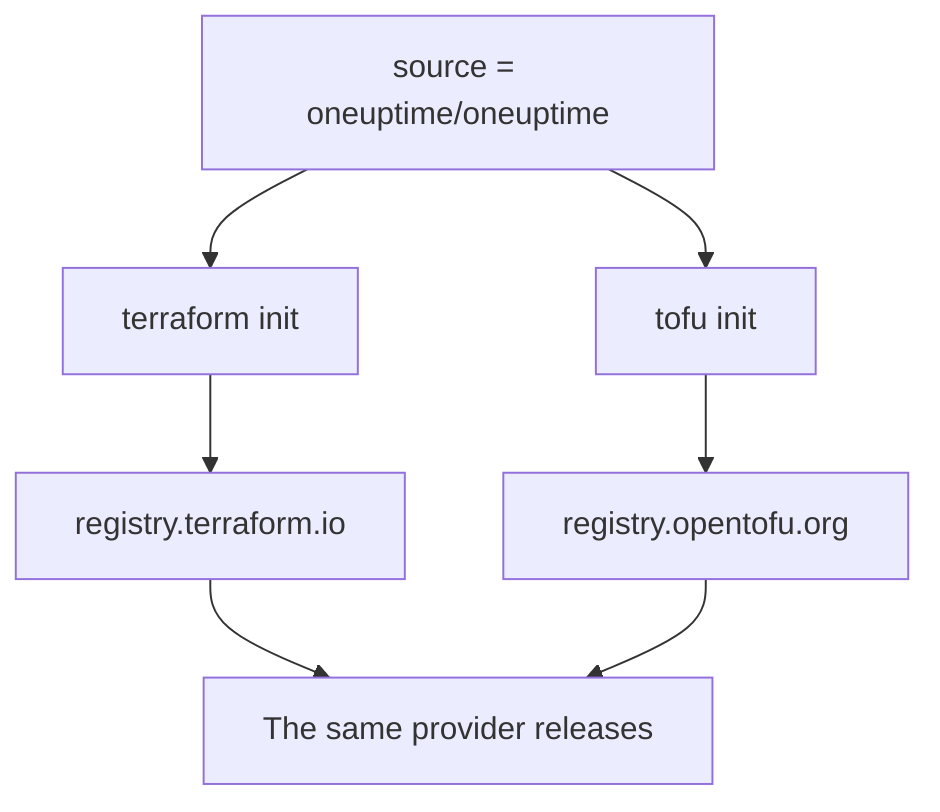

# OpenTofu

The OneUptime provider works with [OpenTofu](https://opentofu.org) as it does with Terraform. It is published to the [OpenTofu Registry](https://search.opentofu.org/provider/oneuptime/oneuptime/latest), and every release passes the same end-to-end tests under both before it is published. Your configuration does not change: run `tofu` wherever these docs run `terraform`.

:::cards
- [Use the provider with OpenTofu](#use-the-provider-with-opentofu): The same configuration, run with `tofu`.
- [What differs from Terraform](#what-differs-from-terraform): Registries, lock files, `.tofu` files and versions.
- [Move a configuration to OpenTofu](#move-a-configuration-to-opentofu): Switch an existing configuration in four steps.
- [A reusable module](#a-reusable-module): Monitors, an on-call policy and a status page for one service.
:::

## Use the provider with OpenTofu

You need OpenTofu 1.6 or later. Declare the provider as you would for Terraform:

```hcl title="main.tf"
terraform {
  required_providers {
    oneuptime = {
      source  = "oneuptime/oneuptime"
      version = "{{TERRAFORM_PROVIDER_VERSION}}"
    }
  }
}

provider "oneuptime" {
  # The API key comes from the ONEUPTIME_API_KEY environment variable.
  # On a self-hosted OneUptime, add your OneUptime's address:
  # oneuptime_url = "https://oneuptime.example.com"
}
```

Then run it with `tofu`:

```bash
export ONEUPTIME_API_KEY="<your-api-key>"
tofu init
tofu plan
tofu apply
```

`tofu init` downloads the provider from the OpenTofu Registry. Everything in the [Quick Start](/docs/terraform/quick-start), the [Complete Guide](/docs/terraform/complete-guide), [Monitor Steps](/docs/terraform/monitor-steps), [Examples](/docs/terraform/examples) and [Importing Resources](/docs/terraform/importing-resources) applies as it is, and the configuration the dashboard's **Terraform** pages write works unchanged.

### Keep the registry out of the source address

`source = "oneuptime/oneuptime"` names no registry, so each engine reads it from its own:



Leave the hostname out. With one, every engine uses that registry: under `registry.terraform.io/oneuptime/oneuptime`, OpenTofu downloads from the Terraform Registry too, and Terraform refuses the OpenTofu Registry's copy with `authentication signature from unknown issuer`.

## What differs from Terraform

| Topic | Under OpenTofu |
| --- | --- |
| The registry | `oneuptime/oneuptime` is `registry.opentofu.org/oneuptime/oneuptime`, which publishes the same versions as the Terraform Registry. |
| Signatures | `tofu init` says signature validation was skipped: the OpenTofu Registry holds no signing key for this provider, so OpenTofu checks the download against the registry's checksums. |
| The `terraform` block | Stays `terraform`: it is part of the language, and OpenTofu reads it as it is. |
| `.tofu` files | OpenTofu 1.8 and later also read `.tofu` files, and skip a `.tf` file that has a `.tofu` file of the same name. Terraform reads only `.tf` files. |
| `required_version` | OpenTofu's versions start at 1.6.0, so `>= 1.5.0`, written for Terraform, admits every OpenTofu. |
| The lock file | Names `registry.opentofu.org/oneuptime/oneuptime`. Switching engines rewrites that entry: commit the change. |
| State | OpenTofu reads a state Terraform wrote, as it is. |
| Variables | `TF_VAR_name` sets a variable under OpenTofu too. |
| The CLI configuration file | `~/.tofurc` or `~/.terraformrc`, or the file `TF_CLI_CONFIG_FILE` names. |
| A `removed` block | Its `lifecycle` block needs OpenTofu 1.10 or later. Without one, OpenTofu forgets the resource and keeps the record, where Terraform destroys it. |
| Moving to a renamed resource type | A `moved` block from `oneuptime_io_t_fleet` to `oneuptime_iot_fleet`, or between the other renamed types, needs OpenTofu 1.12 or later. |

## Move a configuration to OpenTofu

A configuration that Terraform manages moves to OpenTofu as it is, with its state:

:::steps
### Install OpenTofu

Install OpenTofu: 1.6 is enough for the provider, and 1.12 or later also moves a resource to a renamed type, such as `oneuptime_io_t_fleet` to `oneuptime_iot_fleet`.

### Initialize with tofu

In the configuration's folder, run `tofu init`. It downloads the provider from the OpenTofu Registry, and says it changed the lock file: the provider's entry now names the OpenTofu Registry.

### Plan

Run `tofu plan`. It reads the state Terraform left, and answers `No changes.`

### Commit the lock file

Commit `.terraform.lock.hcl`, and run the configuration with `tofu` from now on, in CI too.
:::

## A reusable module

[`Examples/opentofu/`](https://github.com/OneUptime/oneuptime/tree/master/Examples/opentofu) in the OneUptime repository holds runnable configurations, and a module that sets up one service: a website monitor for each address you give it, a label on everything it makes, an on-call policy with one escalation rule, and a status page that lists the monitors. It is plain HCL, so it works under Terraform too.

```hcl title="main.tf"
module "storefront" {
  source = "github.com/OneUptime/terraform-provider-oneuptime//modules/monitoring-and-incident-response?ref=vX.Y.Z"

  service_name          = "storefront"
  status_page_is_public = true

  monitors = {
    homepage = { url = "https://example.com" }
    checkout = { url = "https://example.com/checkout" }
    api      = { url = "https://api.example.com/health", expected_status_code = "204" }
  }
}
```

Replace `vX.Y.Z` with a published provider version, such as the newest on the [provider's releases](https://github.com/OneUptime/terraform-provider-oneuptime/releases): the module is published with the provider, and its repository changes with every release.

The module does not create monitor statuses or incident severities. It looks up the ones every project starts with, by name: `Operational`, `Offline` and `Critical Incident`. If your project renamed them, set `operational_monitor_status_name`, `offline_monitor_status_name` or `incident_severity_name`.

Its escalation rule pages nobody until you say who: add a team to it with the module's outputs:

```hcl title="main.tf"
resource "oneuptime_team" "storefront" {
  name = "Storefront"
}

resource "oneuptime_team_on_call_duty_escalation_rule" "storefront" {
  on_call_duty_policy_id                 = module.storefront.on_call_policy_id
  on_call_duty_policy_escalation_rule_id = module.storefront.escalation_rule_id
  team_id                                = oneuptime_team.storefront.id
}
```

## Next steps

:::cards
- [Quick Start](/docs/terraform/quick-start): Create an API key and apply your first resources.
- [Registry Usage](/docs/terraform/registry): How versions are numbered, and the lock file.
- [Self-Hosted Setup](/docs/terraform/self-hosted): Your own OneUptime, and a mirror for offline machines.
- [Troubleshooting](/docs/terraform/troubleshooting): Common errors and how to fix them.
:::
