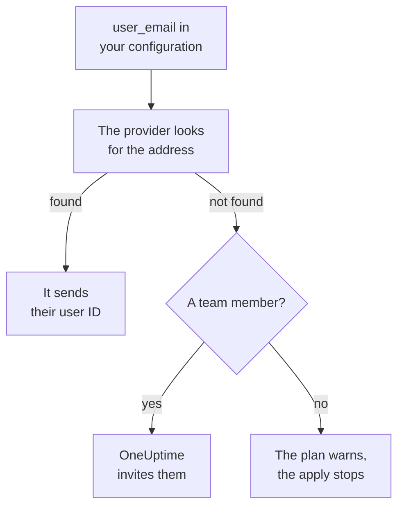

# People and Teams

Keep who is in your project in your Terraform configuration: teams and their members, who is on call, and who owns what. Name every person by their email address: the provider finds them, and invites anyone who is new to the project.

:::cards
- [Name people by email address](#name-people-by-email-address): The attribute beside every user ID.
- [Onboarding](#onboarding): Invite someone, and give them a team, turns on call and something to own.
- [Offboarding](#offboarding): Remove someone, and what OneUptime removes with them.
- [Import members you already have](#import-members-you-already-have): By their team and their address.
:::

## How it works

The provider looks the address up among the people of the API key's project: its members, and the people invited to it. It sends the API the ID of the person it finds. A team member named by an address nobody in the project has invites that address instead.



Only the API key's own project is searched. Nobody outside it is ever found, and the provider cannot tell whether an address has an account anywhere else.

## Before you begin

- **An API key that may read the project's teams.** The provider finds people through them.
- **To add someone new, a key that may invite people.** See [Inviting People](/docs/permissions/inviting-people).

## Name people by email address

Every resource that names a person takes their email address beside their user ID. Give one of the two:

| User ID | Email address |
| --- | --- |
| `user_id` | `user_email` |
| `owner_users` | `owner_user_emails` |
| `assigned_to_user_id` | `assigned_to_user_email` |
| `override_user_id` | `override_user_email` |

The address is found in any case, and kept in state as you wrote it. The user ID is filled in, so other resources can refer to it.

## Onboarding

This configuration adds Alice, who is new to the project, to a team, gives her turns on call from her first day, and makes Bob, who is in the project already, the owner of a monitor:

```hcl title="people.tf"
resource "oneuptime_team" "sre" {
  name        = "SRE"
  description = "Site reliability engineering"
}

# New to the project: OneUptime invites her.
resource "oneuptime_team_member" "alice" {
  team_id    = oneuptime_team.sre.id
  user_email = "alice@example.com"
}

resource "oneuptime_on_call_policy_schedule" "weekly" {
  name     = "SRE weekly"
  timezone = "UTC"
}

resource "oneuptime_on_call_schedule_layer" "weekly" {
  on_call_duty_policy_schedule_id = oneuptime_on_call_policy_schedule.weekly.id
  name                            = "Weekly"
  starts_at                       = "2030-01-07T09:00:00Z"
  hand_off_time                   = "2030-01-14T09:00:00Z"
}

# Named through her membership, so she is invited first.
resource "oneuptime_on_call_schedule_layer_user" "alice" {
  on_call_duty_policy_schedule_id       = oneuptime_on_call_policy_schedule.weekly.id
  on_call_duty_policy_schedule_layer_id = oneuptime_on_call_schedule_layer.weekly.id
  user_id                               = oneuptime_team_member.alice.user_id
}

resource "oneuptime_monitor" "api" {
  name         = "Public API"
  monitor_type = "Manual"
}

# In the project already: named by his address.
resource "oneuptime_monitor_user_owner" "api" {
  monitor_id = oneuptime_monitor.api.id
  user_email = "bob@example.com"
}
```

`terraform apply` invites Alice by email, as an invitation from the dashboard does. OneUptime makes her an account if she has none. `has_accepted_invitation` stays `false` until she accepts, and her accepting is no change to the plan. Someone who is in the project already joins a new team at once.

To put someone this configuration invites on call, or make them an owner, refer to their membership with `user_id = oneuptime_team_member.<name>.user_id`: Terraform then invites them before it names them anywhere else. An address nobody in the project has is a warning in the plan, and an error in the apply.

## Find someone

The `oneuptime_user` data source looks someone up by `email`, `name` or `id`, and reads their user ID, their name, whether they have joined, and the teams they are in:

```hcl
data "oneuptime_user" "alice" {
  email = "alice@example.com"
}

output "alice_teams" {
  value = data.oneuptime_user.alice.team_ids
}
```

## Offboarding

Remove the person's memberships from your configuration and apply. Out of their last team of the project, they are out of the project, and OneUptime takes them off every on-call schedule, escalation rule and override, and off what they own: everything, except the incidents, alerts and maintenance events that are over. Remove the blocks that name them in the same change, or the next plan creates them again for someone who is no longer in the project.

Their OneUptime account stays theirs: only the project is left. A team that must keep a member refuses to lose its last one who has accepted.

## Import members you already have

No screen shows a membership's ID, so import one by its team's ID and the person's address:

```bash
terraform import oneuptime_team_member.alice 6b1d1c2e-4f3a-4b5c-8d6e-7f8091a2b3c4/alice@example.com
```

The address stays as you wrote it, so write it as your configuration does. The membership's own ID imports it too, and then the address is read from OneUptime, in lower case.

Owners and on-call rows import the same way, by what they belong to. A monitor's owner takes the monitor's ID and the person's address. A row that names a team or a schedule, such as an owner team or the team an escalation rule pages, takes both IDs:

```bash
terraform import oneuptime_monitor_user_owner.api 68a1b2c3-d4e5-4f6a-8b9c-0d1e2f3a4b01/bob@example.com
terraform import oneuptime_escalation_rule_team.sre 68a1b2c3-d4e5-4f6a-8b9c-0d1e2f3a4b06/6b1d1c2e-4f3a-4b5c-8d6e-7f8091a2b3c4
```

## When someone changes their address

A person who changes their address in OneUptime stays the same person to Terraform: nothing changes until you write the new address, and then only `user_email` does.

## Troubleshooting

:::details The plan says an address is not in this project yet
Nobody in the project, or invited to it, has that address. Invite them with an `oneuptime_team_member` first. If that membership is in the same configuration, refer to it with `user_id = oneuptime_team_member.<name>.user_id` instead of the address. If they changed their address in OneUptime, use the new one.
:::

:::details The apply says the user has already been invited to this team
The person is in the team already. Import that membership instead of creating it, as in [Import members you already have](#import-members-you-already-have).
:::

## Next steps

:::cards
- [Importing Resources](/docs/terraform/importing-resources): Bring the rest of your project under Terraform.
- [Inviting People](/docs/permissions/inviting-people): How invitations work in OneUptime.
- [Examples](/docs/terraform/examples): Ready-to-use configurations for the common resources.
:::
