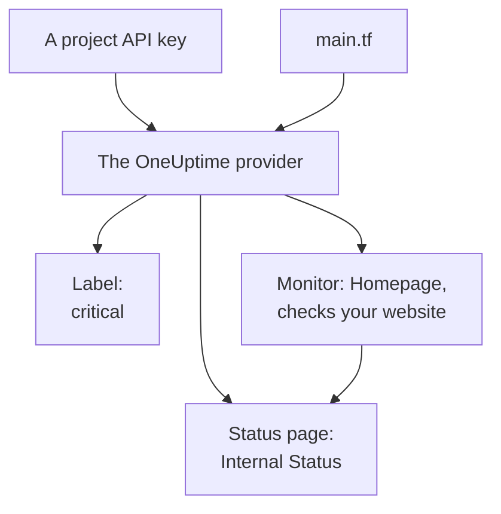

# Quick Start

This guide takes you from nothing to a OneUptime project managed by Terraform in about ten minutes. You create an API key, point Terraform at your project, and apply a label, a monitor that checks your website, and a private status page that shows it. Then you change one of them and clean up.

:::cards
- [Before you begin](#before-you-begin): Terraform, a project, and a plan with API keys.
- [Create your first resources](#create-your-first-resources): From an API key to an applied plan, in six steps.
- [Change a resource](#change-a-resource): Edit the configuration, plan and apply.
- [Troubleshooting](#troubleshooting): The errors a first run can stop on.
:::



## Before you begin

- **Terraform 1.5 or later, or OpenTofu 1.6 or later.** With OpenTofu, run `tofu` wherever this guide runs `terraform`.
- **A OneUptime project** on [oneuptime.com](https://oneuptime.com) or on your own OneUptime, in which you can create API keys.
- **On OneUptime Cloud, the Growth plan or above.** A project's API keys work only on it.

## Create your first resources

:::steps
### Create a project API key

In the OneUptime dashboard, open **Project Settings → Advanced → API Keys** and click **Create API Key**. Give it a **Name**, such as `terraform`, and under **Access** pick **Project Admin**: Terraform creates, reads, changes and deletes every kind of record it manages, and **Project Admin** may do all of that. For a narrower key, pick **Choose permissions later** and add only the permissions you need on the key's page.

The key expires a year from today. To pick another date, open **More fields** before you create it, or change the date on the key's page later. Once the key is created, its page opens: copy the **API Key** from the **API Key Details** card.

### Make the key available to Terraform

Put the key in the `ONEUPTIME_API_KEY` environment variable of the shell you run Terraform in, so it never lands in a file:

:::tabs
@tab Linux
```bash
export ONEUPTIME_API_KEY="<your-api-key>"
```
@tab macOS
```bash
export ONEUPTIME_API_KEY="<your-api-key>"
```
@tab Windows
```powershell
$env:ONEUPTIME_API_KEY = "<your-api-key>"
```
:::

### Point Terraform at OneUptime

Make an empty folder, and in it a file named `main.tf`:

```hcl title="main.tf"
terraform {
  required_providers {
    oneuptime = {
      source  = "oneuptime/oneuptime"
      version = "{{TERRAFORM_PROVIDER_VERSION}}"
    }
  }
}

provider "oneuptime" {
  # The API key comes from ONEUPTIME_API_KEY.
  # On a self-hosted OneUptime, add your OneUptime's address:
  # oneuptime_url = "https://oneuptime.example.com"
}
```

On a self-hosted OneUptime, read [Self-Hosted Setup](/docs/terraform/self-hosted) before you pick a provider version.

### Describe your resources

Add these blocks to `main.tf`. They read two of the monitor statuses every project starts with, and create a label, a monitor that checks `https://example.com` every five minutes (put your own website there), and a private status page that shows the monitor:

```hcl title="main.tf"
data "oneuptime_monitor_status" "operational" {
  name = "Operational"
}

data "oneuptime_monitor_status" "offline" {
  name = "Offline"
}

resource "oneuptime_label" "critical" {
  name        = "critical"
  description = "Resources that page on-call when down"
  color       = "#FF5733"
}

resource "oneuptime_monitor" "homepage" {
  name                = "Homepage"
  description         = "Checks that the homepage responds"
  monitor_type        = "Website"
  monitoring_interval = "*/5 * * * *"
  labels              = [oneuptime_label.critical.id]

  monitor_steps = [{
    monitor_destination      = "https://example.com"
    monitor_destination_type = "URL"
    request_type             = "GET"

    criteria = [
      {
        name                  = "Offline"
        description           = "The homepage does not respond"
        filter_condition      = "Any"
        change_monitor_status = true
        monitor_status_id     = data.oneuptime_monitor_status.offline.id

        filters = [
          {
            check_on    = "Is Online"
            filter_type = "False"
          }
        ]
      },
      {
        name                  = "Online"
        description           = "The homepage responds"
        filter_condition      = "All"
        change_monitor_status = true
        monitor_status_id     = data.oneuptime_monitor_status.operational.id

        filters = [
          {
            check_on    = "Is Online"
            filter_type = "True"
          }
        ]
      }
    ]
  }]
}

resource "oneuptime_status_page" "internal" {
  name                  = "Internal Status"
  description           = "Status of our internal services"
  page_title            = "Service Status"
  is_public_status_page = false
}

resource "oneuptime_status_page_resource" "homepage" {
  status_page_id = oneuptime_status_page.internal.id
  monitor_id     = oneuptime_monitor.homepage.id
  display_name   = "Homepage"
}

output "monitor_id" {
  value = oneuptime_monitor.homepage.id
}
```

The monitor's `monitor_steps` say what it checks and what each result means: after each check, the first criteria that matches sets its status. [Monitor Steps](/docs/terraform/monitor-steps) explains every part.

### Plan and apply

:::tabs
@tab Terraform
```bash
terraform init
terraform plan
terraform apply
```
@tab OpenTofu
```bash
tofu init
tofu plan
tofu apply
```
:::

`init` downloads the provider. The plan ends with `Plan: 4 to add, 0 to change, 0 to destroy.` Type `yes` to apply it; when it is done, Terraform prints the new monitor's ID.

### Check the dashboard

In the OneUptime dashboard:

- **Monitors** lists `Homepage`, with the `critical` label. Its first check is in within a few minutes.
- **Status Pages** lists `Internal Status`, which shows `Homepage`.
- **Project Settings → Basic → Labels** lists `critical`, in the color you set.

Run `terraform plan` again. It answers `No changes.`: OneUptime holds exactly what the configuration says.
:::

## Change a resource

Change the configuration, not the dashboard. Set the label's `color` to `"#2ECC71"` in `main.tf`, then plan and apply:

```bash
terraform plan
terraform apply
```

The plan ends with `Plan: 0 to add, 1 to change, 0 to destroy.`: the label is changed in place. A change someone makes in the dashboard to a resource Terraform manages shows in the next plan, and applying it puts back what the configuration says.

## Clean up

If this was a test drive, delete what the configuration created:

```bash
terraform destroy
```

It deletes the label, the monitor, the status page and its resource. The two monitor statuses stay: the data sources only read them.

## Troubleshooting

:::details Missing API Key
The provider found no API key. Export `ONEUPTIME_API_KEY` in the shell you run Terraform in, or set `api_key` in the provider block, and run the command again.
:::

:::details The OneUptime API returned status 400: Invalid API Key
The key is mistyped, expired or deleted, or it belongs to another OneUptime than the one `oneuptime_url` points at. Copy the key again from its page, or create a new one.
:::

:::details The OneUptime API returned status 402: API keys need the Growth plan
On OneUptime Cloud, a project's API keys work only on the Growth plan or above. Upgrade the project in **Project Settings → Billing and Invoices → Billing**, and the same key works again.
:::

:::details The OneUptime API returned status 422: You do not have permissions to create Monitor
The key has no permission for that kind of record. On the key's page, give it **Project Admin**, or the permission the message names.
:::

:::details No monitor status matches {name = "Offline"}
Your project's monitor statuses have other names. Use the names you see in **Monitors → Settings → Monitor Status**, or look the status up by `is_offline_state = true` instead.
:::

## Next steps

:::cards
- [Complete Guide](/docs/terraform/complete-guide): Authentication, project layout, data sources, state and upgrades.
- [Monitor Steps](/docs/terraform/monitor-steps): Decide what a monitor checks and what each result means.
- [Examples](/docs/terraform/examples): Ready-to-use configurations for the common resources.
- [Importing Resources](/docs/terraform/importing-resources): Bring what you made in the dashboard under Terraform.
:::
