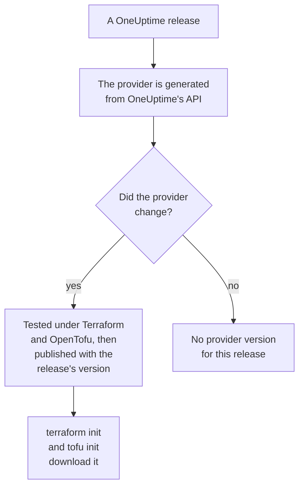

# Registry Usage

The OneUptime provider is published to the [Terraform Registry](https://registry.terraform.io/providers/oneuptime/oneuptime) and the [OpenTofu Registry](https://search.opentofu.org/provider/oneuptime/oneuptime/latest). `terraform init` and `tofu init` download it from there: there is nothing to install by hand. This page covers what is published, how versions are numbered, and how to move to a newer one.

:::cards
- [What is published](#what-is-published): The provider for each platform, its reference, and its versions.
- [How versions are numbered](#how-versions-are-numbered): A provider's version is the OneUptime release that published it.
- [The lock file](#the-lock-file): The version and checksums every machine installs.
- [Move to a newer version](#move-to-a-newer-version): Read what changed, download it, and plan.
:::

## What is published

Every OneUptime release generates the provider from OneUptime's own API. When the provider changed, the release publishes it, under the release's version, once it has passed its end-to-end tests under Terraform and under OpenTofu:



| What | Where |
| --- | --- |
| The provider, for Linux, macOS, Windows, FreeBSD, OpenBSD and Solaris | Downloaded by `terraform init` and `tofu init`, with checksums that OneUptime signs |
| The reference of every resource and data source, with each of its attributes | The registry's documentation, grouped by product: monitors, status pages, incidents, on-call and the others |
| A guide to using the provider with OpenTofu | The registry's guides |
| Every version, newest first | The registry's version list |

The reference lists what each attribute is. These docs show how to use them together: start from the [Terraform Overview](/docs/terraform/index).

## How versions are numbered

A provider's version is the version of the OneUptime release that published it: provider {{TERRAFORM_PROVIDER_MAJOR}}.0.20 came with OneUptime {{TERRAFORM_PROVIDER_MAJOR}}.0.20. A release whose provider did not change publishes none, so the versions have gaps, and a constraint that names one exact version can name a version that does not exist. Write a range instead:

| You use | Constraint | Terraform installs |
| --- | --- | --- |
| OneUptime Cloud | `{{TERRAFORM_PROVIDER_VERSION}}` | The newest {{TERRAFORM_PROVIDER_MAJOR}}.x provider |
| A self-hosted OneUptime | A range that ends at your OneUptime's version, such as `>= {{TERRAFORM_PROVIDER_MAJOR}}.0, <= {{TERRAFORM_PROVIDER_MAJOR}}.0.40` | The newest provider that is not newer than your OneUptime |

On a self-hosted OneUptime, a provider newer than your OneUptime may send settings your OneUptime does not have yet: [Self-Hosted Setup](/docs/terraform/self-hosted#pick-the-provider-version) shows how to write its range.

```hcl title="main.tf"
terraform {
  required_providers {
    oneuptime = {
      source  = "oneuptime/oneuptime"
      version = "{{TERRAFORM_PROVIDER_VERSION}}"
    }
  }
}
```

The source address names no registry: Terraform reads it from the Terraform Registry, and OpenTofu from the OpenTofu Registry, which publish the same versions.

## The lock file

`terraform init` records the version it picked, and the checksums of its downloads, in `.terraform.lock.hcl`. Commit that file: every machine and every CI run then installs exactly that version, until you choose another one. The checksums cover every platform the registry publishes, so one lock file serves Linux, macOS and Windows machines alike.

```hcl title=".terraform.lock.hcl"
provider "registry.terraform.io/oneuptime/oneuptime" {
  version     = "{{TERRAFORM_PROVIDER_MAJOR}}.0.20"
  constraints = "{{TERRAFORM_PROVIDER_VERSION}}"
  hashes = [
    "h1:...",
    "zh:...",
  ]
}
```

The lock file names the registry. OpenTofu writes `registry.opentofu.org/oneuptime/oneuptime` where Terraform writes `registry.terraform.io/oneuptime/oneuptime`, so switching engines changes the lock file: `init` replaces the entry, and asks you to commit the change.

## Move to a newer version

:::steps
### Read what changed

[OneUptime's releases](https://github.com/OneUptime/oneuptime/releases) say what each release changed, the provider included. [The provider's releases](https://github.com/OneUptime/terraform-provider-oneuptime/releases) link to the changes since the one before.

### Download it

```bash
terraform init -upgrade
```

`init -upgrade` takes the newest version your constraint allows, prints it, and updates `.terraform.lock.hcl`. The constraint `{{TERRAFORM_PROVIDER_VERSION}}` takes every {{TERRAFORM_PROVIDER_MAJOR}}.x release; a new major version needs a new constraint.

### Plan before you apply

Run `terraform plan`, and apply only when it is empty or shows the changes you expect. Commit the updated lock file.
:::

On a self-hosted OneUptime, upgrade OneUptime first, then raise the end of the provider's range.

## Where the code lives

The provider is generated from the OneUptime API in the [main OneUptime repository](https://github.com/OneUptime/oneuptime), and each version is built from the release that published it. Its own repository, [OneUptime/terraform-provider-oneuptime](https://github.com/OneUptime/terraform-provider-oneuptime), holds what the generator wrote, so changes are made in the main repository: report problems, documentation ones included, at [github.com/OneUptime/oneuptime/issues](https://github.com/OneUptime/oneuptime/issues).

## Next steps

:::cards
- [Self-Hosted Setup](/docs/terraform/self-hosted): The version range for your own OneUptime, and a mirror for offline machines.
- [OpenTofu](/docs/terraform/opentofu): The same provider and configuration, with `tofu`.
- [Complete Guide](/docs/terraform/complete-guide): Authentication, project layout, data sources, state and upgrades.
- [Troubleshooting](/docs/terraform/troubleshooting): Common errors and how to fix them.
:::
