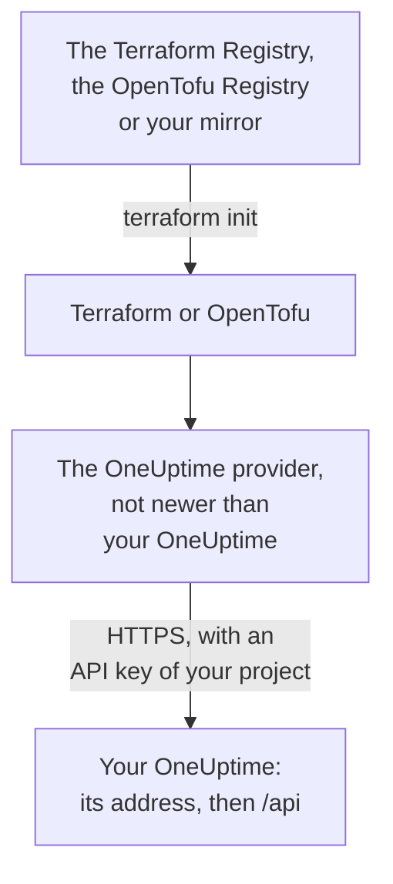

# Self-Hosted Setup

The provider works with your own OneUptime the way it works with OneUptime Cloud: the same resources, the same attributes and the same project API keys. What is yours to set: the address of your OneUptime, the provider version that matches it, and, where you need them, a mirror for machines without internet access and trust for a private certificate authority.

:::cards
- [Point the provider at your OneUptime](#point-the-provider-at-your-oneuptime): Its address, and an API key of your project.
- [Pick the provider version](#pick-the-provider-version): The newest provider that is not newer than your OneUptime.
- [Without internet access](#without-internet-access): Mirror the provider into your network.
- [TLS and certificates](#tls-and-certificates): A private certificate authority, proxies and plain HTTP.
:::



## Point the provider at your OneUptime

Set `oneuptime_url` to the address you open the dashboard at: the scheme and the host, with no path. The provider adds `https://` when the address has no scheme, and `/api` at the end, so `https://oneuptime.example.com` sends every request to `https://oneuptime.example.com/api`.

```hcl title="main.tf"
terraform {
  required_providers {
    oneuptime = {
      source  = "oneuptime/oneuptime"
      version = "{{TERRAFORM_PROVIDER_MATCHING}}"
    }
  }
}

provider "oneuptime" {
  oneuptime_url = "https://oneuptime.example.com"
  # The API key comes from the ONEUPTIME_API_KEY environment variable.
}
```

The address can come from the `ONEUPTIME_URL` environment variable instead, so one configuration can point at several installations:

```bash
export ONEUPTIME_URL="https://oneuptime.example.com"
export ONEUPTIME_API_KEY="<your-api-key>"
```

The address is the host your installation is served at: `HOST` and `HTTP_PROTOCOL` in `config.env` with Docker Compose, and `host` and `httpProtocol` in the Helm chart's values.

The key is an API key of the project you manage, created in your OneUptime's dashboard under **Project Settings → Advanced → API Keys**, as on OneUptime Cloud. The master API key of a self-hosted OneUptime belongs to no project, so a create made with it fails with `ProjectId required`.

> [!TIP]
> Your OneUptime writes this block for you. Open any resource or list in the dashboard, then **Developer** and **Terraform** in its side menu: the provider block it shows has your OneUptime's address, and a version range that matches it.

## Pick the provider version

Use the newest published provider that is not newer than your OneUptime. Provider versions follow OneUptime's: a OneUptime release that changes the provider publishes it under the release's own version number, and a provider newer than your OneUptime may send settings your OneUptime does not have yet.

So write a range that ends at your OneUptime's version, as the dashboard does. The block above takes `{{TERRAFORM_PROVIDER_MATCHING}}`, the range for the OneUptime these docs come from: when you read them on your own OneUptime, that range is yours. Otherwise, write your own version in:

:::steps
### Find your OneUptime's version

Ask your OneUptime for it:

```bash
curl https://oneuptime.example.com/version
```

The answer is JSON, such as `{"version":"{{TERRAFORM_PROVIDER_MAJOR}}.0.40","commit":"..."}`. As a master admin, you can also open the edition label in the Admin Dashboard's header: see [Find your current version](/docs/installation/upgrading#find-your-current-version).

### Write it into the range

The range starts at the major version and ends at yours. For a OneUptime {{TERRAFORM_PROVIDER_MAJOR}}.0.40:

```hcl title="main.tf"
terraform {
  required_providers {
    oneuptime = {
      source  = "oneuptime/oneuptime"
      version = ">= {{TERRAFORM_PROVIDER_MAJOR}}.0, <= {{TERRAFORM_PROVIDER_MAJOR}}.0.40"
    }
  }
}
```

Terraform takes the newest provider in the range. A OneUptime release that did not change the provider publishes none, and the range steps over the versions that do not exist.

### Download the provider

Run `terraform init`. It prints the version it installed and records it in `.terraform.lock.hcl`.
:::

When you upgrade, upgrade OneUptime first. Then raise the end of the range to its new version, and run `terraform init -upgrade`.

## Without internet access

When the machines that run Terraform cannot reach the registry, copy the provider into your network once, and point Terraform at the copy.

:::steps
### Mirror the provider

On a machine with internet access, in a folder with your configuration, download the provider for every platform your machines run. Without `-platform`, the command downloads the provider for its own platform only:

:::tabs
@tab Terraform
```bash
terraform providers mirror -platform=linux_amd64 -platform=darwin_arm64 /srv/terraform-mirror
```
@tab OpenTofu
```bash
tofu providers mirror -platform=linux_amd64 -platform=darwin_arm64 /srv/terraform-mirror
```
:::

The folder holds the provider under the registry's address, such as `registry.terraform.io/oneuptime/oneuptime/`. Copy it into your network.

### Point Terraform at the mirror

Write a CLI configuration file that installs the OneUptime provider from the folder, and everything else as usual:

:::tabs
@tab Terraform
```hcl title="mirror.tfrc"
provider_installation {
  filesystem_mirror {
    path    = "/srv/terraform-mirror"
    include = ["registry.terraform.io/oneuptime/oneuptime"]
  }
  direct {
    exclude = ["registry.terraform.io/oneuptime/oneuptime"]
  }
}
```
@tab OpenTofu
```hcl title="mirror.tfrc"
provider_installation {
  filesystem_mirror {
    path    = "/srv/terraform-mirror"
    include = ["registry.opentofu.org/oneuptime/oneuptime"]
  }
  direct {
    exclude = ["registry.opentofu.org/oneuptime/oneuptime"]
  }
}
```
:::

Name it in `TF_CLI_CONFIG_FILE`, which both Terraform and OpenTofu read: `export TF_CLI_CONFIG_FILE=/etc/terraform/mirror.tfrc`.

### Initialize

Run `terraform init`: it installs the provider from the mirror. It warns that the lock file now has checksums for this platform only. To record them for every platform, run `terraform providers lock` with the same `-platform` options on the machine with internet access, and commit `.terraform.lock.hcl` with your configuration.
:::

Mirror again whenever you raise the version range.

## TLS and certificates

The provider checks your OneUptime's certificate against the trust store of the machine that runs Terraform, and there is no setting to skip the check. When the certificate comes from a private certificate authority, add that authority to the trust store of every machine and CI runner that runs Terraform:

:::tabs
@tab Debian / Ubuntu
```bash
sudo cp my-ca.crt /usr/local/share/ca-certificates/
sudo update-ca-certificates
```
@tab RHEL / Fedora
```bash
sudo cp my-ca.crt /etc/pki/ca-trust/source/anchors/
sudo update-ca-trust
```
:::

On Linux, where you cannot change the trust store, such as in a CI container, set `SSL_CERT_FILE` to a file that holds your authority and the public ones. On macOS and Windows, add the authority to the system's certificate store.

- **Proxies.** The provider sends its requests through the proxy in `HTTPS_PROXY`, apart from the hosts in `NO_PROXY`. A reverse proxy in front of OneUptime must pass every `/api` path, and the `APIKey` header, through unchanged.
- **Plain HTTP.** An `http://` address works, for a test installation. The API key travels with every request, so use HTTPS for anything else.

## Troubleshooting

:::details x509: certificate signed by unknown authority
The machine running Terraform does not trust your OneUptime's certificate: add your certificate authority as [TLS and certificates](#tls-and-certificates) shows.
:::

:::details invalid character '<' looking for beginning of value
A web page answered instead of the API: `oneuptime_url` has a path, or a proxy answered. Set it to your OneUptime's address alone.
:::

:::details no available releases match the given constraints
No published provider fits the version constraint, for example one that names a single version OneUptime never published. Write a range, as [Pick the provider version](#pick-the-provider-version) shows.
:::

:::details ProjectId required
The key is the master API key, which belongs to no project. Create an API key of the project, under **Project Settings → Advanced → API Keys**.
:::

[Troubleshooting](/docs/terraform/troubleshooting) has the other errors, and what each one means.

## Next steps

:::cards
- [Quick Start](/docs/terraform/quick-start): Create an API key and apply your first resources.
- [Registry Usage](/docs/terraform/registry): Where the provider is published, and how versions are numbered.
- [Troubleshooting](/docs/terraform/troubleshooting): Common errors and how to fix them.
- [Upgrading](/docs/installation/upgrading): Upgrade your OneUptime, before you raise the provider's range.
:::
