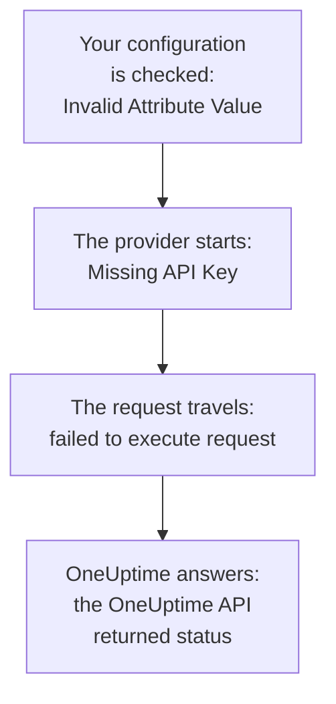

# Troubleshooting

Look up the message Terraform printed, or what you saw happen, in the table below: each row leads to its fix. The sections after the table explain each error, grouped by where it comes from.

:::cards
- [Find your error](#find-your-error): Every message and symptom on this page, and its fix.
- [API keys, permissions and plans](#api-keys-permissions-and-plans): When OneUptime refuses the provider's key.
- [Plans that do not settle](#plans-that-do-not-settle): Changes that come back, and resources that leave the state.
- [Connecting to a self-hosted OneUptime](#connecting-to-a-self-hosted-oneuptime): The address, certificates and proxies.
:::

## Find your error

| Message or symptom | What to do |
| --- | --- |
| `Missing API Key` | Give the provider its key: see [`Missing API Key` or `Invalid API Key`](#missing-api-key-or-invalid-api-key) |
| `Invalid API Key` | Copy the key again, or create a new one: see [`Missing API Key` or `Invalid API Key`](#missing-api-key-or-invalid-api-key) |
| `ProjectId required` | Use an API key of the project, not a master key: see [`ProjectId required`](#projectid-required) |
| `You do not have permissions to create Monitor` | Give the key the permission the message names: see [The key lacks a permission](#the-key-lacks-a-permission) |
| `API keys need the Growth plan` | Move the project back to the Growth plan: see [Payment required](#payment-required) |
| `402` for one resource or one setting | Upgrade the plan, or leave the setting at its default: see [Payment required](#payment-required) |
| `This project has been blocked` | Ask a master admin to unblock the project: see [A blocked project](#a-blocked-project) |
| `references records that are not in this project` | Use an ID of your project's own record: see [IDs from another project](#ids-from-another-project) |
| `Not Found` or `Ambiguous Match` from a data source | Fix the lookup's arguments: see [Lookups that find none or several](#lookups-that-find-none-or-several) |
| `Cannot import non-existent remote object` | Check the ID and the key's permissions: see [Importing Resources](/docs/terraform/importing-resources#troubleshooting) |
| `Provider produced inconsistent result after apply` | Upgrade the provider: see [Inconsistent result after apply](#inconsistent-result-after-apply) |
| A plan creates a resource you did not add | The key can no longer read it, and OneUptime answered `404`: give the key read access back, then `terraform import` the resource: see [A resource leaves the state, and the next apply creates it again](#a-resource-leaves-the-state-and-the-next-apply-creates-it-again) |
| A `priority` or `order` changes after apply | Give each one a number nobody else holds: see [A priority or order that moves](#a-priority-or-order-that-moves) |
| `Invalid Configuration for Read-Only Attribute` | Remove the attribute from the configuration: see [Read-only attributes](#read-only-attributes) |
| `has been renamed to` | Rename the resource type, with a `moved` block: see [A renamed resource type](#a-renamed-resource-type) |
| A monitor made with Terraform never shows its checks | Upgrade OneUptime: see [Monitors made before step IDs](#monitors-made-before-step-ids) |
| `must contain at least 1 elements` | Leave the attribute out instead of empty: see [Empty values](#empty-values) |
| JSON from the dashboard in a `.tf` file | Write it as HCL: see [JSON from the dashboard](#json-from-the-dashboard) |
| `no available releases match the given constraints` | Use a version range, not one exact version: see [A version that was never published](#a-version-that-was-never-published) |
| `x509: certificate signed by unknown authority` | Trust your certificate authority: see [Certificates](#certificates) |
| `invalid character '<' looking for beginning of value` | Point `oneuptime_url` at your OneUptime itself: see [A web page instead of the API](#a-web-page-instead-of-the-api) |
| `connection refused` or `Client.Timeout exceeded` | Check the address, the network and any proxy: see [Connections that fail](#connections-that-fail) |

## How to read an error

An error names the step that failed, and its message says where it came from:



- An error that comes before any request, such as `Invalid Attribute Value`, is about your configuration: the provider checks it before it talks to OneUptime.
- `failed to execute request` means the request never got an answer: see [Connecting to a self-hosted OneUptime](#connecting-to-a-self-hosted-oneuptime).
- `the OneUptime API returned status` is OneUptime's answer: the status and the message after it say what OneUptime refused.

The provider names what it was doing: `Unable to create monitor` and `Unable to update monitor` for a change, and `Unable to parse label response` when it reads a resource. A read that OneUptime refuses is reported with the summary `Parse Error`, but the message after it is OneUptime's answer, not a parsing problem.

## API keys, permissions and plans

### `Missing API Key` or `Invalid API Key`

`Missing API Key` stops the provider before it makes any request: neither `api_key` in the provider block nor the `ONEUPTIME_API_KEY` environment variable is set. Export the variable in the shell you run Terraform in, or pass the key in a variable marked `sensitive`.

`Invalid API Key` is OneUptime's answer to a key it does not know: one that is mistyped, expired or deleted, or one of another OneUptime than the one `oneuptime_url` points at. Copy the key again from its page under **Project Settings → Advanced → API Keys**, or create a new one.

### `ProjectId required`

The provider needs an API key of the project it manages: that is where the project comes from. A self-hosted OneUptime's master API key belongs to no project, so every create made with it fails with `ProjectId required`. Create an API key of the project, as in [Create a project API key](/docs/terraform/quick-start#create-a-project-api-key), and use it instead.

### The key lacks a permission

`You do not have permissions to create Monitor` and messages like it come with status `422`: the key may not do that with that kind of record. They name the permissions that would allow it. Open the key's page under **Project Settings → Advanced → API Keys** and give it one of them, or **Project Admin**. An import needs only the permission to read.

### Payment required

- **402 Payment Required on every request** — `API keys need the Growth plan...`: on OneUptime Cloud, the project is below **Growth**, and a project's API keys - the provider's included - stop working below it. Every call the provider makes is refused, `terraform plan` too, until the project is back on Growth; then the same key works again, with nothing to change in your configuration. Upgrade in **Project Settings → Billing and Invoices → Billing**, or manage the project in the dashboard meanwhile. See [API keys and SCIM below their plan](/docs/api-reference/api-reference#api-keys-and-scim-below-their-plan).
- **402 Payment Required** — you reached a limit of your OneUptime plan, or the configuration switches on a setting your plan does not include (a private status page, email reports, a public dashboard, an IP allowlist...), whether `terraform apply` creates the resource with it or changes it later. Terraform shows OneUptime's message as it is. Upgrade the plan, or trim the configuration.

Putting such a setting back to its default, which switches the feature off, works on every plan, so a configuration that turns paid features off applies after a trial ends or the plan goes down.

The same holds for the resources your plan sells that a project keeps after it goes down - SSO providers, SCIM connections, API keys, on-call schedules, and Slack and Microsoft Teams rules and summaries: below the plan (while the project is still on Growth, which the provider's own API key needs), the ones the project already has can still be read (so `terraform plan` and `import` work), deleted (so removing them from the configuration, or `terraform destroy`, applies), and switched off where they have an `is_enabled` attribute. Creating them, changing them or switching them on again still answers 402.

Other resources your plan sells, such as templates, custom fields and monitor groups, still need the plan to be read, so a plan that refreshes them answers 402; they can still be deleted, for example with `terraform destroy -refresh=false`.

An API key's permissions are not deleted one by one below Growth, since deleting a block permission would give the key more access: run `terraform state rm` on the permission resources, then destroy the key, and its permissions go with it.

### A blocked project

`This project has been blocked. Please contact your administrator.` comes with status `403`: a master admin blocked the project, and until they unblock it, nothing but a master admin acts in it, the project's API keys included.

## Records and lookups

### IDs from another project

Every ID a resource names - a monitor's labels, a status page group's status page, a network device's site, an escalation rule's teams - must be a record of the project your API key belongs to. An ID of another project's record, an ID that does not exist and an ID of a record the key may not read all get the same answer, which names the field and the ID:

```text
This network device references records that are not in this project: Network Site "…". Please pick values from this project and try again.
```

It usually means an ID was copied from another project's configuration or state, or the record was deleted outside Terraform. Refer to the record through its resource or a data source in the same configuration (`oneuptime_label.critical.id`) instead of a literal ID, and apply again. Someone named as a user must be a member of the project.

### Lookups that find none or several

A data source finds exactly one record, or stops the plan. `Not Found` says no record has the `id`, or none matches the arguments you set; `Ambiguous Match` says several do. Fix the arguments, set more of them to narrow the lookup down to one, or look the record up by `id`. [Read what already exists](/docs/terraform/complete-guide#read-what-already-exists) has the rules.

## Plans that do not settle

### Inconsistent result after apply

`Provider produced inconsistent result after apply` means the provider returned other values than it planned. Older providers did this with values the server works out: defaults the server adds inside `monitor_steps`, timestamps the server wrote another way, wrapped values like `probe_version`, and attributes the server keeps up to date, such as when an incoming request monitor last received its heartbeat. They also read a decimal number as null when the API sent it as text, so every apply of a status page bar color rule failed on `uptime_percent_greater_than_or_equal_to`. Current providers handle all of these: timestamps are compared as instants, label lists are sets, numbers read back as you wrote them, and an attribute you did not set keeps its planned value until the next refresh reads the server's.

:::steps
1. Upgrade the provider: keep `version = "{{TERRAFORM_PROVIDER_VERSION}}"` in the provider requirement, and run `terraform init -upgrade`.
2. Apply again. A resource the failed apply left tainted is replaced once, and plans are empty after that. To keep the resource as it is instead, untaint it by its address first: `terraform untaint oneuptime_status_page_history_chart_bar_color.operational`.
:::

If a current provider still fails this way, report it at [github.com/OneUptime/oneuptime/issues](https://github.com/OneUptime/oneuptime/issues), with the provider version, the resource type, the smallest `resource` block that fails, and the whole error. The error names the attribute whose value changed, which is the most useful thing to send.

### A resource leaves the state, and the next apply creates it again

A read by ID answers `404` both for a record that does not exist and for one the API key may not read: the API says nothing about a record it does not show you. Terraform takes a `404` at refresh for a resource deleted outside Terraform. It drops the resource from the state, and the next `terraform apply` creates it again, beside the one that is still there.

That happens when the key that manages a resource can no longer read it: its read permission was limited to labels the resource does not carry, or to the resources its teams own, or a block takes the resource away - or the resource's labels or owners changed.

**Before you plan:**

- Give the key a read permission for every resource type it manages that reaches every resource it manages: at **All** scope, or limited to labels those resources carry. A key's update and delete permissions reach only what it may read.
- Read the plan before you apply it: a resource planned for creation that you did not add is one the key can no longer read.

**When the state has lost a resource already:** give the key its read access back, then [import](/docs/terraform/importing-resources) the resource instead of applying, so Terraform adopts the one that exists rather than creating a second one. If a copy was created already, delete the one you do not want.

### A priority or order that moves

Monitor statuses, incident and alert states and severities, and the other lists you put in order in the dashboard hold each number once. A number nobody else holds is kept as written. A number another one already holds is taken over, and the ones in the way step down one place, as a drag in the dashboard does. So two of them configured with the same number trade places on every apply.

Give each one its own number with gaps between them, such as `101`, `102` and `103`, and reorder the ones Terraform manages in Terraform, not by dragging them in the dashboard.

### Read-only attributes

`Invalid Configuration for Read-Only Attribute` stops the plan when a configuration sets an attribute only OneUptime writes. Who created a record, and who archived, resolved or acknowledged it, is recorded from the request: the person signed in, and nobody for a request made with an API key, which is how Terraform signs in. So `created_by_user_id`, and every other attribute ending in `_by_user_id`, can be read from a resource or a data source, but not set. The same goes for `archived_at`: setting `is_archived` records when the resource was archived, and applying it again unchanged keeps that time. Remove the attribute from the resource block; nothing else about the resource changes.

### A renamed resource type

`has been renamed to` warns that a resource type has a new name. Resource types keep words like IoT and vCenter whole now: `oneuptime_iot_fleet` and `oneuptime_vcenter`, where older providers split them (`oneuptime_io_t_fleet`, `oneuptime_v_center`). The old names keep working as deprecated aliases. To switch without replacing anything, rename the resource in your configuration and tell Terraform it moved:

```hcl
resource "oneuptime_iot_fleet" "factory" {
  name = "Factory floor"
}

moved {
  from = oneuptime_io_t_fleet.factory
  to   = oneuptime_iot_fleet.factory
}
```

`terraform plan` then shows the move and no other change. Moving between resource types needs Terraform 1.8 or later, or OpenTofu 1.12 or later; on an older version, keep the old name, which keeps working. Data sources were renamed the same way: change the name, and nothing else.

### Monitors made before step IDs

The IDs inside a monitor's steps - of each step, criteria, and incident and alert template - are the server's to give. Older OneUptime versions gave criteria IDs only, and a new set of them on every write, so a monitor written through the API, as every monitor the provider made was, was stored with a step that had no ID. Its probes still checked it and its status still changed, but the monitor's page could not find its checks, its incidents could not resolve themselves, and every `terraform apply` that changed `monitor_steps` cut open incidents loose from their criteria.

Current OneUptime gives every one of these an ID on create, keeps them across every apply, and fills in the missing ones of existing monitors when it is upgraded. Nothing changes in your configuration: there are still no IDs to write. An incident the old behaviour left open closes on the monitor's next recovery, as long as the criteria that opened it is still there; one whose criteria an earlier apply replaced needs resolving once by hand.

## Configuration the provider refuses

### Empty values

The provider refuses an empty list, map or text in `monitor_steps` and its parts, such as `monitor_steps = []`, `request_headers = {}` or `request_body = ""`:

```text
Attribute monitor_steps list must contain at least 1 elements, got: 0
```

Leave the attribute out instead: an attribute that is not there is unset. [Monitor Steps](/docs/terraform/monitor-steps) lists what each part takes.

### JSON from the dashboard

The JSON the dashboard and the API show for a resource is what the API sends, not Terraform configuration: attribute names are snake_case in Terraform, values are written differently, and many fields are the server's. Pasted into a `.tf` file, it does not work.

- To adopt the resource, [import it](/docs/terraform/importing-resources): the dashboard's **Terraform** page writes the configuration for you.
- To write a new one, start from the [Examples](/docs/terraform/examples).
- For a monitor's steps, write the typed `monitor_steps` attribute that [Monitor Steps](/docs/terraform/monitor-steps) describes: drop the `{_type, value}` wrappers, write the camelCase keys in snake_case, and leave out every `id`.

## Versions and the registry

### A version that was never published

`no available releases match the given constraints` means no published version fits the version constraint. Not every OneUptime release publishes a provider: a release whose provider did not change publishes none, so a constraint that names one exact version can name a version that does not exist. Use a range instead:

```hcl
terraform {
  required_providers {
    oneuptime = {
      source  = "oneuptime/oneuptime"
      version = "{{TERRAFORM_PROVIDER_VERSION}}"
    }
  }
}
```

On a self-hosted OneUptime, cap the range at your OneUptime's version, as [Self-Hosted Setup](/docs/terraform/self-hosted#pick-the-provider-version) shows. [Registry Usage](/docs/terraform/registry#how-versions-are-numbered) explains how versions are numbered.

## Connecting to a self-hosted OneUptime

### Certificates

`x509: certificate signed by unknown authority` means the machine running Terraform does not trust the certificate your OneUptime presents, usually one from a private certificate authority. The provider checks it against that machine's trust store. Add your certificate authority there, on every machine and CI runner that runs Terraform: see [TLS and certificates](/docs/terraform/self-hosted#tls-and-certificates). There is no setting to skip the check.

### A web page instead of the API

`invalid character '<' looking for beginning of value` means a web page answered where the provider expected the API: `oneuptime_url` has a path after the host, such as `/dashboard`, or a proxy in front of OneUptime answered instead. Set `oneuptime_url` to your OneUptime's address alone, such as `https://oneuptime.example.com`: the provider adds `/api` itself.

### Connections that fail

`failed to execute request` with `connection refused`, `no such host` or `Client.Timeout exceeded` means no answer came back. Check that the address and port are right and reachable from where Terraform runs, and set `HTTPS_PROXY` if the machine reaches the internet through a proxy. The provider waits up to 60 seconds for each answer. It tries a read or a delete up to three times when no answer comes, or the answer is `429`, `502`, `503` or `504`, but never a create or a change: after a create fails this way, look in the dashboard before you apply again, in case it was made.

## Get more detail

The provider writes its warnings to Terraform's log. Run the command with `TF_LOG_PROVIDER=WARN` to see them, and `TF_LOG_PATH` to keep them in a file:

```bash
TF_LOG_PROVIDER=WARN TF_LOG_PATH=terraform.log terraform plan
```

`OneUptime rejected a column in the select; dropping it and retrying` names a column OneUptime would not send to the provider's key, usually for want of a permission. That attribute stays empty in the state, so it can show as a change on every plan.

## Still stuck?

Open an issue at [github.com/OneUptime/oneuptime/issues](https://github.com/OneUptime/oneuptime/issues) with the provider version (`terraform version` prints it after `init`), the resource block, and the whole error. The provider is generated from the OneUptime code, so its issues are kept in the main repository.

## Next steps

:::cards
- [Importing Resources](/docs/terraform/importing-resources): Adopt what you made in the dashboard, and fix import errors.
- [Self-Hosted Setup](/docs/terraform/self-hosted): The address, the version and certificates of your own OneUptime.
- [Complete Guide](/docs/terraform/complete-guide): Authentication, data sources, state and upgrades.
- [Monitor Steps](/docs/terraform/monitor-steps): Every attribute of a monitor's checks.
:::
