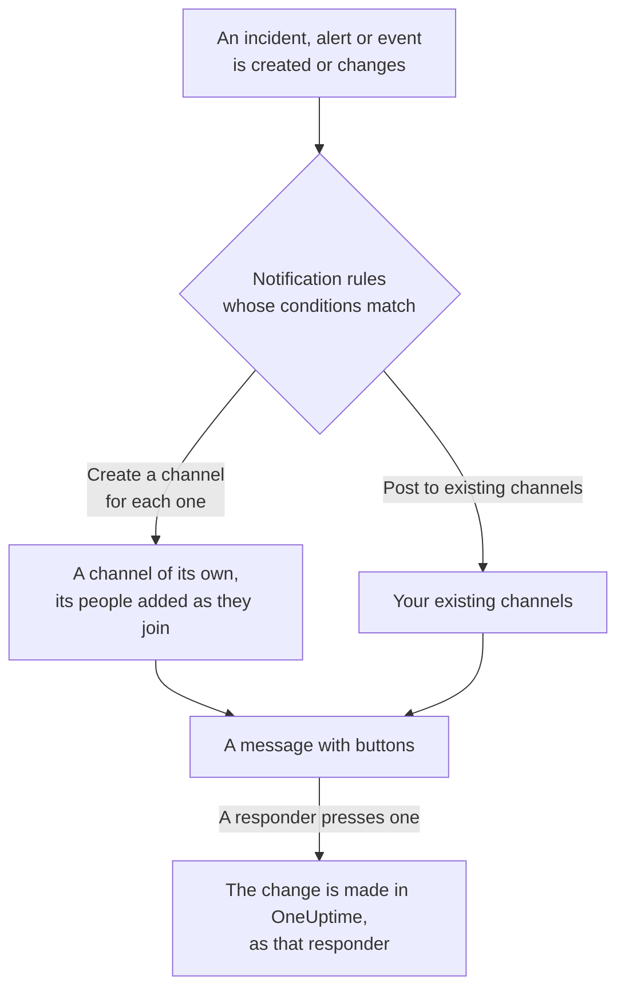

# Mattermost

Connect OneUptime to your Mattermost server to post incidents, alerts, episodes, scheduled maintenance, monitors and on-call updates to your channels, give each incident a channel of its own, and let responders acknowledge, resolve, add notes and change state without leaving Mattermost.

:::cards
- [Connect Mattermost](#connect-mattermost): Create a bot account for OneUptime, then connect the project with its token.
- [Connect your own account](#connect-your-own-mattermost-account): Link your Mattermost account to your OneUptime account.
- [Notification rules](#notification-rules): Decide which events post where, and which get a channel of their own.
- [Acting from Mattermost](#acting-on-incidents-alerts-and-events-from-mattermost): The buttons on OneUptime's messages.
- [Network and self-hosting](#network-and-self-hosting): What each server must be able to reach.
:::

## How it works

Two connections make this work:

- **The project's connection**, made once: a bot account on your Mattermost server, in the team OneUptime posts in. It posts the messages, creates the channels and adds people to them.
- **Each person's own connection**: their Mattermost account linked to their OneUptime account. Buttons act as that person, with their permissions in the project.

One Mattermost team can be connected to more than one project, such as production and staging. A button acts in the project of the record its message is about.

## Before you begin

- **A role that may connect the project:** **Project Owner**, **Project Admin** or **Project Member**. Disconnecting needs **Project Owner** or **Project Admin**.
- **A Mattermost server** where you may create a bot account, or a Mattermost admin who can create one for you. Mattermost Cloud and self-hosted Mattermost both work.
- **The Growth plan on OneUptime Cloud** for notification rules and summaries.

OneUptime needs nothing set up on its own server for Mattermost: each project brings its own Mattermost server and bot account.

## Connect Mattermost

:::steps
### Create a bot account in Mattermost

In Mattermost, open **System Console** > **Integrations** > **Bot Accounts** and make sure **Enable Bot Account Creation** is on. Then go to **Integrations** > **Bot Accounts** > **Add Bot Account**, name it `oneuptime`, and save. Mattermost shows the bot's access token once: copy it.

### Add the bot to your team

Add the bot to the team OneUptime should post in, as you would add a person: **Main Menu** > **Invite People**, and invite `@oneuptime`. OneUptime creates channels and posts only in that team.

### Connect the project

In OneUptime, go to **Project Settings** > **Workspace** > **Mattermost** and click **Connect with Mattermost**. Enter your server's address, such as `https://chat.example.com`, and the bot's access token. OneUptime checks the token with your server before it keeps anything. If the bot is in more than one team, OneUptime asks which one to post in.

### Add a notification rule

Go to **Incidents** > **Workspace** > **Mattermost**, and create a rule. For example, one that creates a Mattermost channel for every new incident with everyone working on it. See [Notification rules](#notification-rules).
:::

The bot's access token is kept on the OneUptime server only, encrypted with the project's other secrets, and is never shown again. The server address, the team and the bot's username are shown to everyone in the project, on the Mattermost settings page.

A project is connected to one Mattermost team. To move it to another team, or another server, disconnect it first: **Project Settings** > **Workspace** > **Mattermost**, then **⋯** > **Disconnect Mattermost**. Disconnecting disconnects every member's own Mattermost account too. Your notification rules and summaries are kept for when you connect again.

## Connect your own Mattermost account

Mattermost has no sign-in OneUptime can send you to, so OneUptime's bot sends your Mattermost account a direct message with a link instead:

:::steps
1. Go to **User Settings** > **Workspace** > **Mattermost**. OneUptime looks for the Mattermost account with your email address. If it finds one, click **Send link to @your-username**. If not, click **Send me a link** and enter your Mattermost username.
2. Open the direct message from the OneUptime bot in Mattermost, and click **Connect my account**.
3. The link opens OneUptime, which connects your account.
:::

Open the link in the same browser where you asked for it: it works only there, only once, and only for 15 minutes. That proves the person who asked holds both accounts, so nobody can connect somebody else's Mattermost account. If you did not ask for a link, ignore it: nothing is connected until it is opened in the browser that asked.

Your account's connection belongs to this project. In another project connected to the same Mattermost team, connect it there too.

## Notification rules

A notification rule says which events post to Mattermost, and where. Each product has its own rules, under **Workspace** > **Mattermost** in its menu: **Incidents** (with **Incident Episodes** and a **Summary** tab), **Alerts** (with **Alert Episodes** and **Summary**), **Scheduled Maintenance**, **Monitors**, **On-Call Duty** and **Security Events**. They work as Slack's do: see [Notification rules](/docs/workspace-connections/slack#notification-rules) for conditions, destinations and who joins a channel.

A channel a rule creates is named after its record: incident INC-42 gets `inc-42`. Mattermost takes lowercase letters, numbers, `-` and `_`, up to 64 characters, starting and ending with a letter or a number, and the rule form shows the name as you type. If a channel by that name already exists, such as an archived one, OneUptime adds `-2`, `-3` and so on. A private incident, alert or episode gets a private channel.

To post to an existing channel, enter its name as it appears in its address, such as `incidents` for `chat.example.com/team/channels/incidents`, or its display name. OneUptime joins a public channel by itself the first time it posts there. Add the bot to a private channel in Mattermost before a rule posts to it.

People join a rule's channel by the Mattermost account they connected, or else by the Mattermost account with their email address, when your server shows email addresses to the bot (**System Console** > **Site Configuration** > **Users and Teams** > **Show Email Address**). OneUptime names whoever it could not add in one message in the channel, with a link to connect their account.

**Test Rule** on a rule's row posts a test message for that rule to the channels it names, as it does for Slack.

OneUptime's messages notify nobody with what they quote: a name or a description that holds `@channel`, `@here` or `@someone` is shown as written, and pings nobody.

## Acting on incidents, alerts and events from Mattermost

OneUptime's messages carry buttons, and a **More actions** menu for what fewer people need. Each acts as you, with your permissions in the project, and answers in a message only you see.

| Record | Buttons and menu |
| --- | --- |
| **Incident** | **Acknowledge**, **Resolve**, **Add Note**, and in the menu **Change Severity** and **Change State** |
| **Alert** | **Acknowledge**, **Resolve**, **Add Note**, **Change State**, **Execute On-Call Policy** |
| **Incident episode, alert episode** | **Acknowledge**, **Resolve**, **Add Note**, **Change State**, **Execute On-Call Policy** |
| **Scheduled maintenance** | **Mark as Ongoing**, **Mark as Complete**, **Add Note**, **Change State** |

**Add Note**, **Change State**, **Change Severity** and **Execute On-Call Policy** open a form in Mattermost. A note on an incident or a scheduled maintenance event can be public, shown on the status page, or private; a note on a private incident is always private, and on an alert always private too. Every message also has a link that opens its record in OneUptime, for everything else.

If your Mattermost account is not connected yet, a button tells you so, with a link to **User Settings** > **Workspace** > **Mattermost**. Connect your account, then press the button again.

Each press is recorded in **Project Settings** > **Notifications** > **Notification Logs**, on the **Workspace** tab, with who pressed it.

## Network and self-hosting

Two servers talk to each other:

- **OneUptime calls your Mattermost server**, to post, create channels and add people. On OneUptime Cloud, your Mattermost server must be reachable from the internet. A self-hosted OneUptime can reach a Mattermost server on a private network once its operator allows private addresses with `ALLOW_PRIVATE_NETWORK_WEBHOOKS` or `PRIVATE_NETWORK_WEBHOOK_ALLOWLIST`. OneUptime never calls an address on its own machine or a cloud metadata address, and never follows a redirect.
- **Your Mattermost server calls OneUptime** when someone presses a button or sends a form: `https://<your OneUptime>/api/mattermost/interactive` and `/api/mattermost/dialog`. If OneUptime's address is a private one, add its host to **System Console** > **Environment** > **Developer** > **Allow untrusted internal connections to** in Mattermost, or the buttons will not work.

Every button OneUptime posts carries a signature, checked when it is pressed, for the Mattermost team it was posted in: a press OneUptime did not sign, or one sent from another team, does nothing.

## Troubleshooting

| What you see | What to do |
| --- | --- |
| **Mattermost did not accept the access token** | Copy the bot's token again. Mattermost shows it only once: create a new one under **Integrations** > **Bot Accounts** if you need to. |
| **The bot account is not a member of any team** | Add the bot to your team in Mattermost, then connect again. |
| **OneUptime could not reach the Mattermost server** | Check the address, and that OneUptime can reach it. See [Network and self-hosting](#network-and-self-hosting). |
| **The bot is not a member of the private Mattermost channel** | Add the bot to the channel in Mattermost. |
| A button does nothing, or Mattermost says it could not complete the action | Mattermost cannot reach OneUptime. See [Network and self-hosting](#network-and-self-hosting). |
| No direct message arrives with your link | Check the username, and that the bot is in a team you are in. |
