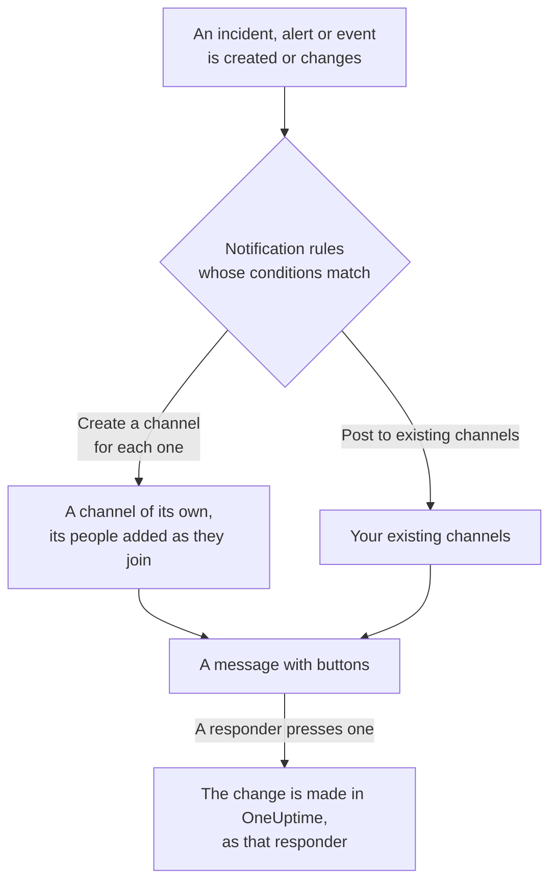

# Mattermost

Connect OneUptime to your Mattermost server to post incidents, alerts, episodes, scheduled maintenance, monitors and on-call updates to your channels, give each incident a channel of its own, and let responders acknowledge, resolve, add notes and change state without leaving Mattermost.

:::cards
- [Connect Mattermost](#connect-mattermost): Create a bot account for OneUptime, then connect the project with its token.
- [Connect your own account](#connect-your-own-mattermost-account): Link your Mattermost account to your OneUptime account.
- [Notification rules](#notification-rules): Decide which events post where, and which get a channel of their own.
- [Who is in a record's channel](#who-is-in-a-records-channel): See who is in it, join it and add people, from the record's page.
- [Acting from Mattermost](#acting-on-incidents-alerts-and-events-from-mattermost): The buttons on OneUptime's messages.
- [Network and self-hosting](#network-and-self-hosting): What each server must be able to reach.
:::

## How it works

Two connections make this work:

- **The project's connection**, made once: a bot account on your Mattermost server, in the teams OneUptime posts in. It posts the messages, creates the channels and adds people to them.
- **Each person's own connection**: their Mattermost account linked to their OneUptime account. Buttons act as that person, with their permissions in the project.

One Mattermost team can be connected to more than one project, such as production and staging. A button acts in the project of the record its message is about.

## Before you begin

- **A role that may connect the project:** **Project Owner**, **Project Admin** or **Project Member**. Disconnecting needs **Project Owner** or **Project Admin**.
- **A Mattermost server** where you may create a bot account, or a Mattermost admin who can create one for you. Mattermost Cloud and self-hosted Mattermost both work.
- **The Growth plan on OneUptime Cloud** for notification rules and summaries.

OneUptime needs nothing set up on its own server for Mattermost: each project brings its own Mattermost server and bot account.

## Connect Mattermost

:::steps
### Create a bot account in Mattermost

In Mattermost, open **System Console** > **Integrations** > **Bot Accounts** and make sure **Enable Bot Account Creation** is on. Then go to **Integrations** > **Bot Accounts** > **Add Bot Account**, name it `oneuptime`, and save. Mattermost shows the bot's access token once: copy it.

### Add the bot to your team

Add the bot to each team OneUptime should post in, as you would add a person: **Main Menu** > **Invite People**, and invite `@oneuptime`. OneUptime creates channels and posts only in the teams the bot is a member of.

### Connect the project

In OneUptime, go to **Project Settings** > **Workspace** > **Mattermost** and click **Connect with Mattermost**. Enter your server's address, such as `https://chat.example.com`, and the bot's access token. OneUptime checks the token with your server before it keeps anything. If the bot is in more than one team, OneUptime asks which one is the default: the team a notification rule that names no team creates its channels in. Until a workspace is connected, the **Workspace** section of the Incidents, Alerts, Scheduled Maintenance, Monitors and On-Call menus holds **Connect a workspace**, which leads here too.

### Add a notification rule

Go to **Incidents** > **Workspace** > **Mattermost**, and create a rule. For example, one that creates a Mattermost channel for every new incident with everyone working on it. See [Notification rules](#notification-rules).
:::

The bot's access token is kept on the OneUptime server only, encrypted with the project's other secrets, and is never shown again. The server address, the teams and the bot's username are shown to everyone in the project, on the Mattermost settings page.

A project is connected to one Mattermost server. To move it to another server, disconnect it first: **Project Settings** > **Workspace** > **Mattermost**, then **⋯** > **Disconnect Mattermost**. Disconnecting disconnects every member's own Mattermost account too, and removes their Mattermost notification methods and the steps of How to Reach Me that use them. Your notification rules and summaries are kept for when you connect again.

## More than one team

OneUptime works in every team of your Mattermost server its bot is a member of:

1. In Mattermost, add the bot to each team that should use OneUptime, as you would add a person: open the team, then **Main Menu** > **Invite People**.
2. The **Mattermost teams** card on **Project Settings** > **Workspace** > **Mattermost** lists those teams, the default one first. Click **Refresh** after adding the bot to another one.

- **Which team a rule uses.** Notification rules pick the **Mattermost team** their channels are in. Left empty, a rule creates its channel in the default team, and looks for the channels it names there first, then in the bot's other teams.
- **Which team a summary uses.** Summaries, on the **Summary** tab of **Incidents** and **Alerts**, pick the **Mattermost team** their channels are in too. Left empty, a summary looks for its channels in the default team first, then in the bot's other teams.
- **The default team.** It is the team you connected the project to. **Make default** on the card makes another team the default, for a role that may connect the project.
- **Where OneUptime works.** The buttons on OneUptime's messages, and the forms they open, work in each of those teams. In a team the bot was taken out of, a button only says that the team is no longer connected.
- **A default team the bot was taken out of.** The card says so. Add the bot back in Mattermost, or make another team the default.
- **A team a rule names that the bot was taken out of.** The rule's card says so, and the rule does not use another team instead. Add the bot back to the team in Mattermost, or pick another team on the rule: its form still shows the old pick, so you can change it.

## Connect your own Mattermost account

Mattermost has no sign-in OneUptime can send you to, so OneUptime's bot sends your Mattermost account a direct message with a link instead:

:::steps
1. Go to **User Settings** > **Workspace** > **Mattermost**. OneUptime looks for the Mattermost account with your email address. If it finds one, click **Send link to @your-username**. If not, click **Send me a link** and enter your Mattermost username.
2. Open the direct message from the OneUptime bot in Mattermost, and click **Connect my account**.
3. The link opens OneUptime, which connects your account.
:::

Open the link in the same browser where you asked for it: it works only there, only once, and only for 15 minutes. That proves the person who asked holds both accounts, so nobody can connect somebody else's Mattermost account. If you did not ask for a link, ignore it: nothing is connected until it is opened in the browser that asked.

Your account's connection belongs to this project. In another project connected to the same Mattermost team, connect it there too.

## Getting paged in Mattermost

To be paged by direct message when you are on call, add Mattermost as one of your notification methods:

:::steps
1. Connect your own Mattermost account (see [Connect your own Mattermost account](#connect-your-own-mattermost-account)).
2. Go to **User Settings** > **Notification Methods**, open the **Workspace Apps** tab and click **Add Mattermost Account**.
3. Click **Send Test Message** on its row. The message arrives as a direct message from the project's bot.
:::

Adding it adds it to How to Reach Me straight away, so pages reach you in Mattermost from then on. Change which pages it gets under **User Settings** > **How to Reach Me**. Each page carries a link to acknowledge it and one to escalate it. Disconnecting your Mattermost account removes this method and the steps of How to Reach Me that use it.

## Notification rules

A notification rule says which events post to Mattermost, and where. Each product has its own rules, under **Workspace** > **Mattermost** in its menu: **Incidents** (with **Incident Episodes** and a **Summary** tab), **Alerts** (with **Alert Episodes** and **Summary**), **Scheduled Maintenance**, **Monitors**, **On-Call**, **Security Events** and **SLOs**. They work as Slack's do: see [Notification rules](/docs/workspace-connections/slack#notification-rules) for conditions, destinations, the updates a rule posts and who joins a channel. On-call messages are as in Slack, one line at each hand-off: see [On-call messages](/docs/workspace-connections/slack#on-call-messages). A time in a message, such as when an on-call shift ends, shows in UTC: Mattermost cannot show it in each reader's own time zone.

A channel a rule creates is named after its record: incident INC-42 gets `inc-42`. Mattermost takes lowercase letters, numbers, `-` and `_`, up to 64 characters, starting and ending with a letter or a number, and the rule form shows the name as you type. If a channel by that name already exists, such as an archived one, OneUptime adds `-2`, `-3` and so on. A private incident, alert or episode gets a private channel.

To post to an existing channel, enter its name as it appears in its address, such as `incidents` for `chat.example.com/team/channels/incidents`, or its display name. OneUptime joins a public channel by itself the first time it posts there. Add the bot to a private channel in Mattermost before a rule posts to it. When the bot is in more than one team, a rule also picks the team its channels are in: see [More than one team](#more-than-one-team).

People join a rule's channel by the Mattermost account they connected, or else by the Mattermost account with their email address, when your server shows email addresses to the bot (**System Console** > **Site Configuration** > **Users and Teams** > **Show Email Address**). OneUptime names whoever it could not add in one message in the channel, with a link to connect their account.

An incident, alert, episode or maintenance event with a channel of its own has **Open in Mattermost** in the header of its page in OneUptime, beside its state buttons. It opens that channel in a new tab, on your Mattermost server. A record with two channels of its own lists both under the button. A record that also has channels in Slack or Microsoft Teams has one **Open channel** button instead, which lists them all. The existing channels your rules post to are not offered.

**Test Rule** on a rule's row posts a test message for that rule to the channels it names, as it does for Slack.

OneUptime's messages notify nobody with what they quote: a name or a description that holds `@channel`, `@here` or `@someone` is shown as written, and pings nobody.

## Who is in a record's channel

An incident, alert, episode or maintenance event with a Mattermost channel of its own has a **Mattermost Channel** card on its page in OneUptime. The card shows the channel, as a link that opens it on your Mattermost server, whether it is private, and who is in it, you first. From the card, without a Mattermost admin:

- **Join channel** adds you, when you are not in the channel.
- **Add people** opens a list of the project's people and teams: pick a person to add them, or a team to add everyone in it.

OneUptime's bot adds them, as it adds the people of a rule's channel. The bot stays in the channels it creates, so this works for a private channel that everybody has left, too. A record that also has channels in Slack or Microsoft Teams lists them all on one **Chat Channels** card.

- **Who may add people.** Whoever may edit the record: **Project Owner**, **Project Admin**, **Project Member**, **Incident Admin** and **Incident Member** for an incident, or **Edit Incident** in a custom role, and the same permission for an alert, an episode or an event (**Edit Alert**, for example). Anyone else sees who is in the channel, and how to get in.
- **Who can be added.** Someone OneUptime can find in Mattermost, by the account they connected or else by their email address, when your server shows email addresses to the bot, and who is in the channel's team. A guest account in that team can be added too: Mattermost lets a channel's members add guests. The card names whoever it could not add, and why.
- **What it records.** Who was added, and by whom, in the record's feed (**Channel Member Added**) and in **Project Settings** > **Notifications** > **Notification Logs**, on the **Workspace** tab.
- **An archived channel.** The card still lists who is in it, and adds nobody until the channel is unarchived in Mattermost.
- **A channel the bot was taken out of.** Mattermost shows a channel's people only to someone in it, even a public channel's, so the card says it can't see the channel. Someone in it can add the bot back in Mattermost. OneUptime also joins a public channel by itself the next time it posts there.
- **Taking someone out.** OneUptime only adds people: remove someone from the channel in Mattermost.

## Acting on incidents, alerts and events from Mattermost

OneUptime's messages carry buttons, and a **More actions** menu for what fewer people need. Each acts as you, with your permissions in the project, and answers in a message only you see.

| Record | Buttons and menu |
| --- | --- |
| **Incident** | **Acknowledge**, **Resolve**, **Add Note**, and in the menu **Change Severity** and **Change State** |
| **Alert** | **Acknowledge**, **Resolve**, **Add Note**, **Change State**, **Execute On-Call Policy** |
| **Incident episode, alert episode** | **Acknowledge**, **Resolve**, **Add Note**, **Change State**, **Execute On-Call Policy** |
| **Scheduled maintenance** | **Mark as Ongoing**, **Mark as Complete**, **Add Note**, **Change State** |

**Add Note**, **Change State**, **Change Severity** and **Execute On-Call Policy** open a form in Mattermost. A note on an incident or a maintenance event can be public, shown on the status page, or private; a note on a private incident is always private, and on an alert always private too. Every message also has a link that opens its record in OneUptime, for everything else. When the project's public notes need approval, a public note sent from the form waits for it, and a message only you see says who it waits for: see [Public note approval](/docs/incidents/notes-owners-and-feed#public-note-approval).

If your Mattermost account is not connected yet, a button tells you so, with a link to **User Settings** > **Workspace** > **Mattermost**. Connect your account, then press the button again.

Each press is recorded in **Project Settings** > **Notifications** > **Notification Logs**, on the **Workspace** tab, with who pressed it.

## Approving a public note

When your project's public notes need approval and you turn on Mattermost for **Public Note Approval** in your notification settings, each public note that waits for a step you approve comes to your direct messages with OneUptime's bot: who sent it, the step it waits for, the note, **Approve**, **Reject** and a link to the note in OneUptime. **Approve** approves it for that step; on the last step it reads **Approve and publish**, and the note is published at once. **Reject** opens a form that asks why: a reason is required, and the note's author sees it. The buttons act as you, by the same rules as in OneUptime, and answer in a message only you see. A press after somebody else decided, or after the note or its steps changed, decides nothing and says what happened. Once the note is decided, every approver's message about it, yours included, changes to say what happened: approved for its step and who it waits for now, published, rejected, changed or sent for approval again, published without approval, or deleted. It keeps its link to the note in OneUptime, and **Approve** and **Reject** are gone. If your Mattermost account is not connected, connect it under **User Settings** > **Workspace** > **Mattermost**, then press the button again. When the approval steps change while a note waits, your message about it changes too if the note no longer waits for your step or you are no longer asked, and whoever it waits for now gets a message of their own. See [Public note approval](/docs/incidents/notes-owners-and-feed#public-note-approval).

## Network and self-hosting

Two servers talk to each other:

- **OneUptime calls your Mattermost server**, to post, create channels and add people. On OneUptime Cloud, your Mattermost server must be reachable from the internet. A self-hosted OneUptime can reach a Mattermost server on a private network once its operator allows private addresses with `ALLOW_PRIVATE_NETWORK_WEBHOOKS` or `PRIVATE_NETWORK_WEBHOOK_ALLOWLIST`. OneUptime never calls an address on its own machine or a cloud metadata address, and never follows a redirect.
- **Your Mattermost server calls OneUptime** when someone presses a button or sends a form: `https://<your OneUptime>/api/mattermost/interactive` and `/api/mattermost/dialog`. If OneUptime's address is a private one, add its host to **System Console** > **Environment** > **Developer** > **Allow untrusted internal connections to** in Mattermost, or the buttons will not work.

Every button OneUptime posts carries a signature, checked when it is pressed, for the Mattermost team it was posted in: a press OneUptime did not sign, or one sent from another team, does nothing.

## Troubleshooting

| What you see | What to do |
| --- | --- |
| **Mattermost did not accept the access token** | Copy the bot's token again. Mattermost shows it only once: create a new one under **Integrations** > **Bot Accounts** if you need to. |
| **The bot account is not a member of any team** | Add the bot to your team in Mattermost, then connect again. |
| A team you added the bot to is not on the **Mattermost teams** card | Click **Refresh** on the card. |
| **OneUptime's bot is not a member of this Mattermost team** | You chose a team the bot has left. Add the bot to it in Mattermost, then click **Refresh**. |
| **OneUptime's bot may not create channels in the Mattermost team this rule names** | Add the bot to that team in Mattermost, or choose another team in the rule. |
| **OneUptime's bot is not a member of the Mattermost team chosen for the channel** | Add the bot to that team in Mattermost, or choose another team in the rule. |
| **OneUptime's bot is no longer a member of the project's default Mattermost team** | Add the bot back to that team in Mattermost, or make another team the default. |
| **OneUptime could not reach the Mattermost server** | Check the address, and that OneUptime can reach it. See [Network and self-hosting](#network-and-self-hosting). |
| **The bot is not a member of the private Mattermost channel** | Add the bot to the channel in Mattermost. |
| A button does nothing, or Mattermost says it could not complete the action | Mattermost cannot reach OneUptime. See [Network and self-hosting](#network-and-self-hosting). |
| No direct message arrives with your link | Check the username, and that the bot is in a team you are in. |
| The channel card says OneUptime can't see the channel | The channel was deleted, or the bot was removed from it. If it's still there, someone in it can add the bot back in Mattermost. |
| The channel card says someone isn't in the Mattermost team | Add them, in Mattermost, to the channel's team, then add them again. |
