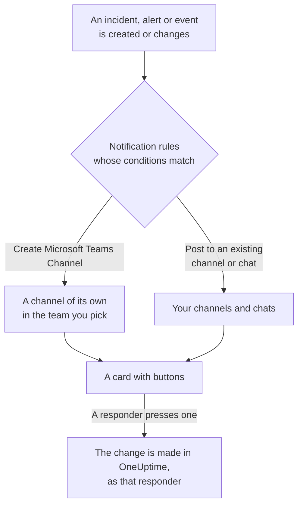

# Microsoft Teams

Connect OneUptime to Microsoft Teams to post incidents, alerts, episodes, scheduled maintenance, monitors and on-call updates to your channels and chats, give each incident a channel of its own, and let responders act from Teams: acknowledge, resolve, add notes, page on-call, declare incidents and ask OneUptime AI.

:::cards
- [Connect Microsoft Teams](#connect-microsoft-teams): Admin consent, your sign-in, and the app in each team.
- [Notification rules](#notification-rules): Decide which events post where, and which get a channel of their own.
- [Talking to the OneUptime bot](#talking-to-the-oneuptime-bot): Commands, questions and forms in a chat with the bot.
- [Acting on incidents, alerts and events from Microsoft Teams](#acting-on-incidents-alerts-and-events-from-microsoft-teams): The buttons on OneUptime's cards.
:::

## How it works

Three things make this work:

- **The project's connection**, made once: a Microsoft 365 administrator consents to the OneUptime app for your organization.
- **The OneUptime app in each team** you want notifications in. Microsoft only lets the bot post into a team it has been added to.
- **Each person's own connection**: their Microsoft Teams account linked to their OneUptime account. Buttons, commands and reactions act as that person, with their permissions in the project.

## Before you begin

- **A role that may connect the project:** **Project Owner**, **Project Admin** or **Project Member**. Uninstalling needs **Project Owner** or **Project Admin**.
- **A Microsoft 365 administrator** to grant admin consent, once for the whole organization.
- **The Growth plan on OneUptime Cloud** for notification rules and summaries. See [Notification rules below the Growth plan](#notification-rules-below-the-growth-plan).
- **On a self-hosted server,** a Teams bot set up for it first. See [Microsoft Teams Integration](/docs/self-hosted/microsoft-teams-integration).

## Connect Microsoft Teams

:::steps
### Grant admin consent

Go to **Project Settings** > **Workspace** > **Microsoft Teams** and click **Grant Admin Consent**. A Microsoft 365 administrator signs in and allows the OneUptime app for the organization. The card then says **Admin Consent Completed**. Until a workspace is connected, the **Workspace** section of the Incidents, Alerts, Scheduled Maintenance, Monitors and On-Call menus holds **Connect Slack or Teams**, which leads here too.

### Connect your account

Click **Connect with Microsoft Teams** and sign in with your work account. OneUptime reads the teams of your organization; **View Teams** lists them.

### Add the OneUptime app to each team (required)

Connecting your account is not enough on its own. Microsoft only lets the OneUptime bot post into a team it has been added to, so do this for every team you want notifications in:

- In Microsoft Teams, click the "..." next to the **team name** (not the channel name).
- Choose **Manage team** > **Apps** > **More apps**, find **OneUptime** and click **Add**.

On OneUptime Cloud, **Open Teams Store** opens the app in the Microsoft Teams store, where **Add to a team** does the same. On a self-hosted server, install the package from **Download App Manifest Zip** instead: only it carries your server's bot. If a test notification reports that the OneUptime app is not installed in the team, this is the step that was missed.

### Connect everyone else

Each person links their own Microsoft Teams account under **User Settings** > **Workspace** > **Microsoft Teams** with **Connect my account with Microsoft Teams**, to act on incidents and get direct messages as themselves. That section appears once the project is connected to Microsoft Teams.

### Add a notification rule

Go to **Incidents** > **Workspace** > **Microsoft Teams**. The **Workspace** section lists only the chat workspaces your project has connected, so **Microsoft Teams** appears there once it is connected. Create a rule, for example one that posts to a Teams channel when an incident is created, then click **Test Rule** on its row.
:::

> [!NOTE]
> Installing OneUptime for yourself, or adding it to a chat, is a different installation and does not let it post to a team's channels. **Private channels** need the app added to the channel itself: open the channel > "..." > **Manage channel** > **Apps** > **Add an app**. **Shared channels** cannot receive notifications: Microsoft Teams does not support bots in shared channels.

## Notification rules

A notification rule says which events post to Microsoft Teams, and where. Each product has its own rules, under **Workspace** > **Microsoft Teams** in its menu:

| Product | Tabs on its **Microsoft Teams** page |
| --- | --- |
| **Incidents** | **Incidents**, **Incident Episodes**, **Summary** |
| **Alerts** | **Alerts**, **Alert Episodes**, **Summary** |
| **Scheduled Maintenance** | One list of rules |
| **Monitors** | One list of rules |
| **On-Call Duty** | One list of rules |

Creating a rule walks four steps:

| Step | What you set |
| --- | --- |
| **Basic** | **Rule Name** and **Rule Description**. |
| **Conditions** | Which events the rule fires for, by severity, state, label, monitor or words in the title, for example. With no conditions it fires for every event. With two or more, **Match Condition** says whether all of them must match, or any one. |
| **Destination** | Where it posts: an existing channel of a team you pick, the chats you pick, a new channel created in a team you pick, or any of these together. |
| **Video Call** | Incidents and alerts only: start a call for each one. See [Video Calls](/docs/workspace-connections/video-calls). |

A channel the rule creates is named from **New Microsoft Teams Channel Name** followed by the record's number, such as `oneuptime-incident-42`, and only a channel that was created gets the people the rule invites. A private incident, alert or episode gets a private channel. Every later update of the record — a state change, a note, a new owner — is posted to its channels and chats.

**Project Settings** > **Workspace** > **Microsoft Teams** lists the channels OneUptime can see in your teams, and the chats it was added to, with **Send Test** beside each one. A chat appears once the OneUptime app is added to it in Microsoft Teams; **Refresh Chats** picks up new chats and their current names.

## Testing a rule

**Test Rule** on a rule's row posts a test message for that rule to the channels it names, so you can see it arrive. If the rule creates a channel for each event, the test creates one too and invites the rule's people to it.

Like **Send Test** beside a channel in **Project Settings** > **Workspace** > **Microsoft Teams**, it needs permission to create notification rules: **Project Owner**, **Project Admin**, **Project Member**, **Settings Admin**, **Settings Member**, or **Create Workspace Notification Rule** and **Read Workspace Notification Rule** in a custom role. For someone who can only see the rules, such as a **Viewer**, **Test Rule** is locked, and its tooltip says what it takes; the API refuses their test with "You do not have permission to send test notifications in this project." On OneUptime Cloud, testing a rule needs the **Growth** plan, like adding one.

On OneUptime Cloud, **Send Test** beside a channel or a chat needs the **Growth** plan too, since posting into a channel is what rules and summaries do. **Send Test Now** on a summary needs permission to create summaries (**Create Workspace Notification Summary** and **Read Workspace Notification Summary** in a custom role) and, on OneUptime Cloud, the **Growth** plan; for anyone else it is locked, and its tooltip says what it takes. An MCP client connected with read-only access cannot send any test.

## Summaries

The **Summary** tab of **Incidents** > **Workspace** > **Microsoft Teams** (and of **Alerts**) posts a recurring roundup to the channels you name: how many incidents or alerts there were, how fast they were acknowledged and resolved, and a list with links. A new summary goes out every week and covers the last 7 days. Leave **Send First Report At** empty, and the first one goes out at 09:00 at the start of the next week, day or month; the form says when.

A summary goes out on the clock of its **Timezone**, which starts on yours. It keeps its time of day there all year: one set for 09:00 in Berlin still goes out at 09:00 in Berlin after the clocks change for daylight saving time, and the dates in its message are Berlin's too. Through the API, send `timezone` as an IANA time zone name, such as `Europe/Berlin`. A summary created without one takes the time zone in its creator's profile, or UTC when an API key creates it.

The summary form has four steps: **Basic Info** (its name, the channels and their **Team Name**), **Schedule**, **Content** (**What to Include**) and **Filters** (which incidents or alerts it counts).

## Notification rules below the Growth plan

On OneUptime Cloud, notification rules and summaries are on the **Growth** plan and above. A project below it keeps the rules and summaries it already has, and they keep posting to Microsoft Teams. So each product's **Microsoft Teams** page (Incidents, Alerts, Scheduled Maintenance, On-Call Duty, Monitors) shows the plan note with them under it (**Notification rules still set up**, **Summaries still set up**): delete a rule, or turn a summary off or delete it. Adding or changing rules and summaries needs **Growth**.

## Getting paged in Microsoft Teams

To be paged by direct message when you are on call, add Microsoft Teams as one of your notification methods:

:::steps
1. Connect your own Microsoft Teams account (see [Connect Microsoft Teams](#connect-microsoft-teams)).
2. Go to **User Settings** > **Notification Methods**, open the **Workspace Apps** tab and click **Add Microsoft Teams Account**.
3. Click **Send Test Message** on its row. The message arrives in your Microsoft Teams chats.
:::

Adding it adds it to your on-call rules straight away, so pages reach you in Microsoft Teams from then on. Change which pages it gets under **User Settings** > **On-Call Rules**.

## Saving messages as notes

React to a message, or a reply, in the channel OneUptime created for an incident, alert, episode or scheduled maintenance event, and OneUptime saves it as a note on that record. It picks the reaction up within a minute and confirms with a reply in the thread:

| Reaction | Saved as |
| --- | --- |
| 📌 or 📍 | A private note, seen only by your team |
| 📣 or 📢 | A public note, shown on the status page. Incidents and scheduled maintenance events only. |

The note is saved as you, with your permissions, so your own Microsoft Teams account must be connected, and the OneUptime app must be in the team.

## Talking to the OneUptime bot

Message the bot in a personal chat, or @mention OneUptime in a channel or a group chat: there it answers only when mentioned.

| Message | What the bot does |
| --- | --- |
| `help` | Lists what it can do. |
| `ask <question>`, or any question in plain language | OneUptime AI answers about your logs, traces, metrics, incidents and monitors, for example "which monitors are down right now?". Answers only read. |
| `create incident [title]` | Opens the incident form, with the title filled in. |
| `create maintenance [title]` | Opens the scheduled maintenance form, with the title filled in. |
| `show active incidents`, `show active alerts` | Lists what is open now. |
| `show scheduled maintenance`, `show ongoing maintenance` | Lists upcoming, or ongoing, maintenance events. |

Asking OneUptime AI needs AI turned on for the project. See [Ask AI](/docs/ai/ask-ai).

## Creating incidents and maintenance from Microsoft Teams

Typing `create incident` or `create maintenance` to the OneUptime bot opens a form for the person who typed it, in a personal chat, a channel or a group chat alike. It is filled in as that person: as the OneUptime account their Microsoft Teams account is connected to (see [Connect Microsoft Teams](#connect-microsoft-teams)), with that account's permissions in the project. Someone whose account is not connected, or whose OneUptime account is no longer a member of the project, is told what to do instead of getting the form.

- **Who may use them.** The people who may declare an incident or create a scheduled maintenance event in OneUptime: **Project Owner**, **Project Admin**, **Project Member**, **Incident Admin** and **Incident Member** for an incident (**Create Incident** in a custom role), and **Scheduled Maintenance Admin** and **Scheduled Maintenance Member** for an event (**Create Scheduled Maintenance**). Anyone else is told so, and gets no form.
- **What a form offers.** Each list — severities, monitors, monitor statuses, on-call policies and labels — holds what the person who asked for it may read, as the same list in OneUptime does, and the card's "not shown" notes count only those: with a role limited to some labels, the monitors and on-call policies carrying those labels. A list they may not read at all is left off. Archived on-call policies are never offered.
- **What a form may name.** In a channel or a group chat anyone there may submit the form, and it is submitted as whoever does, with their own permissions. The incident or event is created with those permissions and credited to that person. A monitor, on-call policy, label, severity or status they may not read, or one of another project, is refused like one the project does not have, and nothing is created: the bot answers "One of the values you picked ... is not available in this project any more. Please pick it again."

**Execute On-Call Policy** on an incident, alert or episode works the same way: it needs permission to execute an on-call policy (**Project Owner**, **Project Admin**, **Project Member**, **On-Call Admin** and **On-Call Member**, or **Create On-Call Duty Policy Execution Log** in a custom role) and to read that incident, alert or episode, and offers the live on-call policies the person may read. Viewing a monitor or an on-call policy from a card reads it as the person who pressed the button, too.

## Acting on incidents, alerts and events from Microsoft Teams

The buttons on OneUptime's cards act as the person who presses them, in a personal chat, a channel or a group chat alike: as the OneUptime account their Microsoft Teams account is connected to, with that account's permissions in the project. **Acknowledge**, **Resolve**, **Change State**, **Add Note** and **Execute On-Call Policy** on an incident, an alert or an episode, and **Mark as Ongoing**, **Mark as Complete**, **Change State** and **Add Note** on a scheduled maintenance event, each make the change the same action makes in OneUptime, and it is credited to that person there: the record's state timeline and feed show who changed its state, and the note is theirs. A note saved from a message with a reaction is posted the same way.

- **Who may use them.** The people who may make the same change in OneUptime. Acknowledging, resolving or changing the state of an incident needs permission to change its state: **Project Owner**, **Project Admin**, **Project Member**, **Incident Admin** and **Incident Member**, or **Create Incident State Timeline** in a custom role. An alert, an episode or a scheduled maintenance event needs the same permission for its own kind (**Create Alert State Timeline**, for example), and a note needs permission to post that kind of note. Like the state panel in OneUptime, they do not ask for permission to edit the incident or alert itself. Anyone else is told so, and nothing changes.
- **Which records.** Those the person may read, as in OneUptime: with a role limited to some labels, the incidents, alerts, episodes and events carrying them. A button on any other record, or on one of another project, is answered that the record "was not found in this project, or you do not have access to it.", and nothing changes. On OneUptime Cloud, a change the project's plan doesn't include is refused with the plan it needs.
- **What Change State offers.** The states the person may read that the record may move into next, in the project's order: none before the state it is in, for an episode as for an incident, an alert or a scheduled maintenance event, since a state change never moves a record back up its list (see [Order is a real constraint](/docs/incidents/states-and-severities#order-is-a-real-constraint-not-a-display-preference)). When they may read none, the bot says "No incident states are available to you in this project. Ask a project admin for access to them."; when the record is in the last state it can reach, it says "There is no later state to move this incident to." Neither shows an empty card.
- **Escalate.** A card's **Escalate** executes its on-call policy for the incident, alert or episode the card is about, as the person who pressed it, with the same permissions as **Execute On-Call Policy**. A card about none of them is answered "This on-call policy can only be executed for an incident, an alert or an episode. Open the record you are paging about and use Execute On-Call Policy there.", and nobody is paged.

## Disconnecting

- **Disconnect** unlinks only your own Microsoft Teams account, and removes your Microsoft Teams notification method with it.
- **Uninstall OneUptime from Microsoft Teams**, on **Project Settings** > **Workspace** > **Microsoft Teams**, disconnects the project. OneUptime stops posting to Microsoft Teams, and the **Workspace** menus stop listing it. The notification rules and summaries are kept for when you connect again.

> [!WARNING]
> Uninstalling also unlinks every member's own Microsoft Teams account in the project, and removes the Microsoft Teams notification methods and the on-call rules that used them. A project is connected to one Microsoft 365 organization: to move it to another, uninstall first.

## Troubleshooting

:::details A test says the OneUptime app is not installed in the team
Microsoft refused the post because the bot is not in that team. Add the app to the team (see [Connect Microsoft Teams](#connect-microsoft-teams)), or, for a private channel, to the channel itself. Adding it to one team does nothing for the others.
:::

:::details Microsoft Teams was not connected
When Microsoft sends you back without a connection, the page you started from says **Microsoft Teams was not connected**, and one sentence says why: you lack the permission, the link was used or expired, you signed in to another Microsoft 365 organization, or your organization has no teams yet. See [Connecting did not finish](/docs/self-hosted/microsoft-teams-integration#connecting-did-not-finish) for every sentence and what to do.
:::

:::details The bot says my account is not connected
Link it under **User Settings** > **Workspace** > **Microsoft Teams** with **Connect my account with Microsoft Teams**, signed in to the organization the project is connected to. A guest account from another organization is not the same account.
:::

:::details Every notification fails on a self-hosted server
The Teams app installed in your teams must be the package your server built, and Microsoft must be able to reach your server's bot endpoint. See the troubleshooting of [Microsoft Teams Integration](/docs/self-hosted/microsoft-teams-integration#troubleshooting).
:::

## Next steps

:::cards
- [Slack](/docs/workspace-connections/slack): The same notifications and actions in Slack.
- [Video Calls](/docs/workspace-connections/video-calls): Give every incident a call, posted with its updates.
- [Microsoft Teams Integration](/docs/self-hosted/microsoft-teams-integration): Set up the Teams bot on a self-hosted server.
- [Declaring an Incident](/docs/incidents/declaring-incidents): Every way an incident starts, and what runs when it does.
:::
