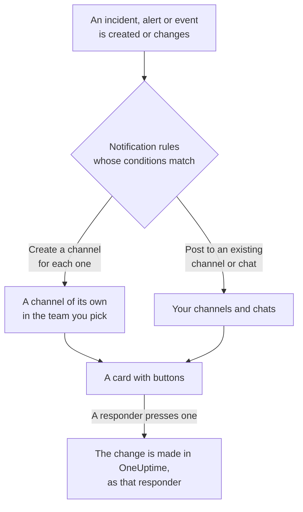

# Microsoft Teams

Connect OneUptime to Microsoft Teams to post incidents, alerts, episodes, scheduled maintenance, monitors and on-call updates to your channels and chats, give each incident a channel of its own, and let responders act from Teams: acknowledge, resolve, add notes, page on-call, declare incidents and ask OneUptime AI.

:::cards
- [Connect Microsoft Teams](#connect-microsoft-teams): Admin consent, your sign-in, and the app in each team.
- [Asking everyone to connect](#asking-everyone-to-connect): Message every member who has not connected their account, in one go.
- [Notification rules](#notification-rules): Decide which events post where, and which get a channel of their own.
- [Talking to the OneUptime bot](#talking-to-the-oneuptime-bot): Commands, questions and forms in a chat with the bot.
- [On-call tags](#on-call-tags): Keep a team's tag equal to whoever is on call, and page it.
- [Acting on incidents, alerts and events from Microsoft Teams](#acting-on-incidents-alerts-and-events-from-microsoft-teams): The buttons on OneUptime's cards.
:::

## How it works

Three things make this work:

- **The project's connection**, made once: a Microsoft 365 administrator consents to the OneUptime app for your organization.
- **The OneUptime app in each team** you want notifications in. Microsoft only lets the bot post into a team it has been added to.
- **Each person's own connection**: their Microsoft Teams account linked to their OneUptime account. Buttons, commands and reactions act as that person, with their permissions in the project.

One Microsoft 365 organization can be connected to more than one project, such as production and staging. A card's button acts in the project of the record it is about. A message to the bot acts in the project of the channel it is sent in, such as an incident's channel, or else in the one project the sender's Microsoft Teams account is connected in. When nothing tells which, the bot names the projects they're in and asks them to try again from a channel of the one they mean.

## Before you begin

- **A role that may connect the project:** **Project Owner**, **Project Admin** or **Project Member**. Uninstalling needs **Project Owner** or **Project Admin**.
- **A Microsoft 365 administrator** to grant admin consent, once for the whole organization.
- **The Growth plan on OneUptime Cloud** for notification rules and summaries. See [Notification rules below the Growth plan](#notification-rules-below-the-growth-plan).
- **On a self-hosted server,** a Teams bot set up for it first. See [Microsoft Teams Integration](/docs/self-hosted/microsoft-teams-integration).

## Connect Microsoft Teams

:::steps
### Grant admin consent

Go to **Project Settings** > **Workspace** > **Microsoft Teams** and click **Grant Admin Consent**. A Microsoft 365 administrator signs in and allows the OneUptime app for the organization. The card then says **Admin Consent Completed**. Until a workspace is connected, the **Workspace** section of the Incidents, Alerts, Scheduled Maintenance, Monitors and On-Call menus holds **Connect Slack or Teams**, which leads here too.

### Connect your account

Click **Connect with Microsoft Teams** and sign in with your work account. OneUptime reads the teams of your organization; **View Teams** lists them.

### Add the OneUptime app to each team (required)

Connecting your account is not enough on its own. Microsoft only lets the OneUptime bot post into a team it has been added to, so do this for every team you want notifications in:

- In Microsoft Teams, click the "..." next to the **team name** (not the channel name).
- Choose **Manage team** > **Apps** > **More apps**, find **OneUptime** and click **Add**.

On OneUptime Cloud, **Open Teams Store** opens the app in the Microsoft Teams store, where **Add to a team** does the same. On a self-hosted server, install the package from **Download App Manifest Zip** instead: only it carries your server's bot. If a test notification reports that the OneUptime app is not installed in the team, this is the step that was missed.

### Connect everyone else

Each person links their own Microsoft Teams account under **User Settings** > **Workspace** > **Microsoft Teams** with **Connect my account with Microsoft Teams**, to act on incidents and get direct messages as themselves. That section appears once the project is connected to Microsoft Teams. To bring in a whole team at once, see [Asking everyone to connect](#asking-everyone-to-connect).

### Add a notification rule

Go to **Incidents** > **Workspace** > **Microsoft Teams**. The **Workspace** section lists only the chat workspaces your project has connected, so **Microsoft Teams** appears there once it is connected. Create a rule, for example one that posts to a Teams channel when an incident is created, then click **Test Rule** on its row.
:::

> [!NOTE]
> Installing OneUptime for yourself, or adding it to a chat, is a different installation and does not let it post to a team's channels. **Private channels** need the app added to the channel itself: open the channel > "..." > **Manage channel** > **Apps** > **Add an app**. **Shared channels** cannot receive notifications: Microsoft Teams does not support bots in shared channels.

## Asking everyone to connect

Nobody can connect somebody else's Microsoft Teams account, an admin included: each person signs in to their own. To bring in a whole team, a **Project Owner** or **Project Admin** asks everyone at once on **Project Settings** > **Workspace** > **Microsoft Teams**. The **Members' Microsoft Teams accounts** card says how many members have connected. **Ask everyone to connect** has the OneUptime bot send each member who has not a message, with a **Connect Microsoft Teams account** button that connects their account in one click.

- **Who gets a message.** Every member of the project who has not connected their Microsoft Teams account and is in a team the OneUptime app is added to, found there by their email address or user principal name. Somebody asked in the last 24 hours is not asked again, so asking again the next day reminds only the people who still have not connected.
- **What the card says.** How far the messages have got while they go out, then who asked and how many members got a message. Members OneUptime could not find are named on the card: add the app to their team, or have them connect under **User Settings** > **Workspace** > **Microsoft Teams** themselves.
- **What the button connects.** The Microsoft Teams account of whoever presses it and signs in, to their own OneUptime account. A message passed on to somebody else connects nothing to the member it was sent to.

## Notification rules

A notification rule says which events post to Microsoft Teams, and where. Each product has its own rules, under **Workspace** > **Microsoft Teams** in its menu:

| Product | Tabs on its **Microsoft Teams** page |
| --- | --- |
| **Incidents** | **Incidents**, **Incident Episodes**, **Summary** |
| **Alerts** | **Alerts**, **Alert Episodes**, **Summary** |
| **Scheduled Maintenance** | One list of rules |
| **Monitors** | One list of rules |
| **On-Call Duty** | One list of rules |

Creating a rule walks four steps:

| Step | What you set |
| --- | --- |
| **Basic** | **Rule Name** and **Rule Description**. |
| **Conditions** | Which events the rule is for, by severity, state, label, monitor or words in the title, for example. They are checked when an event is created and again with each update OneUptime posts about it, so a rule for acknowledged incidents acts when an incident is acknowledged. A new rule is for every event, such as **All incidents**. To narrow it down, pick **Only incidents that match conditions** and add the conditions. With two or more, **Match Condition** says whether all of them must match, or any one. |
| **Destination** | Where it posts: an existing channel of a team you pick, the chats you pick, a channel for each incident (or alert, episode, event, monitor or on-call policy) created in a team you pick, or any of these together. Under the step, **What this rule does** says it in sentences, as the rule's card does. |
| **Video Call** | Incidents and alerts only: start a call for each one. See [Video Calls](/docs/workspace-connections/video-calls). |

A channel the rule creates is named after its record: incident INC-42 gets `inc-42`, alert ALT-7 gets `alt-7`, and in a project without number prefixes, incident 42 gets `incident-42`. Text in **Channel Name Prefix** goes in front, so `prod-` makes `prod-inc-42`, and the form shows the name as you type. For a scheduled maintenance event, the prefix takes the place of its number prefix: SM-5 gets `sm-5`, and `maint-` makes `maint-5`. OneUptime keeps letters, numbers, spaces, `-` and `_`, up to the 50 characters Microsoft Teams takes. If the team already has a channel by that name, such as another project's or one deleted in the last 30 days, OneUptime adds `-2`, `-3` and so on.

A rule creates its channel the first time an event matches it: when the event is created, or later, when an update makes it match while it is still open. A rule for acknowledged incidents creates the channel when the incident is acknowledged. Microsoft Teams shows a team's channels to everyone in the team, so OneUptime adds nobody to a channel one by one: everyone in the team you pick can open it, as the rule form says under **Who joins the channel**. A private incident, alert or episode gets a private channel, which only its members see; add people to it in Microsoft Teams.

To bring in whoever is on call, pick their on-call schedules under **Mention who is on call**. When the channel is created, OneUptime posts a message in it, just after the record's first one, that @mentions whoever is on call in those schedules, so Microsoft Teams notifies them. Nobody is paged. OneUptime finds each person in the team by the Microsoft Teams account they connected to OneUptime, or else by their email address. Someone who is not in the team can't open its channels, so they are named in the message instead, with why. In a private channel, only its members can open it, so add the people on call to it in Microsoft Teams.

Every later update of the record — a state change, a note, a new owner — is posted to its channels, and to the existing channels and chats its rules name while their conditions match. OneUptime cannot archive a Microsoft Teams channel, so a rule's channel stays when its record is over; archive or delete it in Microsoft Teams.

An incident, alert, episode or scheduled maintenance event with a channel of its own has **Open in Microsoft Teams** in the header of its page in OneUptime, beside its state buttons. It opens that channel in a new tab, in the Microsoft Teams app or in the browser. A record with two channels of its own lists both under the button. A record with channels in both Slack and Microsoft Teams has one **Open channel** button instead, which lists them all. The existing channels and chats your rules post to are not offered.

The record's page also has a **Microsoft Teams Channel** card, which says who can open the channel: everyone in the team, or, for a private channel, its members, whom its owners add in Microsoft Teams. OneUptime does not change who is in a Microsoft Teams channel. For a Slack channel, the card lists who is in it and adds people: see [Who is in a record's channel](/docs/workspace-connections/slack#who-is-in-a-records-channel).

Channels and chats stay readable: each event is posted once, and a record's first state is in the card that announces the record, not in a card of its own. An on-call policy run is one card that is edited as the run escalates: who was paged, how often and how, who was not and why, and who acknowledged. A new card is posted only when someone has to act: an escalation rule reached nobody, or the run ended without anyone acknowledging. That a record's owners or status page subscribers were notified stays in its feed in OneUptime.

**Project Settings** > **Workspace** > **Microsoft Teams** lists the channels OneUptime can see in your teams, and the chats it was added to, with **Send Test** beside each one. A chat appears once the OneUptime app is added to it in Microsoft Teams; **Refresh Chats** picks up new chats and their current names.

## Testing a rule

**Test Rule** on a rule's row posts a test message for that rule to the channels it names, so you can see it arrive. If the rule creates a channel for each event, the test creates one too and invites the rule's people to it.

Like **Send Test** beside a channel in **Project Settings** > **Workspace** > **Microsoft Teams**, it needs permission to create notification rules: **Project Owner**, **Project Admin**, **Project Member**, **Settings Admin**, **Settings Member**, or **Create Workspace Notification Rule** and **Read Workspace Notification Rule** in a custom role. For someone who can only see the rules, such as a **Viewer**, **Test Rule** is locked, and its tooltip says what it takes; the API refuses their test with "You do not have permission to send test notifications in this project." On OneUptime Cloud, testing a rule needs the **Growth** plan, like adding one.

On OneUptime Cloud, **Send Test** beside a channel or a chat needs the **Growth** plan too, since posting into a channel is what rules and summaries do. **Send Test Now** on a summary needs permission to create summaries (**Create Workspace Notification Summary** and **Read Workspace Notification Summary** in a custom role) and, on OneUptime Cloud, the **Growth** plan; for anyone else it is locked, and its tooltip says what it takes. An MCP client connected with read-only access cannot send any test.

## Summaries

The **Summary** tab of **Incidents** > **Workspace** > **Microsoft Teams** (and of **Alerts**) posts a recurring roundup to the channels you name: how many incidents or alerts there were, how fast they were acknowledged and resolved, and a list with links. A new summary goes out every week and covers the last 7 days. Leave **Send First Report At** empty, and the first one goes out at 09:00 at the start of the next week, day or month; the form says when.

A summary goes out on the clock of its **Timezone**, which starts on yours. It keeps its time of day there all year: one set for 09:00 in Berlin still goes out at 09:00 in Berlin after the clocks change for daylight saving time, and the dates in its message are Berlin's too. Through the API, send `timezone` as an IANA time zone name, such as `Europe/Berlin`. A summary created without one takes the time zone in its creator's profile, or UTC when an API key creates it.

The summary form has four steps: **Basic Info** (its name, the channels and their **Team Name**), **Schedule**, **Content** (**What to Include**) and **Filters** (which incidents or alerts it counts).

## Notification rules below the Growth plan

On OneUptime Cloud, notification rules and summaries are on the **Growth** plan and above. A project below it keeps the rules and summaries it already has, and they keep posting to Microsoft Teams. So each product's **Microsoft Teams** page (Incidents, Alerts, Scheduled Maintenance, On-Call Duty, Monitors) shows the plan note with them under it (**Notification rules still set up**, **Summaries still set up**): delete a rule, or turn a summary off or delete it. Adding or changing rules and summaries needs **Growth**.

## Getting paged in Microsoft Teams

To be paged by direct message when you are on call, add Microsoft Teams as one of your notification methods:

:::steps
1. Connect your own Microsoft Teams account (see [Connect Microsoft Teams](#connect-microsoft-teams)).
2. Go to **User Settings** > **Notification Methods**, open the **Workspace Apps** tab and click **Add Microsoft Teams Account**.
3. Click **Send Test Message** on its row. The message arrives in your Microsoft Teams chats.
:::

Adding it adds it to your on-call rules straight away, so pages reach you in Microsoft Teams from then on. Change which pages it gets under **User Settings** > **On-Call Rules**.

## Saving messages as notes

React to a message, or a reply, in the channel OneUptime created for an incident, alert, episode or scheduled maintenance event, and OneUptime saves it as a note on that record. It picks the reaction up within a minute and confirms with a reply in the thread:

| Reaction | Saved as |
| --- | --- |
| 📌 or 📍 | A private note, seen only by your team |
| 📣 or 📢 | A public note, shown on the status page. Incidents and scheduled maintenance events only. On a private incident, a private note, and the confirmation says why. |

The note keeps the message as Microsoft Teams showed it: its formatting, links and code, the people it mentions by name, and its files and images as links to them. A public note leaves the files and images out, since they open only for your team.

It is the words of whoever wrote the message: their OneUptime name when their Microsoft Teams account is connected, otherwise the name Teams shows. A private note is filed in the timeline when the message was posted, however long after it is saved. A public note is filed when it is saved, which is when the status page shows it. The timeline says who saved it. The note is not posted back into the channel, where the message already is.

The note is saved as you, with your permissions, and the OneUptime app must be in the team. If your Microsoft Teams account is not connected yet, OneUptime asks you to connect it, in a reply that mentions you, with a button that saves the message as soon as you have.

## Talking to the OneUptime bot

Message the bot in a personal chat, or @mention OneUptime in a channel or a group chat: there it answers only when mentioned.

| Message | What the bot does |
| --- | --- |
| `help` | Lists what it can do. |
| `incident [title or number]` | Opens the incident form, with the title filled in. An incident's number, such as `42` or `INC-42`, shows that incident instead: see [Managing an incident from Microsoft Teams](#managing-an-incident-from-microsoft-teams). |
| `maintenance [title]` | Opens the scheduled maintenance form, with the title filled in. |
| `oncall` | Lists who is on call right now in each on-call schedule you can see, until when, and who is next. |
| `page [who] [message]` | Pages the people you @mention about your message, or sends a card to pick who to page. See [Paging someone from Microsoft Teams](#paging-someone-from-microsoft-teams). |
| `ask [question]`, or any question in plain language | OneUptime AI answers about your logs, traces, metrics, incidents and monitors, for example "which monitors are down right now?". Answers only read. |
| `show active incidents`, `show active alerts` | Lists what is open now. |
| `show scheduled maintenance`, `show ongoing maintenance` | Lists upcoming, or ongoing, maintenance events. |

Apart from the `show` lists, these are the words that follow `/oneuptime` in Slack; `create incident` and `create maintenance` still work too. Asking OneUptime AI needs your own Microsoft Teams account connected, and AI turned on for the project. If yours is not connected, the bot asks you once in each thread or chat to connect it, with a **Connect Microsoft Teams account** button. See [Ask AI](/docs/ai/ask-ai).

## Your Home in Microsoft Teams

Type `home` to the OneUptime bot, and it answers with your Home: a card with what is happening in the project, as you may see it.

- **Your on-call.** The on-call schedules you are on call in now, and until when, or else your next shift.
- **What is open.** The newest open incidents and alerts you may read, each linked to its page in OneUptime.
- **Its buttons.** **Declare incident** and **Page someone** answer as `incident` and `page` do, **Who's on call** as `oncall` does, and **Refresh** reads the card again, in place.

When you add the OneUptime app for yourself, the bot sends you your Home straight away. The Home and the `show` lists read as you, so they need your own Microsoft Teams account connected: until it is, the bot answers with a **Connect Microsoft Teams account** button. **Open OneUptime in Microsoft Teams**, under **User Settings** > **Workspace** > **Microsoft Teams**, opens the app in Teams.

When the app is added to a team, the bot says hello in it: how to ask it a question, and where to add a notification rule that posts to the team's channels.

## Creating incidents and maintenance from Microsoft Teams

Typing `incident` or `maintenance` to the OneUptime bot opens a form for the person who typed it, in a personal chat, a channel or a group chat alike. It is filled in as that person: as the OneUptime account their Microsoft Teams account is connected to (see [Connect Microsoft Teams](#connect-microsoft-teams)), with that account's permissions in the project. Someone whose account is not connected, or whose OneUptime account is no longer a member of the project, is told what to do in a reply that mentions them, instead of getting the form.

- **Who may use them.** The people who may declare an incident or create a scheduled maintenance event in OneUptime: **Project Owner**, **Project Admin**, **Project Member**, **Incident Admin** and **Incident Member** for an incident (**Create Incident** in a custom role), and **Scheduled Maintenance Admin** and **Scheduled Maintenance Member** for an event (**Create Scheduled Maintenance**). Anyone else is told so, and gets no form.
- **What a form offers.** Each list — severities, monitors, monitor statuses, on-call policies and labels — holds what the person who asked for it may read, as the same list in OneUptime does, and the card's "not shown" notes count only those: with a role limited to some labels, the monitors and on-call policies carrying those labels. A list they may not read at all is left off. Archived on-call policies are never offered.
- **What a form may name.** In a channel or a group chat anyone there may submit the form, and it is submitted as whoever does, with their own permissions. The incident or event is created with those permissions and credited to that person. A monitor, on-call policy, label, severity or status they may not read, or one of another project, is refused like one the project does not have, and nothing is created: the bot answers "One of the values you picked ... is not available in this project any more. Please pick it again."

**Execute On-Call Policy** on an incident, alert or episode works the same way: it needs permission to execute an on-call policy (**Project Owner**, **Project Admin**, **Project Member**, **On-Call Admin** and **On-Call Member**, or **Create On-Call Duty Policy Execution Log** in a custom role) and to read that incident, alert or episode, and offers the live on-call policies the person may read. Viewing a monitor or an on-call policy from a card reads it as the person who pressed the button, too.

## Paging someone from Microsoft Teams

In a channel or a group chat, `@OneUptime page @Nawaz Dhandala The checkout API is throwing 500s` pages Nawaz straight away. OneUptime creates an alert whose title is your message, and each person you @mention gets a phone call, an SMS, a push notification or an email, as their own on-call rules say, until somebody acknowledges the alert.

- **Who is paged at once.** The people you @mention, and whoever is on call in the schedules a tag you @mention follows (see [On-call tags](#on-call-tags)), when a message follows them. OneUptime knows a person by the OneUptime account their Microsoft Teams account is connected to, or else by their email address in Microsoft Teams. Nobody outside the project is paged.
- **Anything else gets a card.** With nobody @mentioned, as in a personal chat with the bot, no message, a tag that follows no on-call schedule you can see, or a person OneUptime cannot tell, the bot answers with the **Page someone** card, what you typed filled in, and says whom it could not pick. Pick people, a team, an on-call schedule, which pages whoever is on call in it now, or an on-call policy, which pages through its escalation rules, and submit it. Anyone in the conversation may submit the card, as themselves. Once it has paged, the card is removed, so nobody pages with it twice.
- **Where it shows.** The conversation shows the page as one card, kept up to date: who was paged and how, and who acknowledged. Where the bot cannot post it, its reply says who was paged, with a link to the alert.
- **Who may page.** Anyone who may both execute an on-call policy and create an alert: **Project Owner**, **Project Admin** and **Project Member**, or **On-Call Member** with **Alert Member** (**Create On-Call Duty Policy Execution Log** and **Create Alert** in a custom role). Paging people, a team or a schedule directly, with no on-call policy behind the page, also takes access to every on-call policy of the project. Anyone else is told so in a reply, and nobody is paged. On OneUptime Cloud, paging needs the Growth plan: below it, OneUptime says which plan it needs, and nobody is paged.

## On-call tags

Keep a Microsoft Teams tag, such as `@Payments on-call`, equal to whoever is on call in one or more on-call schedules, so anyone in its team can @mention it to reach them. OneUptime changes the tag's people at every hand-off and override, and checks it every 15 minutes.

:::steps
### Connect a tag to a schedule

Open the schedule under **On-Call Duty** > **On-Call Schedules**. In its **Microsoft Teams tags** card, click **Connect tag**, pick the team, and name the tag: the team's tag of that name, or a new one OneUptime makes. The people in it are replaced with whoever is on call straight away.

### Connect it to the secondary schedule too

For a tag that holds the primary and the secondary on call, connect the same tag on the secondary schedule's page. A tag can follow any number of schedules.
:::

- **What the card shows.** Who is in each tag now, its team, the other schedules it follows, and whether it is **Up to date**. A tag holds only people in its team: somebody on call who is not in the team is named, with why.
- **Nobody on call.** OneUptime takes everybody out of the tag until somebody is on call. A new tag needs somebody from the team on call, as Microsoft Teams makes no tag with nobody in it.
- **Paging it.** `@OneUptime page @Payments on-call The checkout API is down` pages whoever is on call in the schedules the tag follows. See [Paging someone from Microsoft Teams](#paging-someone-from-microsoft-teams).
- **What Microsoft 365 needs.** Changing tags takes the app's `TeamworkTag.ReadWrite.All` permission, which a Microsoft 365 administrator grants with **Grant Admin Consent** under **Project Settings** > **Workspace** > **Microsoft Teams**. If your organization consented before OneUptime could keep tags, consent once more.
- **Who may connect one.** The roles that may edit schedules: **Project Owner**, **Project Admin**, **Project Member**, **On-Call Admin** and **On-Call Member**, or **Edit On-Call Duty Policy Schedule** in a custom role. On OneUptime Cloud, connecting one needs the **Growth** plan.
- **Disconnecting.** OneUptime stops changing the tag. The tag, and the people in it, stay in Microsoft Teams as they are.

## Managing an incident from Microsoft Teams

An incident's card has four buttons, **Acknowledge Incident**, **Resolve Incident**, **Add Note** and **View Incident**, and the rest in its menu, the button with three dots:

| Menu item | What it does |
| --- | --- |
| **Change Severity** | Sets the incident's severity. |
| **Change Incident State** | Moves the incident to a later state. |
| **Assign Role** | Gives somebody a role on the incident, such as **Incident Commander**. A role that takes one person moves to them. |
| **Page Someone** | Pages people, a team, whoever is on call in a schedule, or an on-call policy about the incident, until somebody acknowledges it. |
| **Edit Custom Fields** | Sets the incident's custom fields, each filled in with what the incident holds. A field left empty is cleared. |

`incident 42`, typed to the bot, answers with incident 42, these buttons and its menu. Type the number as OneUptime shows it: `42`, `#42` or `INC-42`. In an incident's own channel, `incident` alone shows that incident.

- **Who may use them.** The people who may make the same change in OneUptime, as in Slack: see [Managing an incident from Slack](/docs/workspace-connections/slack#managing-an-incident-from-slack). Each item answers with a card, filled in as the person who pressed it may see the incident. Anyone in the conversation may submit the card, as themselves, with their own permissions.
- **What happens.** The change is made as the person who submitted the card, as in OneUptime, and the incident's feed says what changed. The bot says so in a reply that mentions them, and removes the card, so nobody submits it twice. **Page Someone** says who was paged, or why nobody was; an incident that is resolved already pages nobody.
- **Where Microsoft Teams differs.** A card cannot say what is wrong under a field: a value that does not fit is said in a reply, and the card stays to be fixed and submitted again. A date and time field is a day and a time, in your own time zone. An older Teams client draws the menu as more buttons. `incident 42` answers in the conversation, where everyone in it can see the incident.
- **Cards posted before the menu.** They keep their **Execute On-Call Policy** button, and it keeps working: **Page Someone** pages an on-call policy too. Alerts and episodes keep theirs.

## Acting on incidents, alerts and events from Microsoft Teams

The buttons on OneUptime's cards act as the person who presses them, in a personal chat, a channel or a group chat alike: as the OneUptime account their Microsoft Teams account is connected to, with that account's permissions in the project. **Acknowledge**, **Resolve**, **Change State**, **Add Note** and **Execute On-Call Policy** on an incident, an alert or an episode, and **Mark as Ongoing**, **Mark as Complete**, **Change State** and **Add Note** on a scheduled maintenance event, each make the change the same action makes in OneUptime, and it is credited to that person there: the record's state timeline and feed show who changed its state, and the note is theirs. A note saved from a message with a reaction is posted the same way.

- **Who may use them.** The people who may make the same change in OneUptime. Acknowledging, resolving or changing the state of an incident needs permission to change its state: **Project Owner**, **Project Admin**, **Project Member**, **Incident Admin** and **Incident Member**, or **Create Incident State Timeline** in a custom role. An alert, an episode or a scheduled maintenance event needs the same permission for its own kind (**Create Alert State Timeline**, for example), and a note needs permission to post that kind of note. Like the state panel in OneUptime, they do not ask for permission to edit the incident or alert itself. Anyone else is told so, and nothing changes.
- **Which records.** Those the person may read, as in OneUptime: with a role limited to some labels, the incidents, alerts, episodes and events carrying them. A button on any other record says why, and nothing changes: on an incident their role doesn't reach, "your access in this project does not include this incident. Ask a project admin for access to it."; on a private incident they don't own, "this incident is private, so only its owners and the project's owners and admins can see it. Ask one of them to add you as an owner."; and on one deleted since, "the incident was not found. It may have been deleted." On OneUptime Cloud, a change the project's plan doesn't include is refused with the plan it needs.
- **What Change State offers.** The states the person may read that the record may move into next, in the project's order: none before the state it is in, for an episode as for an incident, an alert or a scheduled maintenance event, since a state change never moves a record back up its list (see [Order is a real constraint](/docs/incidents/states-and-severities#order-is-a-real-constraint-not-a-display-preference)). When they may read none, the bot says "No incident states are available to you in this project. Ask a project admin for access to them."; when the record is in the last state it can reach, it says "There is no later state to move this incident to." Neither shows an empty card.
- **Add Note on a private incident.** A private incident takes no public notes, so its card asks for no note type and adds a private note. A card sent before it was made private adds a private note too, and says so. See [Private incidents take private notes only](/docs/incidents/notes-owners-and-feed#private-incidents-take-private-notes-only).
- **Escalate.** A card's **Escalate** executes its on-call policy for the incident, alert or episode the card is about, as the person who pressed it, with the same permissions as **Execute On-Call Policy**. A card about none of them is answered "This on-call policy can only be executed for an incident, an alert or an episode. Open the record you are paging about and use Execute On-Call Policy there.", and nobody is paged.
- **Where the person is answered.** In a reply in the same conversation, the card's thread in a channel, that mentions them, so Microsoft Teams notifies them. A button pressed too late says who got there first, and when, such as "Incident INC-2 was already acknowledged by Simon Lee at 6:07 PM."
- **If their account is not connected.** The reply asks them to connect it, with a **Connect Microsoft Teams account** button. The button opens their own Microsoft Teams settings in OneUptime and connects their account in one step, after they sign in to OneUptime if they need to. OneUptime then finishes what they pressed, as them, and replies in the same conversation; for a button that opens a form, or a command, it asks them to press or type it again. The button works once, for 30 minutes, and only for the Microsoft account that pressed it.

## Disconnecting

- **Disconnect** unlinks only your own Microsoft Teams account, and removes your Microsoft Teams notification method with it.
- **Uninstall OneUptime from Microsoft Teams**, on **Project Settings** > **Workspace** > **Microsoft Teams**, disconnects the project. OneUptime stops posting to Microsoft Teams, and the **Workspace** menus stop listing it. The notification rules and summaries are kept for when you connect again.

> [!WARNING]
> Uninstalling also unlinks every member's own Microsoft Teams account in the project, and removes the Microsoft Teams notification methods and the on-call rules that used them. A project is connected to one Microsoft 365 organization: to move it to another, uninstall first.

## Troubleshooting

:::details A test says the OneUptime app is not installed in the team
Microsoft refused the post because the bot is not in that team. Add the app to the team (see [Connect Microsoft Teams](#connect-microsoft-teams)), or, for a private channel, to the channel itself. Adding it to one team does nothing for the others.
:::

:::details Microsoft Teams was not connected
When Microsoft sends you back without a connection, the page you started from says **Microsoft Teams was not connected**, and one sentence says why: you lack the permission, the link was used or expired, you signed in to another Microsoft 365 organization, or your organization has no teams yet. See [Connecting did not finish](/docs/self-hosted/microsoft-teams-integration#connecting-did-not-finish) for every sentence and what to do.
:::

:::details The bot says my account is not connected
Press **Connect Microsoft Teams account** in the bot's reply to connect it in one step, or link it under **User Settings** > **Workspace** > **Microsoft Teams** with **Connect my account with Microsoft Teams**. Either way, you sign in to the organization the project is connected to, as a guest if you are one there. If you are a guest and connected your own organization's account before, connect again.
:::

:::details Every notification fails on a self-hosted server
The Teams app installed in your teams must be the package your server built, and Microsoft must be able to reach your server's bot endpoint. See the troubleshooting of [Microsoft Teams Integration](/docs/self-hosted/microsoft-teams-integration#troubleshooting).
:::

## Next steps

:::cards
- [Slack](/docs/workspace-connections/slack): The same notifications and actions in Slack.
- [Video Calls](/docs/workspace-connections/video-calls): Give every incident a call, posted with its updates.
- [Microsoft Teams Integration](/docs/self-hosted/microsoft-teams-integration): Set up the Teams bot on a self-hosted server.
- [Declaring an Incident](/docs/incidents/declaring-incidents): Every way an incident starts, and what runs when it does.
:::
