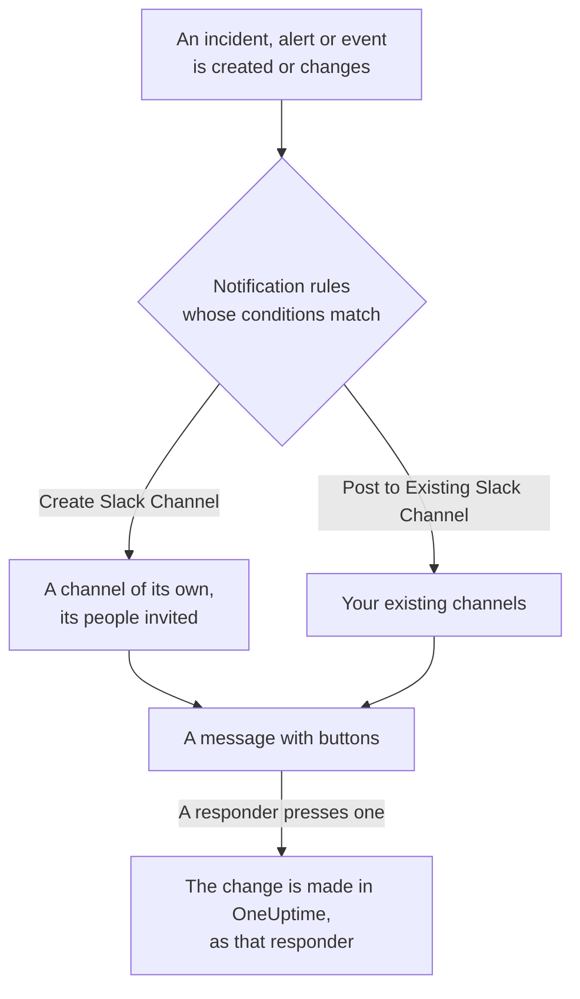

# Slack

Connect OneUptime to Slack to post incidents, alerts, episodes, scheduled maintenance, monitors and on-call updates to your channels, give each incident a channel of its own, and let responders act without leaving Slack: acknowledge, resolve, add notes, page on-call and declare incidents.

:::cards
- [Connect Slack](#connect-slack): Install OneUptime in your workspace, then link your own account.
- [Notification rules](#notification-rules): Decide which events post where, and which get a channel of their own.
- [Creating incidents and maintenance from Slack](#creating-incidents-and-maintenance-from-slack): `/incident` and `/maintenance`, as yourself.
- [Acting on incidents, alerts and events from Slack](#acting-on-incidents-alerts-and-events-from-slack): The buttons on OneUptime's messages.
:::

## How it works

Two connections make this work:

- **The project's connection**, made once: OneUptime's app installed in your Slack workspace. It posts the messages, creates the channels and invites people.
- **Each person's own connection**: their Slack account linked to their OneUptime account. Buttons, commands and emoji reactions act as that person, with their permissions in the project.

## Before you begin

- **A role that may connect the project:** **Project Owner**, **Project Admin** or **Project Member**. Uninstalling the app needs **Project Owner** or **Project Admin**.
- **A Slack workspace** where you may install apps.
- **The Growth plan on OneUptime Cloud** for notification rules and summaries. See [Notification rules below the Growth plan](#notification-rules-below-the-growth-plan).
- **On a self-hosted server,** a Slack app set up for it first. See [Slack Integration](/docs/self-hosted/slack-integration).

## Connect Slack

:::steps
### Install OneUptime in your Slack workspace

Go to **Project Settings** > **Workspace** > **Slack** and click **Connect with Slack**. Pick the workspace and allow OneUptime. Slack sends you back to the same page, which now names the workspace the project is connected to. Until a workspace is connected, the **Workspace** section of the Incidents, Alerts, Scheduled Maintenance, Monitors and On-Call menus holds **Connect Slack or Teams**, which leads here too.

### Connect your own Slack account

Installing the app links the account of whoever installed it. Everyone else links their own Slack account under **User Settings** > **Workspace** > **Slack** with **Connect my account with Slack**, to act on incidents and get direct messages as themselves. That section appears once the project is connected to Slack.

### Add a notification rule

Go to **Incidents** > **Workspace** > **Slack**. The **Workspace** section lists only the chat workspaces your project has connected, so **Slack** appears there once it is connected. Create a rule, for example one that creates a Slack channel for every new incident and invites the incident's owners. See [Notification rules](#notification-rules).

### Test the rule

Click **Test Rule** on the rule's row. A test message arrives in the channels the rule names. See [Testing a rule](#testing-a-rule).
:::

## Notification rules

A notification rule says which events post to Slack, and where. Each product has its own rules, under **Workspace** > **Slack** in its menu:

| Product | Tabs on its **Slack** page |
| --- | --- |
| **Incidents** | **Incidents**, **Incident Episodes**, **Summary** |
| **Alerts** | **Alerts**, **Alert Episodes**, **Summary** |
| **Scheduled Maintenance** | One list of rules |
| **Monitors** | One list of rules |
| **On-Call Duty** | One list of rules |

Creating a rule walks four steps:

| Step | What you set |
| --- | --- |
| **Basic** | **Rule Name** and **Rule Description**. |
| **Conditions** | Which events the rule fires for, by severity, state, label, monitor or words in the title, for example. With no conditions it fires for every event. With two or more, **Match Condition** says whether all of them must match, or any one. |
| **Destination** | Where it posts: **Post to Existing Slack Channel** with the channel names, **Create Slack Channel** with the new channel's name and who is invited, or both. |
| **Video Call** | Incidents and alerts only: start a call for each one. See [Video Calls](/docs/workspace-connections/video-calls). |

A channel the rule creates is named from **New Slack Channel Name** followed by the record's number, such as `oneuptime-incident-42`, and only a channel that was created gets the people the rule invites: the record's owners, chosen teams and users, and, for incidents and alerts, the people on call as they are paged. A private incident, alert or episode gets a private channel. Every later update of the record - a state change, a note, a new owner - is posted to its channels and to the existing channels its rules name. An incident, alert or episode created already resolved gets no channel of its own; its created message still goes to the channels your rules name. See [Declared already acknowledged or resolved](/docs/incidents/declaring-incidents#declared-already-acknowledged-or-resolved).

**Project Settings** > **Workspace** > **Slack** lists the channels OneUptime can see, with **Send Test** beside each one. OneUptime joins a public channel on its own the first time it posts there. A private channel is listed, and can be posted to, only after the OneUptime app is invited to it in Slack.

## Testing a rule

**Test Rule** on a rule's row posts a test message for that rule to the channels it names, so you can see it arrive. If the rule creates a channel for each event, the test creates one too and invites the rule's people to it.

Like **Send Test** beside a channel in **Project Settings** > **Workspace** > **Slack**, it needs permission to create notification rules: **Project Owner**, **Project Admin**, **Project Member**, **Settings Admin**, **Settings Member**, or **Create Workspace Notification Rule** and **Read Workspace Notification Rule** in a custom role. For someone who can only see the rules, such as a **Viewer**, **Test Rule** is locked, and its tooltip says what it takes; the API refuses their test with "You do not have permission to send test notifications in this project." On OneUptime Cloud, testing a rule needs the **Growth** plan, like adding one.

On OneUptime Cloud, **Send Test** beside a channel needs the **Growth** plan too, since posting into a channel is what rules and summaries do. **Send Test Now** on a summary needs permission to create summaries (**Create Workspace Notification Summary** and **Read Workspace Notification Summary** in a custom role) and, on OneUptime Cloud, the **Growth** plan; for anyone else it is locked, and its tooltip says what it takes. An MCP client connected with read-only access cannot send any test.

## Summaries

The **Summary** tab of **Incidents** > **Workspace** > **Slack** (and of **Alerts**) posts a recurring roundup to the channels you name: how many incidents or alerts there were, how fast they were acknowledged and resolved, and a list with links. A new summary goes out every week and covers the last 7 days. Leave **Send First Report At** empty, and the first one goes out at 09:00 at the start of the next week, day or month; the form says when.

A summary goes out on the clock of its **Timezone**, which starts on yours. It keeps its time of day there all year: one set for 09:00 in Berlin still goes out at 09:00 in Berlin after the clocks change for daylight saving time, and the dates in its message are Berlin's too. Through the API, send `timezone` as an IANA time zone name, such as `Europe/Berlin`. A summary created without one takes the time zone in its creator's profile, or UTC when an API key creates it.

The summary form has four steps: **Basic Info** (its name and the channels), **Schedule**, **Content** (**What to Include**) and **Filters** (which incidents or alerts it counts).

## Notification rules below the Growth plan

On OneUptime Cloud, notification rules and summaries are on the **Growth** plan and above. A project below it keeps the rules and summaries it already has, and they keep posting to Slack. So each product's **Slack** page (Incidents, Alerts, Scheduled Maintenance, On-Call Duty, Monitors) shows the plan note with them under it (**Notification rules still set up**, **Summaries still set up**): delete a rule, or turn a summary off or delete it. Adding or changing rules and summaries needs **Growth**.

## Getting paged in Slack

To be paged by direct message when you are on call, add Slack as one of your notification methods:

:::steps
1. Connect your own Slack account (see [Connect Slack](#connect-slack)).
2. Go to **User Settings** > **Notification Methods**, open the **Workspace Apps** tab and click **Add Slack Account**.
3. Click **Send Test Message** on its row. The message arrives in your Slack direct messages.
:::

Adding it adds it to your on-call rules straight away, so pages reach you in Slack from then on. Change which pages it gets under **User Settings** > **On-Call Rules**.

## Saving messages as notes

React to a message in the channel of an incident, alert, episode or scheduled maintenance event, and OneUptime saves it as a note on that record, then confirms with a reply in the thread:

| Reaction | Saved as |
| --- | --- |
| 📌 A pin emoji, or Slack's own **Pin to channel** | A private note, seen only by your team |
| 📢 A megaphone or loudspeaker emoji | A public note, shown on the status page. Incidents and scheduled maintenance events only. |

The note is saved as you, with your permissions, so your own Slack account must be connected. A message is saved only once, however many people react.

## Asking OneUptime AI from Slack

Ask about your logs, traces, metrics, incidents and monitors in plain language. @mention OneUptime in a channel, or send it a direct message, and it answers in the thread; reply there to ask more. `/oneuptime ask which monitors are down?` posts its answer in the channel. Either needs your own Slack account connected, and AI turned on for the project. Answers in Slack only read: to change something, use the buttons. See [Ask AI](/docs/ai/ask-ai).

## Creating incidents and maintenance from Slack

`/incident` and `/maintenance` open a form that you fill in and submit as yourself: as the OneUptime account your Slack account is connected to (see [Connect Slack](#connect-slack)), with that account's permissions in the project. If your Slack account is not connected, or your OneUptime account is no longer a member of the project, OneUptime tells you in a direct message what to do, and no form opens. The **Create New Incident** and **Create Scheduled Event** shortcuts open the same forms.

- **Who may use them.** The people who may declare an incident or create a scheduled maintenance event in OneUptime: **Project Owner**, **Project Admin**, **Project Member**, **Incident Admin** and **Incident Member** for an incident (**Create Incident** in a custom role), and **Scheduled Maintenance Admin** and **Scheduled Maintenance Member** for an event (**Create Scheduled Maintenance**). Anyone else is told so in a direct message, and no form opens.
- **What a form offers.** Each list - severities, monitors, monitor statuses, on-call policies and labels - holds what you may read, as the same list in OneUptime does: with a role limited to some labels, the monitors and on-call policies carrying those labels. A list you may not read at all is left off the form. Archived on-call policies are never offered.
- **What a form may name.** The incident or event is created with your own permissions and credited to you. A monitor, on-call policy, label, severity or status you may not read, or one of another project, is refused like one the project does not have, even from a form opened before your access changed, and nothing is created. OneUptime tells you why in a direct message.

**Execute On-Call Policy** on an incident, alert or episode works the same way: it needs permission to execute an on-call policy (**Project Owner**, **Project Admin**, **Project Member**, **On-Call Admin** and **On-Call Member**, or **Create On-Call Duty Policy Execution Log** in a custom role) and to read that incident, alert or episode, and offers the live on-call policies you may read.

## Acting on incidents, alerts and events from Slack

The buttons on OneUptime's Slack messages act as you too: as the OneUptime account your Slack account is connected to, with that account's permissions in the project. **Acknowledge**, **Resolve**, **Change State**, **Add Note** and **Execute On-Call Policy** on an incident, an alert or an episode, and **Mark as Ongoing**, **Mark as Complete**, **Change State** and **Add Note** on a scheduled maintenance event, each make the change the same action makes in OneUptime, and it is credited to you there: the record's state timeline and feed show that you changed its state, and the note is yours. A note saved from a message with an emoji reaction is posted the same way.

- **Who may use them.** The people who may make the same change in OneUptime. Acknowledging, resolving or changing the state of an incident needs permission to change its state: **Project Owner**, **Project Admin**, **Project Member**, **Incident Admin** and **Incident Member**, or **Create Incident State Timeline** in a custom role. An alert, an episode or a scheduled maintenance event needs the same permission for its own kind (**Create Alert State Timeline**, for example), and a note needs permission to post that kind of note. Anyone else is told so in a direct message, and nothing changes.
- **Which records.** Those you may read, as in OneUptime: with a role limited to some labels, the incidents, alerts, episodes and events carrying them. A button on any other record, or on one of another project, is answered that the record "was not found in this project, or you do not have access to it.", and nothing changes. On OneUptime Cloud, a change the project's plan doesn't include is refused with the plan it needs.
- **What Change State offers.** The states you may read that the record may move into next, in the project's order: none before the state it is in, for an episode as for an incident, an alert or a scheduled maintenance event, since a state change never moves a record back up its list (see [Order is a real constraint](/docs/incidents/states-and-severities#order-is-a-real-constraint-not-a-display-preference)). When you may read none, you are told "No incident states are available to you in this project. Ask a project admin for access to them."; when the record is in the last state it can reach, you are told "There is no later state to move this incident to." Neither opens an empty form.

## Disconnecting

- **Disconnect** unlinks only your own Slack account, and removes your Slack notification method with it.
- **Uninstall OneUptime from Slack**, on **Project Settings** > **Workspace** > **Slack**, disconnects the project. OneUptime stops posting to Slack, and the **Workspace** menus stop listing it. The notification rules and summaries are kept for when you connect again.

> [!WARNING]
> Uninstalling also unlinks every member's own Slack account in the project, and removes the Slack notification methods and the on-call rules that used them. People who were paged in Slack are paged on their other notification methods until they add Slack again.

## Troubleshooting

:::details A rule posts nothing
Check the rule's conditions with **Test Rule**: if the test arrives, the rule's conditions did not match the event. If it does not, the Slack page shows why. For a private channel, invite the OneUptime app to it in Slack first. Every message OneUptime posts, and every one Slack refused, is listed in **Project Settings** > **Notifications** > **Notification Logs**, on the **Workspace** tab.
:::

:::details Slack was not connected
When Slack sends you back without a connection, the page you started from says **Slack was not connected**, and one sentence says why: you lack the permission, the link was used or expired, you signed in to another workspace, or the server is not set up for Slack. See [Connecting did not finish](/docs/self-hosted/slack-integration#connecting-did-not-finish) for every sentence and what to do.
:::

:::details A button or command says my Slack account is not connected
Link it under **User Settings** > **Workspace** > **Slack** with **Connect my account with Slack**. If you are no longer a member of the project, OneUptime says so instead, and acts on nothing for you.
:::

:::details Notifications arrive, but buttons and commands do nothing
On a self-hosted server, Slack must be able to reach OneUptime for buttons, forms and commands; notifications need only outbound access. See [Network access for self-hosted deployments](/docs/self-hosted/slack-integration#network-access-for-self-hosted-deployments).
:::

## Next steps

:::cards
- [Microsoft Teams](/docs/workspace-connections/microsoft-teams): The same notifications and actions in Microsoft Teams.
- [Video Calls](/docs/workspace-connections/video-calls): Give every incident a call, posted with its updates.
- [Slack Integration](/docs/self-hosted/slack-integration): Set up the Slack app on a self-hosted server.
- [Declaring an Incident](/docs/incidents/declaring-incidents): Every way an incident starts, and what runs when it does.
:::
