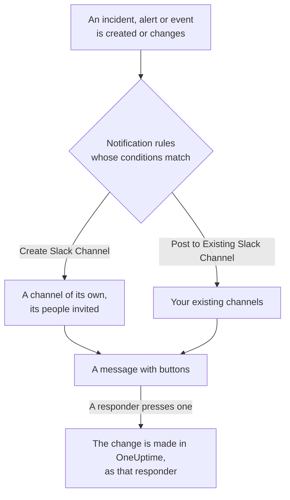

# Slack

Connect OneUptime to Slack to post incidents, alerts, episodes, scheduled maintenance, monitors and on-call updates to your channels, give each incident a channel of its own, and let responders act without leaving Slack: acknowledge, resolve, add notes, page on-call and declare incidents.

:::cards
- [Connect Slack](#connect-slack): Install OneUptime in your workspace, then link your own account.
- [Notification rules](#notification-rules): Decide which events post where, and which get a channel of their own.
- [The /oneuptime command](#the-oneuptime-command): Declare incidents, schedule maintenance, see who is on call and ask AI.
- [On-call user groups](#on-call-user-groups): Keep a user group equal to whoever is on call, and page it.
- [Acting on incidents, alerts and events from Slack](#acting-on-incidents-alerts-and-events-from-slack): The buttons on OneUptime's messages.
:::

## How it works

Two connections make this work:

- **The project's connection**, made once: OneUptime's app installed in your Slack workspace. It posts the messages, creates the channels and invites people.
- **Each person's own connection**: their Slack account linked to their OneUptime account. Buttons, commands and emoji reactions act as that person, with their permissions in the project.

## Before you begin

- **A role that may connect the project:** **Project Owner**, **Project Admin** or **Project Member**. Uninstalling the app needs **Project Owner** or **Project Admin**.
- **A Slack workspace** where you may install apps.
- **The Growth plan on OneUptime Cloud** for notification rules and summaries. See [Notification rules below the Growth plan](#notification-rules-below-the-growth-plan).
- **On a self-hosted server,** a Slack app set up for it first. See [Slack Integration](/docs/self-hosted/slack-integration).

## Connect Slack

:::steps
### Install OneUptime in your Slack workspace

Go to **Project Settings** > **Workspace** > **Slack** and click **Connect with Slack**. Pick the workspace and allow OneUptime. Slack sends you back to the same page, which now names the workspace the project is connected to. Until a workspace is connected, the **Workspace** section of the Incidents, Alerts, Scheduled Maintenance, Monitors and On-Call menus holds **Connect Slack or Teams**, which leads here too.

### Connect your own Slack account

Installing the app links the account of whoever installed it. Everyone else links their own Slack account under **User Settings** > **Workspace** > **Slack** with **Connect my account with Slack**, to act on incidents and get direct messages as themselves. That section appears once the project is connected to Slack.

### Add a notification rule

Go to **Incidents** > **Workspace** > **Slack**. The **Workspace** section lists only the chat workspaces your project has connected, so **Slack** appears there once it is connected. Create a rule, for example one that creates a Slack channel for every new incident and invites the incident's owners. See [Notification rules](#notification-rules).

### Test the rule

Click **Test Rule** on the rule's row. A test message arrives in the channels the rule names. See [Testing a rule](#testing-a-rule).
:::

## Notification rules

A notification rule says which events post to Slack, and where. Each product has its own rules, under **Workspace** > **Slack** in its menu:

| Product | Tabs on its **Slack** page |
| --- | --- |
| **Incidents** | **Incidents**, **Incident Episodes**, **Summary** |
| **Alerts** | **Alerts**, **Alert Episodes**, **Summary** |
| **Scheduled Maintenance** | One list of rules |
| **Monitors** | One list of rules |
| **On-Call Duty** | One list of rules |

Creating a rule walks four steps:

| Step | What you set |
| --- | --- |
| **Basic** | **Rule Name** and **Rule Description**. |
| **Conditions** | Which events the rule fires for, by severity, state, label, monitor or words in the title, for example. With no conditions it fires for every event. With two or more, **Match Condition** says whether all of them must match, or any one. |
| **Destination** | Where it posts: **Post to Existing Slack Channel** with the channel names, **Create Slack Channel** with the new channel's name and who is invited, or both. |
| **Video Call** | Incidents and alerts only: start a call for each one. See [Video Calls](/docs/workspace-connections/video-calls). |

A channel the rule creates is named from **New Slack Channel Name** followed by the record's number, such as `oneuptime-incident-42`, and only a channel that was created gets the people the rule invites: the record's owners, chosen teams and users, and, for incidents and alerts, the people on call as they are paged. A private incident, alert or episode gets a private channel. Every later update of the record — a state change, a note, a new owner — is posted to its channels and to the existing channels its rules name. An incident, alert or episode created already resolved gets no channel of its own; its created message still goes to the channels your rules name. See [Declared already acknowledged or resolved](/docs/incidents/declaring-incidents#declared-already-acknowledged-or-resolved).

An incident, alert, episode or scheduled maintenance event with a channel of its own has **Open in Slack** in the header of its page in OneUptime, beside its state buttons. It opens that channel in a new tab, in the Slack app or in the browser. A record with two channels of its own lists both under the button. A record with channels in both Slack and Microsoft Teams has one **Open channel** button instead, which lists them all. The existing channels your rules post to are not offered.

A channel stays readable: each event is posted once, and a record's first state is in the message that announces the record, not in a message of its own. An on-call policy run is one message that is edited as the run escalates: who was paged, how often and how, who was not and why, and who acknowledged. A new message is posted only when someone has to act: an escalation rule reached nobody, or the run ended without anyone acknowledging. Someone whose Slack account is not connected to OneUptime cannot be added to a channel; OneUptime says so once per channel, in one message that names them all and is edited when the list grows. Send them its **Connect Slack account** link to connect their account in one step. That a record's owners or status page subscribers were notified stays in its feed in OneUptime.

**Project Settings** > **Workspace** > **Slack** lists the channels OneUptime can see, with **Send Test** beside each one. OneUptime joins a public channel on its own the first time it posts there. A private channel is listed, and can be posted to, only after the OneUptime app is invited to it in Slack.

## Testing a rule

**Test Rule** on a rule's row posts a test message for that rule to the channels it names, so you can see it arrive. If the rule creates a channel for each event, the test creates one too and invites the rule's people to it.

Like **Send Test** beside a channel in **Project Settings** > **Workspace** > **Slack**, it needs permission to create notification rules: **Project Owner**, **Project Admin**, **Project Member**, **Settings Admin**, **Settings Member**, or **Create Workspace Notification Rule** and **Read Workspace Notification Rule** in a custom role. For someone who can only see the rules, such as a **Viewer**, **Test Rule** is locked, and its tooltip says what it takes; the API refuses their test with "You do not have permission to send test notifications in this project." On OneUptime Cloud, testing a rule needs the **Growth** plan, like adding one.

On OneUptime Cloud, **Send Test** beside a channel needs the **Growth** plan too, since posting into a channel is what rules and summaries do. **Send Test Now** on a summary needs permission to create summaries (**Create Workspace Notification Summary** and **Read Workspace Notification Summary** in a custom role) and, on OneUptime Cloud, the **Growth** plan; for anyone else it is locked, and its tooltip says what it takes. An MCP client connected with read-only access cannot send any test.

## Summaries

The **Summary** tab of **Incidents** > **Workspace** > **Slack** (and of **Alerts**) posts a recurring roundup to the channels you name: how many incidents or alerts there were, how fast they were acknowledged and resolved, and a list with links. A new summary goes out every week and covers the last 7 days. Leave **Send First Report At** empty, and the first one goes out at 09:00 at the start of the next week, day or month; the form says when.

A summary goes out on the clock of its **Timezone**, which starts on yours. It keeps its time of day there all year: one set for 09:00 in Berlin still goes out at 09:00 in Berlin after the clocks change for daylight saving time, and the dates in its message are Berlin's too. Through the API, send `timezone` as an IANA time zone name, such as `Europe/Berlin`. A summary created without one takes the time zone in its creator's profile, or UTC when an API key creates it.

The summary form has four steps: **Basic Info** (its name and the channels), **Schedule**, **Content** (**What to Include**) and **Filters** (which incidents or alerts it counts).

## Notification rules below the Growth plan

On OneUptime Cloud, notification rules and summaries are on the **Growth** plan and above. A project below it keeps the rules and summaries it already has, and they keep posting to Slack. So each product's **Slack** page (Incidents, Alerts, Scheduled Maintenance, On-Call Duty, Monitors) shows the plan note with them under it (**Notification rules still set up**, **Summaries still set up**): delete a rule, or turn a summary off or delete it. Adding or changing rules and summaries needs **Growth**.

## Getting paged in Slack

To be paged by direct message when you are on call, add Slack as one of your notification methods:

:::steps
1. Connect your own Slack account (see [Connect Slack](#connect-slack)).
2. Go to **User Settings** > **Notification Methods**, open the **Workspace Apps** tab and click **Add Slack Account**.
3. Click **Send Test Message** on its row. The message arrives in your Slack direct messages.
:::

Adding it adds it to your on-call rules straight away, so pages reach you in Slack from then on. Change which pages it gets under **User Settings** > **On-Call Rules**.

## Saving messages as notes

React to a message in the channel of an incident, alert, episode or scheduled maintenance event, and OneUptime saves it as a note on that record, then confirms with a reply in the thread:

| Reaction | Saved as |
| --- | --- |
| 📌 A pin emoji, or Slack's own **Pin to channel** | A private note, seen only by your team |
| 📢 A megaphone or loudspeaker emoji | A public note, shown on the status page. Incidents and scheduled maintenance events only. |

The note keeps the message as Slack showed it: its formatting, links and code, the people and channels it mentions by name, and its files and images as links to them. A public note leaves the files and images out, since they open only for your team.

It is the words of whoever wrote the message: their OneUptime name when their Slack account is connected, otherwise the name Slack shows. A private note is filed in the timeline when the message was posted, however long after it is saved. A public note is filed when it is saved, which is when the status page shows it. The timeline says who saved it. The note is not posted back into the channel, where the message already is.

The note is saved as you, with your permissions. If your Slack account is not connected yet, OneUptime asks you to connect it, in a message only you see, with a button that saves the message as soon as you have. A message is saved only once, however many people react.

## The /oneuptime command

OneUptime has one command in Slack, `/oneuptime`. The word you type after it says what to do; anything else after it is a question for OneUptime AI.

| Command | What it does |
| --- | --- |
| `/oneuptime help` | Lists the commands, with examples. |
| `/oneuptime incident [title]` | Opens the incident form, with the title filled in. |
| `/oneuptime maintenance [title]` | Opens the scheduled maintenance form, with the title filled in. |
| `/oneuptime oncall` | Lists who is on call right now in each on-call schedule you can see, until when, and who is next. |
| `/oneuptime page [who] [message]` | Pages the people you @mention about your message, or opens a form to pick who to page. See [Paging someone from Slack](#paging-someone-from-slack). |
| `/oneuptime ask [question]`, or any question | OneUptime AI answers about your logs, traces, metrics, incidents and monitors. |

The answers to `help` and `oncall` are messages only you see, under the command. A first word that looks like a command misspelt, such as `incidnet`, gets the command it looks like, not an answer from OneUptime AI. The incident and maintenance forms act as you: see [Creating incidents and maintenance from Slack](#creating-incidents-and-maintenance-from-slack).

> [!NOTE]
> `/oneuptime incident` and `/oneuptime maintenance` replace `/incident` and `/maintenance`, which could clash with other Slack apps' commands of the same name. A Slack app created from an earlier manifest keeps them, and they open the same forms, until the app is updated: see [Apps created from an older manifest](/docs/self-hosted/slack-integration#apps-created-from-an-older-manifest).

## OneUptime's Home in Slack

Open OneUptime under **Apps** in Slack's sidebar, and its **Home** tab shows what is happening in the project, as you may see it, read again each time you open it.

- **Your on-call.** The on-call schedules you are on call in now, and until when, or else your next shift.
- **What is open.** The newest open incidents and alerts you may read, each linked to its page in OneUptime.
- **Its buttons.** **Declare incident**, **Schedule maintenance** and **Page someone** open the same forms as `/oneuptime incident`, `/oneuptime maintenance` and `/oneuptime page`, and **Who's on call** answers as `/oneuptime oncall` does.

The Home reads as you, so it needs your own Slack account connected. Until it is, the Home holds a **Connect Slack account** button, and shows you your Home once you have connected it.

When somebody adds OneUptime to a channel, it posts a hello there: how to ask it a question, and where to add a notification rule that posts to the channel. The first time you open its **Messages** tab, it welcomes you there: what it does in Slack, and how to start.

## Asking OneUptime AI from Slack

Ask about your logs, traces, metrics, incidents and monitors in plain language. @mention OneUptime in a channel, or send it a direct message, and it answers in the thread. `/oneuptime ask which monitors are down?` posts its answer in the channel. Either needs your own Slack account connected, and AI turned on for the project. Answers in Slack only read: to change something, use the buttons. See [Ask AI](/docs/ai/ask-ai).

OneUptime answers only what is addressed to it.

- **In your own conversation, just reply.** A question you ask in a channel, not in a thread, starts a conversation in the thread under it: reply there to ask more without mentioning OneUptime again, and anyone else joins in by mentioning it.
- **In any other thread, mention OneUptime.** Under an incident's message, for example, mention it each time: what people write to each other there gets no answer.
- **If your Slack account is not connected.** OneUptime asks you once in each conversation to connect it, in a message only you see, with a **Connect Slack account** button.

## Creating incidents and maintenance from Slack

`/oneuptime incident` and `/oneuptime maintenance` open a form that you fill in and submit as yourself: as the OneUptime account your Slack account is connected to (see [Connect Slack](#connect-slack)), with that account's permissions in the project. If your Slack account is not connected, or your OneUptime account is no longer a member of the project, OneUptime tells you what to do where you ran the command, in a message only you see, and no form opens. The **Create New Incident** and **Create Scheduled Event** shortcuts open the same forms.

- **Who may use them.** The people who may declare an incident or create a scheduled maintenance event in OneUptime: **Project Owner**, **Project Admin**, **Project Member**, **Incident Admin** and **Incident Member** for an incident (**Create Incident** in a custom role), and **Scheduled Maintenance Admin** and **Scheduled Maintenance Member** for an event (**Create Scheduled Maintenance**). Anyone else is told so where they ran it, and no form opens.
- **What a form offers.** Each list — severities, monitors, monitor statuses, on-call policies and labels — holds what you may read, as the same list in OneUptime does: with a role limited to some labels, the monitors and on-call policies carrying those labels. A list you may not read at all is left off the form. Archived on-call policies are never offered.
- **What a form may name.** The incident or event is created with your own permissions and credited to you. A monitor, on-call policy, label, severity or status you may not read, or one of another project, is refused like one the project does not have, even from a form opened before your access changed, and nothing is created. OneUptime tells you why in the channel, in a message only you see.

**Execute On-Call Policy** on an incident, alert or episode works the same way: it needs permission to execute an on-call policy (**Project Owner**, **Project Admin**, **Project Member**, **On-Call Admin** and **On-Call Member**, or **Create On-Call Duty Policy Execution Log** in a custom role) and to read that incident, alert or episode, and offers the live on-call policies you may read.

## Paging someone from Slack

`/oneuptime page @nawaz The checkout API is throwing 500s` pages Nawaz straight away. OneUptime creates an alert whose title is your message, and each person you @mention gets a phone call, an SMS, a push notification or an email, as their own on-call rules say, until somebody acknowledges the alert.

- **Who is paged at once.** The people you @mention, and whoever is on call in the schedules a user group you @mention follows (see [On-call user groups](#on-call-user-groups)), when a message follows them. OneUptime knows a person by the OneUptime account their Slack account is connected to, or else by the email address Slack has for them. Nobody outside the project is paged.
- **Anything else opens a form.** With nobody @mentioned, no message, `@here`, a user group that follows no on-call schedule you can see, or a person OneUptime cannot tell, the **Page someone** form opens with what you typed filled in, and says whom it could not pick. Pick people, a team, an on-call schedule, which pages whoever is on call in it now, or an on-call policy, which pages through its escalation rules, and submit it. A name you type first, as in `/oneuptime page Primary The disk is full`, picks the schedule, team or policy of that name.
- **Where it shows.** The channel shows the page as one message, kept up to date: who was paged and how, and who acknowledged. Where OneUptime cannot post, such as a private channel it was not invited to, a message only you see says who was paged, with a link to the alert.
- **Who may page.** Anyone who may both execute an on-call policy and create an alert: **Project Owner**, **Project Admin** and **Project Member**, or **On-Call Member** with **Alert Member** (**Create On-Call Duty Policy Execution Log** and **Create Alert** in a custom role). Paging people, a team or a schedule directly, with no on-call policy behind the page, also takes access to every on-call policy of the project. Anyone else is told so where they ran the command, and nobody is paged.

## On-call user groups

Keep a Slack user group, such as `@payments-oncall`, equal to whoever is on call in one or more on-call schedules, so anyone can @mention it to reach them. OneUptime changes the group's people at every hand-off and override, and checks it every 15 minutes.

:::steps
### Connect a user group to a schedule

Open the schedule under **On-Call Duty** > **On-Call Schedules**. In its **Slack user groups** card, click **Connect user group**, then pick one of your workspace's user groups, or **Create a new user group** with a name and a handle. The people in it are replaced with whoever is on call straight away.

### Connect it to the secondary schedule too

For a group that holds the primary and the secondary on call, connect the same group on the secondary schedule's page. A group can follow any number of schedules.
:::

- **What the card shows.** Who is in each group now, the other schedules it follows, and whether it is **Up to date**. Somebody on call who cannot be put in the group is named, with why: OneUptime finds a person by their connected Slack account, or else by the email address Slack has for them, and Slack keeps guests out of user groups.
- **Nobody on call.** Slack cannot keep a user group with nobody in it, so OneUptime turns the group off until somebody is on call, then turns it back on.
- **Paging it.** `/oneuptime page @payments-oncall The checkout API is down` pages whoever is on call in the schedules the group follows. See [Paging someone from Slack](#paging-someone-from-slack).
- **What Slack needs.** User groups are on Slack's paid plans, and a workspace can let only its owners and admins change them: the card says which, and what to do. If Slack was connected before OneUptime could keep user groups, connect it again once under **Project Settings** > **Workspace** > **Slack**.
- **Who may connect one.** The roles that may edit schedules: **Project Owner**, **Project Admin**, **Project Member**, **On-Call Admin** and **On-Call Member**, or **Edit On-Call Duty Policy Schedule** in a custom role. On OneUptime Cloud, connecting one needs the **Growth** plan.
- **Disconnecting.** OneUptime stops changing the group. The group, and the people in it, stay in Slack as they are.

## Acting on incidents, alerts and events from Slack

The buttons on OneUptime's Slack messages act as you too: as the OneUptime account your Slack account is connected to, with that account's permissions in the project. **Acknowledge**, **Resolve**, **Change State**, **Add Note** and **Execute On-Call Policy** on an incident, an alert or an episode, and **Mark as Ongoing**, **Mark as Complete**, **Change State** and **Add Note** on a scheduled maintenance event, each make the change the same action makes in OneUptime, and it is credited to you there: the record's state timeline and feed show that you changed its state, and the note is yours. A note saved from a message with an emoji reaction is posted the same way.

- **Who may use them.** The people who may make the same change in OneUptime. Acknowledging, resolving or changing the state of an incident needs permission to change its state: **Project Owner**, **Project Admin**, **Project Member**, **Incident Admin** and **Incident Member**, or **Create Incident State Timeline** in a custom role. An alert, an episode or a scheduled maintenance event needs the same permission for its own kind (**Create Alert State Timeline**, for example), and a note needs permission to post that kind of note. Anyone else is told so, and nothing changes.
- **Which records.** Those you may read, as in OneUptime: with a role limited to some labels, the incidents, alerts, episodes and events carrying them. A button on any other record, or on one of another project, is answered that the record "was not found in this project, or you do not have access to it.", and nothing changes. On OneUptime Cloud, a change the project's plan doesn't include is refused with the plan it needs.
- **What Change State offers.** The states you may read that the record may move into next, in the project's order: none before the state it is in, for an episode as for an incident, an alert or a scheduled maintenance event, since a state change never moves a record back up its list (see [Order is a real constraint](/docs/incidents/states-and-severities#order-is-a-real-constraint-not-a-display-preference)). When you may read none, you are told "No incident states are available to you in this project. Ask a project admin for access to them."; when the record is in the last state it can reach, you are told "There is no later state to move this incident to." Neither opens an empty form.
- **Where you are answered.** Under the message the button is on, in a message only you see; in a direct message only if Slack refuses that. A button pressed too late says who got there first, and when, such as "Incident INC-2 was already acknowledged by Simon Lee at 6:07 PM."
- **If your Slack account is not connected.** The answer asks you to connect it, with a **Connect Slack account** button. The button opens your own Slack settings in OneUptime and connects your account in one step, after you sign in to OneUptime if you need to. OneUptime then finishes what you pressed, as you, and answers under the same message; for a button that opens a form, or a command, it asks you to press or run it again. The button works once, for 30 minutes, and only for the Slack account that pressed it: signed in to Slack as someone else, it connects nothing.

## Disconnecting

- **Disconnect** unlinks only your own Slack account, and removes your Slack notification method with it.
- **Uninstall OneUptime from Slack**, on **Project Settings** > **Workspace** > **Slack**, disconnects the project. OneUptime stops posting to Slack, and the **Workspace** menus stop listing it. The notification rules and summaries are kept for when you connect again.

> [!WARNING]
> Uninstalling also unlinks every member's own Slack account in the project, and removes the Slack notification methods and the on-call rules that used them. People who were paged in Slack are paged on their other notification methods until they add Slack again.

## Your Slack data

OneUptime reads from Slack only what these features need, with the permissions you grant when you install it:

- **Messages addressed to OneUptime.** A message that @mentions it, one you send it in a direct message, and your replies in a conversation with it, with the earlier messages of that thread or direct message, so OneUptime AI can answer. Slack also sends it the other messages of the channels and group DMs it is in; OneUptime neither answers nor keeps them.
- **Messages you save as notes.** A message you react to with 📌 or 📢, or pin, in the channel of an incident, alert, episode or scheduled maintenance event, saved as a note on that record with its author's name.
- **Names of channels and people.** The channels it can post to, so you can pick them, and people's names, to show who wrote or did something.
- **Email addresses.** The email address Slack has for a person, to match their Slack account to their OneUptime account when they have not connected it: to page them, or to put them in an on-call user group.
- **User groups.** Your workspace's user groups, to pick one for an on-call schedule, and the people in one you connect, to keep it equal to whoever is on call.

What OneUptime keeps of it — the workspace's name, its channels, the Slack accounts people connect, the notes and the user groups — is stored with your project. The [Privacy Policy](https://oneuptime.com/legal/privacy) says how OneUptime handles your data.

## Troubleshooting

:::details A rule posts nothing
Check the rule's conditions with **Test Rule**: if the test arrives, the rule's conditions did not match the event. If it does not, the Slack page shows why. For a private channel, invite the OneUptime app to it in Slack first. Every message OneUptime posts, and every one Slack refused, is listed in **Project Settings** > **Notifications** > **Notification Logs**, on the **Workspace** tab.
:::

:::details Slack was not connected
When Slack sends you back without a connection, the page you started from says **Slack was not connected**, and one sentence says why: you lack the permission, the link was used or expired, you signed in to another workspace, or the server is not set up for Slack. See [Connecting did not finish](/docs/self-hosted/slack-integration#connecting-did-not-finish) for every sentence and what to do.
:::

:::details A button or command says my Slack account is not connected
Press **Connect Slack account** in that answer to connect it in one step, or link it under **User Settings** > **Workspace** > **Slack** with **Connect my account with Slack**. If you are no longer a member of the project, OneUptime says so instead, and acts on nothing for you.
:::

:::details OneUptime does not answer a reply in a thread
A reply with no mention is answered only in your own conversation with OneUptime AI: the thread under a question you asked it in a channel. In any other thread, such as the one under an incident's message, @mention OneUptime. If your Slack account is not connected, OneUptime asks you to connect it once in a conversation, not on every message: press **Connect Slack account** in that message, or link it under **User Settings** > **Workspace** > **Slack**. See [Asking OneUptime AI from Slack](#asking-oneuptime-ai-from-slack).
:::

:::details Notifications arrive, but buttons and commands do nothing
On a self-hosted server, Slack must be able to reach OneUptime for buttons, forms and commands; notifications need only outbound access. See [Network access for self-hosted deployments](/docs/self-hosted/slack-integration#network-access-for-self-hosted-deployments).
:::

## Next steps

:::cards
- [Microsoft Teams](/docs/workspace-connections/microsoft-teams): The same notifications and actions in Microsoft Teams.
- [Video Calls](/docs/workspace-connections/video-calls): Give every incident a call, posted with its updates.
- [Slack Integration](/docs/self-hosted/slack-integration): Set up the Slack app on a self-hosted server.
- [Declaring an Incident](/docs/incidents/declaring-incidents): Every way an incident starts, and what runs when it does.
:::
