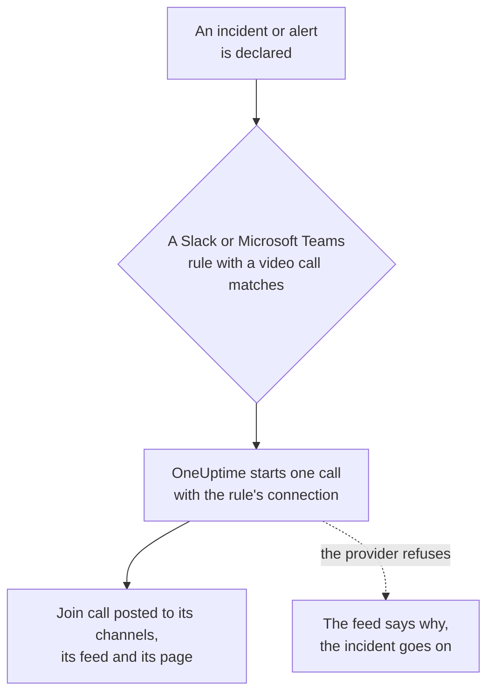

# Video Calls

Give every incident and alert its own call. When a Slack or Microsoft Teams notification rule fires for a new incident or alert, OneUptime starts a dedicated meeting (a Zoom meeting, a Google Meet, a Microsoft Teams meeting or the Slack huddle of the incident's channel) and posts a **Join call** button wherever the incident's updates go. Responders join in one click, and nobody has to create a meeting at 3am and paste the link around.

:::cards
- [How it works](#how-it-works): A rule starts the call, and responders join from wherever they are.
- [Connect in one click](#connect-in-one-click): Zoom, Google Meet or Microsoft Teams, by signing in.
- [Providers](#providers): Your own app's service identity, a standing meeting link, or a Slack huddle.
- [Starting a call by hand](#starting-a-call-by-hand): From an incident's or alert's page.
- [Call transcripts](#call-transcripts): What was said on an incident's call, and the root cause OneUptime AI reads in it.
:::

## How it works



:::steps
### Connect a provider

Go to **Project Settings** > **Workspace** > **Video Calls** and connect Zoom, Google Meet or Microsoft Teams, or add a standing meeting link. On OneUptime Cloud, connecting Zoom, Google Meet or Microsoft Teams is one click: sign in and allow OneUptime to create meetings (see [Connect in one click](#connect-in-one-click)). Slack huddles need nothing beyond the project's Slack connection.

### Turn it on in a rule

Open a Slack or Microsoft Teams notification rule for incidents or alerts (**Incidents** > **Workspace** > **Slack**, for example). On the rule's **Video Call** step, turn on **Start a video call for the incident** and pick where the call is held.

### Join in one click

When the rule fires, OneUptime starts one call for the incident and posts it with a **Join call** button to the channels the incident's updates go to and to the incident's feed. The incident's page shows the call in its **Video Call** card and a **Join call** button in its header.
:::

The rule's conditions decide which incidents get a call. For a bridge on Sev1 incidents only, give the rule a **Severity** condition. Calls start for incidents and alerts that are declared ongoing. An incident created already resolved gets no call.

### One call per incident

A call is started once per incident for each place a call is held. Rules that pick the same connection share one call, and a rule never starts a second call for an incident that already has one from that connection. Rules that pick different places each start their own call, for example a Zoom meeting for the responders and the huddle of the incident's Slack channel.

### When a call cannot start

Declaring an incident never waits for a video call provider. The call is started after the incident is created, so a slow or failing provider never delays the incident or its on-call notifications.

If the provider refuses (an expired secret, a missing permission, a deleted host), the incident's feed says the rule's call could not be started, with the provider's reason, so responders know to start one from the incident's page. The rule's run is listed in the workspace notification logs as **Start Video Call**, and the connection's row in **Project Settings** > **Workspace** > **Video Calls** shows the error until a call starts again.

### Private incidents

A meeting is named after the incident it is for, with its number and title, and its description links back to the incident. For a private incident the title is left out, because everyone invited to the meeting can read its name.

## Connect in one click

On OneUptime Cloud, connecting Zoom, Google Meet or Microsoft Teams takes one click and nothing to set up at the provider:

:::steps
1. Go to **Project Settings** > **Workspace** > **Video Calls** and click **Connect** on Zoom, Google Meet or Microsoft Teams.
2. Click **Continue to Zoom** (or Google, or Microsoft), sign in, and allow OneUptime to create meetings.
3. You come back to the Video Calls page with the connection made. **Start a test meeting** checks it end to end, then pick the connection in a Slack or Microsoft Teams notification rule.
:::

Every meeting is created as the account you sign in with, which hosts it. Sign in with a shared account, such as incidents@example.com, rather than your own, so calls keep starting when people leave. The connection's row shows who it is signed in as.

| Provider | Sign in with | What OneUptime may do |
| --- | --- | --- |
| Zoom | A Zoom user. Meetings hosted by a Basic (free) user end after 40 minutes. | Create meetings for that user (`meeting:write:meeting`) and read who it is (`user:read:user`). For [call transcripts](#call-transcripts), read its meetings' cloud recording transcripts (`cloud_recording:read:list_recording_files`, `cloud_recording:read:meeting_transcript`). |
| Google Meet | A Google account that can use Google Meet. | Create Meet spaces as that account (`meetings.space.created`) and read its email address. |
| Microsoft Teams | A work or school account with Microsoft Teams. Personal Microsoft accounts cannot create Teams meetings. | Create online meetings as that account (the delegated `OnlineMeetings.ReadWrite` permission) and stay signed in (`offline_access`). To [record and transcribe incident calls](#record-and-transcribe-every-call), put the meetings on its calendar (`Calendars.ReadWrite`) and read their transcripts (`OnlineMeetingTranscript.Read.All`, which an administrator approves). |

A connection made by signing in still has the settings that decide who waits: **Who can join** for Google Meet and **Who skips the lobby** for Microsoft Teams. Change them with **Edit** on the connection's row.

A Zoom connection signed in before OneUptime read call transcripts starts calls as before, but cannot read their transcripts until it is signed in again: **Reconnect** on its row asks Zoom for the transcript permissions.

A Microsoft Teams connection signed in while **Record and transcribe incident calls** was off starts calls as before, unrecorded. Once the switch is on, **Reconnect** on its row asks Microsoft for the calendar and transcript permissions too.

### Staying signed in

OneUptime keeps the sign-in's refresh token, encrypted, and refreshes it at least once a week, so it never expires for going unused, however long the project goes without an incident. If the sign-in stops working (the account removed OneUptime, was deleted or suspended, or your organization's policy asks it to sign in again), the connection's row shows **Not working** with the reason the day OneUptime notices, not at the next incident. **Reconnect** on the row signs it in again.

Connections signed in as the same account share one sign-in, in every project: Zoom keeps only one sign-in per account, so connecting the same Zoom user again replaces it for all of them.

### Reconnecting and removing

**Reconnect** on a connection's row signs it in again, as the same account or another one. Use it after the account removed OneUptime, or to move incident meetings to a different account.

Deleting a connection withdraws OneUptime's access at Zoom and Google once no other connection uses the sign-in. For Microsoft, remove OneUptime under **My Apps** (myapps.microsoft.com) of the account. Removing OneUptime from your Zoom account in the Zoom App Marketplace deletes its sign-in from every connection signed in as that account, and they show **Not working** until reconnected.

### If Microsoft asks for an administrator

Some Microsoft 365 organizations only let administrators approve apps. If Microsoft says you need admin approval, ask a Microsoft 365 administrator to connect Microsoft Teams, or to approve OneUptime in the [Microsoft Entra admin center](https://entra.microsoft.com/) under **Enterprise applications** > **Admin consent requests**. A project that records its Teams calls needs this approval in every organization, once: only an administrator can let an app read meeting transcripts.

### Use your own app instead

To connect with a service identity rather than a person's sign-in — a Zoom Server-to-Server OAuth app, a Google service account with domain-wide delegation, or a Microsoft Entra app registration — click **Use your own Zoom app** (or Google, or Microsoft) in the Connect dialog. [Providers](#providers) explains each. On a self-hosted server without one-click apps set up, **Connect** opens this form directly; see [One-click connect on a self-hosted server](#one-click-connect-on-a-self-hosted-server) to set them up.

## Starting a call by hand

The **Video Call** card on an incident's or alert's page has **Start call** (or **Start another** once there is one). Pick one of the project's connections, the huddle of the incident's Slack channel, or paste a meeting link of your own. The call is posted to the incident's channels and feed like one a rule starts.

**Remove** on the card takes a call off the incident's page. The meeting itself is not deleted, and anyone with the link can still join it.

Starting and removing calls needs permission to work on incidents (or alerts): **Project Owner**, **Project Admin**, **Project Member**, **Incident Admin** or **Incident Member**, or **Create Incident Video Call** and **Delete Incident Video Call** in a custom role. Everyone who can read the incident sees its calls.

## Call transcripts

What responders say on a call, what they checked, what they suspect and what they decided, is the best record of how an incident was worked, and it is gone when the call ends. An incident's call keeps its transcript, and OneUptime AI reads it for the root cause the call points at. Nothing it reads reaches the incident until a responder uses it.

:::steps
### Get the transcript after the call

On the incident's **Video Call** card, **Get from Zoom**, **Get from Google Meet** or **Get from Microsoft Teams** reads the transcript of a meeting OneUptime started there (for Microsoft Teams, one it started while every call is recorded and transcribed). For any other call, **Add transcript** takes the file the meeting tool saved (`.vtt`, `.srt` or `.txt`, up to 5 MB) or the transcript pasted. With [every call recorded and transcribed](#record-and-transcribe-every-call), OneUptime gets it by itself once the call is over.

### OneUptime AI reads it

Within a minute or two, the incident's **OneUptime AI** card shows the **Suggested root cause**, marked **Not confirmed**, with the transcript lines it rests on, quoted with their time and speaker. Under it, folded, is the rest of what the call said: the findings, split into **Confirmed on the call** and **Hypotheses**, then what was tried, decisions, follow-ups and open questions. What it read is posted to the incident's feed too, and from there to the incident's Slack and Microsoft Teams channels.

### Use it, or dismiss it

**Use as root cause** opens the suggestion, quotes and all, in the root cause's editor. Change what you need, then save: it becomes the incident's root cause as your own edit, recorded in its feed. **Dismiss** sets the suggestion aside, and **Undo** brings it back.
:::

OneUptime AI suggests a cause only when the call names one, with the lines that say so, and it quotes those lines as the transcript has them. When the call did not settle the cause, the card says **Not enough was said on the call to suggest a root cause** instead of guessing.

### Record and transcribe every call

So that nobody has to remember to record a call or to get its transcript, turn on **Record and transcribe incident calls** in **Project Settings** > **Workspace** > **Video Calls**. While it is on:

- OneUptime asks Zoom to record each incident meeting it starts to the cloud, Google Meet to transcribe it, and Microsoft Teams to record and transcribe it automatically. The message that posts the call says so before anyone joins.
- Once the call is over, OneUptime gets the transcript by itself, as **Get from Zoom** would, and OneUptime AI reads it. Until then the **Video Call** card says that it is waiting.
- What OneUptime AI read goes to the incident's feed and its Slack and Microsoft Teams channels: the suggested root cause, marked as not confirmed, then what was confirmed, tried and decided, the follow-ups and the open questions.
- When the incident resolves before the transcript is in, the automatic postmortem draft waits for it, so that it reads what was said on the call: up to six hours while the provider prepares the transcript, and one hour when there is no sign of one yet.

It is off by default, because it records people: everyone on those calls sees that they are recorded or transcribed, so check that your organization allows it. Zoom keeps a transcript only when the account records to the cloud with its audio transcript on, and Google Meet only on a Google Workspace edition that has transcripts. Slack huddles and meeting links are not recorded, and neither are alert calls: add their transcripts by hand.

Microsoft lets apps read the transcripts only of Teams meetings on a calendar, so OneUptime puts each incident meeting on its organizer's calendar and turns on automatic recording and transcription in the meeting's options. For that, the connection needs two more Microsoft Graph permissions, `Calendars.ReadWrite` and `OnlineMeetingTranscript.Read.All`: add them to your app registration (see [Microsoft Teams](#microsoft-teams)), or **Reconnect** a connection made by signing in. The organizer's Teams meeting policy must allow cloud recording, transcription and automatic recording, and your organization must not have turned off apps' access to transcripts. A call OneUptime cannot put on the calendar starts all the same, unrecorded, and its **Video Call** card says why.

### What each provider keeps

| Call | How it gets its transcript | What it needs |
| --- | --- | --- |
| Zoom | **Get from Zoom** | The meeting recorded to the cloud with its audio transcript on, or AI Companion's meeting summary on. The connection needs the transcript scopes (see [Zoom](#zoom)), and one signed in before them needs **Reconnect**. Zoom prepares a transcript after the meeting, usually within twice its length. |
| Google Meet | **Get from Google Meet** | Transcripts turned on in the call, on a Google Workspace edition that has them. Nothing else to set up: OneUptime reads the transcripts of the meetings it created. Google keeps a transcript for apps to read for 30 days. |
| Microsoft Teams | **Get from Microsoft Teams** | A meeting OneUptime started while [every call is recorded and transcribed](#record-and-transcribe-every-call): Microsoft lets apps read the transcripts only of meetings on a calendar, and keeps a meeting for 60 days. For any other Teams meeting, **Add transcript**: in Teams, open the meeting's recap, then its transcript, and download it as a `.vtt` file. |
| Meeting link or Slack huddle | **Add transcript** | The transcript the meeting tool, or the huddle's notes, keep. |

### Who can do what

Getting, adding, replacing and removing a transcript, having it read again and dismissing a suggestion need permission to start the incident's calls: **Project Owner**, **Project Admin**, **Project Member**, **Incident Admin** or **Incident Member**, or **Create Incident Video Call** in a custom role. **Use as root cause** needs permission to edit the incident's root cause. Everyone who can read the incident sees its calls' transcripts and what OneUptime AI read in them.

### What OneUptime AI reads

Reading a transcript is AI work like an investigation: it runs only while AI is on for the project, and counts toward the project's AI usage and daily limits (see [Cost controls](/docs/ai/ai-sre#cost-controls)). A long transcript is read in parts. When AI is off, the transcript is kept and the card says it was not read. Removing a transcript removes what OneUptime AI read in it, and keeps the incident's root cause. An AI postmortem draft reads what the incident's calls said too (see [Postmortems](/docs/incidents/postmortems)).

## Providers

This section is about connecting a provider with your own app's service identity: a Zoom Server-to-Server OAuth app, a Google service account, a Microsoft Entra app registration. A service identity never depends on a person, so it keeps working whoever leaves. To connect by signing in instead, see [Connect in one click](#connect-in-one-click).

Credentials are encrypted at rest and are never returned by the API. When you edit a connection, a credential left blank keeps the stored one.

**Start test meeting** in the connection form, and **Test** on a connection's row, create a real meeting with the connection's settings and show its link. It is the one check that proves the credentials, the permission on the provider's side and the host all work together. Nothing is posted anywhere.

Connecting a provider needs **Project Owner**, **Project Admin** or **Settings Admin**, or **Create Video Call Connection** and **Edit Video Call Connection** in a custom role.

### Zoom

OneUptime creates a Zoom meeting for each incident through a Zoom **Server-to-Server OAuth** app, hosted by a licensed Zoom user of your choice.

:::steps
1. In the [Zoom App Marketplace](https://marketplace.zoom.us/), choose **Develop** > **Build App** and create a **Server-to-Server OAuth** app. Creating one needs a Zoom account admin, or a role that allows Server-to-Server OAuth apps.
2. On the app's **Scopes** page, add **meeting:write:meeting:admin** (create a meeting for a user). An app created before granular scopes can use **meeting:write:admin** instead. To let OneUptime read [call transcripts](#call-transcripts) too, add **cloud_recording:read:list_recording_files:admin** and **cloud_recording:read:meeting_transcript:admin** (or **recording:read:admin** on an app created before granular scopes).
3. **Activate** the app, then copy the **Account ID**, **Client ID** and **Client secret** from its **App Credentials** page into the connection form.
4. Enter the **Meeting host**: the email of a licensed Zoom user, ideally a service account such as incidents@example.com, so meetings keep working when people leave. Meetings hosted by a Basic (free) user end after 40 minutes.
5. Responders join without waiting for the host, because the host is a service account that never joins. Make sure your Zoom account's **Waiting room** setting is not locked on, or nobody can get in.
:::

| Field | Where to find it |
| --- | --- |
| Account ID | The app's **App Credentials** page |
| Client ID | The app's **App Credentials** page |
| Client secret | The app's **App Credentials** page |
| Meeting host | The email of the licensed Zoom user that hosts every meeting |

### Google Meet

OneUptime creates a Google Meet for each incident with the Google Meet REST API, through a Google Cloud service account that acts as a Google Workspace user with domain-wide delegation.

:::steps
1. In the [Google Cloud console](https://console.cloud.google.com/), pick or create a project and enable the **Google Meet REST API** for it.
2. Under **IAM & Admin** > **Service accounts**, create a service account. Open it, go to **Keys** > **Add key** > **Create new key**, choose **JSON**, and paste the downloaded file into the connection form as the **Service account JSON key**.
3. In the [Google Admin console](https://admin.google.com/), open **Security** > **Access and data control** > **API controls** > **Manage Domain Wide Delegation** and click **Add new**. Enter the service account's numeric **Client ID** and the scope `https://www.googleapis.com/auth/meetings.space.created`.
4. Enter the Google Workspace user the service account acts as in **Create meetings as**: a dedicated account such as incidents@example.com. Every meeting is owned by this user.
:::

**Who can join** decides who joins without asking: with **People in your organization join directly, others ask to join** (the default), people outside your Google Workspace ask to join and someone in the call admits them. With **Anyone with the link joins directly**, nobody waits.

Domain-wide delegation can take a few minutes to start working. If the test reports that Google did not let the service account act as the user right after you added the delegation, wait a few minutes and test again.

### Microsoft Teams

OneUptime creates a Microsoft Teams meeting for each incident with Microsoft Graph, through a Microsoft Entra app registration that organizes meetings on behalf of a licensed Teams user.

:::steps
1. In the [Microsoft Entra admin center](https://entra.microsoft.com/), open **App registrations** > **New registration** and register a single-tenant app. Copy its **Directory (tenant) ID** and **Application (client) ID**.
2. Under **API permissions**, add the Microsoft Graph **application** permission **OnlineMeetings.ReadWrite.All** (and, to [record and transcribe incident calls](#record-and-transcribe-every-call) too, **Calendars.ReadWrite** and **OnlineMeetingTranscript.Read.All**), then click **Grant admin consent**.
3. Under **Certificates & secrets**, create a client secret and paste its **Value**, not its Secret ID, into the connection form as the **Client secret**.
4. Pick the organizer: a licensed Teams user, ideally a service account. Copy its **Object ID** from **Users** in the Entra admin center into **Organizer object ID**.
5. Allow the app to create meetings for the organizer with an application access policy. In Teams PowerShell, after `Connect-MicrosoftTeams`, run the two commands below.
:::

```powershell
New-CsApplicationAccessPolicy -Identity OneUptime-Meetings -AppIds "<application-client-id>"
Grant-CsApplicationAccessPolicy -PolicyName OneUptime-Meetings -Identity "<organizer-object-id>"
```

The policy can take up to 30 minutes to apply. Until it does, the test reports that the app is not allowed to create meetings for the organizer.

The same policy lets the app read the transcripts of the organizer's meetings. `Calendars.ReadWrite` lets an app change every calendar in your organization: to keep it to the organizer's, grant it with [RBAC for Applications in Exchange Online](https://learn.microsoft.com/exchange/permissions-exo/application-rbac), scoped to the organizer, instead of under **API permissions**.

**Who skips the lobby** decides who joins without waiting: with **People in your organization skip the lobby** (the default), anyone else waits in the lobby until someone in the meeting admits them. With **Everyone skips the lobby**, nobody waits.

### Meeting link

A standing meeting link is the same room for every incident: a Zoom Personal Meeting Room, a recurring Microsoft Teams or Google Meet meeting, a Webex personal room or a Jitsi room. Nothing is created per incident, so there is nothing to authorize.

:::steps
1. Create a meeting that never expires in the tool your team already uses.
2. Paste its https join link into the connection form as the **Meeting link**.
:::

Every incident and alert started with this connection shares the room, so two incidents at once share it too. Make sure the meeting lets people join without the host.

### Slack huddles

A Slack rule can start the huddle of the incident's Slack channel instead. There is nothing to connect: pick **Slack huddle** on the rule's **Video Call** step.

The huddle is held in the channel the rule creates for the incident or, when the rule posts to existing channels instead, in the first of them. So the rule has to create a channel or post to an existing one. The **Join huddle** button opens the channel's huddle in Slack. The first responder to open it starts the huddle, and everyone after joins it. Slack has no way to start a huddle for an app, so nobody is in the huddle until someone opens it.

A Slack huddle is only for Slack rules. A Microsoft Teams rule starts its calls with one of the project's video call connections.

## Using the API

A call is a record on the incident (`IncidentVideoCall`) or the alert (`AlertVideoCall`). Create one with the incident's `_id` and one of:

- `videoCallConnectionId`: start a new meeting with that connection.
- `provider` set to `SlackHuddle`: the huddle of the incident's Slack channel.
- `joinUrl` (and optionally `title`): a meeting link of your own.

```json
{
  "data": {
    "projectId": "<project-id>",
    "incidentId": "<incident-id>",
    "videoCallConnectionId": "<connection-id>"
  }
}
```

`POST /api/video-call-connection/test` starts a test meeting with a saved connection (`{ "connectionId": "..." }`) or with settings that are not saved yet (`{ "provider": "Zoom", "config": { ... }, "secrets": { ... } }`), and returns its `joinUrl`.

A connection's `authMethod` says how it signs in: `OAuth` for one made by signing in, `AppCredentials` for one with your own app's credentials, and nothing for a meeting link. A connection made by signing in is created only by signing in, in the Dashboard. Through the API you can rename it and change its `config`, and its `connectedAccount` says who it is signed in as.

## One-click connect on a self-hosted server

OneUptime Cloud has its own Zoom, Google and Microsoft apps for one-click connect. A self-hosted server offers it for each provider whose app you set up. Without one, **Connect** opens the form for your own app.

Create one OAuth app per provider and register this redirect URI on it, with your server's host:

| Provider | Redirect URI | Environment variables | Helm values |
| --- | --- | --- | --- |
| Zoom | `https://<host>/api/video-call-oauth/zoom/callback` | `ZOOM_APP_CLIENT_ID`, `ZOOM_APP_CLIENT_SECRET`, `ZOOM_APP_WEBHOOK_SECRET_TOKEN` | `zoomApp.clientId`, `zoomApp.clientSecret`, `zoomApp.webhookSecretToken` |
| Google Meet | `https://<host>/api/video-call-oauth/google-meet/callback` | `GOOGLE_MEET_APP_CLIENT_ID`, `GOOGLE_MEET_APP_CLIENT_SECRET` | `googleMeetApp.clientId`, `googleMeetApp.clientSecret` |
| Microsoft Teams | `https://<host>/api/video-call-oauth/microsoft-teams/callback` | `MICROSOFT_TEAMS_MEETINGS_APP_CLIENT_ID`, `MICROSOFT_TEAMS_MEETINGS_APP_CLIENT_SECRET` | `microsoftTeamsMeetingsApp.clientId`, `microsoftTeamsMeetingsApp.clientSecret` |

- **Zoom**: in the [Zoom App Marketplace](https://marketplace.zoom.us/), choose **Develop** > **Build App** and create a **General App**, managed by users. Under **Basic Information**, add the redirect URI as the OAuth Redirect URL on both the **Development** and **Production** tabs and to the OAuth allow list, and on the **Production** tab set the **Deauthorization Notification** endpoint URL to `https://<host>/api/video-call-oauth/zoom/events`. Under **Scopes**, add `meeting:write:meeting` and `user:read:user`. To let it read [call transcripts](#call-transcripts), add `cloud_recording:read:list_recording_files` and `cloud_recording:read:meeting_transcript` too. The **Secret Token** under **Features** > **Access** is `ZOOM_APP_WEBHOOK_SECRET_TOKEN`. The **Development** credentials work only for users of your own Zoom account; the **Production** credentials work for everyone once Zoom has reviewed and published the app.
- **Google Meet**: in the [Google Cloud console](https://console.cloud.google.com/), enable the **Google Meet REST API**, configure the OAuth consent screen (**Google Auth Platform**) with the scopes `openid`, `email` and `https://www.googleapis.com/auth/meetings.space.created`, and create an OAuth client of type **Web application** with the redirect URI. Publish the app to production: an app left in testing loses its sign-ins after seven days. Google reviews apps that ask for the Meet scope; until it has, people see a warning before they sign in.
- **Microsoft Teams**: in the [Microsoft Entra admin center](https://entra.microsoft.com/), register an app for **Accounts in any organizational directory**, add the redirect URI as a **Web** redirect URI, add the Microsoft Graph delegated permissions `openid`, `profile`, `email`, `offline_access` and `OnlineMeetings.ReadWrite` (and `Calendars.ReadWrite` and `OnlineMeetingTranscript.Read.All`, which a project that [records and transcribes its calls](#record-and-transcribe-every-call) asks for), and create a client secret. Use a registration of its own, not the Microsoft Teams bot's (`MICROSOFT_TEAMS_APP_CLIENT_ID`). Until the app has a verified publisher, most organizations need an administrator to consent to it.

The client IDs are public: they are sent to the Dashboard so it knows which providers connect in one click. Keep the secrets and the webhook secret token secret. Every day the worker refreshes the sign-ins that are due, so it needs the same values as the app.

## Troubleshooting

:::details No call was started for an incident
Check that the rule matched the incident (**Test Rule**), that its **Video Call** step is on, and that the incident was declared ongoing: an incident created already resolved gets no call. A rule that already started a call for the incident with that connection does not start another.
:::

:::details The feed says the call could not be started
The provider refused, and the feed gives its reason. Start a call from the incident's page meanwhile. Then run **Test** on the connection's row: it shows the same reason while you fix the setup at the provider, such as an expired client secret or a missing permission.
:::

:::details A connection shows Not working
Its sign-in stopped working: the account removed OneUptime, was deleted or suspended, or must sign in again. Click **Reconnect** on its row. Until then, the calls it should start cannot start.
:::

:::details People wait in a lobby or a waiting room
Change **Who can join** (Google Meet) or **Who skips the lobby** (Microsoft Teams) with **Edit** on the connection's row. For Zoom, make sure the account's **Waiting room** setting is not locked on.
:::

:::details Get from Zoom finds no transcript
Zoom keeps a transcript only of a meeting recorded to the cloud with its audio transcript on, or with AI Companion's meeting summary on, and prepares it after the meeting ends. The card says which: try again later, or turn one of them on for your incident meetings. Meanwhile **Add transcript** takes a transcript you saved.
:::

:::details The Video Call card still waits for a transcript
OneUptime asks Zoom, Google Meet or Microsoft Teams for it every few minutes once the call is over, less often as the call gets older, for three days after the call started. The transcript comes in minutes after the provider has prepared it, and Zoom takes up to about twice the call's length. **Get from Zoom** asks at once. When the provider keeps no transcript, the card says so: check that the Zoom account records to the cloud with its audio transcript on, that your Google Workspace edition has transcripts, or that the Teams organizer's meeting policy allows automatic recording.
:::

:::details A Microsoft Teams call was not recorded
OneUptime could not put the meeting on its organizer's calendar, so it started the call the usual way, unrecorded, and the **Video Call** card says why. Usually the connection lacks `Calendars.ReadWrite` or `OnlineMeetingTranscript.Read.All`: add them to the app registration and grant admin consent, or **Reconnect** a connection made by signing in. Calls started after that are recorded.
:::

:::details OneUptime AI could not read a transcript
The card says why: AI is off for the project, the project reached a daily AI limit, or the AI provider refused. Once that is fixed, **Try again** on the card reads it again.
:::

## Next steps

:::cards
- [Slack](/docs/workspace-connections/slack): The rules that start calls, and the channels they post to.
- [Microsoft Teams](/docs/workspace-connections/microsoft-teams): The same rules and calls in Microsoft Teams.
- [Microsoft Teams Integration](/docs/self-hosted/microsoft-teams-integration): Set up the Teams bot on a self-hosted server.
- [Declaring an Incident](/docs/incidents/declaring-incidents): What happens when an incident starts.
:::
