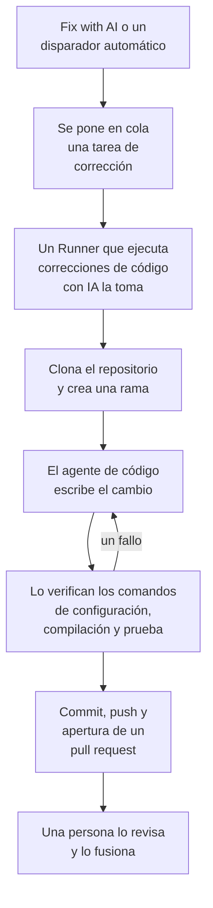

# Tareas de corrección

Una tarea de corrección es un pull request que OneUptime AI escribe en tu código. La inicias desde una excepción, una traza, un servicio o una investigación, o OneUptime la inicia por su cuenta; un [Runner](/docs/runbooks/agents) clona el repositorio, escribe el cambio en una rama nueva, lo compila y lo prueba, y abre un pull request. Una persona revisa y fusiona cada uno: el Runner puede subir ramas y abrir pull requests, nada más.

:::cards
- [Cómo funciona una ejecución de corrección](#cómo-funciona-una-ejecución-de-corrección): De un clic a un pull request, paso a paso.
- [Dónde empiezan las tareas de corrección](#dónde-empiezan-las-tareas-de-corrección): Los botones que inician una, y lo que hace cada pull request.
- [Antes de empezar](#antes-de-empezar): Un modelo, un repositorio conectado y un Runner.
- [Cuando una corrección falla](#cuando-una-corrección-falla): Qué pasa con una ejecución que falla, se detiene o espera.
:::

> [!TIP]
> También puedes iniciarlo desde GitHub. Menciona la GitHub App de OneUptime en un issue o en un pull request y implementa, revisa o reseña allí mismo: consulta [GitHub App](/docs/ai/github-app). Es el mismo agente, el mismo Runner y los mismos presupuestos; solo cambia el disparador.

## Cómo funciona una ejecución de corrección



1. Haces clic en **Fix with AI** en una excepción sin resolver, u otro botón o disparador inicia una tarea (consulta [Dónde empiezan las tareas de corrección](#dónde-empiezan-las-tareas-de-corrección)).
2. La tarea se pone en cola, y un Runner disponible con **Ejecuta correcciones de código con IA** activado la toma.
3. El Runner obtiene el contexto de la tarea. Para una excepción, es su tipo, su mensaje y su stack trace.
4. Clona el repositorio en un espacio de trabajo propio y crea una rama. Una corrección de una excepción se llama `oneuptime-fix-exception-` seguido de los primeros caracteres del id de la ejecución.
5. Un agente de código, impulsado por el proveedor de LLM de tu proyecto, lee el código y escribe el cambio. El servidor de OneUptime hace las llamadas al LLM, así que el Runner nunca tiene la clave de API de tu proveedor, y cada llamada se mide y aparece en los registros de IA.
6. Si el repositorio tiene comandos de verificación, el Runner compila y prueba el cambio antes de hacer ningún commit, y devuelve un fallo al agente de código para que lo repare (consulta [Verificación antes del pull request](#verificación-antes-del-pull-request)).
7. El Runner hace el commit, sube la rama, abre el pull request y borra el espacio de trabajo.

La página desde la que se inició la tarea muestra su estado en directo. Cada tarea aparece en **Productos → Código → Tareas**: abre una para ver su **Vista general**, sus **Registros** (una línea por cada archivo que el Runner leyó o escribió y por cada comando que ejecutó) y sus **Pull requests**.

Cada ejecución está sujeta a presupuestos que impone el servidor: como máximo **40 llamadas al LLM** y **100.000 tokens de salida**. Una ejecución que llega a uno de ellos termina con un resumen del trabajo hecho hasta entonces en lugar de entrar en bucle. Las ejecuciones de corrección también cuentan para los límites diarios de IA del proyecto, cuando el proyecto los fija.

## Dónde empiezan las tareas de corrección

| Dónde | Clic | El pull request |
| --- | --- | --- |
| La página **Asistencia de IA** de una excepción | **Fix with AI** | Corrige el error detrás de la excepción. |
| La página **Asistencia de IA** de una excepción | **Generar prueba de regresión** | Añade una prueba que reproduce la excepción y falla hasta que se corrige el error. |
| La página **Asistencia de IA** de una excepción | **Mejorar el manejo de errores** | Para un error esperado, como una entrada no válida: saca los datos de usuario del mensaje, valida la entrada antes y marca el error como gestionado, sin cambiar el comportamiento. |
| La tarjeta **Investigación de IA** de un incidente o una alerta | **Abrir PR de corrección a partir de este análisis** | Corrige la causa raíz que publicó la investigación (consulta [Correcciones de código automáticas a partir de investigaciones](#correcciones-de-código-automáticas-a-partir-de-investigaciones)). |
| Una traza | **Corregir el rendimiento con IA** | Corrige el patrón lento encontrado en la traza, como consultas N+1 o un único span lento dominante. |
| La página **Registros** de un servicio | **Improve Logging** | Hace que los logs del servicio sean estructurados, con la severidad correcta y vinculados a sus trazas, sin cambiar el comportamiento. |
| La página **Trazas** de un servicio | **Improve Tracing** | Añade spans y atributos donde falta el tracing del servicio, sin cambiar el comportamiento. |

Para abrir la página **Asistencia de IA** de una excepción, abre la excepción en **Productos → Observabilidad → Excepciones** y elige **Asistencia de IA** en su menú lateral. Una excepción resuelta o archivada tiene que marcarse primero como no resuelta.

OneUptime AI también inicia tareas de corrección por su cuenta: a partir de una investigación que encuentra un cambio de código, de una que termina sin conclusión porque faltaba telemetría, y de los AI Insights sobre excepciones y trazas lentas. Cada una tiene su propio interruptor; consulta [Correcciones de código automáticas](/docs/ai/ai-sre#correcciones-de-código-automáticas).

## Verificación antes del pull request

Un repositorio de código puede tener hasta tres comandos de verificación en su página **Ajustes**, en **Repositorios de código**:

| Comando | Ejemplo | Cuándo se ejecuta |
| --- | --- | --- |
| **Comando de configuración** | `npm ci` | Primero, para instalar las dependencias. |
| **Comando de compilación** | `npm run build` | Después de la configuración. |
| **Comando de prueba** | `npm test` | Al final. |

Cuando alguno está definido, cada ejecución de corrección comprueba su cambio antes de que se abra el pull request:

1. Cuando el agente de código termina, los comandos se ejecutan en orden en la raíz del repositorio, en el Runner, en el espacio de trabajo clonado. Cada uno tiene hasta 15 minutos y se ejecuta con `CI=true`, para que nada espere una respuesta; el primer fallo detiene la pasada.
2. Ante un fallo, el final de la salida del comando fallido vuelve al mismo agente de código como tarea de reparación, con instrucciones de corregir su propio cambio en lugar de debilitar u omitir pruebas, y los comandos se ejecutan de nuevo. Hace como máximo **2** intentos de reparación. Comparten el presupuesto de LLM de la ejecución, y sus cambios van en el mismo commit que la corrección.
3. El resultado, superado, fallido u omitido (sin comandos definidos), se escribe en una sección Verification de la descripción del pull request y se registra en el pull request de la tarea.

Un cambio que sigue sin superar la verificación no se descarta: el pull request se abre de todos modos, con una sección "Verification failed" claramente marcada que nombra el comando fallido y termina con su salida. El trabajo se conserva y quien revisa decide. Un repositorio sin comandos definidos se informa como omitido, en lugar de dar a entender una compilación en verde.

Los comandos son ajustes del repositorio que escribe tu equipo y que se ejecutan en tu propio Runner: el mismo modelo de confianza que los pasos de Bash de un runbook. La IA nunca los escribe ni los cambia.

## Antes de empezar

Una tarea de corrección necesita tres cosas. La página **Asistencia de IA** de la excepción comprueba las tres antes de ofrecer empezar, y dice qué falta.

| Qué | OneUptime Cloud | Autoalojado |
| --- | --- | --- |
| Un proveedor de LLM | Nada que configurar: un proyecto sin proveedor propio usa el proveedor global, pagado con los créditos de IA del proyecto. Un proveedor propio, en **Ajustes del proyecto → IA → Proveedores de LLM**, tiene prioridad. | Define una vez las variables de entorno `GLOBAL_LLM_PROVIDER_*` en el servidor, o añade un proveedor al proyecto. |
| Un repositorio conectado mediante la GitHub App | **Productos → Código → Tareas**, luego **Repositorios de código** y **Conectar con la GitHub App**. Si la app ya está instalada en la cuenta de GitHub, haz clic en **Conectar una instalación existente** en su lugar: instalarla de nuevo no la conecta. Requiere el plan Growth. | Lo mismo, una vez que tu instancia tiene una GitHub App (consulta [Integración con GitHub](/docs/self-hosted/github-integration)). |
| Un Runner que ejecuta correcciones de código con IA | Nada que operar: lo hacen los Runners compartidos de OneUptime. | El servicio `runner` de Docker Compose, o el Runner del chart de Helm (`runner.enabled`, activado por defecto), se registra solo y ejecuta correcciones de código con IA. |

En una instancia autoalojada, el proveedor global es un bloque de `config.env` (Docker Compose) o de tus valores de Helm. Para un Ollama autoalojado:

```bash
GLOBAL_LLM_PROVIDER_TYPE=Ollama
# An address the OneUptime server can reach, never localhost.
GLOBAL_LLM_PROVIDER_BASE_URL=http://ollama:11434
GLOBAL_LLM_PROVIDER_MODEL_NAME=llama3.1
# No GLOBAL_LLM_PROVIDER_API_KEY needed — Ollama is keyless.
```

Cualquier proveedor compatible sirve: consulta [Proveedores de LLM](/docs/ai/llm-provider) para verlos todos y cada variable de entorno.

No asignas repositorios a servicios. Cuando una tarea empieza, OneUptime encuentra el repositorio comparando las rutas de archivo del stack trace de la excepción con tus repositorios conectados. Si nada coincide, recurre a un repositorio que se llame como el servicio, y después al único repositorio del proyecto cuando solo hay uno. La página **Asistencia de IA** muestra qué repositorio encontró.

### Ejecuta un Runner propio

Para ejecutar un Runner en otro lugar, por ejemplo en una máquina cerca de tus repositorios:

:::steps
### Crea el Runner

Crea un Runner en **Runbooks → Agentes de runbook** y haz clic en **Mostrar instrucciones de configuración** en su fila. El comando incluye la clave secreta del Runner, que solo un Project Owner, Project Admin o Runbook Admin puede leer. Tiene este aspecto:

```bash
docker run --name oneuptime-runner --restart unless-stopped \
  -e ONEUPTIME_RUNNER_ID=<runner-id> \
  -e ONEUPTIME_RUNNER_KEY=<runner-key> \
  -e ONEUPTIME_URL=<your-oneuptime-url> \
  -d oneuptime/runner:release
```

### Activa las correcciones de código con IA

Activa **Ejecuta correcciones de código con IA** en el Runner. Está desactivado por defecto, y el Runner recoge el cambio con su siguiente heartbeat, en aproximadamente un minuto; no hay nada que reiniciar.

### Comprueba que se conecta

El Runner aparece como conectado en la página **Runbooks → Agentes de runbook** en uno o dos minutos. Si no, lee el log del contenedor (`docker logs oneuptime-runner`) en busca de un error de credenciales o de red.
:::

Cualquier forma de ejecutar el contenedor sirve (Docker Compose, Kubernetes, etc.), siempre que tenga estas variables y pueda llegar a tu instancia de OneUptime por HTTPS:

| Variable | Qué es |
| --- | --- |
| `ONEUPTIME_RUNNER_ID` | El id del Runner, del panel. |
| `ONEUPTIME_RUNNER_KEY` | La clave secreta del Runner. |
| `ONEUPTIME_URL` | La dirección de tu instancia de OneUptime (`https://oneuptime.com` en OneUptime Cloud). |

> [!NOTE]
> Antes de OneUptime 12, las correcciones de código con IA se ejecutaban en un componente AI Agent aparte (la imagen `oneuptime/ai-agent` con variables `AI_AGENT_*`). Se integró en el Runner: si todavía ejecutas uno, la [guía de actualización de v11 a v12](/docs/installation/upgrading) explica cómo sustituirlo.

## Correcciones de código automáticas a partir de investigaciones

Cuando una [investigación de IA](/docs/ai/ai-sre) publica un análisis de causa raíz en un incidente o una alerta, y su clasificación cuidadosa recomienda un cambio en el código, la tarjeta de la investigación ofrece **Abrir PR de corrección a partir de este análisis**: una tarea de corrección cuyo contexto entero es el análisis publicado. El botón se oculta cuando el remedio es operativo, solo de infraestructura, externo, una denegación esperada, un error del usuario o no concluyente. Las correcciones aptas ocurren sin el clic mientras el interruptor **Abrir un pull request de corrección cuando una investigación encuentra un cambio de código** está activado. Forma parte de la corrección: está bajo **Corregir automáticamente los incidentes nuevos** en **Incidentes → IA → Ajustes** (y bajo **Corregir automáticamente las alertas nuevas** en **Alertas → IA → Ajustes**), se activa cuando se activa la corrección y solo abre pull requests mientras la corrección está activada. Ambos empiezan desactivados, también en los proyectos nuevos.

Mientras está activado, una investigación que termina con una causa raíz segura y respaldada por pruebas que un cambio de código puede corregir pone en cola la misma tarea de corrección que crea el botón. La decisión es una clasificación acotada que comprueba el servidor, nunca un patrón buscado en el texto del análisis: solo un veredicto positivo de corrección de código abre un pull request. La falta de pruebas, un remedio fuera del código y una clasificación fallida terminan todos sin hacer nada.

Todo lo demás coincide con el botón:

- El pull request se abre listo para revisión, escrito a partir del análisis publicado, y necesita un repositorio conectado mediante la GitHub App y un Runner con **Ejecuta correcciones de código con IA** activado.
- Cuenta para el límite diario de tareas de corrección de esa señal (**Límite diario de tareas de corrección de IA para incidentes** o **Límite diario de tareas de corrección de IA para alertas**, en **Más ajustes** de su página de ajustes de IA) y para el tope de pull requests abiertos del repositorio, cuando alguno está definido. Sin definir, ninguno limita nada.
- Cada disparador busca primero una tarea de corrección ya en cola o en ejecución para el mismo incidente o la misma alerta, así que un disparador automático y un clic normalmente se convierten en una tarea, no en dos pull requests. La comprobación es una lectura antes de la escritura, no un bloqueo, así que dos disparadores en el mismo instante aún pueden pasar los dos.
- La ejecución la escribe el sistema, no se atribuye a nadie, y nada se fusiona solo.

## Cuando una corrección falla

:::details La ejecución falla
No se pudo aplicar la corrección, no se pudo acceder al repositorio o falló la llamada al LLM. La página desde la que se inició la tarea muestra el motivo y ofrece volver a intentarlo. La página **Registros** de la tarea tiene el registro completo de la ejecución.
:::

:::details El Runner se detiene en mitad de una ejecución
Una ejecución cuyo heartbeat lleva más de 12 minutos en silencio se marca como fallida con un error. Nunca se vuelve a poner en cola por sí sola, porque el Runner puede haber subido ya parte de una rama de corrección; iníciala de nuevo desde donde la iniciaste.
:::

:::details Ningún Runner toma la tarea
Una tarea que espera más de 30 minutos mientras no hay conectado ningún Runner con **Ejecuta correcciones de código con IA** falla, con un mensaje para revisar el Runner, así que nunca aparece en curso para siempre. Cuando un Runner está en línea pero ocupado, las tareas en cola esperan su turno.
:::

## Privacidad

El clon de tu repositorio vive en un espacio de trabajo dentro del contenedor del Runner y se borra cuando termina la ejecución, tanto si salió bien como si no. El Runner nunca tiene la clave de API de tu proveedor de LLM: el servidor de OneUptime hace las llamadas al LLM por él. OneUptime no conserva tu repositorio ni entrena con tu código. El registro de la tarea guarda los primeros 300 caracteres de la salida de cada paso, para que puedas comprobar lo que hizo el Runner, y eso puede incluir fragmentos de código. Ejecuta un Runner autoalojado con tu propio proveedor de LLM (Ollama local incluido) y tu código nunca sale de tu infraestructura.

## En la hoja de ruta

Previsto, y **todavía no disponible**:

- **Compatibilidad con GitLab.** Los repositorios se conectan solo mediante la GitHub App.
- **Más telemetría en una corrección.** Aportar a la corrección las trazas, los logs y las métricas en torno a una excepción, más allá del stack trace.

## Próximos pasos

:::cards
- [GitHub App](/docs/ai/github-app): Pide un cambio, una revisión o una reseña desde el propio GitHub.
- [AI SRE](/docs/ai/ai-sre): Las investigaciones cuyos análisis las tareas de corrección pueden convertir en pull requests.
- [Agentes de runbook](/docs/runbooks/agents): El worker que lleva a cabo cada ejecución de corrección.
:::
