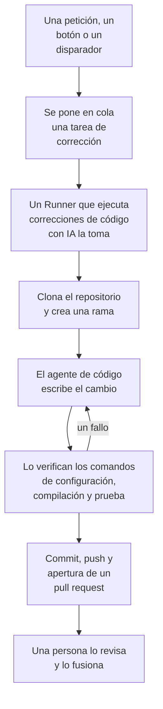

# Código

Código es donde le pides a OneUptime AI que trabaje en tus repositorios, como se lo pedirías a un agente de programación: corregir un bug, escribir tests, explicar el código, hacer un cambio. Se abre en el cuadro donde pides, con el repositorio y la rama elegidos en él y todas las tareas debajo; la página de una tarea es una conversación en la que puedes responder. OneUptime también inicia tareas por su cuenta, a partir de excepciones, trazas e investigaciones. Un [Runner](/docs/runbooks/agents) clona el repositorio, escribe el cambio en una rama nueva, lo compila y lo prueba, y abre un pull request. Una persona revisa y fusiona cada uno: el Runner puede subir ramas y abrir pull requests, nada más.

:::cards
- [Pedirle a la IA en un repositorio](#pedirle-a-la-ia-en-un-repositorio): Una petición con tus propias palabras, con el contexto que necesita.
- [La conversación de una tarea](#la-conversación-de-una-tarea): Lo que hizo la IA, lo que cambió y tu respuesta.
- [Cómo funciona una ejecución de corrección](#cómo-funciona-una-ejecución-de-corrección): De un clic a un pull request, paso a paso.
- [Dónde empiezan las tareas de corrección](#dónde-empiezan-las-tareas-de-corrección): Las tareas que inicia OneUptime, y lo que hace cada pull request.
- [Telemetría de producción en una corrección](#telemetría-de-producción-en-una-corrección): Lo que una corrección lee de producción mientras escribe el cambio.
- [Revisión de producción de pull requests](#revisión-de-producción-de-pull-requests): Lo que producción dice del código que cambia cada pull request.
- [Antes de empezar](#antes-de-empezar): Un modelo, un repositorio conectado y un Runner.
- [Cuando una corrección falla](#cuando-una-corrección-falla): Qué pasa con una ejecución que falla, se detiene o espera.
:::

> [!TIP]
> También puedes iniciarlo desde GitHub. Menciona la GitHub App de OneUptime en un issue o en un pull request y implementa, revisa o reseña allí mismo: consulta [GitHub App](/docs/ai/github-app). Es el mismo agente, el mismo Runner y los mismos presupuestos; solo cambia el disparador.

## Pedirle a la IA en un repositorio

:::steps
### Abre Código

Abre **Productos → Código**. Se abre en **¿Qué debe hacer la IA?**: el cuadro donde pides, con todas las tareas debajo, las más recientes primero. Si todavía no hay ningún repositorio, ofrece en su lugar **Conectar GitHub** (consulta [Antes de empezar](#antes-de-empezar)). **Repositorios**, en su menú lateral, muestra los repositorios en los que la IA puede trabajar, y agrupa bajo **No conectado** los que la GitHub App ya no alcanza. La página de cada repositorio tiene el mismo cuadro para ese repositorio.

### Elige el repositorio y la rama

El cuadro empieza en el repositorio que elegiste la última vez. Elige otro en su fila inferior y, al lado, la rama de la que parte la tarea: la rama principal del repositorio, marcada como **Predeterminado**, hasta que elijas otra. La IA crea su rama a partir de la que elijas y abre su pull request hacia ella.

### Di lo que quieres

Escribe el cambio, el bug o la pregunta con tus propias palabras. Mientras no se haya pedido nada, Código sugiere algunas en **Prueba a pedir**.

### Añade contexto

Haz clic en **Añadir contexto** para darle a la IA lo que necesita: un archivo o una carpeta del repositorio, una nota, un enlace o un registro del proyecto. OneUptime lee cada registro al enviar la petición, con tus permisos, y guarda lo que recibió la IA.

### Inicia la tarea

Haz clic en **Iniciar tarea** o pulsa Intro. Se abre la página de la tarea, y el trabajo de la IA aparece ahí a medida que ocurre.
:::

| Contexto | Lo que recibe la IA |
| --- | --- |
| **Archivo o carpeta** | Una ruta del repositorio, que la IA lee primero. |
| **Nota** | Texto que pegas: un error, una especificación, una línea de log. |
| **Enlace** | Una dirección web, como referencia. |
| **Incidente** o **Alerta** | Su estado, su descripción y su causa raíz, tal como están al enviar la petición. |
| **Excepción** | Su mensaje y su stack trace. |
| **Monitor** | Su tipo, su estado y su descripción. |
| **Traza** | Sus spans: sus nombres, tiempos y errores. |
| **Registros** | Las últimas 20 líneas de log que contienen tu búsqueda, de la última hora, el último día o la última semana. |
| **Perfil de rendimiento** | Adónde va el tiempo de una función en los perfiles de su servicio: quién la llama, qué llama y sus líneas más calientes. |

Una petición lleva como máximo 10 elementos de contexto. Los tokens, claves, contraseñas y direcciones de correo en lo que lee OneUptime se ocultan antes de que la IA los vea, como en todos los sitios donde OneUptime AI lee tus datos.

## La conversación de una tarea

La página de una tarea es una conversación: lo que se pidió y el contexto añadido, y luego el turno de la IA: los pasos que da a medida que los da (los archivos que leyó y editó, lo que buscó, los comandos que ejecutó), su respuesta, los archivos que cambió con su diff, y el pull request. La parte de arriba de la página dice dónde trabaja la tarea (su repositorio y la rama de la que partió), cuántas líneas cambió, con un botón a su pull request, y cómo va la tarea:

| Estado | Qué significa |
| --- | --- |
| **En cola** | Espera a que un Runner la tome. |
| **Trabajando…** | La IA está en ello. **Detener** la detiene; lo que subió se queda en la rama. |
| **Esperándote** | La IA hizo una pregunta. Respóndela en el cuadro de abajo. |
| **Hecho** | La IA terminó: su respuesta, y el pull request si cambió código. |
| **Fallido** | El turno no pudo terminar, y dice por qué. **Volver a intentar** pide lo mismo otra vez. |
| **Detenido** | Alguien la detuvo. **Volver a intentar** pide lo mismo otra vez. |

Para seguir, escribe en el cuadro de abajo, que sigue a la vista mientras la conversación se desplaza: responde a la IA, añade contexto o pide cambios. Cada respuesta es el siguiente turno de la misma tarea: trabaja en la misma rama y sube al mismo pull request mientras siga abierto. Una tarea hace un turno cada vez, así que el cuadro espera mientras la IA trabaja. El **Registro** de cada turno es la constancia literal de lo que hizo.

Quien puede leer un repositorio lee sus tareas. Pedirle algo a la IA, responder y detener una tarea requieren permiso para editar el repositorio, y también ver el diff de un cambio: los demás ven qué archivos cambiaron. Las tareas que OneUptime inicia por su cuenta (abajo) también están en su repositorio, como conversaciones en las que puedes responder.

## Cómo funciona una ejecución de corrección



1. Haces clic en **Iniciar tarea** en Código, o en **Corregir con IA** en una excepción sin resolver, u otro botón o disparador inicia una tarea (consulta [Dónde empiezan las tareas de corrección](#dónde-empiezan-las-tareas-de-corrección)).
2. La tarea se pone en cola en su repositorio, y el Runner que elige el repositorio la toma: uno de tus Runners, o un Runner global cuando no elige ninguno (consulta [Elige el Runner del repositorio](#elige-el-runner-del-repositorio)).
3. El Runner obtiene el contexto de la tarea. Para una petición, son sus palabras, el contexto añadido y la conversación hasta ahora; para una excepción, su tipo, su mensaje y su stack trace.
4. Clona el repositorio en un espacio de trabajo propio y crea una rama. Una corrección de una excepción se llama `oneuptime-fix-exception-` seguido de los primeros caracteres del id de la ejecución. Una petición parte de la rama elegida cuando se hizo, y su pull request se abre hacia ella. Una respuesta trabaja, en cambio, en la rama del pull request abierto de la tarea.
5. Un agente de código, impulsado por el proveedor de LLM de tu proyecto, lee el código y escribe el cambio. El servidor de OneUptime hace las llamadas al LLM, así que el Runner nunca tiene la clave de API de tu proveedor, y cada llamada se mide y aparece en los registros de IA. Una corrección de una excepción, de una traza lenta o de un incidente también lee datos de producción mientras trabaja: las excepciones, las trazas, los logs y las métricas de los servicios del repositorio (consulta [Telemetría de producción en una corrección](#telemetría-de-producción-en-una-corrección)).
6. En un Runner propio, el agente de código compila y prueba su cambio como indica el `AGENTS.md` del repositorio antes de hacer ningún commit, y repara lo que falla (consulta [Verificación antes del pull request](#verificación-antes-del-pull-request)).
7. El Runner hace el commit, sube la rama, abre el pull request (para una petición, solo si cambió código) y borra el espacio de trabajo.

La página desde la que se inició la tarea muestra su estado en directo. Cada tarea aparece en su repositorio, en **Productos → Código**: su página es su conversación, y el **Registro** de cada turno tiene una línea por cada archivo que el Runner leyó o escribió y por cada comando que ejecutó.

Cada ejecución está sujeta a presupuestos que impone el servidor: como máximo **40 llamadas al LLM** y **100.000 tokens de salida**. Las consultas de telemetría de producción de una ejecución se descuentan de esas mismas 40 llamadas. Una ejecución que llega a uno de ellos termina con un resumen del trabajo hecho hasta entonces en lugar de entrar en bucle. Las ejecuciones de corrección también cuentan para los límites diarios de IA del proyecto, cuando el proyecto los fija.

## Dónde empiezan las tareas de corrección

| Dónde | Clic | El pull request |
| --- | --- | --- |
| La página **Asistencia de IA** de una excepción | **Corregir con IA** | Corrige el error detrás de la excepción. |
| La página **Asistencia de IA** de una excepción | **Generar prueba de regresión** | Añade una prueba que reproduce la excepción y falla hasta que se corrige el error. |
| La página **Asistencia de IA** de una excepción | **Mejorar el manejo de errores** | Para un error esperado, como una entrada no válida: saca los datos de usuario del mensaje, valida la entrada antes y marca el error como gestionado, sin cambiar el comportamiento. |
| La tarjeta **Investigación de IA** de un incidente o una alerta | **Abrir PR de corrección a partir de este análisis** | Corrige la causa raíz que publicó la investigación (consulta [Correcciones de código automáticas a partir de investigaciones](#correcciones-de-código-automáticas-a-partir-de-investigaciones)). |
| Una traza que vale la pena corregir | **Acelerar con IA** | Corrige el patrón lento que nombra el botón, como una consulta N+1 o llamadas que podrían ir en paralelo. |
| La página **Registros** de un servicio | **Mejorar los registros** | Hace que los logs del servicio sean estructurados, con la severidad correcta y vinculados a sus trazas, sin cambiar el comportamiento. |
| La página **Trazas** de un servicio | **Mejorar el trazado** | Añade spans y atributos donde falta el tracing del servicio, sin cambiar el comportamiento. |
| Una función en **Perfiles de rendimiento** | **Corregir con IA** | Hace que la función haga el mismo trabajo con menos tiempo o memoria, con su perfil como evidencia. |

Estos botones solo aparecen donde pueden iniciar una tarea. Con la IA desactivada para el proyecto, no aparece ninguno y el menú lateral de una excepción no tiene **Asistencia de IA**. **Mejorar los registros** y **Mejorar el trazado** aparecen en cuanto hay un repositorio conectado, y **Acelerar con IA** solo en una traza que vale la pena corregir (consulte [Explorador de trazas](/docs/telemetry/traces-explorer)). El botón **Corregir con IA** de una función solo aparece en el código propio de la aplicación que ocupa al menos el 5 % del tiempo o la memoria del perfil, o cuya proporción creció 3 puntos o más desde la ventana con la que se compara (consulta [Perfilado continuo](/docs/telemetry/profiles)).

Para abrir la página **Asistencia de IA** de una excepción, abre la excepción en **Productos → Observabilidad → Excepciones** y elige **Asistencia de IA** en su menú lateral. Una excepción resuelta o archivada tiene que marcarse primero como no resuelta.

OneUptime AI también inicia tareas de corrección por su cuenta: a partir de una investigación que encuentra un cambio de código, de una que termina sin conclusión porque faltaba telemetría, y de los AI Insights sobre excepciones y trazas lentas. Cada una tiene su propio interruptor; consulta [Correcciones de código automáticas](/docs/ai/ai-sre#correcciones-de-código-automáticas).

## Telemetría de producción en una corrección

OneUptime ya recoge lo que hace tu código en producción, así que una corrección no tiene por qué basarse solo en un stack trace. Mientras el agente de código trabaja, puede consultar la telemetría de producción de los servicios del repositorio:

| Lee | Para qué |
| --- | --- |
| **Excepciones** | Los grupos de excepciones lanzadas en determinados archivos o en una función: cuántas veces en los últimos días, desde qué versión, y la traza de una ocurrencia reciente. |
| **Trazas** | El perfil de latencia y de errores de un endpoint o de una operación, y los spans de una traza. |
| **Registros** | Las líneas de log de un servicio, por periodo, severidad, texto o traza. |
| **Métricas** | Una métrica que reporta un servicio, a lo largo del tiempo; sin un nombre, las métricas que reporta. |
| **Incidentes** | Los incidentes que afectaron a los servicios, o para los que se abrió una corrección de OneUptime en este repositorio, con su causa raíz y su post mortem. |
| **Despliegues** | Los despliegues recientes y otros cambios de los servicios, cada uno con el veredicto de OneUptime sobre si perjudicó a su servicio. |

| Tarea | Qué comprueba |
| --- | --- |
| **Corregir con IA** en una excepción | Cuántas veces se lanza ahora y desde qué versión, los logs y la traza de una ocurrencia. |
| **Acelerar con IA** | Cuánto tráfico tiene la operación y lo lenta que es en todas sus trazas, no solo en la analizada. No cambia nada cuando la operación ya no es lenta. |
| **Abrir PR de corrección a partir de este análisis**, y las correcciones abiertas automáticamente a partir de investigaciones | Los despliegues anteriores al incidente, sus errores, logs y operaciones lentas, y si la causa ya se había dado antes. |
| `@oneuptime review` desde GitHub | Lo que dicen los datos de producción sobre el código cambiado (consulta [Reseñas con contexto de producción](/docs/ai/github-app#reseñas-con-contexto-de-producción)). |

La descripción del pull request dice qué consultó el agente y qué encontró. Las demás tareas, como las pruebas de regresión y las mejoras de los registros o del trazado, no consultan producción.

Lo que el agente puede leer lo decide el servidor de OneUptime, a partir de la propia tarea:

- **Solo lectura.** Las consultas se ejecutan en el servidor de OneUptime, nunca en el Runner, que no tiene ninguna credencial que lea telemetría. Nada de lo que hacen puede cambiar tu proyecto.
- **Este proyecto, y solo los servicios de este repositorio.** No los asignas tú: son los servicios para los que OneUptime encuentra este repositorio, del mismo modo que encuentra el repositorio de una corrección - los stack traces de sus excepciones pasan por sus archivos, se llaman como él o es el único repositorio del proyecto. No se puede leer la telemetría de otro servicio.
- **Sin incidentes privados**, y los tokens, claves, contraseñas y direcciones de correo se ocultan antes de que el agente vea un resultado, como en todos los sitios donde OneUptime AI lee tus datos.
- **Acotado.** Como máximo **12** consultas por ejecución, y cada una se descuenta de las 40 llamadas de la ejecución.

Cuando ningún servicio corresponde al repositorio, la tarea se ejecuta sin telemetría de producción, como antes.

## Revisión de producción de pull requests

OneUptime sabe lo que hace tu código en producción, así que puede revisar una pull request con lo que nadie ve al leer el diff. Activa **Revisar pull requests frente a producción**, en **Más ajustes** de la página **Ajustes** de un repositorio en Código, y cada pull request que alguien con acceso de escritura abre o actualiza recibe un comentario que dice lo que producción muestra del código que cambia. El comentario se edita en su sitio con cada push, y la página **Revisiones de producción** del repositorio en Código guarda cada revisión, con **Volver a revisar**.

| Lo que lee | Del código que cambia la pull request |
| --- | --- |
| **Excepciones** | Las excepciones lanzadas en las líneas, funciones y archivos modificados en los últimos 7 días, con las nuevas y las no controladas marcadas. |
| **Operaciones** | Las operaciones trazadas que ejecutan el código modificado en la última hora: sus spans, sus errores y su p95. |
| **Funciones costosas** | Las funciones del código modificado que ocupan una parte de los perfiles de los servicios en la última hora. |
| **Incidentes** | Los incidentes de los servicios de los últimos 30 días que siguen abiertos, o cuya causa raíz o post mortem menciona el código modificado. Nunca un incidente privado. |
| **Despliegues** | Los despliegues de los servicios de los últimos 7 días que OneUptime sospecha de una regresión. |

Cuando producción dice algo, OneUptime AI lo lee junto al diff y añade **Qué vigilar**: unos pocos puntos breves, cada uno basado en los datos. Solo se ejecuta mientras la IA está activada en el proyecto, como mucho 10 veces al día por pull request y 100 por repositorio, y se mide como cualquier llamada de IA; los datos se leen siempre sin ella. Cuando producción no muestra nada del cambio, OneUptime no publica nada.

- **Solo agregados.** El comentario contiene recuentos, duraciones y nombres de código: nunca el mensaje de una excepción, una línea de registro, el título de un incidente ni datos personales.
- **Los repositorios públicos reciben un enlace.** Cualquiera puede leer las pull requests de un repositorio público, así que allí el comentario solo enlaza a la revisión en OneUptime, que solo los miembros del proyecto pueden abrir. **Comentario de revisión de producción**, en **Más ajustes** de la página **Ajustes** del repositorio, puede publicar **Solo un enlace a la revisión** en todos, o **La revisión, incluso en un repositorio público**.
- **Los colaboradores externos no pueden iniciar una.** Una pull request se revisa sola solo cuando su autor, y quien haya hecho push en ella, pueden escribir en el repositorio. La de cualquier otra persona - un colaborador externo, un fork, un bot - se revisa cuando alguien con acceso de escritura comenta `@oneuptime production review` en ella, o pulsa **Volver a revisar** en Código.
- **Solo lectura.** Una revisión no clona nada ni ejecuta nada de la pull request. Su diff y su título son datos para OneUptime AI, nunca instrucciones: la IA no tiene herramientas, y lo que escribe se coloca en el comentario como texto.

El interruptor está activado para los repositorios que la GitHub App conecte a partir de ahora. Un repositorio conectado antes de que existiera lo mantiene desactivado hasta que lo actives.

## Verificación antes del pull request

Un repositorio dice cómo se compila y se prueba en un `AGENTS.md` en su raíz, el archivo que leen los agentes de código. Antes de cambiar nada, el agente de código lee el `AGENTS.md` del repositorio (o su `CLAUDE.md`, cuando no tiene `AGENTS.md`) de la rama de la que parte la tarea, y trabaja como indica. Sin ninguno de los dos, lo averigua a partir del `CONTRIBUTING.md` del repositorio, el README, los scripts del paquete, el `Makefile` o los flujos de CI. No hay nada que configurar en OneUptime.

| Dónde trabaja la IA | Qué hace con la compilación y las pruebas del repositorio |
| --- | --- |
| Uno de tus Runners | Compila y prueba su cambio antes de que se abra el pull request, corrige lo que falla y vuelve a comprobar, y dice en su resumen qué comprobaciones ejecutó. Cada comando que ejecuta tiene hasta 2 minutos, sin las credenciales propias del Runner en su entorno. |
| **Runner global** | No ejecuta ningún comando: escribe el cambio y abre el pull request, y la CI propia de tu repositorio lo comprueba. |

Nada de un pull request que viene de un fork se lee nunca como instrucciones del repositorio: una revisión rechaza ese pull request, y una reseña lee la rama base.

### Comandos definidos en un repositorio

Código ya no pide comandos de configuración, compilación y prueba, pero un repositorio que los tiene, definidos antes o mediante la API o Terraform, los conserva. Se muestran de solo lectura en la tarjeta **Comandos de compilación y prueba**, en **Más ajustes** de la página **Ajustes** del repositorio, y **Eliminar comandos** elimina los tres. Mientras alguno esté definido, cada ejecución de corrección en un Runner propio también comprueba su cambio con ellos antes de que se abra el pull request:

1. Cuando el agente de código termina, los comandos se ejecutan en orden en la raíz del repositorio, en el Runner, en el espacio de trabajo clonado. Cada uno tiene hasta 15 minutos y se ejecuta con `CI=true`, para que nada espere una respuesta; el primer fallo detiene la pasada.
2. Ante un fallo, el final de la salida del comando fallido vuelve al mismo agente de código como tarea de reparación, con instrucciones de corregir su propio cambio en lugar de debilitar u omitir pruebas, y los comandos se ejecutan de nuevo. Hace como máximo **2** intentos de reparación. Comparten el presupuesto de LLM de la ejecución, y sus cambios van en el mismo commit que la corrección.
3. El resultado, superado, fallido u omitido (sin comandos definidos, o un Runner global), se escribe en una sección Verification de la descripción del pull request y se registra en el pull request de la tarea.

Un cambio que sigue sin superar la verificación no se descarta: el pull request se abre de todos modos, con una sección "Verification failed" claramente marcada que nombra el comando fallido y termina con su salida. El trabajo se conserva y quien revisa decide. Un repositorio sin comandos definidos se informa como omitido, en lugar de dar a entender una compilación en verde.

Los comandos son ajustes del repositorio que escribe tu equipo y que se ejecutan en tu propio Runner: el mismo modelo de confianza que los pasos de Bash de un runbook. La IA nunca los escribe ni los cambia. Un Runner global, que OneUptime ejecuta para todos los proyectos, nunca los ejecuta: en un Runner global, la corrección se escribe y se abre para revisión, la verificación se informa como omitida y la CI propia de tu repositorio comprueba el cambio. [Ejecuta un Runner propio](#ejecuta-un-runner-propio) para que las correcciones se compilen y prueben antes de que se abra el pull request.

## Después de fusionar una corrección

Fusionar una corrección no corrige nada hasta que se ejecuta. En cuanto se fusiona un pull request de corrección, OneUptime espera un despliegue registrado que lo contenga (consulta [Despliegues y cambios](/docs/telemetry/change-events)) y vigila en ese despliegue aquello para lo que era la corrección. El pull request de la tarea en Code dice cómo fue, y también la página **Asistencia de IA** de la excepción, los registros de IA del incidente y el insight de IA del que salió la corrección:

| Una corrección de | Qué se vigila | Funcionó | No funcionó |
| --- | --- | --- | --- |
| Una excepción | Si la excepción vuelve a ocurrir | **Corregido en producción** | **Sigue ocurriendo tras la corrección** |
| Una traza lenta o un insight de latencia | El p99 de la operación que nombra la corrección | **Más rápido en producción** | **Sigue lento tras la corrección** |
| La causa raíz de un incidente o una alerta | Si su monitor genera otro | **Corregido en producción** | **Volvió a ocurrir tras la corrección** |
| Telemetría, registro o trazado que faltaban | Lo que añade la corrección y el resto de la telemetría del servicio | **Llega en producción** | **La telemetría se detuvo tras la corrección** |

Hasta que un despliegue la entrega, la corrección indica **Fusionado, esperando un despliegue**, y luego **Desplegado, en observación en producción** mientras se vigila. Una que ningún despliegue registrado contiene en 14 días, o de la que la producción no puede decir nada, indica **No verificado en producción**. [Correcciones de código automáticas](/docs/ai/ai-sre#correcciones-de-código-automáticas) recoge las reglas. Una prueba de regresión, un mejor manejo de errores, una revisión y una solicitud en Code no se vigilan: la producción no puede mostrar lo que cambian.

## Antes de empezar

Una tarea necesita tres cosas. El cuadro de peticiones de Código y la página **Asistencia de IA** de la excepción comprueban las tres antes de ofrecer empezar, y dicen qué falta.

| Qué | OneUptime Cloud | Autoalojado |
| --- | --- | --- |
| Un proveedor de LLM | Nada que configurar: un proyecto sin proveedor propio usa el proveedor global, pagado con los créditos de IA del proyecto. Un proveedor propio, en **Ajustes del proyecto → IA → Proveedores de LLM**, tiene prioridad. | Define una vez las variables de entorno `GLOBAL_LLM_PROVIDER_*` en el servidor, o añade un proveedor al proyecto. |
| Un repositorio conectado mediante la GitHub App | **Productos → Código**, luego **Conectar GitHub**. Si la app ya está instalada en la cuenta de GitHub, haz clic en **Conectar una instalación existente** en su lugar: instalarla de nuevo no la conecta. Requiere el plan Growth. | Lo mismo, una vez que tu instancia tiene una GitHub App (consulta [Integración con GitHub](/docs/self-hosted/github-integration)). |
| Un Runner que ejecuta correcciones de código con IA | Nada que operar: un repositorio que no elige ninguno trabaja en los Runners globales de OneUptime. | El servicio `runner` de Docker Compose, o el Runner del chart de Helm (`runner.enabled`, activado por defecto), se registra solo y ejecuta correcciones de código con IA en cada repositorio que no elige ningún Runner. |

En una instancia autoalojada, el proveedor global es un bloque de `config.env` (Docker Compose) o de tus valores de Helm. Para un Ollama autoalojado:

```bash
GLOBAL_LLM_PROVIDER_TYPE=Ollama
# An address the OneUptime server can reach, never localhost.
GLOBAL_LLM_PROVIDER_BASE_URL=http://ollama:11434
GLOBAL_LLM_PROVIDER_MODEL_NAME=llama3.1
# No GLOBAL_LLM_PROVIDER_API_KEY needed — Ollama is keyless.
```

Cualquier proveedor compatible sirve: consulta [Proveedores de LLM](/docs/ai/llm-provider) para verlos todos y cada variable de entorno.

No asignas repositorios a servicios. Cuando una tarea empieza, OneUptime encuentra el repositorio comparando las rutas de archivo del stack trace de la excepción con tus repositorios conectados. Si nada coincide, recurre a un repositorio que se llame como el servicio, y después al único repositorio del proyecto cuando solo hay uno. La página **Asistencia de IA** muestra qué repositorio encontró.

### Elige el Runner del repositorio

Cada repositorio elige el Runner en el que la IA trabaja en él: en su página **Ajustes** en Código, abre **Más ajustes**, haz clic en **Editar** en la tarjeta **Runner** y elige uno. Un repositorio que importa la GitHub App empieza en el [Runner predeterminado](/docs/runbooks/agents#el-runner-predeterminado-del-proyecto) del proyecto, cuando lo tiene. Un repositorio que no elige ninguno trabaja en **Runner global**, que OneUptime ejecuta para todos los proyectos.

| Runner | Qué hace con una tarea |
| --- | --- |
| **Runner global** | Escribe el cambio y abre el pull request sin compilarlo ni probarlo: la CI propia de tu repositorio comprueba el cambio. |
| Uno de tus Runners | También compila y prueba el cambio como indica el `AGENTS.md` del repositorio, en un host que tú controlas. |

Solo el Runner que elige un repositorio recibe sus tareas y un token para él. En un proyecto que desactiva **Usar Runners globales** en **Runbooks → Agentes de runbook**, cada repositorio necesita uno de los Runners propios del proyecto. La página de un Runner lista los repositorios que lo eligen.

### Ejecuta un Runner propio

Para ejecutar un Runner en otro lugar, por ejemplo en una máquina cerca de tus repositorios:

:::steps
### Crea el Runner

Crea un Runner en **Runbooks → Agentes de runbook** y haz clic en **Mostrar instrucciones de configuración** en su fila. El comando incluye la clave secreta del Runner, que solo un Project Owner, Project Admin o Runbook Admin puede leer. Tiene este aspecto:

```bash
docker run --name oneuptime-runner --restart unless-stopped \
  -e ONEUPTIME_RUNNER_ID=<runner-id> \
  -e ONEUPTIME_RUNNER_KEY=<runner-key> \
  -e ONEUPTIME_URL=<your-oneuptime-url> \
  -d oneuptime/runner:release
```

### Elígelo para el repositorio

En la página **Ajustes** del repositorio en Código, abre **Más ajustes**, haz clic en **Editar** en la tarjeta **Runner** y elige el Runner. El Runner recoge el cambio con su siguiente heartbeat, en aproximadamente un minuto; no hay nada que reiniciar.

### Comprueba que se conecta

El Runner aparece como conectado en la página **Runbooks → Agentes de runbook** en uno o dos minutos. Si no, lee el log del contenedor (`docker logs oneuptime-runner`) en busca de un error de credenciales o de red.
:::

Cualquier forma de ejecutar el contenedor sirve (Docker Compose, Kubernetes, etc.), siempre que tenga estas variables y pueda llegar a tu instancia de OneUptime por HTTPS:

| Variable | Qué es |
| --- | --- |
| `ONEUPTIME_RUNNER_ID` | El id del Runner, del panel. |
| `ONEUPTIME_RUNNER_KEY` | La clave secreta del Runner. |
| `ONEUPTIME_URL` | La dirección de tu instancia de OneUptime (`https://oneuptime.com` en OneUptime Cloud). |

> [!NOTE]
> Antes de OneUptime 12, las correcciones de código con IA se ejecutaban en un componente AI Agent aparte (la imagen `oneuptime/ai-agent` con variables `AI_AGENT_*`). Se integró en el Runner: si todavía ejecutas uno, la [guía de actualización de v11 a v12](/docs/installation/upgrading) explica cómo sustituirlo.

## Correcciones de código automáticas a partir de investigaciones

Cuando una [investigación de IA](/docs/ai/ai-sre) publica un análisis de causa raíz en un incidente o una alerta, y su clasificación cuidadosa recomienda un cambio en el código, la tarjeta de la investigación ofrece **Abrir PR de corrección a partir de este análisis**: una tarea de corrección cuyo contexto entero es el análisis publicado. El botón se oculta cuando el remedio es operativo, solo de infraestructura, externo, una denegación esperada, un error del usuario o no concluyente. Las correcciones aptas ocurren sin el clic mientras **Corregir automáticamente los incidentes nuevos** está activado en **Incidentes → IA → Ajustes** (y **Corregir automáticamente las alertas nuevas** en **Alertas → IA → Ajustes**). La corrección empieza desactivada, también en los proyectos nuevos. Sin reglas de remediación automática se abre cada corrección apta; con reglas, solo una para lo que coincide con una regla, cuando la regla tiene **Pull requests de corrección** activado (una regla nueva lo tiene), en los repositorios de código que nombra.

Mientras la corrección está activada, una investigación que termina con una causa raíz segura y respaldada por pruebas que un cambio de código puede corregir pone en cola la misma tarea de corrección que crea el botón. La decisión es una clasificación acotada que comprueba el servidor, nunca un patrón buscado en el texto del análisis: solo un veredicto positivo de corrección de código abre un pull request. La falta de pruebas, un remedio fuera del código y una clasificación fallida terminan todos sin hacer nada.

Todo lo demás coincide con el botón:

- El pull request se abre listo para revisión, escrito a partir del análisis publicado, y necesita un repositorio conectado mediante la GitHub App, uno de los que nombran las reglas que coinciden cuando nombran alguno, y un Runner en línea para trabajar en él: el que elige el repositorio, o un Runner global.
- Cuenta para el límite diario de tareas de corrección de esa señal (**Límite diario de tareas de corrección de IA para incidentes** o **Límite diario de tareas de corrección de IA para alertas**, en **Más ajustes** de su página de ajustes de IA) y para el tope de pull requests abiertos del repositorio, cuando alguno está definido. Sin definir, ninguno limita nada.
- Cada disparador busca primero una tarea de corrección ya en cola o en ejecución para el mismo incidente o la misma alerta, así que un disparador automático y un clic normalmente se convierten en una tarea, no en dos pull requests. La comprobación es una lectura antes de la escritura, no un bloqueo, así que dos disparadores en el mismo instante aún pueden pasar los dos.
- La ejecución la escribe el sistema, no se atribuye a nadie, y nada se fusiona solo.

## Cuando una corrección falla

:::details La ejecución falla
No se pudo aplicar la corrección, no se pudo acceder al repositorio o a la rama de la que partía una petición, o falló la llamada al LLM. La conversación de la tarea, y la página desde la que se inició, muestran el motivo y ofrecen volver a intentarlo. El **Registro** del turno tiene el registro completo de la ejecución.
:::

:::details El Runner se detiene en mitad de una ejecución
Una ejecución cuyo heartbeat lleva más de 12 minutos en silencio se marca como fallida con un error. Nunca se vuelve a poner en cola por sí sola, porque el Runner puede haber subido ya parte de una rama de corrección; iníciala de nuevo desde donde la iniciaste.
:::

:::details Ningún Runner toma la tarea
Una tarea que espera más de 30 minutos mientras el Runner que debe tomarla no está conectado - el que elige su repositorio, o un Runner global para un repositorio que no elige ninguno - falla, con un mensaje que dice cuál, así que nunca aparece en curso para siempre. Cuando un Runner está en línea pero ocupado, las tareas en cola esperan su turno. Un Runner anterior a Código nunca recibe una petición de Código: actualiza un Runner que ejecutes tú mismo junto con el servidor.
:::

## Privacidad

El clon de tu repositorio vive en un espacio de trabajo dentro del contenedor del Runner y se borra cuando termina la ejecución, tanto si salió bien como si no. El Runner nunca tiene la clave de API de tu proveedor de LLM: el servidor de OneUptime hace las llamadas al LLM por él, y también ejecuta las consultas de telemetría de producción. OneUptime no conserva tu repositorio ni entrena con tu código. El registro de la tarea guarda los primeros 300 caracteres de la salida de cada paso, para que puedas comprobar lo que hizo el Runner, y eso puede incluir fragmentos de código. Ejecuta un Runner autoalojado con tu propio proveedor de LLM (Ollama local incluido) y tu código nunca sale de tu infraestructura.

## En la hoja de ruta

Previsto, y **todavía no disponible**:

- **Compatibilidad con GitLab.** Los repositorios se conectan solo mediante la GitHub App.

## Próximos pasos

:::cards
- [GitHub App](/docs/ai/github-app): Pide un cambio, una revisión o una reseña desde el propio GitHub.
- [AI SRE](/docs/ai/ai-sre): Las investigaciones cuyos análisis las tareas de corrección pueden convertir en pull requests.
- [Agentes de runbook](/docs/runbooks/agents): El worker que lleva a cabo cada ejecución de corrección.
:::
