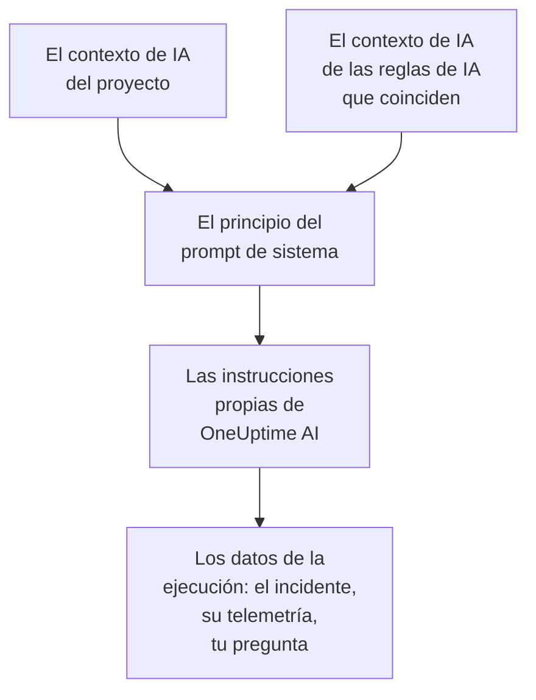

# Contexto de IA

El contexto de IA es lo que tu equipo escribe para OneUptime AI sobre tus propios sistemas: cómo encajan entre sí, de quién es cada síntoma, dónde están los logs y las palabras que usa tu equipo. OneUptime AI lo lee primero en cada investigación, cada corrección, cada borrador de post mortem y cada conversación de Preguntar a la IA, así que empieza por lo que tu equipo ya sabe.

:::cards
- [Escribir el contexto de IA](#escribir-el-contexto-de-ia): Una tarjeta en los ajustes de IA del proyecto.
- [Las notas propias de una regla de IA](#las-notas-propias-de-una-regla-de-ia): Notas sobre lo que coincide con una regla.
- [Qué lo lee](#qué-lo-lee): Las funciones que lo leen, y las que no.
- [Qué leyó una ejecución](#qué-leyó-una-ejecución): Cada ejecución muestra las notas que recibió.
:::

## Cómo funciona

OneUptime AI pone el contexto de IA al principio de su prompt de sistema, antes de sus propias instrucciones y de los datos de la ejecución: primero las notas del proyecto, luego las de las reglas de IA que coinciden. Las lee como conocimiento de fondo de tu equipo. No son una prueba de lo que está pasando ahora, y nunca cambian las reglas propias de OneUptime AI.

Como las notas van primero y no cambian de una ejecución a la siguiente, forman parte del principio del prompt que los proveedores guardan en caché. Con Anthropic, OneUptime marca el prompt de sistema para la caché; OpenAI, Azure OpenAI y los demás proveedores que guardan en caché el principio repetido de un prompt lo hacen por su cuenta. Las notas que no han cambiado cuestan menos de volver a leer.

## Escribir el contexto de IA

:::steps
### Abrir las funciones de IA
Abre **Ajustes del proyecto → IA → Funciones de IA**. La tarjeta **Contexto de IA** está debajo de **Habilitar IA**.

### Escribir las notas
Haz clic en **Añadir contexto de IA**, o en **Editar** cuando ya haya notas. Escribe en Markdown, o haz clic en **Empezar con un esquema** para tener un encabezado para cada tipo de nota.

### Guardarlas
Haz clic en **Guardar cambios**. La tarjeta muestra las notas, su longitud y más o menos cuántos tokens lee un modelo para ellas.
:::

Escribe lo que le contarías a alguien que se acaba de unir al equipo:

| Tipo de nota | Por ejemplo |
| --- | --- |
| Cómo encajan tus sistemas | `checkout-api` sirve la página de pago y depende de `payments-db`. |
| De quién es cada síntoma | Un 502 en la página de pago es del equipo de Pagos: revisa primero `payments-db`. |
| Dónde están los logs | Los logs del pago están en Loki bajo `app=checkout`. |
| Las palabras de tu equipo | PSP es nuestro proveedor de servicios de pago. |

> [!WARNING]
> No pongas secretos: cualquiera que pueda ver lo que hizo una ejecución de IA puede leer las notas que recibió.

## Las notas propias de una regla de IA

Una regla de IA puede tener sus propias notas sobre los incidentes o las alertas que coinciden con ella: los servicios de un producto, sus responsables, dónde están sus logs. Escríbelas en el campo **Contexto de IA** de la regla, en **Más campos**, después de **Proveedor de LLM**. Una regla que solo ejecuta sus runbooks cada vez no le pide nada a OneUptime AI, así que no tiene contexto de IA que escribir.

- Una investigación lee las notas del proyecto y luego las de cada regla de IA habilitada que investiga y coincide con el incidente o la alerta, en el orden de los nombres de las reglas.
- Una corrección lee las notas del proyecto y luego las de su propia regla.
- La conversación sobre un incidente o una alerta lee las mismas notas que su investigación.

## Qué lo lee

| Función | Qué lee |
| --- | --- |
| Las investigaciones de AI SRE, y sus nuevas comprobaciones cuando se abre una alerta nueva | Las notas del proyecto, y las de las reglas de IA que coinciden |
| Las correcciones que inicia una regla de IA: sus planes, comandos y servidores MCP | Las notas del proyecto, y las de la regla |
| Preguntar a la IA, y la conversación sobre un incidente o una alerta | Las notas del proyecto; en un incidente o una alerta, también las de las reglas de IA que coinciden |
| Las respuestas en Slack y Microsoft Teams | Las notas del proyecto |
| Los borradores de post mortem, de incidentes y de episodios | Las notas del proyecto |
| La clasificación de AI Insights y la de los casos de seguridad | Las notas del proyecto |

Las llamadas que solo reformulan o juzgan lo que reciben no lo leen: los borradores de notas y de notas públicas, los resúmenes de llamadas, el resumen, la confianza y la nota de una investigación, y el título de una conversación. Tampoco los prompts que las personas escriben ellas mismas, en el paso de IA de un flujo de trabajo.

## Límites

| Qué | Como máximo |
| --- | --- |
| El contexto de IA del proyecto | 20.000 caracteres |
| El contexto de IA de una regla de IA | 5.000 caracteres |
| Todo el contexto de IA que lee una ejecución | 30.000 caracteres |

El formulario cuenta los caracteres mientras escribes y rechaza guardar por encima del límite, y la API también. Una ejecución lee primero las notas del proyecto y luego las de cada regla que coincide, en el orden de sus nombres. Una regla cuyas notas harían pasar la ejecución de 30.000 caracteres se deja fuera entera, y la actividad de la ejecución lo dice.

El número de tokens es una estimación: el tamaño de las notas en bytes UTF-8 dividido entre 4, redondeado hacia arriba. Cada modelo cuenta los tokens a su manera, así que la cuenta de un proveedor puede ser distinta, sobre todo con un texto que no está en inglés.

## Qué leyó una ejecución

Cada ejecución guarda palabra por palabra las notas que leyó. Su actividad dice **Se leyó el contexto de IA del proyecto**, o de cuántas reglas de IA leyó también las notas, con más o menos cuántos tokens fueron. **Ver** abre las notas tal como las leyó la ejecución: primero las del proyecto y luego las de cada regla bajo su nombre, incluso después de que hayan cambiado. Cuando las notas de una regla se dejaron fuera por el límite de la ejecución, un aviso lo dice.

## Quién puede cambiarlo

- **Project Owner** y **Project Admin** pueden cambiar el contexto de IA del proyecto. **Project Member**, **Viewer** y **Read Project** pueden leerlo.
- Las notas de una regla de IA son parte de la regla: quien puede cambiar la regla puede cambiarlas.
- Las notas solo se leen para su propio proyecto: ninguna ejecución lee el contexto de IA de otro proyecto.

A través de la API o de Terraform, las notas del proyecto son el campo `aiContext` del proyecto, y las de una regla de IA, el propio `aiContext` de la regla.

## Próximos pasos

:::cards
- [AI SRE](/docs/ai/ai-sre): Deja que OneUptime AI investigue cada incidente y cada alerta nuevos.
- [Preguntar a la IA](/docs/ai/ask-ai): Pregunta por los datos de tu proyecto en una conversación.
- [Proveedores de LLM](/docs/ai/llm-provider): Elige el modelo que lee las notas.
:::
