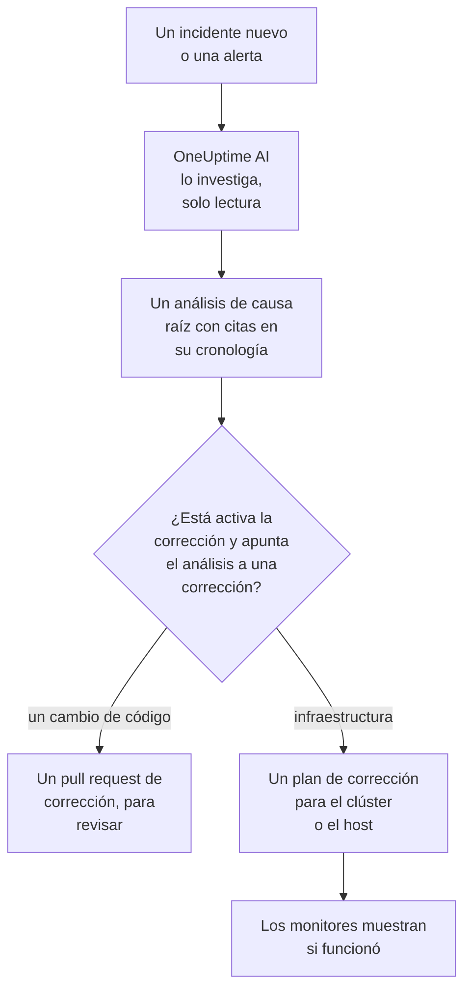
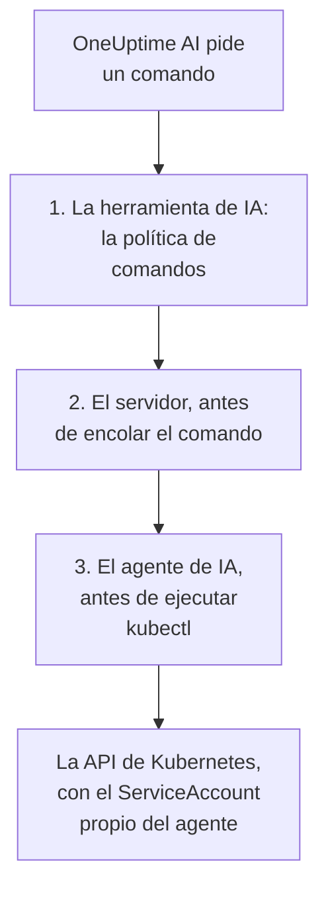

# AI SRE

OneUptime AI es tu ingeniero de fiabilidad de sitios (SRE) con IA. En cuanto se declara un incidente o una alerta nuevos, se pone en marcha, lo investiga con tu propia telemetría —registros, métricas, trazas, excepciones, monitores y cambios recientes— y publica un análisis de causa raíz con citas en la cronología del incidente o de la alerta, normalmente antes de que la persona de guardia termine de leer el aviso.

Cada afirmación del análisis lleva una cita que enlaza directamente con los datos exactos que la respaldan, y la investigación en sí es **estrictamente de solo lectura**: OneUptime AI nunca puede cambiar nada de tu proyecto mientras investiga.

:::cards
- [Cómo funciona](#cómo-funciona): De un incidente nuevo a un análisis con citas, y a una corrección cuando la permites.
- [Habilitar las investigaciones de IA](#habilitar-las-investigaciones-de-ia): Los interruptores y lo que necesitan.
- [Acceso al clúster: deja que OneUptime AI ejecute kubectl](#acceso-al-clúster-deja-que-oneuptime-ai-ejecute-kubectl): Investigar, y corregir, dentro de Kubernetes.
- [Control de costes](#control-de-costes): Límites para los incidentes, para las alertas y para todo el proyecto.
:::

## Cómo funciona

OneUptime AI hace tres cosas ante un incidente o una alerta nuevos, y cada una tiene su propio interruptor:

- **Investiga** (activado por defecto). Lee tu telemetría, y los clústeres y hosts donde se ejecuta un agente de IA, y publica un análisis de causa raíz con citas. Una investigación no cambia nada.
- **Corrige** (desactivado por defecto). Cuando la corrección está activada, un análisis con suficiente confianza se convierte en una corrección: un pull request con un cambio en tu código, o un plan de comandos para un clúster o un host, ejecutado como lo permita el agente de IA de ese clúster o host.
- **Aprende.** Las páginas de Hallazgos de IA cuentan lo que sigue fallando, a partir de todo lo que se ha registrado.



Un análisis que no encuentra ninguna causa se publica en silencio, sin avisar a nadie (consulta [Modo silencioso](#modo-silencioso)), y no se corrige nada sin una causa.

## Qué publica la investigación

Cuando una investigación termina, OneUptime AI publica un análisis de causa raíz con estas secciones:

- **Summary**: una o dos frases que alguien a quien se ha avisado puede leer en cinco segundos.
- **Most likely root cause**: la hipótesis, con solo la confianza que respaldan las pruebas y cada afirmación factual citada. Si la telemetría no basta, la IA lo dice claramente y enumera lo que comprobó en lugar de adivinar.
- **Evidence**: los hallazgos clave que respaldan o descartan la hipótesis, cada uno citado.
- **Suggested next steps**: acciones concretas para la persona de guardia.

En los incidentes, el análisis se publica en el feed del incidente **y** como nota interna del incidente (donde colaboran quienes lo atienden). En las alertas, se publica en el feed de la alerta.

Mientras se ejecuta la investigación, la página del incidente o de la alerta muestra en directo un panel **Investigación de IA** que narra cada paso —qué herramientas se ejecutaron, qué encontraron y cuánto tardaron—, para que puedas verla pensar. Si una investigación falla, el panel muestra el motivo del fallo en lugar de un hueco silencioso.

Una investigación se ejecuta hasta terminar: **no tiene límite de tiempo** ni un presupuesto de consultas pequeño, así que puede ejecutar todas las consultas y todos los comandos kubectl o de infraestructura que necesite. Una salida de comando larga (un `kubectl describe node` de un nodo con mucha carga, los registros de un pod) nunca se corta: OneUptime AI la lee página a página. Si quieres un corte firme, define un **límite de tiempo de investigación** por tipo de señal (consulta **Control de costes** más abajo).

## Qué lee una investigación

Una investigación parte del incidente o de la alerta y de la infraestructura a la que está vinculado: los hosts, los hosts de Docker y Podman, los clústeres de Kubernetes, las bases de datos y los servicios que vigilan sus monitores. Un monitor de sitio web, de API o sintético vigila aquello a lo que lo vinculas en **Monitor → Vista general → Recursos vinculados**, así que vincúlalo a los hosts que sirven lo que comprueba, y cada investigación de sus incidentes empezará ahí. Antes que todo eso, lee el [contexto de IA](/docs/ai/ai-context) del proyecto: lo que tu equipo escribió para OneUptime AI sobre tus propios sistemas, con las notas de las reglas de IA que coinciden.

- Las alertas de esa infraestructura que se abrieron en los 30 minutos anteriores al incidente, o que siguen abiertas, las más nuevas primero, como la alerta de CPU alta del host que hay detrás de un sitio lento. Las alertas privadas se omiten.
- Las métricas propias de la infraestructura, leídas como las lee una persona. Las métricas de host como `system.cpu.utilization` y `system.memory.utilization` se informan una vez por estado, y los estados suman el 100 %, así que un promedio de todos no dice nada. OneUptime AI las lee estado por estado (la CPU ocupada es user más system), y cualquier métrica por contenedor, por punto de montaje o por cualquier otro atributo.
- Los contenedores de un host de Docker o Podman: los más ocupados por CPU, memoria o reinicios, y los que dejaron de enviar datos. Un contenedor detenido no envía nada en lugar de cero, así que las cifras del host completo lo ocultan.
- Los cambios registrados en las 2 horas anteriores al incidente o a la alerta —despliegues, rollouts de Kubernetes, cambios de configuración y las correcciones que ejecutó OneUptime— y cuáles de ellos convierte en sospechosos la telemetría de sus servicios: un servicio que empeoró de forma medible justo después de un cambio. Consulta [Despliegues y cambios](/docs/telemetry/change-events).

La actividad de la investigación en la tarjeta **Investigación de IA** indica cuántas alertas abiertas o recientes leyó y en qué recursos.

### Se vuelve a comprobar cuando se abre una alerta nueva

Una investigación empieza en el momento en que se declara un incidente, y una alerta de host que necesita unos minutos de métricas puede abrirse después. Cuando se abre una alerta en la infraestructura vinculada al incidente en los 30 minutos siguientes al incidente, después de que la investigación la leyera, y el incidente sigue abierto, OneUptime AI vuelve a comprobar el incidente una vez más con esa alerta en la mano. El nuevo análisis empieza con **Checked again** y la alerta que motivó la comprobación, y su actividad también lo indica. Si una regla de IA hizo que OneUptime AI esperara antes de investigar el incidente, esos minutos se cuentan en cambio desde que terminó su investigación (consulta [Esperar antes de investigar](#esperar-antes-de-investigar)).

Esto ocurre como mucho una vez por incidente, con los mismos interruptores y límites que una investigación nueva: **Habilitar IA**, _Investigar los incidentes nuevos_, los créditos de IA y los límites diarios y de simultaneidad. No hay nada que activar. Una comprobación de seguimiento nunca vuelve a ejecutar la remediación automática ni tiene a su vez un seguimiento, y la investigación de una alerta no se vuelve a comprobar.

## Habla con OneUptime AI sobre el incidente

La tarjeta **Investigación de IA** termina con una conversación, **Ask OneUptime AI**, compartida por todas las personas que pueden ver el incidente o la alerta. Es una sola tarjeta pase lo que pase encima: bajo un informe haces preguntas de seguimiento, y cuando no se ejecutó ninguna investigación automática (o se detuvo antes de informar) la primera sugerencia es **¿Cuál es la causa raíz?**, que hace que OneUptime AI investigue a petición.

- **Haz preguntas de seguimiento**: «¿qué pods usan más memoria?», «¿qué cambió justo antes de que empezara esto?», «¿hay algo más afectado?». OneUptime AI parte de su informe, consulta datos nuevos (y ejecuta comandos kubectl o de infraestructura de solo lectura donde tiene acceso, en los clústeres y recursos que puedes ver) y cita cada afirmación.
- **Pídele que actúe**: «reconoce este incidente», «publica una actualización de estado diciendo que estamos investigando», «avisa a la guardia de base de datos», «sube la gravedad». Usa las mismas acciones que Preguntar a la IA y siempre actúa **con tus propios permisos**, así que nunca puede hacer más de lo que podrías hacer tú.
- **Elige cómo actúa** con el interruptor del cuadro de mensaje, que indica a su lado qué significa el modo elegido: _Auto-run_ (el predeterminado: actúa en el acto ante una petición clara), _Ask to act_ (primero muestra una tarjeta de aprobación, que cualquiera en el incidente puede aprobar o rechazar) o _Solo lectura_.
- **Un único hilo compartido.** Cada pregunta muestra quién la hizo, todo el mundo ve la misma conversación en directo y cualquiera puede detener una respuesta en curso. Los gráficos y las tablas de una respuesta se muestran a quien preguntó; los demás ven la respuesta con citas. Cada respuesta enumera sus **Orígenes**, y un origen con página propia (registros, métricas, un monitor) la abre. Un hilo largo se abre en sus mensajes más recientes, con un botón encima (por ejemplo **Show 6 earlier messages**) que trae el resto.

Un incidente o una alerta que OneUptime AI no investigó ni corrigió porque la IA estaba desactivada para él —desactivada en el proyecto, _Investigar los incidentes nuevos_ (o las alertas) desactivado al crearse, ninguna regla de IA que investiga coincidía con él o su gravedad estaba por debajo del mínimo— recibe en su lugar una tarjeta de una línea: **La investigación de IA está desactivada** (o **La IA está desactivada en este proyecto**, mientras lo esté; **La investigación de IA estaba desactivada** cuando vuelve a estar activada) y por qué. Su flecha, **Qué puedes hacer**, abre qué activar, con un enlace al lugar donde se cambia para quienes pueden cambiarlo y quién puede cambiarlo para los demás; un cambio solo vale para los incidentes y alertas nuevos, no para este. Mientras la IA esté activada, **Ask OneUptime AI** en la línea abre la conversación, y una conversación que alguien ya empezó se muestra sola bajo la línea. La tarjeta **Remediación** no se muestra entonces: la línea dice por qué no se corrigió nada.

## Habilitar las investigaciones de IA

Las investigaciones autónomas están **activadas por defecto en los proyectos nuevos**. También lo están los borradores de post mortem y los Hallazgos de IA. La corrección empieza desactivada, y los pull requests que forman parte de ella solo se abren mientras está activada (consulta [Correcciones de código automáticas](#correcciones-de-código-automáticas)). Un proyecto creado antes de este valor predeterminado conserva su ajuste; activa las investigaciones como en el paso 3, o con **Activar** en la página **Agente de IA** de cualquier clúster de Kubernetes (Project Owner o Project Admin). Para comprobarlas o cambiarlas:

:::steps
1. **Configura un proveedor de LLM.** Las instalaciones autoalojadas traen su propia clave (o funcionan totalmente aisladas con Ollama en local): consulta [Proveedores de LLM](/docs/ai/llm-provider). Los usuarios de OneUptime Cloud pueden usar el proveedor global preconfigurado, facturado como tokens de IA medidos, así que el proyecto necesita créditos de IA: una persona propietaria del proyecto o alguien con **Manage Billing** los añade en **Ajustes del proyecto → IA → Créditos de IA**, donde la **Recarga automática** evita que se agoten.
2. **Asegúrate de que la IA está habilitada en el proyecto** (lo está por defecto): **Habilitar IA**, en **Ajustes del proyecto → IA → Funciones de IA**.
3. **Elige por tipo de señal** (ambos activados en los proyectos nuevos):
   - Incidentes: **Incidentes → IA → Ajustes**: activa _Investigar los incidentes nuevos_.
   - Alertas: **Alertas → IA → Ajustes**: activa _Investigar las alertas nuevas_.
:::

Cada comportamiento de la IA en esas páginas es un interruptor que se guarda en cuanto lo cambias; no hay botón de Guardar. La página de incidentes tiene tres, bajo **Qué hace la IA de OneUptime**: _Investigar los incidentes nuevos_, _Corregir automáticamente los incidentes nuevos_ y _Redactar un post mortem cuando se resuelve un incidente_. La página de alertas tiene los mismos, sin el post mortem. _Corregir automáticamente los incidentes nuevos_ (y _Corregir automáticamente las alertas nuevas_) empieza **desactivado**, también en los proyectos nuevos: permite que OneUptime AI cambie tu infraestructura, así que es el proyecto quien lo activa; consulta [Qué incidentes se investigan y se corrigen](#qué-incidentes-se-investigan-y-se-corrigen). Los pull requests que abre, una corrección de tu código y la telemetría que le faltó a una investigación, forman parte de él, y cada regla de IA los define: sin reglas se abren ambos, y una regla puede desactivar cualquiera de los dos en **Más campos** (consulta [Correcciones de código automáticas](#correcciones-de-código-automáticas)). Los Project Owners y los Project Admins pueden cambiarlos; para el resto, cada interruptor está bloqueado e indica qué permiso necesita.

Las páginas solo dicen dos cosas cuando son ciertas. Si **Habilitar IA** está desactivado, no se ejecuta nada de ellas, y la página lo dice arriba, con el propio interruptor Habilitar IA para quienes pueden cambiarlo (los Project Owners y cualquiera con Manage Billing); al resto se le dice quién puede. Si el proyecto no tiene ningún proveedor de LLM que OneUptime AI pueda usar —ninguno en absoluto, o proveedores pero ninguno marcado como predeterminado—, la página también lo dice, con un enlace a **Ajustes del proyecto → IA → Proveedores de LLM**. En OneUptime Cloud cuenta el proveedor global, así que allí no se dice nada.

Los incidentes y las alertas se configuran por separado, de modo que puedes dar a cada tipo de señal su propio tope de simultaneidad, su presupuesto diario de tokens, su presupuesto de tareas de corrección y sus propias reglas. Ninguno de esos límites se aplica hasta que lo defines: están plegados bajo **Más ajustes**, al final de cada página; consulta **Control de costes** más abajo. Cambiar un ajuste de IA de las alertas no cambia el ajuste correspondiente de los incidentes, ni al revés.

La corrección se apoya en las investigaciones: mientras **Corregir automáticamente los incidentes nuevos** (o las alertas) está activado, una investigación que identifica con confianza un cambio de código en un repositorio abre automáticamente un pull request de corrección; consulta **Correcciones de código automáticas** más abajo.

## Acceso al clúster: deja que OneUptime AI ejecute kubectl

De entrada, una investigación solo puede usar la telemetría que envían tus agentes. Para una señal de Kubernetes eso a menudo no basta: «pods atascados en Pending» es un problema de planificación que se diagnostica describiendo el pod y leyendo sus eventos, no mirando una métrica. El **Agente de IA de Kubernetes** permite que OneUptime AI haga exactamente eso y, si lo permites, que corrija lo que encuentra.

La página de cada clúster tiene una sección **IA** en su menú lateral:

- **Agente**: la página **Agente de IA** del clúster: si el agente está conectado, qué puede hacer la IA en el clúster y todo lo que requiere atención, cada cosa con el paso que la resuelve. La misma explicación aparece en el panel de investigación del incidente cuando la IA tuvo que investigar solo con datos de OneUptime.
- **Análisis**: la página **Hallazgos de IA** del clúster: lo que OneUptime AI averiguó sobre el clúster, qué sigue fallando y por qué, y qué hacer al respecto (consulta [Lo que la IA aprendió en un clúster](#lo-que-la-ia-aprendió-en-un-clúster)).
- **Registros**: la página **Registros de IA** del clúster: todo lo que OneUptime AI hizo en el clúster, de lo más reciente a lo más antiguo (consulta [Todo lo que la IA hizo en un clúster](#todo-lo-que-la-ia-hizo-en-un-clúster)).

La **Vista general** del clúster termina con una tarjeta **Agente de IA** que resume la página del agente de IA: si el agente está conectado, si **Investigar con kubectl** está activado, cómo se ejecutan las correcciones (**Desactivado**, **Pedir aprobación**, **Automático** u **Omitir aprobación**) y qué requiere atención, con un enlace a la página del agente de IA, donde se cambian.

### El agente de IA de Kubernetes: activado por defecto y de solo lectura

El chart del [agente de Kubernetes de OneUptime](/docs/telemetry/kubernetes-agent) ejecuta por defecto el agente de IA de Kubernetes: un pod pequeño (`component=ai-agent`, imagen `oneuptime/kubernetes-ai-agent`) con un ServiceAccount de **solo lectura**. Se conecta con la clave de API que ya usa el chart, así que no hay nada que configurar en el panel: en un minuto, la página del agente de IA del clúster lo muestra como **Conectado** y **Investigar con kubectl** está activado, salvo que alguien ya haya elegido ahí ajustes de IA para el clúster, que se conservan tal cual.

En un agente instalado antes de que existiera el agente de IA de Kubernetes, actualiza primero el índice de tus charts y luego haz la actualización:

```bash
helm repo update
helm upgrade kubernetes-agent oneuptime/kubernetes-agent \
  --namespace oneuptime-agent --reset-then-reuse-values \
  --set aiAgent.enabled=true
```

`kubernetes-agent` en `oneuptime-agent` son el nombre de la release y el espacio de nombres que usan las instrucciones de instalación del panel; si instalaste el agente con otros nombres, usa los tuyos (`helm list -A | grep kubernetes-agent` los muestra). Sin `helm repo update`, Helm puede resolver el chart desde el que instalaste, que no conoce `aiAgent` y falla con `Additional property aiAgent is not allowed`. En un OneUptime autoalojado, actualiza OneUptime antes que el chart: consulta [Actualizar el agente](/docs/telemetry/kubernetes-agent#actualizar-el-agente). Para ejecutar el chart sin el agente de IA, pasa `--set aiAgent.enabled=false`.

**Probar conexión**, en el menú **⋯** junto al estado del agente en la página del agente de IA, ejecuta `kubectl version` y `kubectl auth can-i --list` a través del agente y muestra los resultados: a qué puede llegar y qué puede hacer. Si la página dice que el agente no está conectado, lee su registro con `kubectl logs -n oneuptime-agent -l component=ai-agent --tail=100`. Una clave con un **Nombre de servicio fijado** no puede registrar el agente: dale al chart una clave sin él. Cuando el servidor rechaza un registro, el registro del agente dice si el rechazo se resolverá solo (un pod anterior del agente que todavía se reporta, o el antiguo Runner del clúster que aún se está apagando durante una actualización) o qué hay que cambiar. **Restablecer agente**, en el mismo menú, hace que el servidor olvide la clave del agente en cuanto lo confirmas; el pod se vuelve a conectar solo en unos minutos.

El agente de IA de Kubernetes no es un Runner y nunca aparece en Runbooks → Agentes de runbook. Solo usa su propio ServiceAccount, así que OneUptime nunca le entrega una credencial, nunca se usa como host Bash/SSH para los runbooks y nunca se acepta como Runner de comandos de una regla de IA.

### Lo que puede hacer la IA: lo decide el agente

Lo que OneUptime AI puede hacer en un clúster se define donde se ejecuta el agente, en el chart, con dos valores:

- `aiAgent.investigation`: `true`: la IA puede ejecutar kubectl de solo lectura en el clúster mientras investiga. `false`: sigue investigando, con los datos que OneUptime ya tiene.
- `aiAgent.fixes`: cómo aplica la IA una corrección: `off`, `ask-for-approval`, `automatic` o `bypass-approval` (consulta [Cómo funcionan las correcciones](#cómo-funcionan-las-correcciones)). Todos los niveles salvo `off` dan al agente de IA acceso de escritura; con `off` no tiene ninguno y rechaza él mismo cualquier escritura.

El agente de IA comunica ambos a OneUptime en cada heartbeat, y OneUptime los aplica al clúster. **Lo que puede hacer la IA**, en la página del agente de IA del clúster, los muestra (**Activado** y el nivel de correcciones, en verde cuando están activados) sin forma de cambiarlos ahí; **Cambiar** muestra cada opción con el `helm upgrade` exacto que la define. Un cambio hecho en cualquier otro sitio (la página del agente de IA, la API o Terraform) se rechaza mientras el agente los define.

Una release que no define ninguno de los dos valores deja que el agente use sus valores predeterminados (investigación activada; correcciones desactivadas, o ask-for-approval con el antiguo `aiAgent.remediation.enabled=true`). OneUptime solo aplica esos valores predeterminados a un clúster cuyos ajustes de IA nadie eligió en su página del agente de IA: los ajustes elegidos ahí se conservan tal cual, y la página muestra el comando que los traslada al chart. Lo mismo ocurre con un clúster cuyo agente de IA es demasiado antiguo para comunicarlos: actualizar el chart con los dos valores los traslada.

### Deja que la IA corrija lo que encuentra

Las correcciones están desactivadas hasta que las activas con `aiAgent.fixes`, que además da al agente de IA acceso de escritura; lo ideal es que sea solo en los espacios de nombres que la IA puede corregir y con las operaciones de nodo desactivadas:

```bash
helm repo update
helm upgrade kubernetes-agent oneuptime/kubernetes-agent \
  --namespace oneuptime-agent --reset-then-reuse-values \
  --set aiAgent.enabled=true \
  --set aiAgent.investigation=true \
  --set aiAgent.fixes=ask-for-approval \
  --set "aiAgent.remediation.namespaces={web,api}" \
  --set aiAgent.remediation.nodeOperations=false
```

O en todo el clúster:

```bash
helm repo update
helm upgrade kubernetes-agent oneuptime/kubernetes-agent \
  --namespace oneuptime-agent --reset-then-reuse-values \
  --set aiAgent.enabled=true \
  --set aiAgent.investigation=true \
  --set aiAgent.fixes=ask-for-approval \
  --set-json 'aiAgent.remediation.namespaces=[]'
```

Sustituye `{web,api}` por los espacios de nombres que la IA puede corregir. Cada espacio de nombres de la lista debe existir ya: el chart crea un RoleBinding en cada uno y nunca crea un espacio de nombres, así que uno que falte hace fallar toda la instalación o la actualización (el recopilador incluido) con `namespaces "api" not found`. Créalo antes o quítalo de la lista; quita un espacio de nombres de la lista antes de borrarlo. Omitir la opción en una actualización conserva la lista guardada en la release, así que para volver a todo el clúster pasa `--set-json 'aiAgent.remediation.namespaces=[]'` (Helm 3.10+), como hace el segundo comando, y no `={}`, que Helm lee como un nombre vacío y el chart rechaza. `--set aiAgent.remediation.namespaces=null` no restablece una lista guardada con `--reuse-values`: Helm conserva la lista guardada. `aiAgent.remediation.nodeOperations=false` mantiene las correcciones lejos de los nodos; ponlo a `true` para que la IA pueda acordonar, desacordonar, drenar y aplicar taints a los nodos (un drain, un taint o un patch de un nodo sigue esperando a una persona).

Usa `automatic` o `bypass-approval` en lugar de `ask-for-approval` para más autonomía, y `--set aiAgent.fixes=off` para volver a desactivar las correcciones, lo que también retira el acceso de escritura. Las correcciones también necesitan dos interruptores del proyecto. **Corregir automáticamente los incidentes nuevos** (en **Incidentes → IA → Ajustes**) y **Corregir automáticamente las alertas nuevas** (en **Alertas → IA → Ajustes**) empiezan desactivados: hasta que uno esté activado, no se corrige nada nuevo de ese tipo. **Habilitar IA** (**Ajustes del proyecto → IA → Funciones de IA**) está activado salvo que alguien lo haya desactivado; desactiva toda la IA del proyecto, diga lo que diga la configuración de un agente.

### Sobre qué incidentes actúan las correcciones de un clúster

Mientras **Corregir automáticamente los incidentes nuevos** está activado y no hay ninguna regla de IA configurada, OneUptime AI corrige cada incidente nuevo al que está vinculado el clúster, en el modo que define la página de su agente de IA, y lo mismo con las alertas con **Corregir automáticamente las alertas nuevas**. Con reglas, solo corrige los incidentes que coinciden con una regla que corrige con OneUptime AI (consulta [Qué incidentes se investigan y se corrigen](#qué-incidentes-se-investigan-y-se-corrigen)). Lo que no está vinculado, no lo toca, por muy clara que esté la causa en el clúster. Un incidente o una alerta está vinculado a un clúster cuando:

- la telemetría que lo generó nombra el clúster (un monitor de métricas, registros o trazas sobre los datos del clúster);
- su monitor es un monitor de Kubernetes del clúster;
- su monitor está vinculado al clúster en **Monitor → Vista general → Recursos vinculados**, que es la forma de vincular un monitor de sitio web, de API o sintético con el clúster que sirve lo que comprueba;
- Preguntar a la IA lo declaró en la página del clúster, o lo vinculó al clúster cuando se le pidió;
- alguien eligió el clúster en **Otros recursos afectados** al declararlo (elegir un monitor vinculado lo añade ahí por ti).

Cada incidente y cada alerta indica en su tarjeta **Remediación** si estaba vinculado a un clúster y qué hicieron las correcciones del clúster; consulta [Lo que hizo la remediación automática](#lo-que-hizo-la-remediación-automática). Lo mismo vale para un recurso de infraestructura y su agente de IA.

### Quién puede cambiarlo

Mientras el agente de IA de Kubernetes define la investigación y las correcciones, las cambia quien puede cambiar los valores del chart en el clúster; OneUptime rechaza un cambio hecho en cualquier otro sitio. Las reglas siguientes valen para lo que queda en OneUptime (la lista de permitidos de kubectl y la vinculación al Runner anterior dentro del clúster) y para la investigación y las correcciones de un clúster cuyos ajustes aún se definen en OneUptime (consulta [Lo que puede hacer la IA: lo decide el agente](#lo-que-puede-hacer-la-ia-lo-decide-el-agente)).

Activar las correcciones (cualquier paso de **Desactivado** a otro modo) y relajarlas (pasar a **Automático** u **Omitir aprobación**, escribir la lista de permitidos de kubectl o vincular un Runner) requiere un Project Owner, un Project Admin o el permiso **Edit AI Rule**, las mismas personas que pueden crear una regla de IA que corrige sin preguntar. **Restablecer agente** requiere las mismas personas que activar las correcciones. Endurecerlas (**Desactivado**, volver a **Pedir aprobación**, vaciar la lista de permitidos o quitar la vinculación del Runner) está al alcance de cualquiera que pueda editar el clúster, igual que **Probar conexión** y aprobar una corrección que OneUptime AI proponga para él. Todo esto requiere permiso para editar ese clúster en concreto: un permiso restringido a algunas etiquetas, o a los clústeres que pertenecen a ti o a tus equipos, solo llega a esos clústeres, y una entrada de bloqueo con etiquetas retira los clústeres que las llevan.

### Qué puede ejecutar una investigación

Con acceso, una investigación ejecuta kubectl de **solo lectura** a través del agente de IA (`get`, `describe`, `logs`, `events`, `top`, `rollout status/history`, `auth can-i`), tantos comandos como necesite, y cita cada comando como cualquier otra prueba. La salida nunca se corta: el agente conserva hasta un megabyte, y OneUptime AI lee una salida larga página a página. Tres comprobaciones independientes la mantienen en solo lectura: la política que clasifica cada comando, el servidor que se niega a encolar cualquier otra cosa para una investigación y el agente de IA, que vuelve a comprobar la misma política antes de lanzar kubectl. «Solo lectura: no se cambió nada en tus sistemas» sigue siendo literalmente cierto.



### Cómo funcionan las correcciones

Las **Correcciones** de la página del agente de IA tienen cuatro ajustes (el `aiAgent.fixes` del chart: `off`, `ask-for-approval`, `automatic`, `bypass-approval`):

- **Desactivado**: la IA solo investiga.
- **Pedir aprobación**: tras el análisis de causa raíz, OneUptime AI diagnostica con kubectl y compone el plan de kubectl más pequeño que aborda la causa, por ejemplo `kubectl rollout restart deployment/web -n web`. El plan aparece en el incidente con su justificación, el efecto esperado y la reversión; una persona lo aprueba con un clic y OneUptime ejecuta exactamente esos comandos. Si los monitores no se recuperan, se ejecuta la reversión y OneUptime AI compone un plan más, de nuevo para su aprobación, con el intento fallido delante, para seguir otro enfoque o decir qué debería revisar una persona.
- **Automático**: los cambios seguros se ejecutan solos; un cambio más arriesgado, nunca. Cuando la ronda solo pudo encontrar correcciones más arriesgadas, termina proponiendo exactamente esas para aprobarlas con un clic. Cuando también ejecutó una corrección segura, la más arriesgada queda en el análisis y solo se propone si la verificación muestra que la corrección segura no recuperó los monitores, en la ronda de seguimiento, que pide aprobación. Añade la forma de un comando más arriesgado a la lista de permitidos en la página del agente de IA y también se ejecutará solo. El modo automático además resuelve la señal en cuanto la verificación confirma que los monitores se recuperaron, y tiene un cortacircuitos de tres correcciones sin supervisión por clúster y por hora: por encima de eso, o mientras otra ronda sin supervisión de OneUptime AI siga cambiando o verificando el mismo clúster, una ronda propone su plan para su aprobación en lugar de ejecutarlo.
- **Omitir aprobación**: la IA no pregunta. Cada cambio que permite la política, incluidos los más arriesgados, se ejecuta solo, igual que la ronda de seguimiento tras una verificación fallida; la señal se resuelve sola en cuanto la verificación confirma la recuperación. Lo que necesita a una persona en todos los modos (más abajo) sigue esperándola. Una ronda también propone su plan para su aprobación en lugar de ejecutarlo, y explica por qué en el incidente, cuando:
  - el cortacircuitos por hora (tres correcciones sin supervisión por clúster y por hora) ha saltado o no se puede comprobar;
  - otra ronda sin supervisión de OneUptime AI sigue cambiando el mismo clúster, o verificando en él una corrección (una alerta y un incidente de un mismo monitor son el caso habitual), o eso no se puede comprobar;
  - es la ronda de seguimiento tras una corrección cuya reversión no terminó.

**Primero, la reversión.** Cuando OneUptime marcó un rollout de Kubernetes del clúster como sospechoso del incidente (consulta [Despliegues y cambios](/docs/telemetry/change-events)), OneUptime AI intenta revertirlo antes de cualquier otra corrección. OneUptime construye el `kubectl rollout undo` a partir del cambio registrado, nunca a partir de lo que escribe el modelo, y el comando se ejecuta o espera aprobación como cualquier cambio seguro en el modo del clúster. La reversión no se ofrece cuando el Deployment volvió a cambiar después de ese rollout, porque entonces deshacerlo desharía el cambio posterior.

**Workloads que declaran Argo CD, Flux o Helm.** Muchos clústeres declaran sus workloads en git y dejan que Argo CD o Flux lo apliquen, o los instalan con Helm, y un cambio de kubectl en lo que allí se declara no dura: Argo CD lo revierte en segundos cuando la Application tiene activado el self-heal (si no, en su próxima sincronización), Flux en su próxima reconciliación y un release de Helm en su próxima actualización. Por eso, antes de que OneUptime AI ejecute o proponga un cambio de kubectl, OneUptime lee con kubectl de solo lectura, a través del agente de IA del clúster, el objeto que cambia (si es un ReplicaSet, su Deployment) y quién lo declara: Argo CD (la anotación `argocd.argoproj.io/tracking-id`, la etiqueta `argocd.argoproj.io/instance` o su gestor de campos), Flux (las etiquetas `kustomize.toolkit.fluxcd.io/*` o `helm.toolkit.fluxcd.io/*`) o un release de Helm (la anotación `meta.helm.sh/release-name` o la etiqueta `app.kubernetes.io/managed-by: Helm`). Un cambio que Argo CD o Flux revierte —`rollout undo` (incluida la reversión primero), `scale` (cuando git fija el número de réplicas), `set image/env/resources`, `patch`, eliminar un workload— nunca se ejecuta solo, en ningún modo, ni con Omitir aprobación ni con la lista de permitidos: se propone para aprobarlo con un clic como **solución temporal**, y el plan nombra la solución duradera, el mismo cambio en git (el manifiesto, los values de Helm o el overlay de Kustomize del que sale el workload). Argo CD y Helm no tocan lo que git no declara, como un `rollout restart`, un `rollout pause` o una anotación añadida, así que ese cambio se ejecuta según el modo del clúster. Una Kustomization de Flux elimina incluso eso en su próxima reconciliación, así que allí una pausa, una etiqueta o una anotación también son una solución temporal. Con Flux, un reinicio se sigue ejecutando según el modo: al quitar su anotación, los pods se reinician una vez más, pero el reinicio no se deshace. Eliminar un pod que falla se ejecuta según el modo, declare quien declare el workload: git nunca declara un pod, y su ReplicaSet lo reemplaza. Un release de Helm solo revierte un cambio en su próxima actualización, así que allí el cambio también se ejecuta según el modo del clúster, y el plan dice que es temporal.

**La verificación detecta una corrección revertida.** OneUptime lee el objeto que cambia una corrección de kubectl justo antes y justo después de ejecutarla, y de nuevo cada par de minutos mientras la ventana de verificación está abierta. Una corrección que vuelve a sus valores anteriores (revertida por Argo CD, Flux, una actualización de Helm, un operador o un autoescalador) hace fallar la verificación de inmediato, y la nota dice quién la revirtió y dónde va el cambio duradero. Su reversión no se ejecuta: el clúster ya la deshizo, y deshacerla podría volver a aplicar la corrección. Un cambio que Argo CD o Flux revierte se juzga al final de su ventana, no en cuanto se recuperan los monitores. Un reinicio no deja nada que vigilar: sus pods ya se reemplazaron, pase lo que pase después con su anotación.

Un cambio **seguro** afecta exactamente a un objeto con nombre: `rollout restart/undo/pause/resume`, `scale` (a cualquier valor salvo 0), borrar un pod con nombre, `cordon`/`uncordon`, y `label`/`annotate` sobre un Pod, Deployment, StatefulSet, DaemonSet, ReplicaSet, Job o CronJob con nombre y una clave normal (no una reservada como `*.kubernetes.io/…` o `*.k8s.io/…`). Todo lo demás que permite la política es **más arriesgado**: los mismos verbos sobre un tipo sin nombre (`rollout restart deployment`), sobre varios objetos, con un selector o con `--all`; `scale` a 0; borrar un job; `taint`; `drain`; `patch`; `set image/env/resources`; `create`; borrar con `--force`; y las etiquetas o anotaciones sobre cualquier otro tipo o con una clave reservada.

Algunos límites se mantienen en **todos** los modos, Omitir aprobación incluido, y ninguna entrada de la lista de permitidos los cambia:

- Una escritura en **kube-system**, **kube-public** o **kube-node-lease** siempre necesita a una persona. Un recurso personalizado se juzga por el espacio de nombres en el que se escribe, incluso uno cuyo nombre parezca un tipo integrado de ámbito de clúster (`nodes.example.com`, `namespaces.example.com`).
- Un `drain`, un `taint` o un `patch` de un nodo siempre necesita a una persona. Drenar un nodo desaloja pods de todos los espacios de nombres (los tres de arriba y el propio del agente incluidos), y un taint `NoExecute` también los desaloja, tanto si lo pone `kubectl taint` como un `patch` del nodo.
- El agente de IA nunca cambia nada en su propio espacio de nombres (una corrección ahí podría escalar a cero el agente de Kubernetes, o al propio agente de IA), ni nada fuera de los espacios de nombres en los que su chart le deja escribir (`aiAgent.remediation.namespaces`), ni un nodo cuando su chart desactivó las operaciones de nodo (`aiAgent.remediation.nodeOperations=false`). OneUptime lee ese alcance de lo que comunica el agente de IA y rechaza una corrección así cuando OneUptime AI la propone y otra vez cuando alguien la aprueba, así que nunca llega al agente de IA como una corrección fallida; el agente de IA también la rechaza, antes de lanzar `kubectl`.
- Los comandos destructivos (más abajo) nunca se ejecutan, ni siquiera con la aprobación de una persona.

La lista de permitidos del modo automático se compara palabra por palabra con el comando analizado, no como texto libre: `*` representa exactamente una palabra (una imagen, un nombre), nunca objetos, opciones o un segundo `-n` de más, y cada opción que usa el comando debe aparecer escrita en la entrada. `kubectl set image deployment/web * -n web` permite una imagen nueva para `web` en `web`, nada más. Una entrada debe escribir su verbo (y el subcomando de `rollout`, `set` o `create`) en lugar de usar `*` para ello, y debe tener más de una palabra después del `kubectl` inicial opcional; una entrada que incumple estas reglas, como `scale` o `kubectl *`, nunca podría aprobar de antemano un cambio y se rechaza al guardarla.

:::details Comandos que nunca se ejecutan, y cómo se lee un comando
Algunos comandos **nunca** se ejecutan, sea cual sea el modo e incluso con la aprobación de una persona. La política de comandos los rechaza, y se aplica tres veces: en la herramienta del servidor, en el punto de paso obligado por el que el servidor encola y en el agente de IA antes de lanzar `kubectl`: `exec`, `attach`, `cp`, `port-forward`, `proxy`, `debug`, `run`, `edit`, `apply`, `replace`, `diff`, los plugins de kubectl y cualquier otro verbo que no esté en su lista, cualquier entrada desde archivo (`-f`, `-k`) o formato de salida que lea un archivo (`-o jsonpath-file=`, `-o go-template-file=`, `-o custom-columns-file=`, `--template`, y un `-o jsonpath`/`go-template`/`custom-columns` sin su plantilla en línea), las opciones de credenciales, de suplantación (`--as`, `--as-group`, `--as-uid`, `--as-user-extra`), de selección de clúster, `--kuberc`, de API en bruto y de registro detallado, los objetos Secret con **cualquier** verbo (OneUptime AI nunca lee, cambia, borra ni crea un Secret, y `create secret`, `create token` y `set env --resolve` se rechazan con ellos), todo lo que concede RBAC (`create role`, `create clusterrole`, `create rolebinding`, `create clusterrolebinding`, `set subject`), `certificate approve`, `set serviceaccount`, `create deployment`, `create cronjob` o `create job` con `--image` (`create job --from=cronjob/…` sigue siendo un cambio más arriesgado), `expose --overrides` o `--override-type` (la sobrescritura puede hacer que kubectl cree un Job, un ClusterRoleBinding o cualquier otro tipo de objeto en lugar de un Service), un cuerpo de `patch` que no sea JSON (kubectl lo leería como YAML, cuyas etiquetas pueden escribir un campo que ninguna comprobación ve), los patches que cambian el ServiceAccount, los volúmenes o los ajustes de seguridad de una plantilla de pod (puertos del host, la exclusión del espacio de nombres de usuario `hostUsers` y la clase de runtime `runtimeClassName` incluidos), los patches que sustituyen una parte entera de una plantilla de pod en lugar de definir campos en ella (un strategic-merge `$patch: replace`, un merge patch que define una lista `containers` entera, o un JSON patch que sustituye o elimina la especificación del pod), que descartarían esos ajustes sin nombrarlos, una etiqueta o anotación sobre objetos Namespace elegidos con `--all` o un selector en lugar de por su nombre, cualquier escritura (`patch`, `label`, `annotate`, `set`) sobre objetos RBAC, CustomResourceDefinitions, APIServices, configuraciones de webhooks de admisión o políticas de admisión, las escrituras con `--all-namespaces`, `delete --all`, y borrar espacios de nombres, nodos, volúmenes, CRD o roles de clúster. Las opciones se analizan como las analiza kubectl, de modo que una opción o un tipo prohibido no puede esconderse detrás de otro: las opciones cortas combinadas se separan letra a letra (`-As` se detecta), las opciones con valor opcional (`--cascade`, `--dry-run`, `--validate`) nunca se tragan la palabra siguiente, y toda opción salvo `-n`/`--namespace`, `--request-timeout` y `--match-server-version` debe ir después del verbo (y después del subcomando de `rollout`, `set`, `create`, `auth`, `cluster-info` y `top`), porque kubectl elige el comando antes de analizar las opciones. El agente de IA incluye su propio kubectl con versión fija (v1.36.5) y desactiva kuberc, de modo que un archivo kuberc no puede añadir valores predeterminados ni alias a un comando después de que la política lo haya comprobado. Entrega a cada comando un kubeconfig privado para su propio ServiceAccount que apunta al archivo de token montado, nunca una copia del token.
:::

### Lo que el RBAC del agente de IA limita, y lo que no

:::details Lo que concede el RBAC del chart
El RBAC del chart es una capa distinta de la política, y limita **dónde** puede escribir el agente de IA, no lo que puede hacer una escritura. El acceso de solo lectura (get/list/watch, registros de los pods) se concede en todo el clúster. `aiAgent.remediation.enabled` añade patch/update sobre Deployments, StatefulSets, DaemonSets, ReplicaSets y su subrecurso scale, Jobs, CronJobs, Pods y HPA; create sobre Jobs y HPA; y delete solo sobre Pods y Jobs. `aiAgent.remediation.nodeOperations` (activado por defecto) añade cordon, uncordon, taint y drain sobre los nodos, en todo el clúster; ponlo a `false` y el chart no concede RBAC de nodos y se lo indica al agente de IA (`ONEUPTIME_KUBECTL_ALLOW_NODE_OPERATIONS=false`), que entonces rechaza cordon, uncordon, drain, taint y label/annotate/patch sobre un nodo antes de lanzar kubectl; y, como el agente de IA comunica el interruptor, OneUptime ya rechaza una corrección así cuando se propone o se aprueba. Nunca concede Secrets, `exec`, `attach`, `port-forward`, tokens de ServiceAccount, suplantación, CRD ni escrituras de RBAC, así que borrar cualquier otro tipo, o etiquetar un Service, un ConfigMap, un Ingress, un Namespace o un PVC, falla en el servidor de API con `Forbidden` aunque una persona lo haya aprobado. Las dos capas no son copias la una de la otra: para el RBAC, `apply`, `edit`, `replace`, las escrituras con `--all-namespaces` y `delete --all` son llamadas patch, update y delete normales, y solo la política las detiene.
:::

:::warning Lo que supone el acceso de escritura
Ten claro, eso sí, lo que supone ese acceso de escritura: **patch/update sobre workloads, pods y CronJobs, y create sobre Jobs, en un espacio de nombres equivale a ejecutar cualquier imagen como cualquier ServiceAccount de ese espacio de nombres y a leer sus Secrets.** Una plantilla de pod puede nombrar cualquier imagen, ServiceAccount y volumen de Secret, y el RBAC no tiene un verbo «patch, pero no la plantilla del pod»; que ninguna regla nombre `exec` ni los Secrets no lo cambia. Por eso la política rechaza cambiar con qué ServiceAccount, ajustes de seguridad, volúmenes, comando o conexión de Secrets se ejecuta un pod (patches de seguridad de la plantilla del pod, patches que sustituyen la especificación del pod o una lista `containers` entera, `set serviceaccount`, `create … --image`, `expose --overrides`, cuerpos de patch que no son JSON), por eso los espacios de nombres protegidos siempre necesitan a una persona, y por eso existe `aiAgent.remediation.namespaces`. La política **no** rechaza cambiar una imagen: `set image`, o un patch de un campo de imagen, es un cambio más arriesgado (la imagen nueva se ejecuta como el propio ServiceAccount del workload, con sus Secrets) que aprueba una persona, salvo que el clúster omita las aprobaciones o que su lista de permitidos nombre el comando. Sin `aiAgent.remediation.namespaces`, el rol de escritura se vincula en todo el clúster (kube-system, kube-public, kube-node-lease y el propio espacio de nombres del agente incluidos, ya que el RBAC no puede excluir espacios de nombres de una vinculación de todo el clúster), y ahí son la política y el agente de IA quienes mantienen la línea, no el RBAC. Con él, el chart vincula el rol exactamente en los espacios de nombres que enumeras, OneUptime rechaza una escritura en cualquier otro sitio cuando se propone o se aprueba, y el agente de IA la vuelve a rechazar antes de lanzar kubectl.
:::

### Lo que la IA aprendió en un clúster

La página **Hallazgos de IA** del clúster (IA → Análisis) te cuenta lo que vale la pena saber sobre el clúster a partir de los últimos 30 días: no un registro de lo que hizo la IA, sino lo que averiguó:

- **Lo que encontró OneUptime AI**: las pocas cosas que más importan, la más importante primero, cada una con los incidentes y las alertas que hay detrás y un siguiente paso:
  - un problema que vuelve una y otra vez: con qué frecuencia (cuenta cada incidente y cada alerta que generó, investigados o no) y qué parte del total supone, si es nuevo esta semana o va a peor, la hora del día a la que suele empezar (en tu propia zona horaria), las partes del clúster a las que afecta, lo que encontró la última investigación y el primer paso que sugiere su informe;
  - una corrección que no resolvió su problema, y las correcciones que esperan tu aprobación;
  - un riesgo detectado antes de que se avisara a nadie: un [hallazgo](#hallazgos-detección-proactiva) abierto de gravedad High o Medium sobre la propia telemetría del clúster;
  - el nodo, el pod, el espacio de nombres o el workload que hay detrás de varios problemas distintos, enlazado a su propia página en el clúster;
  - lo que la IA corrigió por su cuenta y si la corrección se mantuvo, y, cuando tu equipo aprobó todas las correcciones que propuso la IA, que la IA podría aplicar por su cuenta correcciones como esas;
  - un problema que volvía una y otra vez y que paró tras una corrección.

  Cuando nada destaca, la página lo dice.
- **Otros problemas**: todo lo demás que examinó la IA, agrupado según lo que lo generó (un monitor es un problema, por muchos pods o nodos para los que se haya disparado), lo más frecuente primero: con qué frecuencia, qué espacios de nombres, workloads, pods o nodos afecta, lo que encontró y sugiere la última investigación, qué pasó con las correcciones que propuso la IA y qué dijeron tu equipo y la evaluación de los hallazgos. Un problema que apareció más de una vez se marca como **Recurrente**, **Nuevo esta semana** o **Va a peor**.
- **Dónde ocurren los problemas**: las partes del clúster que más aparecieron, y en cuántos problemas distintos.
- **Detectado antes de que se avisara a nadie**: los demás hallazgos abiertos que los detectores registraron sobre la propia telemetría del clúster.
- **Lo que hizo OneUptime AI aquí**: la nota al pie: cuántas investigaciones, correcciones y comandos hubo y cuántos fallaron, las investigaciones por día, en qué acabaron las correcciones que propuso la IA y si las aplicadas resolvieron el problema, y qué falló en el propio trabajo de la IA (investigaciones fallidas, comandos que el agente nunca recogió, hallazgos que tu equipo rechazó), cada cosa con dónde mirar.

Con **Habilitar IA** desactivado en el proyecto, o sin ningún proveedor de LLM que OneUptime AI pueda usar, la página lo dice arriba: no se investiga nada nuevo, así que no aparece nada nuevo.

Todo lo que hay en la página sale de lo que OneUptime ya registró (los incidentes y las alertas, sus investigaciones y sus conclusiones, los veredictos sobre ellas, las correcciones y los comandos) y no se llama a ningún modelo para construirla: las palabras que son de la propia IA (un hallazgo, un paso sugerido) las escribió la investigación que los encontró, y se muestran como suyas. Cualquiera que pueda ver el clúster puede ver la página, y esta solo nombra los incidentes y las alertas que esa persona puede leer.

### Todo lo que la IA hizo en un clúster

La página **Registros de IA** del clúster (IA → Registros) es el registro de todo lo que OneUptime AI hizo allí, de lo más reciente a lo más antiguo: cada investigación con su incidente o alerta y su resumen, cada corrección que propuso o ejecutó con su estado, y cada comando kubectl (de investigación o de corrección) con el comando, su estado y cuándo se ejecutó. El resumen de una investigación es su TL;DR o, cuando no se pudo escribir un TL;DR, el resumen con el que empieza su informe. Esta página se llamaba antes Hallazgos de IA; un marcador de su dirección antigua abre ahora la página Hallazgos de IA, que enlaza aquí.

### A través del Runner anterior dentro del clúster

Los clústeres configurados con un chart anterior (`aiAccess.enabled=true`) llegan a OneUptime AI a través del Runner anterior dentro del clúster hasta que se actualiza el chart. La actualización sustituye ese Runner por el agente de IA de Kubernetes y conserva sus ajustes: consulta [Actualizar el agente](/docs/telemetry/kubernetes-agent#actualizar-el-agente).

Un Runner fuera del clúster ya no llega a él: lo hacía con una credencial de runbook de Kubernetes, y las credenciales de runbook se eliminaron. Un clúster que no ejecuta el chart del agente de Kubernetes obtiene el kubectl de OneUptime AI instalándolo: el agente de IA de Kubernetes del chart es la forma de entrar.

## Acceso a la infraestructura: Docker, Podman, Swarm, Proxmox, VMware, Ceph, bases de datos y hosts

El mismo tipo de acceso existe para el resto de tu infraestructura. Un agente de IA de recursos (imagen `oneuptime/resource-ai-agent`) se ejecuta junto al recopilador de un host de Docker o Podman, un clúster de Docker Swarm, un clúster de Proxmox, un VMware vCenter, un clúster de Ceph o un servidor de bases de datos (o por su cuenta en un host Linux) y permite que OneUptime AI ejecute allí comandos de solo lectura mientras investiga (`docker logs`, `pvesh get`, `govc vm.info`, `ceph health detail`, un catálogo fijo de diagnósticos de bases de datos, `systemctl status`, `journalctl`, …) y, solo cuando inicias el agente con `ONEUPTIME_AI_ALLOW_WRITES=true` y un nivel de correcciones (`ONEUPTIME_AI_FIXES`), aplique correcciones con los mismos cuatro modos y las mismas tres comprobaciones que un clúster de Kubernetes. Como en un clúster, lo que la IA puede hacer en un recurso así se define donde se ejecuta su agente (`ONEUPTIME_AI_INVESTIGATION`, `ONEUPTIME_AI_FIXES`) y se muestra en solo lectura en la página de su agente de IA. Cada uno de esos recursos tiene las mismas páginas **Agente de IA**, **Análisis** y **Registros**. Consulta [Agentes de IA para la infraestructura](/docs/ai/infrastructure-ai-agents) para saber cómo instalarlos, qué puede ejecutar cada uno y su modelo de seguridad.

## Modo silencioso

Una investigación que no consigue determinar una causa publica su análisis en la cronología **sin** avisar a tu espacio de trabajo de Slack/Teams ni a la guardia. Una no-respuesta nunca debería avisar a nadie: el análisis está ahí cuando alguien mira, pero no se despierta a nadie por un «no concluyente». Los análisis con confianza notifican al espacio de trabajo con normalidad.

Si un análisis cuenta como seguro lo decide una señal verificada por el servidor, no lo que diga el texto del análisis: una investigación que no reunió pruebas (ninguna consulta de telemetría correcta, ninguna cita) siempre se trata como no concluyente, y en los demás casos una comprobación aparte y acotada clasifica el análisis. Si esa comprobación falla, OneUptime AI se inclina por notificar: el modo silencioso falla haciendo más ruido, nunca en silencio.

## Correcciones de código automáticas

Un análisis seguro que recomienda un cambio de código en un repositorio puede ir un paso más allá de notificar: abre la corrección. Los pull requests de corrección forman parte de la corrección: solo se abren mientras **Corregir automáticamente los incidentes nuevos** (en **Incidentes → IA → Ajustes**) o **Corregir automáticamente las alertas nuevas** (en **Alertas → IA → Ajustes**) está activado, y la corrección empieza **desactivada**, también en los proyectos nuevos. Sin reglas de IA se abren para cada investigación que cumpla los requisitos; con reglas, cada regla lo decide para lo que coincide con ella, con **Pull requests de corrección** en **Más campos**, activado en una regla nueva. No se abre nada hasta que el proyecto tiene un repositorio conectado y un Runner con la capacidad de corrección de código. Una investigación que cumple los requisitos encola automáticamente la misma tarea de corrección que el botón **Abrir PR de corrección a partir de este análisis** del panel de investigación: una tarea de agente de IA que convierte el análisis publicado en un pull request, listo para revisar. El botón usa la misma recomendación y se oculta en los análisis cuyo remedio es operativo, solo de infraestructura, externo, un rechazo esperado, un error del usuario o no concluyente.

Los **Pull requests de telemetría**, a su lado en **Más campos** de una regla y también activados en una regla nueva, son para las investigaciones que terminan sin conclusión porque faltaban los registros, las trazas o las métricas que necesitaban: OneUptime AI abre un pull request que añade esa instrumentación en las rutas de código implicadas, para que tu equipo lo revise. Necesitan un repositorio conectado (consulta [Conectar un repositorio](/docs/ai/ai-agent#conectar-un-repositorio)), y también se abren solo mientras la corrección está activada.

Un pull request no cambia nada hasta que tu equipo lo fusiona, pero la corrección hace más que abrirlos. Para obtener los pull requests sin que OneUptime AI cambie tus clústeres ni tus hosts, activa la corrección, deja las **Correcciones** desactivadas en la página **Agente de IA** de cada clúster de Kubernetes y de cada host (desactivado es su valor predeterminado) y no añadas ninguna regla de IA: con la corrección activada y sin reglas, OneUptime AI solo corrige donde lo permite la página de un agente de IA. Con reglas configuradas, un pull request solo se abre para un incidente (o una alerta) que coincide con una regla, cuando una regla que coincide tiene ese pull request activado, y solo en los repositorios de código que nombran las reglas que coinciden; una regla que coincide y no nombra ninguno permite todos los repositorios conectados.

A través de la API o Terraform, la corrección es el campo `enableAutomaticIncidentRemediation` del proyecto (`enableAutomaticAlertRemediation` para las alertas), y cada regla de IA tiene `openCodeFixPullRequests` y `openTelemetryPullRequests`, ambos `true` salvo que los definas, y `codeRepositories`, vacío para todos los repositorios conectados. Los campos del proyecto que antes guardaban los dos pull requests ya no existen; consulta [la nota de actualización](/docs/installation/upgrading#los-interruptores-de-pull-request-pasaron-a-las-reglas-de-remediación-automática).

La misma clasificación acotada y verificada por el servidor que decide la confianza decide también si conviene un cambio en el repositorio. Solo una clasificación positiva como corrección de código ofrece o abre automáticamente el pull request. Una investigación que no reunió pruebas verificadas por el servidor, que recomienda un remedio que no es de código o cuya clasificación falló nunca abre uno: la creación de PR siempre falla hacia no hacer nada. Todo lo demás coincide con el botón manual: el pull request se abre listo para revisar, necesita un repositorio conectado y un Runner con la capacidad de corrección de código, cuenta para el límite diario de tareas de corrección de ese tipo de señal y para el tope de PR abiertos del repositorio cuando alguno está definido, y como mucho puede haber una tarea de corrección activa a la vez por incidente o alerta. La investigación en sí sigue siendo de solo lectura: la corrección se ejecuta como una tarea de agente aparte y totalmente registrada. Consulta [Código](/docs/ai/ai-agent) para ver cómo funcionan los pull requests de corrección, incluida la verificación de compilación y pruebas que se ejecuta antes de abrir cada pull request.

**Verificado en producción.** Fusionar una corrección no corrige la excepción; ejecutarla, sí. Cuando se fusiona una corrección de IA de una excepción, OneUptime espera un despliegue registrado del servicio de la excepción que contenga el commit de la corrección (consulta [Despliegues y cambios](/docs/telemetry/change-events)) y después vigila la excepción en ese despliegue. Si la excepción vuelve a ocurrir, la corrección se marca como **Sigue ocurriendo tras la corrección** y la excepción se reabre. Si no aparece durante al menos un día, y el tiempo suficiente para que, a su ritmo de la semana anterior a la corrección, hubiera ocurrido al menos 3 veces, la corrección se marca como **Corregido en producción** y la excepción se resuelve. Una corrección que ningún despliegue registrado contiene en 14 días, o una excepción demasiado rara para que 7 días tranquilos signifiquen algo, se marca como **No verificado en producción**. La tarea de corrección de la excepción muestra cuál de estos casos se da.

**Las demás correcciones se juzgan por lo que corrigen.** Una corrección de una traza lenta o de un insight de latencia, una corrección de la causa raíz que encontró una investigación y una mejora de la telemetría esperan el mismo despliegue y luego se juzgan según para qué eran:

- **Una operación lenta** — su p99 en la corrección desplegada frente a la semana anterior a la fusión, una vez que la corrección lleva un día en ejecución con al menos 100 spans, leído en la versión del despliegue cuando la telemetría del servicio la indica. Al menos una quinta parte más rápida es **Más rápido en producción**, y el insight de latencia que pidió la corrección se resuelve; nada más rápida es **Sigue lento tras la corrección**, y el insight vuelve a necesitar atención.
- **La causa raíz de un incidente o una alerta** — el monitor que lo generó. Cualquier incidente o alerta que genere después del despliegue es **Volvió a ocurrir tras la corrección**, anotado en el feed de ambos; tranquilo durante un día, y el tiempo suficiente para que a su ritmo de los 30 días anteriores a la corrección hubiera generado 3, es **Corregido en producción**, anotado en el feed del incidente investigado. Mientras uno de sus incidentes siga abierto, un monitor no genera otro, así que ese tiempo no cuenta.
- **Telemetría, registro o trazado que faltaban** — lo que añaden los cambios de la corrección y no aparecía en la semana anterior a la fusión: el nombre de un span, la clave de un atributo, el mensaje de un log. En cuanto algo de eso llega de la corrección desplegada, o un servicio que no enviaba spans ni logs empieza a enviarlos, y la corrección lleva un día en ejecución, es **Llega en producción**; un servicio que enviaba spans o logs con regularidad y no envía ninguno tras el despliegue es **La telemetría se detuvo tras la corrección**.

Una corrección de la que no se puede saber nada en los 7 días siguientes a su despliegue (14 para la causa raíz de un incidente) es **No verificado en producción**. Code muestra el veredicto de cada pull request de corrección, al igual que los registros de IA del incidente y el insight que pidió la corrección.

## Qué incidentes se investigan y se corrigen

Dos interruptores en la página de ajustes de IA de cada tipo de señal deciden qué hace OneUptime AI por su cuenta con un incidente nuevo: _Investigar los incidentes nuevos_ (activado por defecto) y _Corregir automáticamente los incidentes nuevos_ (desactivado por defecto); las alertas tienen su propio par. Las **Reglas de IA**, plegadas bajo **Más ajustes** en la misma página, acotan los dos: en qué incidentes nuevos trabaja OneUptime AI y qué hace con cada uno. La mayoría de los proyectos no necesitan ninguna.

- Sin reglas, OneUptime AI investiga de inmediato cada incidente nuevo y, mientras _Corregir automáticamente los incidentes nuevos_ está activado, corrige cada uno en los clústeres de Kubernetes y los hosts a los que está vinculado, en el modo que define la página del agente de IA de cada uno, y puede elegir el runbook del proyecto que encaje, que te propone para que lo apruebes.
- Con reglas, OneUptime AI solo investiga los incidentes que coinciden con al menos una regla habilitada, y solo corrige los que coinciden con una regla que corrige, cada uno como digan sus reglas coincidentes. Los demás lo dicen: un incidente fuera de las reglas en su tarjeta **Investigación de IA** (**This incident was outside the AI rules that investigate at creation**), donde aun así puedes preguntar a OneUptime AI por él, y uno con el que solo coincidieron reglas que no corrigen en su tarjeta **Remediación**. Las reglas que no se pueden leer nunca detienen una investigación: el incidente se investiga como si no hubiera ninguna. Cuando todas las reglas habilitadas dicen **No corregir**, no se corrige nada, y _Corregir automáticamente los incidentes nuevos_ lo dice bajo su interruptor.

Una regla de IA hace tres preguntas, una por paso:

1. **Coincidencia**: con qué incidentes coincide: **Todos los incidentes**, donde empieza una regla nueva, o **Solo los incidentes que cumplen las condiciones** sobre monitores, gravedades, etiquetas, etiquetas de monitor, título y descripción, las mismas condiciones que las demás reglas de incidentes y alertas del proyecto.
2. **Investigar**: cuándo investiga OneUptime AI lo que coincide con la regla: **De inmediato**, o **Solo si sigue abierto tras una espera** (consulta [Esperar antes de investigar](#esperar-antes-de-investigar)).
3. **Corrección**: qué hace OneUptime AI una vez que ha investigado. **No corregir**: publica lo que encuentra y no cambia nada. **Preguntar antes de corregir**: no se ejecuta nada hasta que alguien aprueba la corrección con un clic. **Corregir sin preguntar**: OneUptime AI corrige enseguida allí donde lo permitan los ajustes del agente de IA (un clúster o un host configurado para pedir aprobación la sigue pidiendo) e inicia los runbooks que elegiste. Una regla nueva pregunta antes de corregir.

No hay corrección sin investigación, así que cada regla creada en el panel investiga. Una regla que era una regla de remediación automática antes de que los dos tipos de regla pasaran a ser uno, o que un cliente de la API o de Terraform crea sin indicarlo, puede solo corregir: su columna **Investiga y corrige** dice **No investiga**, su paso **Investigar** lo dice, e **Investigar también** la convierte en una regla como cualquier otra. Una regla así nunca decide qué incidentes se investigan: OneUptime AI investiga lo que coincide con ella cuando otra regla lo hace, o cuando ninguna regla habilitada investiga. Una regla que ni investiga ni corrige se rechaza.

OneUptime AI corrige a través del agente de IA del clúster o del host al que afecta el incidente, con el runbook del proyecto que le encaje, si hay alguno, y con un pull request cuando la corrección es un cambio en tu código. Lo que la mayoría de las reglas nunca cambia está plegado en **Más campos**, al final del último paso de la regla; los runbooks, el Runner y los dos pull requests son solo para una regla que corrige:

- **Repositorios de código**: los repositorios que OneUptime AI puede leer mientras investiga y corrige, y en los que puede abrir pull requests. Si no hay ninguno elegido (**Todos los repositorios conectados**), puede usar todos los repositorios conectados al proyecto.
- **Servidores MCP**: los [servidores MCP externos](/docs/ai/external-mcp-servers) que OneUptime AI puede usar para la regla: solo sus herramientas que leen mientras investiga, y también las demás cuando corrige. Si no hay ninguno elegido (**Todos los servidores MCP**), puede usar todos los servidores activados del proyecto, y cada cambio que haga mediante ellos espera aprobación; elige algunos para que use solo esos y para que una regla que corrige sin preguntar haga sus cambios por sí misma.
- **Proveedor de LLM**: el proveedor de LLM que OneUptime AI usa para la regla: la investigación, y los runbooks que elige, los comandos que compone, sus correcciones a través de servidores MCP, sus pull requests y el trabajo del agente de IA en el clúster o el host. Si no eliges ninguno, es el proveedor predeterminado del proyecto o, si no hay, el global (consulta [Qué proveedor de LLM usa una regla](#qué-proveedor-de-llm-usa-una-regla)). Una regla que solo corrige y está configurada para **Ejecutarlos siempre** no usa IA, así que no tiene ninguno.
- **Runbooks**: los runbooks que OneUptime AI puede ejecutar para la regla. Si no eliges ninguno (**Cualquier runbook**), puede elegir cualquier runbook habilitado del proyecto; elige algunos para que ejecute solo esos. Un runbook que elige entre todos siempre se propone para aprobación. Uno que elige entre los runbooks de la propia regla empieza enseguida en una regla que corrige sin preguntar, salvo que otra regla coincidente pregunte primero, que el agente de IA ya esté corrigiendo el incidente en un clúster o un host, o que la regla ya haya iniciado el máximo de runbooks que puede iniciar en una hora.
- **Ejecutarlos siempre**: la regla inicia cada runbook que nombra para cada incidente con el que coincide, siempre de la misma forma, en lugar de que decida OneUptime AI. Aparece en cuanto la regla nombra runbooks.
- **Runner**: dónde ejecuta OneUptime AI comandos Bash para la regla. Muestra tus propios Runners y **Runner global**: una regla nueva empieza con el Runner predeterminado del proyecto, el primero de la lista, o con **Runner global** cuando el proyecto no tiene uno predeterminado. Un Runner global lo comparten todos los proyectos y nunca ejecuta un shell, así que en **Runner global** OneUptime AI no ejecuta comandos Bash propios para la regla; elige uno de tus Runners para que los ejecute dentro de tu red. En un proyecto que no usa Runners globales, o en un servidor que no ejecuta ninguno, el campo muestra **Sin Runner** en su lugar. Los comandos en el clúster de Kubernetes o el host afectado siempre pasan por su agente de IA, elija lo que elija la regla. Elegir uno de tus Runners es lo que permite a OneUptime AI ejecutar comandos en él: un Runner no tiene ningún interruptor para eso.
- **Pull requests de corrección** y **Pull requests de telemetría**: si OneUptime AI abre un pull request de corrección, o uno que añade la telemetría que falta, para los incidentes que coinciden con la regla (consulta [Correcciones de código automáticas](#correcciones-de-código-automáticas)). Ambos están activados en una regla nueva.

Cuando coinciden varias reglas, se ejecutan todas: OneUptime AI investiga el incidente una vez, tras la más corta de sus esperas, y lo corrige una vez, y cada regla que ejecuta sus runbooks siempre los ejecuta. Si alguna regla coincidente que corrige con OneUptime AI pregunta antes de corregir, todas las correcciones de OneUptime AI para el incidente preguntan primero, y su línea en la tarjeta **Remediación** nombra esa regla. Una regla coincidente que no corrige no añade nada a la corrección.

Una regla guardada antes de que se simplificaran las reglas sigue haciendo lo que hacía. Una que hacía que la IA compusiera comandos en Runners, o que eligiera uno de los runbooks del proyecto, aparece como **OneUptime AI: comandos en los Runners** u **OneUptime AI: elige un runbook** y lo sigue haciendo; no activa las correcciones de clústeres y hosts ni hace que pregunten. Sus demás ajustes (la lista de permitidos de comandos, los Runners de comandos, la ventana de verificación) se conservan y se definen a través de la API o Terraform. Al editarla, se indica lo que hace, y **Corregir como una regla nueva** hace que corrija como una regla nueva, preguntando primero hasta que elijas otra cosa.

A través de la API, una regla de IA es un `AutoRemediationRule`, en `/api/auto-remediation-rule`: la ruta, los permisos y los identificadores que tenían las reglas de remediación automática. `investigates` y `fixes` dicen lo que hace (`false` y `true` si no los defines, así que un cliente antiguo sigue creando reglas que solo corrigen), y `onlyIfOpenAfterMinutes` es su espera. En Terraform es `oneuptime_ai_rule`; `oneuptime_auto_remediation_rule` sigue funcionando, aunque está obsoleto. La ruta y el recurso de Terraform propios de las reglas de investigación ya no existen: consulta [la nota de actualización](/docs/installation/upgrading#las-reglas-de-investigación-y-las-reglas-de-remediación-automática-ahora-son-reglas-de-ia).

**Los comandos en Runners.** Un comando que OneUptime AI compone para una regla que elige un **Runner**, o para una regla guardada para componer comandos en Runners, es un comando Bash que se ejecuta en el propio host de ese Runner, con lo que el host puede alcanzar. OneUptime AI ya no compone comandos SSH: uno así llegaba a otro host con una credencial de runbook, y las credenciales de runbook se eliminaron, así que un plan guardado que todavía contiene uno no se aprueba y nunca se ejecuta. Un comando kubectl se ejecuta a través del agente de IA de Kubernetes del clúster, o de su Runner anterior dentro del clúster, con su propia ServiceAccount (consulta [Acceso al clúster](#acceso-al-clúster-deja-que-oneuptime-ai-ejecute-kubectl)).

### Qué proveedor de LLM usa una regla

Cada regla de OneUptime AI —reglas de IA y reglas de post mortem— puede elegir, en **Más campos**, el **Proveedor de LLM** que OneUptime AI usa para lo que la regla inicia: uno de los proveedores propios del proyecto o uno global. La mayoría de las reglas no eligen ninguno. Lo que inicia una regla usa, en este orden:

1. el proveedor que elige la regla;
2. si no hay, el proveedor predeterminado del proyecto, el que está marcado como predeterminado en **Ajustes del proyecto → IA → Proveedores de LLM**;
3. si no hay predeterminado, el proveedor global.

Un campo vacío nombra el proveedor que representa, y también lo hace la línea plegada de **Más campos** de la regla cuando hay más de un proveedor entre los que elegir.

- **Todo lo que inicia la regla.** El proveedor de una regla de IA escribe la investigación, la comprobación posterior cuando se abre una alerta nueva y la calificación cuando se resuelve el incidente; **Investigar ahora**, y pedir a OneUptime AI que inicie una investigación, también lo usan. En una regla que corrige, también elabora las correcciones de la regla y abre sus pull requests, y una ronda posterior de una corrección usa el proveedor de la ronda anterior. El proveedor de una regla de post mortem escribe el borrador y elige su plantilla.
- **Varias reglas.** Cuando coinciden varias reglas que investigan, decide la primera de ellas por nombre que elige un proveedor. Cuando coinciden varias reglas que corrigen, cada una elabora sus propias correcciones con su propio proveedor, y lo que comparten —el trabajo del agente de IA en el clúster o el host, y los pull requests— usa la primera de ellas por nombre que elige uno. Una regla coincidente que no elige ninguno nunca oculta la elección de otra. En un post mortem, la regla que decide las plantillas decide el proveedor.
- **Un proveedor que ya no se puede usar.** Eliminar un proveedor lo quita de cada regla que lo eligió. El trabajo encolado antes, y un proveedor que el proyecto ya no puede usar, vuelven al proveedor predeterminado del proyecto o, si no hay, al global. Un proveedor global que se paga con créditos de IA vuelve solo al proveedor predeterminado propio del proyecto cuando los créditos se agotan o el límite diario de gasto en IA del proyecto lo detiene; sin un predeterminado propio, el trabajo se detiene.
- **La ejecución dice cuál.** Una ejecución cuya regla eligió un proveedor dice en su actividad qué proveedor usó, o cuál usó en su lugar y por qué. Un borrador de post mortem lo dice en el feed del incidente.
- **Quién puede elegir uno.** Elegir un proveedor requiere permiso para leer los proveedores de LLM del proyecto. Un rol personalizado que edita reglas pero no lee proveedores no puede elegir ninguno, y una edición que hace conserva el proveedor que eligió la regla.

Por la API o Terraform, el proveedor de cada regla es su `llmProviderId`, vacío para ninguno, y una ejecución de IA registra el proveedor que eligió su regla en su propio `llmProviderId`.

### Esperar antes de investigar

Muchos incidentes terminan en pocos minutos: una comprobación que oscila, un despliegue que se recupera solo. Una regla de IA puede hacer que OneUptime AI espere antes de investigar los incidentes con los que coincide, e investigue solo los que sigan abiertos cuando termine la espera. En **Cuándo investigar**, cada regla elige una de dos opciones:

- **De inmediato**: OneUptime AI empieza en cuanto se declara el incidente. Una regla nueva empieza así, y toda regla guardada antes de que las reglas pudieran esperar lo conserva.
- **Solo si sigue abierto tras una espera**: OneUptime AI espera lo que indica la **Espera (minutos)** de la regla, de 1 a 1440 (un día), contando desde que se declara el incidente. Un incidente resuelto durante la espera no se investiga, y su tarjeta **Investigación de IA** dice por qué: **Resolved before the investigation started**. En la API y en Terraform, la espera es el campo `onlyIfOpenAfterMinutes` de la regla; vacío significa sin espera.

Mientras un incidente espera, su tarjeta **Investigación de IA** muestra **Esperando** y la hora a la que OneUptime AI lo investigará si sigue abierto, y la columna **Investiga y corrige** de la tabla de reglas dice cuándo investiga cada regla. Quien puede editar el incidente puede iniciar la investigación antes con **Investigar ahora** en la tarjeta, o pidiéndole a OneUptime AI que la inicie. Empieza en el acto, digan lo que digan las reglas, el umbral de gravedad o el periodo de espera, siempre que la IA esté activada, tenga un proveedor de LLM y créditos de IA, y no se haya alcanzado ningún límite.

- **Varias reglas.** Cuando coinciden varias reglas habilitadas, decide la espera más corta, y una regla coincidente que investiga de inmediato significa de inmediato.
- **Cambios durante la espera.** Cuando la gravedad, las etiquetas, los monitores, el título o la descripción del incidente cambian mientras espera, la espera sigue a las reglas con las que coincide entonces: una gravedad cuya regla espera menos, o nada, termina la espera antes.
- **Cuando termina la espera.** El incidente se comprueba como uno nuevo: los interruptores, las reglas, el umbral de gravedad, el periodo de espera y los límites. Si las reglas con las que coincide ahora esperan más, sigue esperando hasta entonces. Si ya no coincide con ninguna regla, u otra cosa lo detiene, no se investiga, y su tarjeta dice por qué, marcada con **Decisión registrada al terminar la espera**.
- **La corrección no espera.** La remediación automática empieza cuando se declara el incidente, como cuando no se encola ninguna investigación, y la investigación posterior a la espera nunca la vuelve a iniciar (consulta [La remediación automática espera al análisis](#la-remediación-automática-espera-al-análisis)).
- **Una alerta nueva después.** La comprobación de seguimiento cuenta sus 30 minutos desde que terminó la investigación, no desde que se declaró el incidente (consulta [Se vuelve a comprobar cuando se abre una alerta nueva](#se-vuelve-a-comprobar-cuando-se-abre-una-alerta-nueva)).

Las alertas funcionan igual, en **Alertas → IA → Ajustes**, contando desde que se crea la alerta.

## La remediación automática espera al análisis

Cuando el proyecto corrige automáticamente los incidentes o las alertas nuevos (**Corregir automáticamente los incidentes nuevos** y **Corregir automáticamente las alertas nuevas**, con las reglas de IA bajo **Más ajustes** en **Incidentes → IA → Ajustes** y **Alertas → IA → Ajustes**), la corrección espera a la investigación, **primero el análisis de causa raíz**:

- Cuando un incidente o una alerta nuevos **encolan una investigación de IA**, la remediación automática de ese incidente o alerta se aplaza hasta que la investigación **concluye**, con cualquier resultado final: se publica el análisis, la ejecución falla tras sus reintentos, caduca en la cola o queda obsoleta. Solo entonces se ejecutan las reglas de IA, de modo que el planificador de remediación siempre tiene como entrada el análisis de causa raíz publicado en lugar de competir con él.
- Cuando **no se encola ninguna investigación** (investigaciones desactivadas, o un umbral de gravedad, un periodo de espera o un presupuesto que definiste la descartó), la remediación se dispara en el momento en que se crea el incidente o la alerta, exactamente como antes. La remediación automática nunca depende de que esté habilitada la vía de investigaciones de IA.
- Cuando una regla de IA hace que OneUptime AI **espere antes de investigar** (consulta [Esperar antes de investigar](#esperar-antes-de-investigar)), la remediación no espera con ella: se dispara al crearse el incidente o la alerta, como cuando no se encola ninguna investigación.
- Un incidente o una alerta **creado ya resuelto** no se investiga ni se corrige: había terminado antes de registrarse. Su tarjeta **Investigación de IA** lo dice, y aun así puedes preguntar a OneUptime AI por él. Consulta [Declarado ya reconocido o resuelto](/docs/incidents/declaring-incidents#declarado-ya-reconocido-o-resuelto).

Una investigación que falla, caduca o queda obsoleta también libera la remediación: el aplazamiento retrasa la remediación hasta conocer el resultado; nunca la cancela.

Mientras la remediación espera, la tarjeta **Remediación** del incidente o de la alerta lo dice, y muestra qué ocurrió cuando la investigación concluye.

La remediación automática depende de dos interruptores. **Corregir automáticamente los incidentes nuevos** (o las alertas), desactivado hasta que el proyecto lo activa: con él desactivado, no se corrige ningún incidente (ni alerta) nuevo. Y **Habilitar IA** (**Ajustes del proyecto → IA → Funciones de IA**), el interruptor principal de IA del proyecto: con él desactivado, no se ejecuta ninguna regla de IA (ni siquiera una que inicia un runbook sin IA) y no se corrige ningún clúster ni recurso.

## Lo que hizo la remediación automática

Cada incidente y cada alerta tiene una tarjeta **Remediación** que dice qué hizo con él la remediación automática, también cuando no hizo nada. Cada vez que el motor evalúa el incidente o la alerta, registra una línea por cada forma en que se puede corregir:

- **Cada clúster de Kubernetes al que está vinculado**: OneUptime AI inició una corrección (y si pide aprobación o se ejecuta sola); las correcciones están desactivadas en el clúster; las correcciones están activadas pero bloqueadas, con el motivo y el siguiente paso que indica la página del agente de IA del clúster; el clúster ya tiene una corrección para él; o la corrección no pudo empezar.
- **Cada recurso de infraestructura al que está vinculado**: lo mismo, y que otro recurso vinculado se llevó la única corrección de IA que recibe un incidente.
- **Las reglas de IA**: con reglas configuradas, ninguna coincidió (y cuántas se comprobaron), o solo coincidieron reglas que no corrigen, así que no se corrigió nada; o lo que hizo cada regla coincidente: hizo que OneUptime AI corrigiera el incidente (preguntando antes o no), propuso o inició un runbook, hizo que la IA compusiera comandos o eligiera un runbook, o no pudo, y por qué.
- **El proyecto**: **Corregir automáticamente los incidentes nuevos** (o las alertas) está desactivado; **Habilitar IA** está desactivado, así que no se ejecuta nada; el incidente ya tiene el máximo de correcciones que puede recibir; o la evaluación se detuvo por un error.

Cuando el incidente no está vinculado a ningún clúster ni a ningún recurso de infraestructura, la tarjeta lo dice en una línea (el motivo más habitual de que no se corrigiera nada), con lo que hay que hacer: añade en **Recursos afectados** el host, el clúster o la base de datos al que se refiere, y OneUptime AI lo intenta de nuevo mientras el incidente siga abierto, como haría con uno nuevo. Un incidente con monitores también tiene un enlace a cada uno de ellos, donde puedes vincularlos a lo que vigilan para que el próximo incidente que generen quede vinculado. Cada línea enlaza con el lugar donde se cambia: la página del agente de IA del clúster o del recurso, los ajustes de IA del incidente (o de la alerta), donde están su interruptor de corrección y sus reglas, **Habilitar IA** o los proveedores de LLM. Los incidentes y las alertas creados antes de que esto se registrara solo muestran la tarjeta cuando se propuso algo. Cuando la IA estaba del todo desactivada para un incidente, la línea de la tarjeta **Investigación de IA** dice por qué no se corrigió nada, y la tarjeta **Remediación** no se muestra.

## OneUptime AI responde primero

Una regla de guardia de incidentes o alertas puede dejar que OneUptime AI atienda el aviso primero. En **Más campos**, responda **¿Cuándo debe avisar esta regla?** con **Después de que OneUptime AI lo intente**. Cuando OneUptime AI puede corregir lo que trata un incidente o una alerta que coincide, las políticas de la regla esperan mientras la IA investiga, corrige y comprueba su corrección, como máximo el tiempo fijado en **Esperar a OneUptime AI hasta (minutos)**: 10 minutos por defecto, de 1 a 30. Si la corrección de la IA se verifica, OneUptime AI resuelve el registro y no se avisa a nadie.

En cambio, la regla avisa de inmediato, y el feed del registro dice por qué, cuando una persona creó el registro, tiene la gravedad más alta del proyecto, se abrieron 3 o más alertas e incidentes en los 5 minutos anteriores, OneUptime AI no puede investigarlo ni corregirlo automáticamente, no tiene ningún monitor vinculado, o ningún clúster de Kubernetes ni recurso vinculado tiene un agente de IA en **Automático** u **Omitir aprobación**.

Mientras la IA retiene un aviso, la tarjeta **Investigación de IA** indica cuándo empieza el aviso, con **Avisar ahora** para quien quiera a una persona en ello de inmediato. Cada minuto, OneUptime revisa cada aviso que retiene la IA y empieza a avisar de inmediato, diciendo por qué, cuando:

- la investigación no empieza, espera una regla de IA o no termina;
- la IA no encuentra ninguna corrección que pueda ejecutar por sí misma, o su corrección necesita la aprobación de una persona;
- la corrección de la IA no recupera los monitores;
- alguien pulsa **Avisar ahora**, el registro alcanza la gravedad más alta, o se abren muchos registros a la vez;
- la IA o la corrección automática se desactiva, o la regla ya no deja que la IA responda primero.

Los registros de ejecución de la política indican cómo terminó cada retención. Por la API o Terraform, el `whenToPage` de la regla es `After OneUptime AI` y su `aiHoldTimeInMinutes` es el tiempo de retención.

## Lo que OneUptime AI aprendió, y todo lo que hizo

La sección **IA** de los menús laterales de Incidentes y Alertas se abre en dos páginas que repasan lo que OneUptime AI hizo para ese tipo de señal. Ninguna cambia nada: ambas solo muestran lo que se registró, y solo para los incidentes (o las alertas) que puedes ver.

- **Análisis** (**Incidentes → IA → Análisis**, **Alertas → IA → Análisis**): la misma página Hallazgos de IA que tiene un clúster (consulta [Lo que la IA aprendió en un clúster](#lo-que-la-ia-aprendió-en-un-clúster)), sobre los incidentes (o las alertas) de los últimos 30 días, elaborada en el servidor a partir de lo que se registró:
  - **Lo que encontró OneUptime AI**: las pocas cosas que más importan, cada una con los incidentes que hay detrás y un siguiente paso: un incidente que vuelve una y otra vez (con qué frecuencia y qué parte del total supone, si es nuevo esta semana o va a peor, cuándo suele empezar, los monitores que lo generaron, lo que encontró la IA y el paso que sugiere), una corrección que no ayudó o que espera aprobación, los incidentes que la IA no examinó y por qué (con el camino al ajuste que lo decide, para quien pueda cambiarlo), el servicio o el monitor que hay detrás de varios problemas distintos, lo que la IA corrigió por su cuenta y, cuando tu equipo aprobó todas las correcciones que propuso la IA, la forma de dejar que la IA aplique por su cuenta correcciones como esas.
  - **Otros problemas**: el resto de lo que examinó la IA, agrupado por el monitor que lo generó (por título cuando no lo hay), lo más frecuente primero: con qué frecuencia, los monitores que hay detrás, a qué hosts, pods u otras partes afecta, lo que encontró y sugiere la última investigación, qué pasó con las correcciones que propuso la IA y qué opinaron de los hallazgos tu equipo y la evaluación automática.
  - **Monitores que fallan una y otra vez** y **Servicios que fallan una y otra vez**: los monitores que hay detrás del mayor número de incidentes de los 30 días, y los servicios afectados por más incidentes, investigados o no.
  - **Lo que hizo OneUptime AI aquí**: la nota al pie: cuántas investigaciones hubo y cuántos de los incidentes creados en los 30 días investigó la IA, las correcciones y los comandos y cuántos fallaron, las investigaciones por día, en qué acabaron las correcciones y los pull requests de corrección, y por qué la IA no investigó los demás, con el camino a los ajustes de IA que lo deciden.

  Ver las cifras de correcciones requiere permiso para leer las sugerencias de remediación automática; sin él se omiten, no se muestran como cero.
- **Registros** (**Incidentes → IA → Registros**, **Alertas → IA → Registros**): cada investigación, corrección, pull request de corrección y comando, de lo más reciente a lo más antiguo, cada uno enlazado a su incidente o alerta. El resumen de una investigación es su TL;DR o, cuando no se pudo escribir un TL;DR, el resumen con el que empieza su informe. Fíltralo por un tipo, y usa **Cargar entradas anteriores** para retroceder. Los comandos requieren permiso para leer los trabajos de los Runners, y las correcciones permiso para leer las sugerencias de remediación automática; la página indica qué tipos omite para tu rol.

Los ajustes de IA y las reglas de IA estaban antes en `…/settings/ai` y `…/settings/auto-remediation-rules`, y después las reglas en `…/ai/auto-remediation-rules`; esas direcciones siguen funcionando y abren **IA → Ajustes**, donde están ahora las reglas, bajo **Más ajustes**.

## Control de costes

Todos los límites siguientes son opcionales, y ninguno se aplica hasta que lo defines: con la investigación automática activada, se investiga cada incidente y cada alerta nuevos, sea cual sea su gravedad, y nada limita cuántas investigaciones o tareas de corrección se ejecutan. El volumen de alertas puede ser mucho mayor que el de incidentes, así que estos son los controles a los que recurrir cuando quieres un techo.

Están plegados bajo **Más ajustes**, al final de la página de ajustes de IA de cada tipo de señal, junto con las reglas de IA (consulta [Qué incidentes se investigan y se corrigen](#qué-incidentes-se-investigan-y-se-corrigen)) y, en la página de incidentes, las reglas de post mortem (consulta [Post mortem automático](#post-mortem-automático)), en **Incidentes → IA → Ajustes** y **Alertas → IA → Ajustes**, en tres secciones que se editan cada una en una página: **Qué incidentes se investigan** (o alertas: el umbral de gravedad y el periodo de espera), **Límites de investigación** (el tope de simultaneidad y el límite de tiempo) y **Límites diarios** (los límites de tokens y de tareas de corrección). Plegado, **Más ajustes** nombra sus tablas de reglas y las tres secciones y dice qué hacen los valores predeterminados (se investiga cada incidente o alerta, sea cual sea su gravedad, se corrige cada uno mientras la corrección está activada, cada incidente resuelto recibe un borrador de post mortem, y nada limita cuánto hace OneUptime AI) y, en cuanto se define una regla o un límite, muestra la tabla o la sección que lo contiene. Abierto, es una sola tarjeta: cada tabla y cada conjunto de límites es una sección de ella, con su propio título y su botón **Editar** o **Crear**, separada de la siguiente por un divisor.

| Control | Comportamiento |
| --- | --- |
| Umbral de gravedad | Solo se investigan los incidentes o las alertas de una gravedad mínima o superior. Sin definir (el valor predeterminado) significa **todas las gravedades**. |
| Periodo de espera para reinvestigar | Un incidente o una alerta repetidos de un monitor que se investigó dentro del periodo de espera no se vuelve a investigar: se mantiene el primer análisis. Sin definir (el valor predeterminado) o 0 significa **sin periodo de espera**: se investiga cada incidente y cada alerta. Como máximo 1440 minutos (un día). |
| Tope de simultaneidad | Cuántas investigaciones de este tipo de señal se ejecutan a la vez. Los incidentes y las alertas tienen reservas separadas. Sin definir (el valor predeterminado) significa **sin límite**: cada investigación empieza enseguida. Un tope que definas es como mínimo 1, sin máximo; solo entonces las investigaciones en cola esperan un hueco libre, y caducan a los 30 minutos. |
| Límite de tiempo de investigación | Opcional. Detiene una investigación al cabo de esos minutos e informa de lo que encontró. Sin definir (el valor predeterminado) significa **sin límite de tiempo**: la investigación se ejecuta hasta terminar, solo con una protección contra descontroles de 100 llamadas al LLM y 300 llamadas a herramientas. Una investigación completada gasta además una diminuta llamada de clasificación de confianza (20 tokens de salida como máximo), medida y descontada del límite diario de tokens. |
| Límite diario de tokens | Máximo opcional de tokens por día UTC para el trabajo autónomo de la IA vinculado a este tipo de señal, incluidas las investigaciones, la remediación y las tareas de corrección de seguimiento. El uso de incidentes y el de alertas se cuentan por separado. Cuando se alcanza un límite, solo se pausa el trabajo de IA de ese tipo de señal hasta el día siguiente: el chat de IA interactivo nunca se bloquea. Sin definir (el valor predeterminado) significa **sin límite**; define **0** para pausar esa vía. |
| Límite diario de tareas de corrección | Máximo de tareas de corrección vinculadas a incidentes o alertas que se crean por día UTC. Cada tipo de señal tiene su propio límite. Sin definir (el valor predeterminado) significa **sin límite**; define 0 para pausar las tareas de corrección de esa vía. |

El trabajo de la IA fuera de los incidentes y las alertas (el triaje de hallazgos y las tareas de corrección de excepciones, hallazgos y regresiones de rendimiento) no tiene ajuste propio ni ninguno de los límites de la tabla; solo se le aplican los límites diarios propios del proyecto (más abajo). Sus pull requests cuentan para el **Máximo de pull requests de corrección abiertas** de un repositorio, en **Más ajustes** de la página **Ajustes** del repositorio: **Pull requests de corrección con IA** está en **Sin límite** hasta que eliges **Un límite**, o **Ninguno**, que bloquea los pull requests de corrección de IA en ese repositorio.

### Cómo se cuentan los tokens

Cada límite de tokens de esta página cuenta los tokens de una llamada según lo que cuestan, y lo mismo hacen los Registros de IA y, en OneUptime Cloud, los créditos de IA. Un token que el modelo lee por primera vez, y cada token que escribe, cuenta como uno. Una investigación o una respuesta de Preguntar a la IA son muchas llamadas, y cada llamada vuelve a enviar toda la conversación: el proveedor sirve la parte que ya ha visto desde su caché de prompts, por una fracción del precio. Un token leído de esa caché cuenta como una décima parte de un token, y un token escrito en ella como uno y cuarto.

Los Registros de IA (**Ajustes del proyecto → IA → Registros de IA**) muestran cada llamada con los tokens que cuentan y, debajo, cuántos tokens usó en total y cuántos de ellos salieron de la caché o se escribieron en ella. Con Anthropic, incluido Claude en Microsoft Foundry, OneUptime marca el prompt del sistema, las herramientas y la conversación para la caché, de modo que cada llamada de una investigación lee de ella todo lo anterior a sus resultados de herramientas más recientes. OpenAI y Azure OpenAI guardan en caché un prompt repetido por su cuenta.

### Los límites diarios propios del proyecto

Por encima de todos los límites de la tabla, un proyecto puede limitar lo que OneUptime AI usa en un día, haga lo que haga: Preguntar a la IA, investigaciones, borradores de post mortem, pull requests de corrección, triaje de hallazgos, workflows, runbooks y preguntas en Slack o Microsoft Teams por igual. Los límites están en **Ajustes del proyecto → IA → Funciones de IA**, plegados bajo **Más ajustes**, en su sección **Límites diarios**:

- **Límite diario de tokens de IA**: el máximo de tokens que la IA del proyecto puede usar cada día, a través de cualquier proveedor de LLM.
- **Límite diario de gasto de IA (USD)**, en OneUptime Cloud: el máximo de créditos de IA, en dólares estadounidenses enteros, que la IA del proyecto puede gastar cada día. Solo cuenta la IA facturada con los créditos de IA del proyecto, así que nunca detiene la IA que funciona con el proveedor de LLM propio del proyecto. Las instalaciones autoalojadas no facturan la IA, así que no lo ofrecen.

Sin definir (el valor predeterminado) significa **sin límite**. Un límite es un número entero de al menos 1; para desactivar la IA, usa **Habilitar IA**. Un día es un día UTC, como en los límites de incidentes y alertas: el uso se cuenta desde la medianoche UTC, y la cuenta vuelve a empezar en la siguiente medianoche UTC. Plegada, la sección dice qué se aplica y cuánto ha usado hoy la IA, por ejemplo «Como máximo 200.000 tokens al día. Usados hoy: 45.210 tokens.» Solo una persona propietaria del proyecto o alguien con **Manage Billing** puede cambiar los límites: las mismas personas que pueden desactivar la IA.

Cuando se alcanza un límite, el nuevo trabajo de la IA se detiene hasta la medianoche UTC. Una llamada que ya está en curso termina, y cada llamada posterior se rechaza con una frase que dice qué límite se alcanzó, cuánto se usó, y quién puede cambiarlo y dónde: «A project owner or someone with Manage Billing can raise or remove the limit in Project Settings → AI → AI Features → More settings.» Preguntar a la IA, un botón **Generar con IA**, un workflow, un paso de runbook, y Slack y Microsoft Teams responden con esa frase, y cada llamada rechazada aparece en los Registros de IA (**Ajustes del proyecto → IA → Registros de IA**) con el estado **Budget Exceeded**. Las investigaciones automáticas, los borradores de post mortem y el triaje de hallazgos no llegan a iniciarse. Un incidente o una alerta creados mientras tanto lo dicen en su tarjeta de investigación de IA, con un enlace a los límites para las personas que pueden cambiarlos. Los límites diarios de tokens de incidentes y alertas siguen aplicándose por debajo del del proyecto: la IA se detiene en el que se alcance primero.

#### Cuando se alcanza un límite

**Se envía un correo a las personas propietarias del proyecto.** La primera vez que un límite detiene a OneUptime AI en un día UTC, cada persona propietaria del proyecto recibe un correo: qué límite, cuánto ha usado hoy el proyecto, cuándo se restablece, y un enlace a **Ajustes del proyecto → IA → Funciones de IA**, donde se puede subir o quitar. Llega una vez al día por cada límite: el límite de tokens y el de gasto envían cada uno el suyo, y ese día no se envía nada más, por muchas llamadas que se rechacen. Es el mismo correo que reciben las personas propietarias sobre la facturación, y aparece como esos en los registros de correo del proyecto.

**Los incidentes y las alertas omitidos se investigan tras el restablecimiento.** Un incidente o una alerta que no se investigó porque se alcanzó un límite se investiga en cuanto el límite deja de detener a la IA: después de la medianoche UTC, o en cuanto una persona propietaria sube o quita el límite. Solo mientras siga abierto y tenga menos de un día, y una sola vez. Se aplican los ajustes de ese momento, como en un incidente o una alerta nuevos: mientras Habilitar IA o la investigación automática estén desactivados, no haya proveedor de LLM ni crédito de IA, o se haya alcanzado el límite diario de tokens de incidentes o de alertas, sigue esperando; el umbral de gravedad y el periodo de espera aún pueden descartarlo, y entonces su tarjeta dice por qué. Un registro que se resolvió mientras tanto, o que alguien pidió entretanto a OneUptime AI que investigara, no se vuelve a investigar. Se recogen unos pocos cada cinco minutos, los más recientes primero, y solo mientras la cola de investigaciones del proyecto no tenga nada más esperando, así que los incidentes y las alertas nuevos van primero; si se vuelve a alcanzar el límite, los demás esperan al siguiente restablecimiento.

### Cuando se agotan los créditos de IA

En OneUptime Cloud, OneUptime AI con el proveedor global se paga con los créditos de IA del proyecto, en **Ajustes del proyecto → IA → Créditos de IA**. Lo que ocurre cuando se agotan depende de la **Recarga automática**, en la misma página:

- **Recarga automática activada**: la llamada de IA que encuentra primero los créditos agotados añade el importe configurado en la recarga automática, con cargo a la tarjeta del proyecto, y luego se ejecuta. Las llamadas que llegan en el mismo instante cargan la tarjeta una sola vez. Activar la recarga automática mientras los créditos están por debajo de su umbral los añade enseguida, igual que hace la recarga automática del saldo de SMS y llamadas.
- **Recarga automática desactivada**: OneUptime AI se detiene. Cada llamada de IA se rechaza indicando quién puede añadir créditos, y dónde: «A project owner or someone with Manage Billing can add AI credits in Project Settings → AI → AI Credits.» Cada llamada rechazada aparece en los Registros de IA (**Ajustes del proyecto → IA → Registros de IA**) con el estado **Insufficient Balance**. Las investigaciones automáticas y los borradores de post mortem no se inician, y las páginas de los agentes de IA y Código dicen que el proyecto se ha quedado sin créditos de IA.
- **La recarga automática no pudo cobrar la tarjeta** (no hay método de pago, o se rechazó la tarjeta): OneUptime AI se detiene del mismo modo, y las personas propietarias reciben el correo que dice que la recarga falló. La recarga automática vuelve a intentar cobrar la tarjeta una hora después. Añadir créditos a mano, o volver a guardar la recarga automática, lo intenta en el acto. Hasta entonces, **Créditos de IA** lo dice arriba a todas las personas que la abren: se pide a una persona propietaria del proyecto o a alguien con **Manage Billing** que revise el método de pago o añada créditos, y al resto se le dice quién puede.

**Se envía un correo a las personas propietarias del proyecto** la primera vez que OneUptime AI se detiene por falta de créditos: cuando termina la llamada que gasta los últimos, o cuando se rechaza una llamada de IA o se omite una investigación. El correo dice qué hacer y enlaza con **Créditos de IA**. Llega una vez cada vez que se agotan los créditos; después de añadir créditos, la siguiente vez que se agoten se envía otro.

## Confianza y seguridad

- **Solo lectura, siempre.** Las investigaciones autónomas se ejecutan con un conjunto seleccionado de herramientas de solo lectura (consultas de métricas, registros, trazas, excepciones y cambios, incluida `baseline_anomaly`, que juzga una métrica frente a su rango normal aprendido para cada hora de la semana). La IA no puede reconocer, resolver, avisar ni modificar nada desde una investigación.
- **Las citas se generan en el servidor** a partir de llamadas a herramientas que se ejecutaron de verdad: el modelo no puede inventarse una cita a datos que nunca leyó.
- **Registro de auditoría completo.** Cada investigación se registra como una ejecución de IA con un registro ordenado de eventos (cada llamada al LLM y cada llamada a herramientas), y cada llamada al LLM se mide en la página de Registros de IA (**Ajustes del proyecto → IA → Registros de IA**) con el número de tokens y el coste.
- **Los secretos se ocultan** en los resultados de las herramientas antes de enviar nada al LLM (tokens, credenciales, patrones de claves).
- **Las imágenes quedan fuera de lo que lee el modelo.** Una imagen incrustada en el texto de un incidente o de una alerta (la captura de pantalla de un monitor sintético en la descripción, una imagen pegada en una nota) son cientos de kilobytes de base64 que el modelo no puede leer y que se facturarían en cada llamada. En su lugar va una nota breve, como `[image omitted: JPEG, 340 KB]`, y la actividad de la investigación indica qué se omitió. Una descripción, una causa raíz o una nota de más de 4.000 caracteres se corta del mismo modo, y termina con una nota que dice cuánto falta (16.000 caracteres en un borrador de post mortem o de nota). Las personas siguen viendo todas las imágenes: solo cambia lo que lee el modelo.
- **Autoalojado = ninguna salida de datos a terceros.** Con tu propio proveedor de LLM (incluido Ollama en local), la telemetría nunca sale de tu infraestructura.
- **Lo que escribe no actúa sobre nada.** OneUptime AI escribe a partir de tu telemetría, y la telemetría puede contener texto pensado para dirigirla. Vaya donde vaya su Markdown (el informe del feed y la nota interna, un borrador de post mortem, las notas, actualizaciones de estado y descripciones de incidentes que escribe, y sus respuestas en Slack y Microsoft Teams), conserva sus encabezados, listas, tablas y código, pero una mención de Slack como `<!channel>` en él no notifica a nadie, una imagen se muestra como un enlace, un enlace muestra sus palabras y su dirección tal como están escritas (una dirección sola sigue siendo un enlace que muestra adónde lleva), y una etiqueta HTML se muestra como texto.

## Post mortem automático

Al margen de las investigaciones, OneUptime AI puede redactar automáticamente un post mortem cuando se resuelve un incidente. Tiene su propio interruptor (**Redactar un post mortem cuando se resuelve un incidente**, en la página de ajustes de IA de los incidentes, **Incidentes → IA → Ajustes**), de modo que puedes investigar sin redactar, o redactar sin investigar. Está **activado por defecto en los proyectos nuevos**; un proyecto creado antes de este valor predeterminado conserva su ajuste. El borrador nunca sobrescribe una nota de post mortem existente, y no se escribe en un post mortem que ya tiene activado **Publicar en la página de estado**: ahí iría a la página de estado sin revisar, y se avisaría a los suscriptores. Se escribe con el proveedor de LLM del proyecto, o con el que elige la regla de post mortem que coincide (consulta [Qué proveedor de LLM usa una regla](#qué-proveedor-de-llm-usa-una-regla)), y aparece en la pestaña de post mortem del incidente para que una persona lo revise.

Las **Reglas de post mortem**, plegadas en **Más ajustes** en la misma página, deciden qué incidentes resueltos reciben un borrador y qué plantillas de post mortem puede seguir. Sin reglas, cada incidente resuelto recibe uno, con el esquema estándar de OneUptime AI. Con reglas, decide la primera regla habilitada que coincide con el incidente, empezando por arriba de la lista; un incidente con el que no coincide ninguna regla no recibe borrador, y ningún incidente lo recibe mientras no se puedan leer las reglas. Consulta [Elegir qué incidentes reciben un borrador, y su plantilla](/docs/incidents/postmortems#elegir-qué-incidentes-reciben-un-borrador-y-su-plantilla).

## Hallazgos: detección proactiva

Las investigaciones reaccionan a los incidentes y las alertas. Los **Hallazgos de IA** vigilan los problemas antes de que se avise a nadie: cada 15 minutos, detectores deterministas revisan tu telemetría en busca de problemas que (todavía) no han disparado ningún monitor. **No hay IA en el bucle de vigilancia**: los detectores son comprobaciones estadísticas con umbrales fijos, así que la parte siempre activa de la función no gasta tokens y no puede inventarse un hallazgo. Los umbrales son conservadores a propósito: un hallazgo significa que algo se movió de verdad, no que una cifra osciló.

Lo que vigilan los detectores:

| Detector | Se dispara cuando | Gravedad |
| ------------------------- | ------------------------------------------------------------------------------------------------------------------------------------------------------------------------------------------------------------------------------------------------------------------------------------------ | ------------------------------------------------------------------------------------------------------- |
| Excepciones nuevas | Una excepción vista por primera vez en las últimas 24 horas ya se ha producido 3+ veces | Medium; High a partir de 50+ apariciones |
| Picos de excepciones | Una excepción conocida salta a 10+ apariciones en la última hora, a 5×+ su ritmo horario normal, incluida una excepción dormida durante mucho tiempo que despierta | Medium; High a partir de 10× |
| Picos de registros de error | El volumen de registros Error/Fatal de todo el proyecto llega a 100+ en la última hora, a 3×+ la media horaria del día anterior; el hallazgo nombra los servicios que más contribuyen | Medium; High a partir de 10× |
| Regresiones de latencia de trazas | La latencia p99 de un servicio en la última hora es de al menos 1 segundo y 2×+ su p99 de las 24 horas anteriores, con tráfico suficiente para ser significativa. El detector analiza una traza lenta representativa y registra lo que encontró (patrones de consultas N+1, spans lentos dominantes) como prueba en el hallazgo | Medium; High a partir de 4× |
| Deriva de métricas | La media de una métrica esta semana se ha movido un 50%+ respecto a la misma métrica la semana pasada | Siempre Low: la dirección de la deriva no dice nada sobre si el cambio es malo, así que la deriva nunca se corrige automáticamente |
| Regresiones tras despliegues | Un servicio empeoró de forma medible en los 30 minutos posteriores a un despliegue registrado respecto a los 30 minutos anteriores, según los umbrales con los que una investigación marca un cambio como sospechoso (consulta [Despliegues y cambios](/docs/telemetry/change-events)). El hallazgo nombra el despliegue: su versión, su commit y qué se movió | Medium; High cuando se movieron dos señales o falló una décima parte de los spans |

Cada resultado de los detectores se convierte en un **hallazgo** en una bandeja de entrada tranquila: **Productos → IA → Hallazgos** en el panel. La bandeja empieza por lo que hay que mirar primero: el resultado abierto que más importa (el más grave, el visto más recientemente) con la conclusión de su triaje, el servicio que hay detrás de la mayoría de los hallazgos abiertos cuando uno destaca, y cuántos son nuevos esta semana. Los hallazgos **nunca avisan a nadie ni abren incidentes**; esperan a que alguien mire. Un resultado recurrente actualiza su hallazgo existente (última vez visto, número de apariciones) en lugar de acumular duplicados, un resultado que descartas se queda fuera de tu bandeja de entrada durante 7 días, y cada análisis periódico registra como máximo 10 hallazgos nuevos por proyecto.

Cuando hay un proveedor de LLM configurado, cada hallazgo nuevo recibe además un **análisis de triaje**: una investigación de IA de solo lectura y con citas (el mismo motor, el mismo registro de auditoría y el mismo presupuesto por ejecución que las investigaciones autónomas) que evalúa la causa raíz probable, el alcance del impacto y la siguiente acción que vale la pena. El triaje de hallazgos no está vinculado a ningún incidente ni alerta, así que nunca consume el presupuesto de tokens de incidentes ni el de alertas. El resultado se guarda en la página del hallazgo. Sin proveedor sigues obteniendo los hallazgos; solo te saltas el triaje con IA.

De forma opcional, OneUptime AI también puede abrir un **pull request de corrección** para los tipos de hallazgo con las pruebas más sólidas: excepciones nuevas y con picos (a través de la canalización existente de corrección de excepciones) y regresiones de latencia de trazas (basadas en las pruebas de spans registradas en el hallazgo). Los picos de registros de error, la deriva de métricas y las regresiones tras despliegues nunca se corrigen automáticamente. Cada PR de corrección automática se abre lista para revisar y requiere revisión humana: la fusión automática no existe. El trabajo de la IA fuera de los incidentes y las alertas no tiene límite diario de tareas de corrección, así que el único tope que encuentran estos pull requests es el tope de PR abiertos del repositorio, si defines uno. Mientras la propia sección de IA de Excepciones está activada, las excepciones nuevas o que se disparan se analizan y corrigen allí en su lugar, según digan sus reglas de IA: consulte [Seguimiento de excepciones](/docs/telemetry/exceptions#encontrar-y-corregir-excepciones-nuevas-o-en-aumento-con-ia).

Los tres ajustes están **activados por defecto en los proyectos nuevos** (un proyecto creado antes de este valor predeterminado conserva su ajuste), en **Productos → IA → Hallazgos → Ajustes**. Cada uno es un interruptor que se guarda en cuanto lo cambias:

1. **Vigilar la telemetría en busca de problemas**: activa el bucle de vigilancia, la bandeja de entrada y el triaje.
2. **Abrir un pull request de corrección cuando un hallazgo apunta a tu código**: activa la creación de tareas de corrección para los hallazgos que cumplen los requisitos. Necesita la misma configuración que el flujo manual «Fix with AI»: un repositorio conectado y un proveedor de LLM.
3. **Archivar las excepciones esperadas**: los grupos de excepciones que el triaje clasifica como rechazos esperados (inicios de sesión rechazados, límites del plan, escáneres que activan una validación intencionada) se archivan, para que dejen de aparecer como no resueltos. Los errores de usuario y las condiciones de infraestructura nunca se archivan, y puedes recuperar un grupo archivado desde la pestaña **Archivado**.

Con **Habilitar IA** desactivado, los hallazgos se siguen encontrando (los detectores no usan IA), pero ninguno se tría, se archiva ni se corrige; la página de ajustes lo dice arriba. Sin un proveedor de LLM que OneUptime AI pueda usar, dice que los hallazgos no se trían.

Cada hallazgo tiene los botones **Confirmar** y **Descartar**: úsalos aunque no actúes sobre el hallazgo. Tus votos de confirmar y descartar son la forma de medir la precisión de cada detector, y esa precisión medida es la que decide qué tipos de hallazgo se ganan más automatización con el tiempo. Descartar también deja el mismo hallazgo fuera de tu bandeja de entrada durante los 7 días siguientes.

## Requisitos y límites

- Debe haber un proveedor de LLM configurado (propio del proyecto o el proveedor global de la nube).
- Las investigaciones solo se disparan con incidentes y alertas **recién creados**: activar los interruptores no investiga señales históricas.
- La comprobación `baseline_anomaly` necesita unas dos semanas de historial de métricas antes de que sus referencias por hora de la semana sean fiables; antes de eso informa de «insufficient baseline data» en lugar de adivinar.
- En OneUptime Cloud con el proveedor global, las investigaciones consumen tokens de IA medidos (consulta **Ajustes del proyecto → IA → Créditos de IA**). Trae tu propia clave de proveedor para un uso sin medición, o limita lo que la IA puede gastar cada día con un límite diario de gasto de IA (Ajustes del proyecto → IA → Funciones de IA → Más ajustes).

## Solución de problemas

:::details Un incidente no se investigó
Su tarjeta **Investigación de IA** dice por qué: la IA está desactivada en el proyecto, no hay proveedor de LLM o no hay crédito de IA, se alcanzó un límite, el incidente quedó fuera de las reglas de IA o por debajo del umbral de gravedad, su monitor se investigó dentro del periodo de espera, se creó ya resuelto, o se resolvió durante la espera de una regla de IA. Mientras una regla hace esperar a OneUptime AI, la tarjeta dice en cambio cuándo investigará. Pide a OneUptime AI en la tarjeta que lo investigue ahora. Cuando la IA estaba desactivada para el incidente y tampoco se corrigió nada, la tarjeta es una línea: abre en ella **Qué puedes hacer** para ver qué activar.
:::

:::details El análisis dice que no pudo encontrar una causa
La investigación encontró muy pocas pruebas: dice qué comprobó. Asegúrate de que el servicio envía los registros, las trazas o las métricas en los que se vería la causa, y da al clúster o al host un agente de IA para que OneUptime AI pueda mirar dentro. Mientras la corrección está activada, OneUptime AI abre un pull request que añade lo que faltaba, salvo que las reglas de IA que coinciden desactiven **Pull requests de telemetría**.
:::

:::details No se corrigió nada
La tarjeta **Remediación** del incidente tiene una línea por cada forma en que se podría haber corregido, con el motivo por el que no se hizo y un enlace al lugar donde se cambia: corrección desactivada, ningún clúster ni host vinculado al incidente, correcciones desactivadas en la página del agente de IA, o ninguna regla de IA coincidente. Cuando la IA estaba del todo desactivada para el incidente, lo dice en su lugar la línea de la tarjeta **Investigación de IA**.
:::

:::details OneUptime AI dejó de funcionar por hoy
Se agotó un límite diario o los créditos de IA. El rechazo dice cuál y quién puede cambiarlo; consulta [Control de costes](#control-de-costes).
:::

## Próximos pasos

:::cards
- [Agentes de IA para la infraestructura](/docs/ai/infrastructure-ai-agents): Deja que OneUptime AI mire dentro de Docker, Proxmox, VMware, Ceph, las bases de datos y los hosts.
- [Código](/docs/ai/ai-agent): Cómo se escribe y se comprueba un pull request de corrección.
- [Preguntar a la IA](/docs/ai/ask-ai): Pregunta por cualquier cosa de tu proyecto, desde cualquier página.
:::
