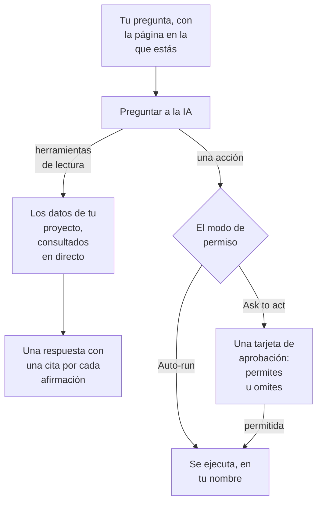

# Preguntar a la IA

Preguntar a la IA es el chat de OneUptime sobre los datos de tu proyecto. Pregúntale por logs, trazas, métricas, excepciones, incidentes, alertas, monitores, guardias, páginas de estado, SLO, runbooks o flujos de trabajo: consulta tu proyecto en directo, respalda cada afirmación con una cita y, cuando se lo permites, actúa por ti.

:::cards
- [Abrir Preguntar a la IA](#abrir-preguntar-a-la-ia): Desde la cabecera, el teclado, un gráfico o su propia página.
- [Qué puede ver](#qué-puede-ver): Los datos que lee para responderte.
- [Acciones y modos de permiso](#acciones-y-modos-de-permiso): Elige si puede actuar y cuándo pregunta antes.
- [Las acciones se hacen en tu nombre](#las-acciones-se-hacen-en-tu-nombre): Tus permisos, tu nombre en cada cambio.
:::

## Cómo responde Preguntar a la IA

Preguntar a la IA responde solo con lo que devuelven sus herramientas: ejecuta consultas contra tu proyecto en lugar de responder de memoria. Cada dato de una respuesta lleva un chip de cita que muestra la consulta que hay detrás y abre los datos que leyó. Cuando le pides que cambie algo, el modo de permiso de la conversación decide si te pregunta antes. Antes de tu pregunta, lee el [contexto de IA](/docs/ai/ai-context) del proyecto: lo que tu equipo escribió para OneUptime AI sobre tus propios sistemas.

En el modo **Solo lectura** las acciones nunca se ofrecen al modelo, así que la conversación solo lee.

## Abrir Preguntar a la IA

| Dónde | Cómo |
| --- | --- |
| Cualquier página | Haz clic en **Preguntar a la IA** en la cabecera, o pulsa `Ctrl` + `I` (`Cmd` + `I` en un Mac). Mientras escribes en un cuadro de texto o un editor, esas teclas siguen siendo el atajo de cursiva del editor. |
| La paleta de comandos | Pulsa `Ctrl` + `K` (`Cmd` + `K` en un Mac) y elige **Preguntar a la IA**. |
| Un patrón de error de los logs, o los hallazgos de un gráfico | Haz clic en **Explain with AI**: Preguntar a la IA se abre con las pruebas como una pregunta que puedes editar antes de enviarla. |
| Su propia página | Abre **Productos → IA → Chat** para tener un espacio de trabajo a página completa. Cada conversación tiene allí su propia dirección, así que puedes guardar un hilo en marcadores o pegarlo en el canal de un incidente. |

En un incidente o una alerta, la tarjeta **Investigación de IA** tiene una conversación propia, **Ask OneUptime AI**, compartida con todos los que pueden ver ese incidente o esa alerta: consulta [Hablar con OneUptime AI sobre el incidente](/docs/ai/ai-sre#habla-con-oneuptime-ai-sobre-el-incidente).

## Qué puede ver

Preguntar a la IA lee tu proyecto con tus propios permisos, así que ve lo que tú puedes ver y nada más.

| Área | Qué lee Preguntar a la IA |
| --- | --- |
| Telemetría | Búsqueda de logs e histogramas, agregaciones de trazas y árboles de spans, métricas, excepciones, eventos de seguridad, monitorización de usuarios reales y Web Vitals, cambios recientes y comprobaciones de anomalías frente a líneas base aprendidas. |
| Infraestructura | Hosts, Docker, Podman, Kubernetes, Docker Swarm, Proxmox, VMware vCenter, Ceph, cabinas de almacenamiento, funciones serverless, entornos en la nube, flotas IoT y dispositivos de red: lo que hay en el inventario, su estado de conexión notificado, tendencias de métricas, recuentos de logs por gravedad y resúmenes de operaciones de trazas. Una consulta abarca tanto la telemetría que nombra un servicio como la que nombra un recurso de infraestructura. |
| Respuesta a incidentes | Incidentes y alertas, con filtros de estado ("¿qué está activo ahora mismo?"), sus cronologías de actividad (cambios de estado, notas internas y públicas, el feed) y propietarios, y una búsqueda en incidentes anteriores para reutilizar cómo se resolvieron. |
| Guardia | Quién está de guardia ahora, las políticas y cadenas de escalado, y si los avisos recientes se entregaron y se reconocieron. |
| El trabajo de la propia IA | Los resultados de las investigaciones de AI SRE y de AI Insights, de modo que "¿qué encontró la IA?" se responde con el análisis publicado en lugar de volver a deducirlo. |
| Plataforma | Monitores (con filtros de estado), mantenimiento programado, páginas de estado y sus anuncios, SLO, runbooks, ejecuciones de flujos de trabajo, salud de las sondas, equipos y el código de los repositorios conectados. |

## Contexto de la página

Preguntar a la IA sabe desde qué página la abriste. En la página de un incidente, "¿por qué ha pasado esto?" significa ese incidente, y el compositor muestra un chip con el tema de la página; quítalo para preguntar por todo el proyecto. Si pasas a otra página con el panel abierto, el contexto te sigue. La conversación también recuerda su primer tema en el servidor, así que una pregunta días después sigue entendiendo "este incidente".

Las listas de infraestructura y las páginas de recursos ofrecen preguntas para el tipo de recurso que estás viendo. Abre un clúster de Kubernetes y pregunta "¿Qué métricas cambiaron en las últimas 24 horas?", o abre un host de Docker y pregunta "Resume la gravedad de los logs y los errores de trazas de las últimas seis horas." Los enlaces a las pruebas vuelven a la página del recurso. Las lecturas respetan tus permisos de proyecto, recursos y telemetría, incluidas las restricciones por propietario y por etiquetas.

En la página de un elemento hijo, el contexto también registra el pod, contenedor, VM, proceso u otro elemento que seleccionaste. Las herramientas de infraestructura leen la telemetría del recurso padre; no pueden medir un elemento hijo solo por su nombre. Preguntar a la IA lo dice, y no adivina un namespace de Kubernetes que la página no indica. Un estado de conexión no es la salud de una carga de trabajo, y la falta de telemetría no significa que un recurso esté sano.

## Comandos en tu infraestructura

Abierta en la página de un recurso cuyo agente de IA está conectado (un host, un host de Docker o Podman, un clúster de Docker Swarm, un clúster de Proxmox, un VMware vCenter, un clúster de Ceph, un servidor de base de datos o un clúster de Kubernetes), Preguntar a la IA ejecuta comandos en él a través de ese agente cuando se lo pides: "ejecuta `uptime` en este host" o "muestra las últimas 100 líneas de `journalctl -u nginx`". Responde con lo que se devolvió, citado como cualquier otra prueba. Abierta en un incidente o una alerta, llega a los recursos vinculados.

- Solo ejecuta los comandos de solo lectura que una investigación de IA puede ejecutar en ese tipo de recurso (consulta [Agentes de IA para la infraestructura](/docs/ai/infrastructure-ai-agents)), como máximo 30 por respuesta a través de cada tipo de agente, comprobados por OneUptime y de nuevo por el agente, en cualquier modo de permiso. Un cambio a través del agente, como reiniciar un servicio, nunca se ejecuta desde Preguntar a la IA: en su lugar te da el comando exacto, y el agente solo hace cambios cuando OneUptime AI remedia un incidente o una alerta, según la propia configuración de correcciones del recurso. Las acciones propias de Preguntar a la IA, como ejecutar un runbook, siguen el modo de permiso de la conversación, como se explica más abajo.
- Solo llega a los recursos que puedes ver, y solo mientras la investigación de IA esté activada para el recurso.
- Cuando no puede ejecutar un comando allí (no hay ningún agente conectado, el agente está desconectado o la investigación de IA está desactivada para el recurso), lo dice, junto con lo que hay que cambiar, y responde en su lugar con los datos de tu proyecto.

## Acciones y modos de permiso

Cada conversación tiene un modo de permiso, que eliges en el compositor, junto al cuadro donde escribes:

| Modo | Qué ocurre |
| --- | --- |
| **Ask to act** | El predeterminado. Preguntar a la IA propone cada acción en una tarjeta de aprobación, y nada se ejecuta hasta que eliges **Permitir** u **Omitir** para ella, o **Denegar todo**. |
| **Auto-run** | Las acciones se ejecutan en cuanto el modelo las pide, siempre limitadas a lo que tu rol puede hacer. Úsalo con cuidado. |
| **Solo lectura** | Las acciones no se ofrecen al modelo en absoluto: Preguntar a la IA solo puede leer. |

Lo que Preguntar a la IA puede hacer cuando un modo lo permite:

- Crear un incidente, reconocer o resolver incidentes y alertas, y cambiar la gravedad de un incidente.
- Publicar una nota interna en un incidente o una alerta. Las notas internas nunca aparecen en una página de estado.
- Publicar una actualización de estado pública en un incidente. Es una acción aparte, porque avisa a los suscriptores de la página de estado.
- Avisar a una política de guardia, ejecutar un runbook o iniciar una investigación de IA de un incidente o una alerta.
- Proponer un cambio de código: hacer commit en una rama nueva de un repositorio conectado y abrir una pull request. Nunca escribe en la rama predeterminada ni en una protegida, así que una persona sigue fusionando el cambio.

## Las acciones se hacen en tu nombre

Cada acción que realiza Preguntar a la IA se hace en tu nombre: hace el mismo cambio que hace el panel para esa acción, con tus propios permisos en el proyecto, y el cambio se te atribuye. Reconocer un incidente desde el chat crea el mismo cambio de estado que el panel de estado del incidente, así que la cronología y el feed del incidente muestran que tú cambiaste su estado. Un aviso enviado desde el chat te muestra como quien lo lanzó.

- **Qué necesita cada acción.** El permiso que el panel pide para el mismo cambio. Reconocer o resolver un incidente requiere permiso para cambiar su estado: **Project Owner**, **Project Admin**, **Project Member**, **Incident Admin** e **Incident Member**, o **Create Incident State Timeline** en un rol personalizado; una alerta requiere el mismo permiso para alertas (**Create Alert State Timeline**). Avisar a una política de guardia requiere permiso para ejecutarla (**Create On-Call Duty Policy Execution Log**), y ejecutar un runbook requiere permiso para iniciar ejecuciones de runbooks: un rol que ejecuta runbooks, para los runbooks a los que llegan sus etiquetas, o **Create Runbook Execution** en un rol personalizado, que llega a todos los runbooks del proyecto. Cambiar la gravedad de un incidente, iniciar una investigación de IA de un incidente o una alerta y escribir código en un repositorio conectado requiere permiso para cambiar ese incidente, alerta o repositorio. Una acción que no puedes realizar se rechaza, y la IA te dice qué permiso necesita. Si tienes el permiso pero un equipo al que perteneces lo bloquea, la IA te lo dice: un bloqueo sobre algunas etiquetas rechaza esa acción en Preguntar a la IA para todos los registros, no solo para los que llevan esas etiquetas.
- **Qué registros.** Los que puedes cambiar, como en todo OneUptime: con un rol limitado a algunas etiquetas, o a los registros que te pertenecen, una acción sobre cualquier otro registro no cambia nada. Un runbook solo se ejecuta cuando tu permiso para iniciar ejecuciones de runbooks llega a él. En OneUptime Cloud, una acción que el plan del proyecto no incluye se rechaza indicando el plan que necesita.
- **Cuando una acción se rechaza.** Nada cambia, y la IA te dice claramente que la acción no se realizó, y por qué, en lugar de volver a intentarlo.
- **Slack, Microsoft Teams y las investigaciones de IA.** Las respuestas de la IA en Slack y Microsoft Teams, y las investigaciones autónomas de IA, solo leen: no realizan ninguna de estas acciones. Para actuar desde Slack o Microsoft Teams, usa los botones de los mensajes de OneUptime, que también actúan en tu nombre (consulta [Slack](/docs/workspace-connections/slack#actuar-sobre-incidentes-alertas-y-eventos-desde-slack) y [Microsoft Teams](/docs/workspace-connections/microsoft-teams#actuar-sobre-incidentes-alertas-y-eventos-desde-microsoft-teams)).

## Dirigir una conversación

- **Detenla.** Mientras Preguntar a la IA trabaja, el botón de enviar se convierte en un botón de detener. Detén una ejecución en cualquier momento y pregunta otra cosa enseguida.
- **Elige el modelo.** El selector de proveedor del compositor muestra los proveedores de LLM de tu proyecto y los globales, con el predeterminado marcado. Una conversación nueva usa el predeterminado.
- **Valora una respuesta.** **Buena respuesta** y **Mala respuesta** se guardan con el mensaje, para poder medir la calidad de las respuestas a lo largo del tiempo.
- **Mira el coste.** El pie de la respuesta más reciente muestra su coste, sus tokens y cuántas consultas ejecutó, y cada consulta es un chip de cita que abre los datos que hay detrás.
- **Guarda una copia.** **Descargar conversación** guarda el hilo con **Descargar como Markdown**, para leerlo o pegarlo en un ticket, o con **Descargar como PDF**, para dárselo a alguien.

## Requisitos

- **Un proveedor de LLM.** Preguntar a la IA usa el proveedor de LLM predeterminado del proyecto (consulta [Proveedores de LLM](/docs/ai/llm-provider)). En OneUptime Cloud funciona desde el primer momento con el proveedor global, pagado con los créditos de IA del proyecto; una instalación autoalojada configura un proveedor, o las variables de entorno del proveedor global. Las respuestas son tan buenas como el modelo: un modelo autoalojado pequeño sin llamadas a herramientas fiables responde mal.
- **El plan Growth, en OneUptime Cloud.** Un proyecto con un plan inferior ve que la IA no está incluida en su plan, con un enlace a **Ajustes del proyecto → Facturación y facturas → Facturación**.
- **La IA activada para el proyecto.** **Habilitar IA**, en **Ajustes del proyecto → IA → Funciones de IA**, desactiva todas las funciones de IA del proyecto, Preguntar a la IA incluida. Está activada a menos que alguien la haya desactivado.

Preguntar a la IA cuenta para los límites diarios de IA del propio proyecto cuando el proyecto los define (Ajustes del proyecto → IA → Funciones de IA → Más ajustes): cuando se alcanza uno, Preguntar a la IA muestra una frase que dice qué límite se alcanzó, que OneUptime AI vuelve a empezar a medianoche UTC y quién puede subir o quitar el límite. Los propietarios del proyecto reciben un correo la primera vez que se alcanza un límite cada día. Los límites diarios de incidentes y alertas nunca detienen Preguntar a la IA. Consulta [los límites diarios del propio proyecto](/docs/ai/ai-sre#los-límites-diarios-propios-del-proyecto).

## Solución de problemas

:::details Preguntar a la IA dice que la IA no está disponible
El panel dice por qué antes de que escribas: el plan del proyecto no incluye IA, **Habilitar IA** está desactivado o el proyecto no tiene proveedor de LLM. Cada aviso enlaza con la página donde se cambia.
:::

:::details Se rechazó una acción
Preguntar a la IA dice qué permiso necesita la acción, o qué equipo la bloquea. Pídeselo a alguien que pueda hacer el cambio, o pide a un propietario del proyecto que dé el permiso a tu rol. No se cambió nada.
:::

:::details Las respuestas son vagas o nunca usan datos
Revisa el modelo que hay detrás del proveedor. Preguntar a la IA necesita un modelo que llame a herramientas de forma fiable; los modelos locales pequeños a menudo responden sin ejecutar ni una sola consulta. Consulta [Proveedores de LLM](/docs/ai/llm-provider).
:::

## Próximos pasos

:::cards
- [AI SRE](/docs/ai/ai-sre): Deja que OneUptime AI investigue cada incidente y cada alerta nuevos.
- [Proveedores de LLM](/docs/ai/llm-provider): Elige el modelo que usan Preguntar a la IA y las demás funciones de IA.
- [Servidor MCP](/docs/ai/mcp-server): Pregunta por OneUptime desde Claude, Cursor o VS Code.
:::
