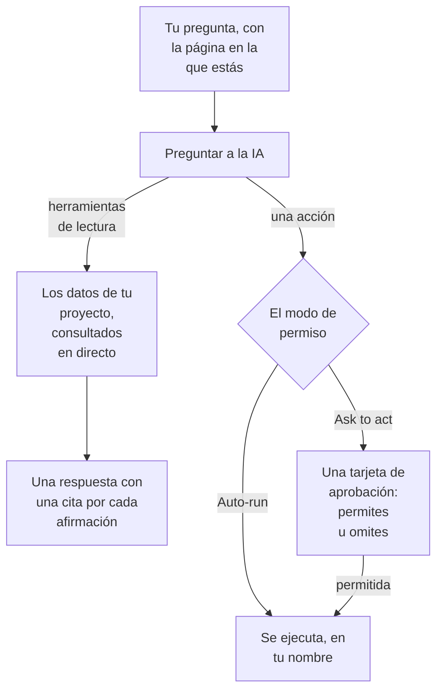

# Preguntar a la IA

Preguntar a la IA es el chat de OneUptime sobre los datos de tu proyecto. Pregúntale por logs, trazas, métricas, excepciones, incidentes, alertas, monitores, guardias, páginas de estado, SLO, runbooks o flujos de trabajo: consulta tu proyecto en directo, respalda cada afirmación con una cita y, cuando se lo permites, actúa por ti.

:::cards
- [Abrir Preguntar a la IA](#abrir-preguntar-a-la-ia): Desde la cabecera, el teclado, un gráfico o el menú de productos.
- [Qué puede ver](#qué-puede-ver): Los datos que lee para responderte.
- [Acciones y modos de permiso](#acciones-y-modos-de-permiso): Elige si puede actuar y cuándo pregunta antes.
- [Las acciones se hacen en tu nombre](#las-acciones-se-hacen-en-tu-nombre): Tus permisos, tu nombre en cada cambio.
:::

## Cómo responde Preguntar a la IA

Preguntar a la IA responde solo con lo que devuelven sus herramientas: ejecuta consultas contra tu proyecto en lugar de responder de memoria. Cada dato de una respuesta lleva un chip de cita que muestra la consulta que hay detrás y abre los datos que leyó. Cuando le pides que cambie algo, el modo de permiso de la conversación decide si te pregunta antes. Antes de tu pregunta, lee el [contexto de IA](/docs/ai/ai-context) del proyecto: lo que tu equipo escribió para OneUptime AI sobre tus propios sistemas.

En el modo **Solo lectura** las acciones nunca se ofrecen al modelo, así que la conversación solo lee.

## Preguntas sobre OneUptime

Preguntar a la IA también responde preguntas sobre el propio OneUptime: «¿Cómo recibo un SMS cuando mi sitio se cae?», «¿Qué es un episodio?», «¿Dónde añado un segundo número de teléfono?». Responde a partir de esta documentación, la copia que sirve tu OneUptime, así que funciona sin acceso a internet y no envía nada a ningún sitio nuevo. Lee la página en tu idioma cuando está traducida, cita la página y la sección de cada paso y, en lugar de adivinar, dice cuándo la documentación no cubre algo.

Una respuesta a un «¿cómo hago…?» termina con un botón que abre la página de tu proyecto donde se hace, como **Crear monitor** o **Métodos de notificación**. Solo abre páginas que OneUptime tiene: las que encuentra la búsqueda (`Ctrl` + `K`).

## Abrir Preguntar a la IA

| Dónde | Cómo |
| --- | --- |
| Cualquier página | Haz clic en **Preguntar a la IA** en la cabecera, o pulsa `Ctrl` + `I` (`Cmd` + `I` en un Mac). Mientras escribes en un cuadro de texto o un editor, esas teclas siguen siendo el atajo de cursiva del editor. |
| La paleta de comandos | Pulsa `Ctrl` + `K` (`Cmd` + `K` en un Mac) y elige **Preguntar a la IA**. |
| Un patrón de error de los logs, o los hallazgos de un gráfico | Haz clic en **Explicar con IA**: Preguntar a la IA se abre con las pruebas como una pregunta que puedes editar antes de enviarla. |
| El menú de productos | Abre **Productos → IA → Chat**. Preguntar a la IA se abre junto a la página en la que estabas. Cada conversación tiene su propia dirección, así que puedes guardarla en marcadores y volver a ella. |

Preguntar a la IA se abre en el lateral de la ventana, y la página le hace sitio: nada queda oculto detrás, así que puedes seguir trabajando en la página, ir a otras páginas y volver a preguntar. Arrastra su borde para hacerla más ancha o más estrecha. Pulsa `Esc` dentro de ella, o vuelve a hacer clic en **Preguntar a la IA**, para devolver a la página toda la ventana. Con ella abierta, `Ctrl` + `I` (`Cmd` + `I` en un Mac) va de la página al cuadro donde escribes, y desde ahí la cierra. La conversación sigue donde la dejaste: vuelve a abrir Preguntar a la IA para continuar. Si la cierras mientras aún responde, un aviso en la esquina te dice cuándo está lista la respuesta, y la abre. En una tableta o un teléfono, donde no hay sitio para ambas, se abre sobre la página, y en un teléfono ocupa toda la pantalla.

En un incidente o una alerta, la tarjeta **OneUptime AI** tiene una conversación propia, **Preguntar a OneUptime AI**, compartida con todos los que pueden ver ese incidente o esa alerta: consulta [Hablar con OneUptime AI sobre el incidente](/docs/ai/ai-sre#habla-con-oneuptime-ai-sobre-el-incidente).

## Qué puede ver

Preguntar a la IA lee tu proyecto con tus propios permisos, así que ve lo que tú puedes ver y nada más.

| Área | Qué lee Preguntar a la IA |
| --- | --- |
| Telemetría | Búsqueda de logs e histogramas, agregaciones de trazas y árboles de spans, métricas, excepciones, eventos de seguridad, monitorización de usuarios reales y Web Vitals, cambios recientes y comprobaciones de anomalías frente a líneas base aprendidas. |
| Infraestructura | Hosts, Docker, Podman, Kubernetes, Docker Swarm, Proxmox, VMware vCenter, Ceph, cabinas de almacenamiento, funciones serverless, entornos en la nube, flotas IoT y dispositivos de red: lo que hay en el inventario, su estado de conexión notificado, tendencias de métricas, recuentos de logs por gravedad y resúmenes de operaciones de trazas. Una consulta abarca tanto la telemetría que nombra un servicio como la que nombra un recurso de infraestructura. |
| Respuesta a incidentes | Incidentes y alertas, con filtros de estado ("¿qué está activo ahora mismo?"), sus cronologías de actividad (cambios de estado, notas internas y públicas, el feed) y propietarios, y una búsqueda en incidentes anteriores para reutilizar cómo se resolvieron. |
| Guardia | Quién está de guardia ahora, las políticas y cadenas de escalado, y si los avisos recientes se entregaron y se reconocieron. |
| El trabajo de la propia IA | Los resultados de las investigaciones de AI SRE y de AI Insights, de modo que "¿qué encontró la IA?" se responde con el análisis publicado en lugar de volver a deducirlo. |
| Plataforma | Monitores (con filtros de estado), mantenimiento programado, páginas de estado y sus anuncios, SLO, runbooks, ejecuciones de flujos de trabajo, salud de las sondas, equipos y el código de los repositorios conectados en GitHub, GitLab, Forgejo, Gitea y Azure DevOps (consulta [Qué lee la IA en un repositorio Git](/docs/ai/ai-agent#qué-lee-la-ia-en-un-repositorio-git)). |

## Contexto de la página

Preguntar a la IA sabe desde qué página la abriste. En la página de un incidente, "¿por qué ha pasado esto?" significa ese incidente: el compositor muestra un chip con el tema de la página, y las preguntas que sugiere son las de esa página. Quita el chip para preguntar por todo el proyecto, y vuelve a añadirlo de la misma forma. Abre Preguntar a la IA en otra página y el contexto te sigue. La conversación también recuerda su primer tema en el servidor, así que una pregunta días después sigue entendiendo "este incidente".

En un incidente, una alerta, un monitor o un evento de mantenimiento, las preguntas también siguen el estado de ese registro, que se lee cada vez que Preguntar a la IA se abre sobre él. Un incidente resuelto pregunta cómo fue la respuesta y qué evitaría que se repita, una alerta resuelta si fue un problema real y con qué frecuencia se activan alertas como ella, y un monitor que no está operativo pregunta por qué. Un evento de mantenimiento que no ha empezado pregunta si sus monitores están sanos antes de empezar, y uno que ha terminado si han vuelto a la normalidad.

Las listas de infraestructura y las páginas de recursos ofrecen preguntas para el tipo de recurso que estás viendo. Abre un clúster de Kubernetes y pregunta "¿Qué métricas cambiaron en las últimas 24 horas?", o abre un host de Docker y pregunta "Resume la gravedad de los logs y los errores de trazas de las últimas seis horas." Los enlaces a las pruebas vuelven a la página del recurso. Las lecturas respetan tus permisos de proyecto, recursos y telemetría, incluidas las restricciones por propietario y por etiquetas.

En la página de un elemento hijo, el contexto también registra el pod, contenedor, VM, proceso u otro elemento que seleccionaste. Las herramientas de infraestructura leen la telemetría del recurso padre; no pueden medir un elemento hijo solo por su nombre. Preguntar a la IA lo dice, y no adivina un namespace de Kubernetes que la página no indica. Un estado de conexión no es la salud de una carga de trabajo, y la falta de telemetría no significa que un recurso esté sano.

## Comandos en tu infraestructura

Abierta en la página de un recurso cuyo agente de IA está conectado (un host, un host de Docker o Podman, un clúster de Docker Swarm, un clúster de Proxmox, un VMware vCenter, un clúster de Ceph, un servidor de base de datos o un clúster de Kubernetes), Preguntar a la IA ejecuta comandos en él a través de ese agente cuando se lo pides: "ejecuta `uptime` en este host" o "muestra las últimas 100 líneas de `journalctl -u nginx`". Responde con lo que se devolvió, citado como cualquier otra prueba. Abierta en un incidente o una alerta, llega a los recursos vinculados.

- Solo ejecuta los comandos de solo lectura que una investigación de IA puede ejecutar en ese tipo de recurso (consulta [Agentes de IA para la infraestructura](/docs/ai/infrastructure-ai-agents)), tantos como necesite la respuesta, comprobados por OneUptime y de nuevo por el agente, en cualquier modo de permiso. Un cambio a través del agente, como reiniciar un servicio, nunca se ejecuta desde Preguntar a la IA: en su lugar te da el comando exacto, y el agente solo hace cambios cuando OneUptime AI remedia un incidente o una alerta, según la propia configuración de correcciones del recurso. Las acciones propias de Preguntar a la IA, como ejecutar un runbook, siguen el modo de permiso de la conversación, como se explica más abajo.
- Solo llega a los recursos que puedes ver, y solo mientras la investigación de IA esté activada para el recurso.
- Cuando no puede ejecutar un comando allí (no hay ningún agente conectado, el agente está desconectado o la investigación de IA está desactivada para el recurso), lo dice, junto con lo que hay que cambiar, y responde en su lugar con los datos de tu proyecto.

## Acciones y modos de permiso

Cada conversación tiene un modo de permiso, que eliges en el compositor, junto al cuadro donde escribes:

| Modo | Qué ocurre |
| --- | --- |
| **Preguntar antes de actuar** | El predeterminado. Preguntar a la IA propone cada acción en una tarjeta de aprobación, y nada se ejecuta hasta que eliges **Permitir** u **Omitir** para ella, o **Denegar todo**. |
| **Ejecución automática** | Las acciones se ejecutan en cuanto el modelo las pide, siempre limitadas a lo que tu rol puede hacer. Úsalo con cuidado. |
| **Solo lectura** | Las acciones no se ofrecen al modelo en absoluto: Preguntar a la IA solo puede leer. |

Lo que Preguntar a la IA puede hacer cuando un modo lo permite:

- Crear un incidente o una alerta, reconocer o resolver incidentes y alertas, y cambiar la gravedad de un incidente.
- Vincular un incidente o una alerta a la infraestructura y los servicios a los que se refiere. Un incidente o una alerta que crea en la página de un recurso, como la de un host, queda vinculado a ese recurso, y la tarjeta de aprobación indica qué vincula cada acción. OneUptime AI investiga y corrige aquello a lo que está vinculado un incidente o una alerta.
- Registrar un problema del que alguien ya se ocupa, o que ya ha terminado: un incidente o una alerta que crea puede empezar reconocido o resuelto, y entonces no avisa a nadie. La tarjeta de aprobación dice cuál de los dos. Consulta [Declarado ya reconocido o resuelto](/docs/incidents/declaring-incidents#declarado-ya-reconocido-o-resuelto).
- Publicar una nota interna en un incidente o una alerta. Las notas internas nunca aparecen en una página de estado.
- Publicar una actualización de estado pública en un incidente. Es una acción aparte, porque avisa a los suscriptores de la página de estado.
- Avisar a una política de guardia, ejecutar un runbook o iniciar una investigación de IA de un incidente o una alerta.
- Configurarlo todo a partir de una frase: un monitor de sitio web o de API, a quién se avisa, una página de estado y los monitores que muestra, todo en una sola tarjeta de aprobación. Consulta [Configurarlo todo](#configurarlo-todo).
- Proponer un cambio de código: hacer commit en una rama nueva de un repositorio en GitHub, GitLab, Forgejo o Gitea y abrir una pull request (un merge request en GitLab). Nunca escribe en la rama predeterminada ni en una protegida, así que una persona sigue fusionando el cambio. Ask AI escribe cada archivo completo a partir del archivo tal como lo leyó por última vez, y lee la rama principal de un repositorio a menos que se le pida otra. Si un archivo cambió en la rama después de que Ask AI lo leyera, la tarjeta lo nombra antes de que apruebes el commit o la pull request, por ejemplo "Este archivo cambió en fix/login después de que la IA lo leyera, y la versión de la IA deshace ese cambio: src/billing/charge.ts." También nombra un archivo que Ask AI solo leyó en otra rama, donde es distinto, un archivo que Ask AI nunca leyó pero reemplaza, y un archivo que OneUptime no pudo comprobar. Ask AI lee un archivo largo por partes, así que la tarjeta también nombra un archivo del que Ask AI solo leyó una parte, por ejemplo "La IA solo leyó una parte de este archivo, y su versión lo reemplaza entero: src/billing/charge.ts." Cuando Ask AI ha leído todo el archivo, de una vez o en varias lecturas, la tarjeta no dice nada de él. Una respuesta posterior tiene las palabras de las anteriores, no los archivos que leyeron, así que la tarjeta también nombra un archivo que Ask AI solo leyó en una respuesta anterior, por ejemplo "La IA leyó este archivo en una respuesta anterior y ya no tiene su texto, y su versión lo reemplaza entero: src/billing/charge.ts." Una respuesta muy larga también deja fuera sus resultados más antiguos, para no pasar de lo que el modelo puede abarcar de una vez, así que la tarjeta también nombra un archivo que Ask AI leyó antes en la misma respuesta si ese resultado quedó fuera, por ejemplo "La IA leyó este archivo antes en esta misma respuesta y ya no tiene su texto, y su versión lo reemplaza entero: src/billing/charge.ts." Si Ask AI leyó el archivo en varias partes y ya no las tiene todas, la tarjeta también lo dice, por ejemplo "La IA leyó este archivo y ya no tiene parte de su texto, y su versión lo reemplaza entero: src/billing/charge.ts." Cuando Ask AI vuelve a leer el archivo en la respuesta que lo cambia, la tarjeta no dice nada de él. Un archivo nuevo nunca cuenta. Para conservar lo que cambió otra persona, omite la acción y pide a Ask AI que vuelva a leer los archivos. En Ejecución automática, donde nadie aprueba las acciones, Ask AI no hace ese cambio: vuelve a leer los archivos y hace su cambio sobre ellos tal como están ahora. Si un archivo cambia mientras la tarjeta te espera, aprobarla no cambia nada, y Ask AI vuelve a proponer el cambio. Una pull request que apruebes de todos modos nombra esos archivos en su descripción, para quien la revise. A Ask AI nunca se le muestran valores que parecen secretos o datos personales, como direcciones IP, direcciones de correo electrónico y claves: en su lugar lee un marcador de posición como `[redacted-ip]`. Por eso la tarjeta también nombra un archivo en el que la versión de Ask AI escribe esos marcadores, por ejemplo "Se ocultaron a la IA valores que parecen secretos o datos personales, y la versión de la IA de este archivo escribe marcadores de posición en lugar de esos valores: config/servers.ts." Un marcador que el archivo de la rama ya tiene no cuenta. Ask AI no puede volver a escribir esos valores, así que en Ejecución automática no hace ese cambio y, en su lugar, te dice qué cambiar.

Pide un incidente cuando los usuarios se ven afectados, y una alerta cuando algo necesita antes la atención de tu equipo, como la memoria de un host que no deja de subir. Ambos se crean una vez y no vigilan nada: para recibir una alerta cada vez que la memoria de un host supere el 75 %, crea un [monitor de host](/docs/monitor/host-monitor#plantillas-de-alerta-listas-para-usar) a partir de su plantilla de memoria, con el 75 % como umbral. Preguntar a la IA solo configura monitores de sitio web y de API (consulta [Configurarlo todo](#configurarlo-todo)). Si le pides otro tipo, te lo dice, comprueba el valor actual y se ofrece a crear una alerta si ya lo supera.

## Las acciones se hacen en tu nombre

Cada acción que realiza Preguntar a la IA se hace en tu nombre: hace el mismo cambio que hace el panel para esa acción, con tus propios permisos en el proyecto, y el cambio se te atribuye. Reconocer un incidente desde el chat crea el mismo cambio de estado que el panel de estado del incidente, así que la cronología y el feed del incidente muestran que tú cambiaste su estado. Un aviso enviado desde el chat te muestra como quien lo lanzó.

- **Qué necesita cada acción.** El permiso que el panel pide para el mismo cambio. Crear un incidente o una alerta requiere permiso para crearlos: un rol que pueda hacerlo, o **Create Incident** o **Create Alert** en un rol personalizado. Reconocer o resolver un incidente requiere permiso para cambiar su estado: **Propietario del proyecto**, **Administrador del proyecto**, **Miembro del proyecto**, **Administrador de incidentes** e **Miembro de incidentes**, o **Create Incident State Timeline** en un rol personalizado; una alerta requiere el mismo permiso para alertas (**Create Alert State Timeline**). Crear un incidente o una alerta que empieza reconocido o resuelto requiere ambos: permiso para crearlo y permiso para cambiar su estado. Avisar a una política de guardia requiere permiso para ejecutarla (**Execute On-Call Policies**), y ejecutar un runbook requiere permiso para iniciar ejecuciones de runbooks: un rol que ejecuta runbooks, para los runbooks a los que llegan sus etiquetas, o **Create Runbook Execution** en un rol personalizado, que llega a todos los runbooks del proyecto. Cambiar la gravedad de un incidente, iniciar una investigación de IA de un incidente o una alerta y escribir código en un repositorio conectado requiere permiso para cambiar ese incidente, alerta o repositorio. Una acción que no puedes realizar se rechaza, y la IA te dice qué permiso necesita. Si tienes el permiso pero un equipo al que perteneces lo bloquea, la IA te lo dice: un bloqueo sobre algunas etiquetas rechaza esa acción en Preguntar a la IA para todos los registros, no solo para los que llevan esas etiquetas.
- **Qué registros.** Los que puedes cambiar, como en todo OneUptime: con un rol limitado a algunas etiquetas, o a los registros que te pertenecen, una acción sobre cualquier otro registro no cambia nada. Un runbook solo se ejecuta cuando tu permiso para iniciar ejecuciones de runbooks llega a él. En OneUptime Cloud, una acción que el plan del proyecto no incluye se rechaza indicando el plan que necesita.
- **Cuando una acción se rechaza.** Nada cambia, y la IA te dice claramente que la acción no se realizó, y por qué, en lugar de volver a intentarlo. Entre los pasos de la respuesta, el de la acción dice que no se hizo, y por qué: tu rol no lo permite, un equipo al que perteneces lo bloquea, o el plan del proyecto no lo incluye.
- **Slack, Microsoft Teams y las investigaciones de IA.** Las respuestas de la IA en Slack y Microsoft Teams, y las investigaciones autónomas de IA, solo leen: no realizan ninguna de estas acciones. Si le pides un cambio allí, la IA te dice cómo hacerlo desde el chat: `/oneuptime incident` declara un incidente, `/oneuptime incident 42` muestra el incidente 42 con sus botones, `/oneuptime page` avisa a alguien (en Microsoft Teams, las mismas palabras escritas al bot de OneUptime), y los botones de los mensajes de OneUptime también actúan en tu nombre (consulta [Slack](/docs/workspace-connections/slack#actuar-sobre-incidentes-alertas-y-eventos-desde-slack) y [Microsoft Teams](/docs/workspace-connections/microsoft-teams#actuar-sobre-incidentes-alertas-y-eventos-desde-microsoft-teams)). Para cualquier otro cambio, enlaza a Preguntar a la IA, que propone el cambio para que lo apruebes. Si preguntas en el canal propio de un incidente o de una alerta, entiende que te refieres a ese incidente o a esa alerta.

## Configurarlo todo

Preguntar a la IA configura, a partir de una frase, lo mismo que las configuraciones guiadas: «Monitoriza example.com cada minuto y mándame un SMS si se cae».

- **Un plan, una aprobación.** Preguntar a la IA propone cada parte en una sola tarjeta de aprobación, cada una en palabras sencillas: un monitor de sitio web o de API, la primera política de guardia del proyecto, una página de estado y los monitores que muestra. La tarjeta termina con «No cambia nada más.». Elige **Omitir** en cualquier parte que no quieras y ejecuta el resto. No se crea nada antes.
- **Siempre se pregunta.** La configuración espera tu aprobación en todos los modos, incluido **Ejecución automática**, porque crea cosas que avisan a personas y que ven tus clientes. **Solo lectura** no la ofrece.
- **Los registros de las configuraciones guiadas.** El monitor es el que **Saber cuándo cae mi sitio web o mi API** crea para la misma dirección: los valores predeterminados de Crear monitor, que abre un incidente cuando la dirección no responde o responde con un error, y se comprueba cada 5 minutos salvo que pidas otro de los intervalos de Crear monitor. Es tuyo, así que recibes un correo cuando cambia su estado. La página de estado es la que **Publica una página de estado** crea: pública en cuanto se crea, muestra el estado, la disponibilidad y el historial de cada monitor.
- **A quién se avisa.** En un proyecto que todavía no avisa a nadie, Preguntar a la IA propone la primera política de guardia del proyecto, «Default on-call policy», que te avisa a ti, y a los miembros y equipos que nombres, ante cada nuevo incidente y cada nueva alerta. Un proyecto que ya avisa a personas conserva sus propias políticas y reglas de guardia, y Preguntar a la IA lo dice en lugar de crear otra.
- **Lo que falta.** Preguntar a la IA nunca añade un número de teléfono ni la aplicación móvil: los añades y verificas tú en **Ajustes de usuario → Métodos de notificación**. Si pides recibir SMS sin un número verificado, la tarjeta lo dice y la respuesta enlaza la página. Una parte que Preguntar a la IA no puede crear no se propone, por ejemplo cuando tu rol no lo permite, la dirección no es una dirección o los monitores no existen: la respuesta dice qué hace falta.
- **Lo que necesita cada parte.** Un monitor necesita permiso para crear monitores. Los avisos necesitan permiso para crear políticas de guardia, sus reglas de escalado y reglas de guardia de incidentes y alertas. Una página de estado necesita permiso para crear páginas de estado y añadirles monitores. Se aplican los límites del plan del proyecto, como en las configuraciones guiadas.
- **Después, pruébalo.** Cuando el plan se ejecuta, cada tarjeta abre lo que se creó, y **Probar esta política** (o **Enviarme un aviso de prueba**, para un monitor solo) bajo la respuesta envía un aviso de prueba que confirmas desde el mensaje. Si una parte falla, la respuesta dice qué se creó y qué no.
- **A quién se notifica.** Pregunta «¿a quién se notifica cuando example.com se cae?» y Preguntar a la IA responde a partir de la misma cadena que muestra la página del monitor, nombrando cada ruptura.

## Dirigir una conversación

- **Detenla.** Mientras Preguntar a la IA trabaja, el botón de enviar se convierte en un botón de detener. Detén una ejecución en cualquier momento y pregunta otra cosa enseguida.
- **Sigue su trabajo.** Mientras responde, una línea dice lo que está haciendo ahora, como buscar en los registros. Haz clic en el número de pasos que hay al lado para ver cada paso.
- **Elige el modelo.** Cuando tu proyecto puede usar más de un proveedor de LLM, el selector de proveedor del compositor muestra los proveedores de LLM de tu proyecto y los globales, con el predeterminado marcado. Una conversación nueva usa el predeterminado.
- **Valora una respuesta.** **Buena respuesta** y **Mala respuesta** se guardan con el mensaje, para poder medir la calidad de las respuestas a lo largo del tiempo.
- **Mira el coste.** Debajo de cada respuesta, sus fuentes se abren en las consultas que ejecutó, y las de la respuesta más reciente también dicen cuántas consultas ejecutó, sus tokens y su coste. Cada chip de cita de una respuesta abre los datos que hay detrás.
- **Guarda una copia.** **Descargar conversación** guarda el hilo con **Descargar como Markdown**, para leerlo o pegarlo en un ticket, o con **Descargar como PDF**, para dárselo a alguien.
- **Retoma donde lo dejaste.** **Todas las conversaciones**, en la cabecera de Preguntar a la IA, muestra tus conversaciones, de la más reciente a la más antigua, para volver a abrirlas o eliminarlas. El inicio de una conversación nueva muestra las tres últimas.

## Requisitos

- **Un proveedor de LLM.** Preguntar a la IA usa el proveedor de LLM predeterminado del proyecto (consulta [Proveedores de LLM](/docs/ai/llm-provider)). En OneUptime Cloud funciona desde el primer momento con el proveedor global, pagado con los créditos de IA del proyecto; una instalación autoalojada configura un proveedor, o las variables de entorno del proveedor global. Las respuestas son tan buenas como el modelo: un modelo autoalojado pequeño sin llamadas a herramientas fiables responde mal.
- **El plan Growth, en OneUptime Cloud.** Un proyecto con un plan inferior ve que la IA no está incluida en su plan, con un enlace a **Ajustes del proyecto → Facturación y facturas → Facturación**.
- **La IA activada para el proyecto.** **Habilitar IA**, en **Ajustes del proyecto → IA → Funciones de IA**, desactiva todas las funciones de IA del proyecto, Preguntar a la IA incluida. Está activada a menos que alguien la haya desactivado.

Preguntar a la IA cuenta para los límites diarios de IA del propio proyecto cuando el proyecto los define (Ajustes del proyecto → IA → Funciones de IA → Más ajustes): cuando se alcanza uno, Preguntar a la IA muestra una frase que dice qué límite se alcanzó, que OneUptime AI vuelve a empezar a medianoche UTC y quién puede subir o quitar el límite. Los propietarios del proyecto reciben un correo la primera vez que se alcanza un límite cada día. Los límites diarios de incidentes y alertas nunca detienen Preguntar a la IA. Consulta [los límites diarios del propio proyecto](/docs/ai/ai-sre#los-límites-diarios-propios-del-proyecto).

## Solución de problemas

:::details Preguntar a la IA dice que la IA no está disponible
Preguntar a la IA dice por qué antes de que escribas: el plan del proyecto no incluye IA, **Habilitar IA** está desactivado o el proyecto no tiene proveedor de LLM. Cada aviso enlaza con la página donde se cambia.
:::

:::details Se rechazó una acción
Preguntar a la IA dice qué permiso necesita la acción, o qué equipo la bloquea. Pídeselo a alguien que pueda hacer el cambio, o pide a un propietario del proyecto que dé el permiso a tu rol. No se cambió nada.
:::

:::details Las respuestas son vagas o nunca usan datos
Revisa el modelo que hay detrás del proveedor. Preguntar a la IA necesita un modelo que llame a herramientas de forma fiable; los modelos locales pequeños a menudo responden sin ejecutar ni una sola consulta. Consulta [Proveedores de LLM](/docs/ai/llm-provider).
:::

## Próximos pasos

:::cards
- [AI SRE](/docs/ai/ai-sre): Deja que OneUptime AI investigue cada incidente y cada alerta nuevos.
- [Proveedores de LLM](/docs/ai/llm-provider): Elige el modelo que usan Preguntar a la IA y las demás funciones de IA.
- [Servidor MCP](/docs/ai/mcp-server): Pregunta por OneUptime desde Claude, Cursor o VS Code.
:::
