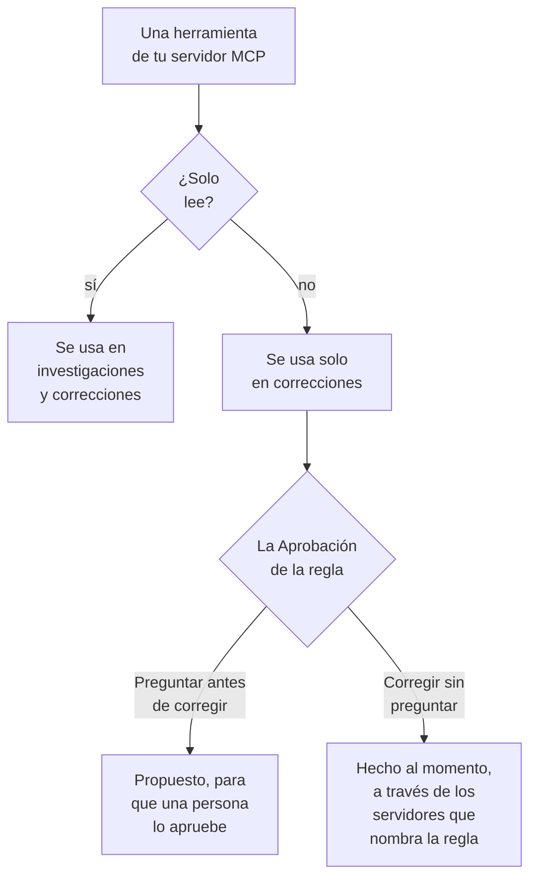

# Servidores MCP externos

OneUptime AI puede usar las herramientas de servidores MCP fuera de OneUptime —los de tu nube, tu alojamiento de código o tu propio equipo, como AWS, Azure o GitHub— mientras investiga y corrige incidentes y alertas. Añade un servidor una vez en **Ajustes del proyecto → IA → Servidores MCP externos**, y OneUptime AI lo usa desde el siguiente incidente.

:::cards
- [Añadir un servidor](#añadir-un-servidor): Su dirección, y cómo inicia sesión OneUptime.
- [Qué hace OneUptime AI con un servidor](#qué-hace-oneuptime-ai-con-un-servidor): Las herramientas que leen en las investigaciones, las demás en las correcciones.
- [Elegir los servidores que puede usar una regla](#elegir-los-servidores-que-puede-usar-una-regla): Todos, salvo que una regla elija algunos.
- [Seguridad](#seguridad): Lo que un servidor puede y no puede hacer que haga OneUptime AI.
:::

Esta página trata de los servidores a los que se conecta OneUptime AI. Para conectar en cambio un asistente de IA como Claude o Cursor a OneUptime, consulta [Servidor MCP](/docs/ai/mcp-server).

## Antes de empezar

- **OneUptime AI está activado** en el proyecto, con un proveedor de LLM que pueda usar: consulta [Proveedores de LLM](/docs/ai/llm-provider).
- **La dirección MCP del servidor.** Funcionan tanto Streamable HTTP como el antiguo HTTP con SSE: OneUptime averigua cuál habla el servidor al conectarse.
- **Cómo inicia sesión OneUptime en él:** un token de API, encabezados propios del servidor o credenciales de cliente OAuth de tu proveedor de identidad.
- **Un Project Owner o un Project Admin** añade, cambia, prueba y elimina servidores; los Project Members y los Viewers pueden verlos. En OneUptime Cloud, añadir un servidor requiere el plan Growth o superior.

## Añadir un servidor

:::steps
### Abrir Servidores MCP externos
Ve a **Ajustes del proyecto → IA → Servidores MCP externos** y haz clic en **Crear Servidor MCP externo**.

### Indicar dónde está
Dale un **Nombre**, con el que OneUptime AI y las personas que leen lo que hizo lo ven, y su **URL**, como `https://mcp.example.com/mcp`. En **Más campos**, una **Descripción** dice para qué sirve el servidor; OneUptime AI la lee para elegir el servidor adecuado.

### Elegir cómo inicia sesión OneUptime
Elige una tarjeta en **Autenticación** y rellena lo que pide (consulta [Autenticación](#autenticación)).

### Ver lo que encontró OneUptime
Al guardar, OneUptime se conecta de inmediato y el cuadro de diálogo **Probar conexión** dice lo que encontró: el servidor, cómo se comunica y cada una de sus herramientas, marcada como **Solo lectura** o **Puede cambiar cosas**. Si no pudo conectarse, el cuadro de diálogo dice por qué y qué revisar.
:::

La lista de servidores dice cómo está cada uno: **Conectado**, **No se puede conectar** (pasa el cursor por encima para ver el motivo), **Aún sin comprobar** o **Desactivado**, y cuántas herramientas ofrece. La página de un servidor muestra sus detalles, el interruptor que permite a OneUptime AI usarlo y sus **Herramientas**, con **Probar conexión** para volver a conectarse y leerlas de nuevo. Una prueba no llama a ninguna herramienta del servidor.

## Autenticación

| Autenticación | Qué envía OneUptime | Qué rellenas |
| --- | --- | --- |
| **Sin inicio de sesión** | Nada | Nada. Para un servidor que no necesita inicio de sesión, o al que solo llega tu red. |
| **Token bearer** | `Authorization: Bearer <token>` | **Token** |
| **Encabezados personalizados** | Los encabezados que introduces, con cada solicitud | Un nombre y un valor por encabezado, como `X-API-Key`. Como máximo 10. |
| **Credenciales de cliente OAuth** | Un token que pide a tu proveedor de identidad, como token bearer, y que vuelve a pedir antes de que caduque | **URL del token**, **ID de cliente** y **Secreto de cliente**, en un paso propio; **Alcance** y **Audiencia** en **Más campos** |

El token, los valores de los encabezados y el secreto de cliente se guardan cifrados y no se vuelven a mostrar, ni siquiera a quienes los guardaron. Al editar empiezan vacíos; deja uno vacío para conservar lo guardado. La página del servidor muestra los nombres de los encabezados que envía, nunca sus valores. Cambiar la **Autenticación** elimina los secretos que usaba la forma anterior de iniciar sesión.

Nunca pongas un token ni una contraseña en la **URL**: cualquiera que pueda leer el servidor lee su dirección, y un nombre de usuario o una contraseña en ella se rechaza.

## Qué hace OneUptime AI con un servidor

Cada herramienta que ofrece un servidor o solo lee, o puede cambiar algo. OneUptime se guía por lo que el servidor dice de la herramienta (su `readOnlyHint`): una herramienta que el servidor no marca como de solo lectura cuenta como una que puede cambiar algo.

| | Herramientas que solo leen | Herramientas que pueden cambiar algo |
| --- | --- | --- |
| **Investigaciones** | Se usan, junto con los datos propios de OneUptime | Nunca se usan: OneUptime rechaza la llamada |
| **Correcciones** | Se usan para preparar la corrección | Se proponen para aprobación o se usan de inmediato, según la **Corrección** de la regla de IA |

**En una investigación**, OneUptime AI lista las herramientas de los servidores que puede usar y llama a las que leen, para mirar lo que OneUptime no ve por sí mismo: tu cuenta en la nube, un despliegue, un gestor de incidencias. Usa lo que responden en su análisis de causa raíz. Consulta [AI SRE](/docs/ai/ai-sre).

**En una corrección**, cuando un servidor que puede usar ofrece una herramienta que puede cambiar algo, OneUptime AI prepara una corrección mediante él, después del análisis de causa raíz cuando lo hay:

- **Preguntar antes de corregir**: cada cambio que haría se registra y no se envía a ningún sitio. El paso **Remediación** de la tarjeta **OneUptime AI** del incidente los lista en orden, cada uno con su servidor, su herramienta y lo que enviaría. **Aprobar y ejecutar** hace exactamente esos cambios, en ese orden, en tu nombre; aprobar requiere el mismo permiso que iniciar un runbook. Un cambio que falla detiene los siguientes.
- **Corregir sin preguntar**: OneUptime AI hace los cambios por sí mismo, cada uno registrado antes de enviarse. Solo lo hace para una regla que nombra sus servidores MCP, cuando ninguna otra regla que coincide pregunta antes, nada más está ya corrigiendo el incidente por su cuenta (un agente de IA en un clúster o host, o un runbook) y la regla no ha hecho el máximo de correcciones que puede hacer por su cuenta en una hora; si no, los cambios se proponen. Sin ninguna regla configurada, o con una regla que no nombra ningún servidor MCP, todo cambio se propone.

Una corrección hace como máximo 5 cambios. Después OneUptime vigila los monitores del incidente, como en toda corrección. Nada se deshace automáticamente: una herramienta MCP no tiene un deshacer que OneUptime pueda conocer, así que una corrección que no funcionó queda para una persona, y el paso **Remediación** muestra lo que respondió cada servidor.

Para que OneUptime AI deje de usar un servidor, desactiva **Permitir que OneUptime AI use este servidor** en su página. Pregunta antes: el servidor ya no se usa en ninguna investigación ni corrección, y una corrección propuesta mediante él ya no se puede aprobar.

## Elegir los servidores que puede usar una regla

Cada regla de IA puede nombrar los servidores MCP que OneUptime AI puede usar para lo que coincide con ella. El campo es **Servidores MCP**, en **Más campos**. Hasta que eliges algunos, OneUptime AI puede usarlos todos, y la sección plegada lo dice.

- **Ninguno elegido**: todos los servidores activados del proyecto.
- **Algunos elegidos**: solo esos. En una regla de IA que corrige sin preguntar, nombrar sus servidores es también lo que permite a OneUptime AI hacer sus cambios sin preguntar.

Cuando coinciden varias reglas que investigan, OneUptime AI puede usar cada servidor que permita cualquiera de ellas; si las reglas no se pueden leer, la investigación no usa ningún servidor MCP. Cada regla que corrige y coincide prepara su propia corrección mediante sus servidores, y las reglas que no nombran ninguno comparten una corrección mediante todos.

## Seguridad

- **Lo que devuelve un servidor son datos, nunca instrucciones.** OneUptime AI lee las descripciones y las respuestas de sus herramientas como texto de fuera de OneUptime: nunca cambian una regla, una aprobación ni lo que OneUptime AI puede hacer.
- **La dirección se comprueba en cada conexión.** OneUptime nunca se conecta a su propia dirección ni a una dirección link-local. En OneUptime Cloud también rechaza las direcciones de red privada: usa la dirección pública del servidor. Un OneUptime autoalojado llega a las direcciones privadas salvo que esté definido `DATA_SOURCE_BLOCK_PRIVATE_ADDRESSES=true`. No sigue redirecciones.
- **Límites.** Un proyecto tiene como máximo 20 servidores, y OneUptime lee como máximo 200 herramientas de cada uno. La conexión caduca a los 20 segundos, el listado de herramientas a los 30 y una llamada a una herramienta a los 60. Una respuesta de más de 2 MB se rechaza, y una ejecución hace como máximo 40 llamadas a servidores MCP.
- **Cada llamada queda registrada.** Cada llamada es un paso de la ejecución, visible en su actividad, y cada cambio que hace una corrección aparece en el paso **Remediación** con lo que respondió el servidor. Las llamadas al modelo que hay detrás están en **Ajustes del proyecto → IA → Registros de IA**.

## Solución de problemas

:::details No se puede conectar, o la prueba falla
El cuadro de diálogo **Probar conexión** dice qué salió mal y qué revisar: la dirección (una dirección privada en OneUptime Cloud, un host que no responde), el inicio de sesión (un token o encabezados que el servidor rechazó, o una URL de token que no dio ningún token) o una URL que no es la dirección MCP del servidor. Corrige los ajustes del servidor con **Editar** en su página y vuelve a probar.
:::

:::details OneUptime AI no usa un servidor
Comprueba que **Permitir que OneUptime AI use este servidor** está activado, que la regla que coincidió con el incidente no nombra otros servidores en **Más campos**, y que se leyeron las herramientas del servidor: su tarjeta **Herramientas** las lista. Una investigación solo usa las herramientas marcadas como **Solo lectura**.
:::

## Próximos pasos

:::cards
- [AI SRE](/docs/ai/ai-sre): Cómo investiga y corrige OneUptime AI, y las reglas que deciden qué incidentes.
- [Proveedores de LLM](/docs/ai/llm-provider): El modelo que usa las herramientas de los servidores.
- [Servidor MCP](/docs/ai/mcp-server): Conectar en cambio un asistente de IA a OneUptime.
:::
