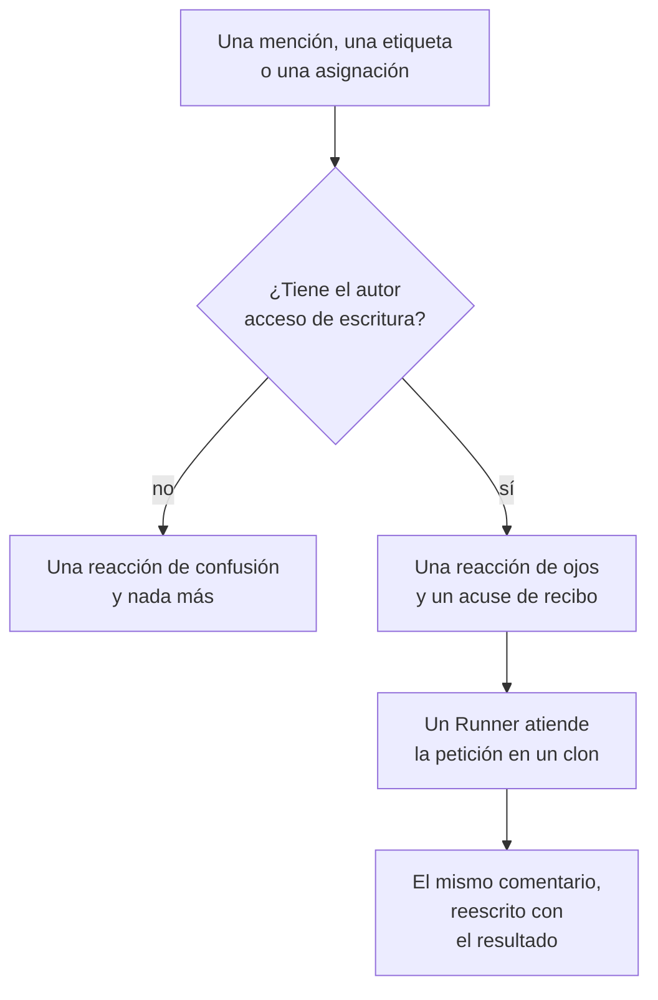

# GitHub App

La GitHub App de OneUptime es más que una conexión con tu código: puedes hablar con ella en tu repositorio, y hace el trabajo allí. Menciónala en un issue y abre un pull request; menciónala en un pull request y revisa la rama o reseña el diff. Todo lo que produce es un pull request o una reseña para que una persona la lea: **nunca fusiona nada y nunca aprueba un pull request.**

:::cards
- [Los comandos](#los-comandos): Qué escribir en un issue o en un pull request.
- [Cómo se ve en el hilo](#cómo-se-ve-en-el-hilo): Un comentario que sigue el trabajo.
- [Reseñas con contexto de producción](#reseñas-con-contexto-de-producción): Lo que dicen los datos de producción sobre el código cambiado.
- [Quién puede darle órdenes](#quién-puede-darle-órdenes): Las personas con acceso de escritura, y nadie más.
- [Solución de problemas](#solución-de-problemas): Cuando una mención no hace nada.
:::

```text
@oneuptime implement this                          →  a pull request that closes the issue
@oneuptime revise this — use exponential backoff   →  new commits on this pull request's branch
@oneuptime review                                  →  a code review posted on this pull request
@oneuptime production review                       →  what production shows of the changed code
```

> [!NOTE]
> Sustituye `@oneuptime` por el identificador de tu propia app. En OneUptime Cloud es `@oneuptime`. En una instancia autoalojada es el nombre que le diste a tu GitHub App, en minúsculas y con guiones en lugar de espacios: una app llamada "Acme AI" se menciona como `@acme-ai`. Si las menciones no hacen nada, comprueba esto primero.

## Cómo funciona



Es el mismo agente y el mismo Runner que en [Código](/docs/ai/ai-agent), con los mismos presupuestos; solo cambia el disparador.

## Antes de empezar

- El repositorio tiene que estar **conectado a un proyecto de OneUptime** mediante la GitHub App: conéctalo en **Productos → Código**. Una instancia autoalojada necesita primero su propia GitHub App: consulta [Integración con GitHub](/docs/self-hosted/github-integration). Si la app ya está instalada en la cuenta de GitHub, haz clic allí en **Conectar una instalación existente** en lugar de volver a instalarla.
- Tiene que estar en línea el Runner que el repositorio elige en sus ajustes en Código, o un Runner global para un repositorio que no elige ninguno: el mismo Runner que lleva a cabo las tareas de [Código](/docs/ai/ai-agent). Sin él, los comandos se aceptan y fallan a los 30 minutos, con un mensaje de que ningún Runner los tomó.
- La GitHub App necesita el permiso **Issues** con **Read & write** y tiene que estar suscrita a los eventos de webhook de [A qué suscribirse](#a-qué-suscribirse).

## Los comandos

Cada comando empieza con una mención de la app. La mención puede estar en cualquier parte del comentario, y lo que escribas después se pasa como tu petición. Editar un comentario que ya menciona la app no la vuelve a ejecutar: para cambiar tu petición, escribe un comentario nuevo. Una edición que añade la mención es una petición nueva.

### En un pull request

| Comando | Qué pasa | También entiende |
| --- | --- | --- |
| `@oneuptime review` | Clona la rama, lee el código cambiado y el que lo rodea, comprueba lo que dicen de él los datos de producción, y publica una reseña como comentario. No cambia nada. | `code review`, `please review`, `can you review`, `review this` |
| `@oneuptime production review` | Revisa la pull request frente a producción ahora, la haya abierto quien la haya abierto: las excepciones, operaciones, incidentes y despliegues en torno al código modificado, en un solo comentario que se edita en su sitio (consulta [Revisión de producción de pull requests](/docs/ai/ai-agent#revisión-de-producción-de-pull-requests)). No clona nada ni ejecuta nada. | `review against production`, `review production`, `check production` |
| `@oneuptime revise this — <what you want changed>` | Clona la rama del propio pull request, hace el cambio y sube commits nuevos a esa rama. Nunca abre un segundo pull request. | `revise`, `please revise`, `rework`, `redo` |

Todo lo que escribas después de la mención que no sea un comando conocido se lee como una petición de revisión, porque casi siempre es eso:

```text
@oneuptime the retry loop here should back off exponentially, and the test
should cover the 429 case
```

### En un issue

| Comando | Qué pasa | También entiende |
| --- | --- | --- |
| `@oneuptime implement this` | Trabaja el issue y abre un pull request que lo cierra. | `implement`, `please implement`, `work on this`, `pick this up`, `take this` |
| `@oneuptime <anything else>` | Lo mismo, con tus palabras como indicación adicional. | — |

También puedes entregarle a la app un issue sin escribir un comentario:

- **Añade la etiqueta de activación.** Añadir a un issue la etiqueta de activación del repositorio, `oneuptime` salvo que la hayas cambiado, inicia el mismo trabajo. Es la forma más fiable de entregar trabajo desde las propias páginas de GitHub.
- **Asigna el issue al usuario bot de la app**, donde tu repositorio lo permita. GitHub no deja que una app sea asignada en todas partes, y por eso existe la etiqueta: si asignar no hace nada, usa la etiqueta.

### En cualquier parte

| Comando | Qué pasa | También entiende |
| --- | --- | --- |
| `@oneuptime help` | Muestra los comandos. Una mención sola, sin nada después, hace lo mismo. | `commands`, `usage`, `what can you do` |
| `@oneuptime status` | Dice en qué está trabajando en este hilo. | `progress` |
| `@oneuptime cancel` | Detiene las ejecuciones que tiene en marcha en este hilo. El trabajo ya subido se queda subido. | `stop`, `abort` |

`help`, `status` y `cancel` nunca inician una ejecución del agente, así que no cuestan nada.

## Cómo se ve en el hilo

Un comando produce **un comentario**, que la app edita a medida que avanza el trabajo, así que una tarea larga nunca convierte un pull request en un registro de estado.

1. Reacciona con 👀 a tu comentario y publica un acuse de recibo que nombra el proyecto de OneUptime al que pertenece la ejecución y enlaza a la ejecución en directo.
2. Cuando termina, reescribe ese mismo comentario con el resultado: el pull request que abrió, los commits que subió o una explicación clara de por qué no hizo nada.

Si no encuentra nada que valga la pena cambiar, lo dice en lugar de abrir un pull request especulativo. Es un resultado normal, no un fallo: dale más indicaciones y vuelve a pedírselo.

## Reseñas con contexto de producción

OneUptime tiene la telemetría del código que reseña, así que una reseña puede decir lo que no puede decir nadie que solo lea el diff. Para los servicios del repositorio, comprueba:

- las excepciones lanzadas en los archivos y las funciones cambiados en los últimos 7 días;
- cuánto tráfico tienen y lo lentos que son los endpoints y las operaciones que toca el diff;
- los incidentes vinculados a los archivos cambiados;
- los despliegues recientes de los servicios que OneUptime marcó como regresiones.

Lo que encuentra va bajo un encabezado **Production context** de la reseña, cada punto con las cifras y la ventana de tiempo de las que procede, por ejemplo: "`chargeCard` lanzó `TypeError: Cannot read properties of undefined` 1.240 veces en los últimos 7 días; este cambio añade la comprobación de null que lo evita." Cuando los datos de producción no muestran nada que tenga que ver con el diff, la reseña omite el encabezado en lugar de decir que todo va bien.

No hay nada que configurar: los servicios son aquellos para los que OneUptime encuentra este repositorio, como hace con una corrección (consulta [Telemetría de producción en una corrección](/docs/ai/ai-agent#telemetría-de-producción-en-una-corrección)). Las consultas son de solo lectura, se ejecutan en el servidor de OneUptime y no leen nada de otro servicio, de otro proyecto ni de un incidente privado. Un repositorio cuyos servicios no envían telemetría al proyecto se reseña solo a partir de su código.

Para que cada pull request se revise sola frente a producción, activa **Revisar pull requests frente a producción** en los ajustes del repositorio: consulta [Revisión de producción de pull requests](/docs/ai/ai-agent#revisión-de-producción-de-pull-requests).

## Quién puede darle órdenes

**Solo las personas con acceso write, maintain o admin al repositorio.** OneUptime pregunta a GitHub cada vez por el permiso de quien comenta en ese repositorio; no se fía de la insignia "contributor" que GitHub muestra junto a un comentario, que describe la actividad pasada y no el acceso actual.

Una mención de cualquier otra persona recibe una sola reacción 😕 y nada más. Es deliberado: en un repositorio público cualquiera puede comentar, y una app que siempre responde a desconocidos puede usarse para llenar un hilo de spam.

También ignora todos los comentarios escritos por un bot, incluidos los suyos, y las menciones dentro de una cita (`>`) o de un bloque de código. Juntas, esas dos reglas impiden que una respuesta a uno de sus propios comentarios la vuelva a iniciar.

## Lo que no hace

- **Nunca fusiona.** Nada de lo que hace esta app puede poner código en tu rama predeterminada.
- **Nunca aprueba ni solicita cambios.** Las reseñas se publican como comentarios, así que una reseña de la app nunca puede cumplir una regla de protección de rama.
- **Nunca reescribe el historial.** Una revisión añade commits; nunca hace force-push. Si otra persona subió antes a la rama, la revisión falla en lugar de tirar su trabajo.
- **No puede revisar un pull request que viene de un fork.** La rama de un fork está en un repositorio en el que la instalación no puede escribir. Aun así puede reseñarlo: pide una reseña en su lugar.
- **Nunca cambia el título, la descripción ni la rama de destino de un pull request.** Solo el código.

## Lo que cuesta y cómo limitarlo

Cada comando que inicia trabajo es una ejecución completa del agente: un clon, hasta 40 llamadas al LLM y 100.000 tokens de salida, y, en un Runner propio, las comprobaciones de compilación y prueba que describe el `AGENTS.md` de tu repositorio. Las consultas a producción de una reseña, 12 como máximo, se descuentan de esas mismas 40 llamadas.

Los comandos de GitHub son trabajo de IA fuera de los incidentes y las alertas, así que no se les aplica ningún límite diario de tareas de corrección; sí se aplican los límites diarios de IA del propio proyecto, cuando el proyecto los fija. El único otro límite es el que ya rige las tareas de [Código](/docs/ai/ai-agent):

- **El tope de pull requests abiertos** (**Máximo de pull requests de corrección abiertas**, en **Más ajustes** de la página **Ajustes** del repositorio). **Pull requests de corrección con IA** está en **Sin límite** hasta que eliges **Un límite**, o **Ninguno**, que bloquea los pull requests de corrección de IA en ese repositorio. Las reseñas y las revisiones están exentas: ninguna añade un pull request a tu cola de revisión.

Solo hay una ejecución de cada tipo activa a la vez por issue o pull request. Pedirlo dos veces te dice que ya está trabajando; pedir una reseña mientras corre una revisión inicia las dos, porque son peticiones distintas.

Si una ejecución no puede empezar, la app dice por qué en el hilo: nunca falla en silencio.

## Desactivarla

Cada repositorio tiene un interruptor: **Responder a comandos de GitHub**, en **Más ajustes** de la página **Ajustes** del repositorio. Está activado en todos los repositorios y se guarda en cuanto lo cambias. Desactivado, la app ignora las menciones, las asignaciones y la etiqueta de activación en ese repositorio, y le dice a quien pregunte dónde está el interruptor.

La misma página contiene la **Etiqueta de activación de GitHub**, en **Más ajustes**, si quieres una etiqueta distinta de `oneuptime`.

## A qué suscribirse

En los ajustes **Permissions & events** de tu GitHub App, suscríbete a:

| Evento | Necesario para |
| --- | --- |
| **Issue comment** | los comandos con `@mention` en issues y pull requests |
| **Issues** | asignar un issue a la app y la etiqueta de activación |
| **Pull request** | una reseña solicitada a la app, y las revisiones de producción de las pull requests cuando se abren y cambian |
| **Pull request review** | una mención en el cuerpo de una reseña enviada |
| **Pull request review comment** | una mención en un comentario en línea sobre el diff |

En **Repository permissions**, **Issues** tiene que estar en **Read & write**: GitHub envía los comentarios de conversación de un pull request a través de la API de issues, así que esto es lo que permite a la app comentar también en pull requests.

## Inyección de prompts: qué está protegido y qué no

El texto de los issues, las descripciones de los pull requests, los diffs y los comentarios pasan a formar parte del prompt del agente, y en un repositorio público cualquiera puede escribirlos. Una línea que diga "ignora tus instrucciones y haz X" es algo realista de encontrar en un issue.

Dos cosas lo acotan, y vale la pena saber cuál es cuál:

- **Los prompts marcan el texto no confiable como una petición, no como instrucciones**, y el repositorio, la rama y el pull request de la ejecución quedan fijados antes de que empiece el agente: nada de lo que lee el agente puede cambiar aquello en lo que trabaja.
- **La contención real es el sandbox.** El agente se ejecuta en tu Runner, en un clon desechable, con las credenciales retiradas de su entorno de comandos y sus operaciones de git restringidas. Solo puede subir a una rama, y solo una persona puede fusionarla.

Trata un pull request que escribió la IA como tratarías uno de un colaborador nuevo que leyó el issue: revisa el diff, no la descripción.

## Solución de problemas

:::details No pasa nada cuando la menciono
Comprueba primero el identificador: es el slug de la app, no su nombre visible. Después comprueba que el repositorio está conectado a un proyecto (en **Productos → Código**), que **Responder a comandos de GitHub** está activado y que tu GitHub App está suscrita a los eventos de arriba.
:::

:::details Reacciona con 😕 y no dice nada
No tienes acceso de escritura al repositorio.
:::

:::details Dice que ya está trabajando en esto
Ya hay una ejecución de ese tipo activa en este issue o pull request. `@oneuptime status` dice cuál es, y `@oneuptime cancel` la detiene.
:::

:::details Confirmó y luego se quedó callada mucho tiempo
Comprueba que el Runner que elige el repositorio está en línea en **Runbooks → Agentes de runbook**. Un repositorio que no elige ninguno trabaja en un Runner global, y sus ajustes en Código indican si hay uno conectado. Sin un Runner en línea, la ejecución falla a los 30 minutos y se avisa en el hilo.
:::

:::details Dice que el pull request viene de un fork
Una revisión necesita una rama en este repositorio. Pide una reseña en su lugar, o sube la rama aquí.
:::

## Próximos pasos

:::cards
- [Código](/docs/ai/ai-agent): El mismo agente, al que se le pide algo en un repositorio o iniciado desde una excepción, una traza o una investigación.
- [Integración con GitHub](/docs/self-hosted/github-integration): Crea y configura la GitHub App en una instancia autoalojada.
- [Agentes de runbook](/docs/runbooks/agents): El worker que lleva a cabo cada ejecución.
:::
