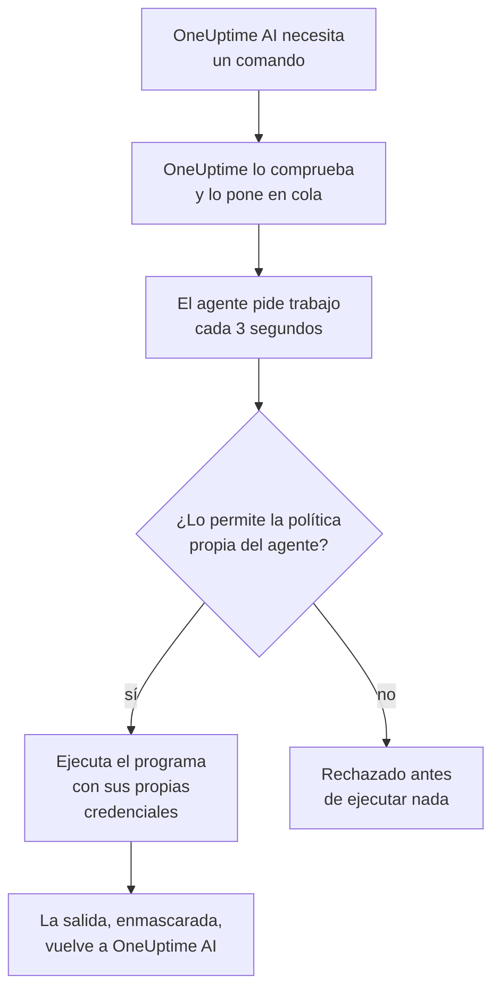

# Agentes de IA para la infraestructura

OneUptime AI puede mirar más allá de tu telemetría mientras investiga un incidente o una alerta. Un pequeño agente instalado junto a uno de tus recursos —un host de Docker o Podman, un clúster de Docker Swarm, un clúster de Proxmox, un VMware vCenter, un clúster de Ceph, un servidor de base de datos o un host Linux— ejecuta los comandos de solo lectura que pide OneUptime AI, como `docker logs --tail 200 web`, `pvesh get /cluster/status`, `ceph health detail`, `db long-queries --min-seconds 30` o `journalctl -u nginx -n 200 --no-pager`, y devuelve la salida, de modo que el análisis de causa raíz cita lo que dice el propio recurso. Si lo permites, el mismo agente también aplica correcciones —reiniciar un contenedor, arrancar una VM, volver a marcar un OSD como in—, cada una clasificada en un nivel por una política de comandos y, salvo que elijas otra cosa, aprobada antes por una persona. Preguntar a la IA, abierta en la página del recurso, ejecuta los mismos comandos de solo lectura cuando se lo pides (consulta [Preguntar a la IA](/docs/ai/ask-ai)).

Para investigar una cuenta de AWS, una suscripción de Azure o un proyecto de Google Cloud no hace falta ningún agente: OneUptime lee la cuenta en vivo, a través de la conexión de solo lectura con la que se conectó. Solo sus correcciones necesitan uno, el agente de IA de la nube, que se ejecuta en la propia cuenta y se configura con un solo comando desde la página de la cuenta (consulta [En una cuenta en la nube](#en-una-cuenta-en-la-nube)).

Estos agentes son los **agentes de IA de recursos**. La página de cada recurso en el panel tiene una sección **IA** con tres páginas:

- **Análisis**: lo que OneUptime AI averiguó sobre el recurso en los últimos 30 días: los problemas que vuelven una y otra vez y por qué, con lo que encontró la IA y el paso que sugiere, las partes del recurso detrás de la mayoría de ellos, las correcciones que no ayudaron o que esperan aprobación, lo que la IA corrigió por su cuenta y los riesgos detectados antes de que se avisara a nadie, con lo que la propia IA hizo allí como nota al pie. Funciona como la de un clúster; consulta [Lo que la IA aprendió en un clúster](/docs/ai/ai-sre#lo-que-la-ia-aprendió-en-un-clúster).
- **Registros**: todo lo que OneUptime AI hizo en el recurso, lo más reciente primero: cada investigación con su incidente o alerta y su resumen, cada corrección que propuso o ejecutó y cada comando que envió a través del agente. (Esta página se llamaba antes Análisis).
- **Agente de IA**: si el agente está conectado, qué puede hacer la IA en el recurso (investigar, y cómo se ejecutan las correcciones), todo lo que requiere atención con el paso que lo resuelve y, en el menú **⋯** junto al estado del agente, **Probar conexión** y **Restablecer agente**.

La **Vista general** del recurso termina con una tarjeta **Agente de IA** que resume la página del agente de IA: si el agente está conectado, si la investigación está activada, cómo se ejecutan las correcciones (**Desactivado**, **Pedir aprobación**, **Automático** u **Omitir aprobación**) y qué requiere atención, con un enlace a la página del agente de IA, donde se cambian.

:::cards
- [Recursos compatibles](#recursos-compatibles): Once tipos de recurso, una sola imagen.
- [Instalar un agente de IA](#instalar-un-agente-de-ia): Junto a un colector que ya ejecutas, en un host Linux o en una cuenta en la nube con un solo comando.
- [Cómo funcionan las correcciones](#cómo-funcionan-las-correcciones): Qué puede ejecutarse solo, qué espera a una persona y qué nunca se ejecuta.
- [Modelo de seguridad](#modelo-de-seguridad): Tres comprobaciones en cada comando y ninguna credencial de OneUptime.
:::

## Cómo funciona

El agente nunca espera una conexión de OneUptime: llama a OneUptime, pide trabajo y ejecuta solo lo que permite su propia copia de la política de comandos, con las credenciales que ya tiene.



## Relación con el agente de IA de Kubernetes

Los clústeres de Kubernetes tienen su propio agente, el agente de IA de Kubernetes, que instala el chart de Helm del agente de Kubernetes; consulta [Acceso al clúster: deja que OneUptime AI ejecute kubectl](/docs/ai/ai-sre#acceso-al-clúster-deja-que-oneuptime-ai-ejecute-kubectl). Nada de esta página lo cambia. Los agentes de IA de recursos siguen el mismo diseño:

- **Los mismos niveles y modos.** Cada comando es **Read**, **SafeWrite**, **RiskyWrite** o **Denied**, y las correcciones son **Desactivado**, **Pedir aprobación**, **Automático** u **Omitir aprobación**, con el mismo significado que en un clúster.
- **Las mismas tres comprobaciones.** La misma política de comandos la aplican las herramientas de IA de OneUptime, de nuevo cuando OneUptime pone el comando en cola, y otra vez el agente antes de ejecutar nada.
- **La misma regla sobre credenciales.** El agente usa solo lo que le dan su propio entorno y sus montajes. OneUptime nunca le envía una credencial.
- **Los mismos valores predeterminados.** Las investigaciones de IA están activadas de forma predeterminada: un recurso empieza con la investigación activada y las correcciones desactivadas, como un clúster, así que OneUptime AI investiga con su agente en cuanto se conecta y no cambia nada hasta que alguien permite las correcciones (consulta [Conectarse a OneUptime](#conectarse-a-oneuptime)).

Lo que cambia:

- **Una sola imagen para cada recurso.** `oneuptime/resource-ai-agent` sirve a los once tipos de recurso, y `ONEUPTIME_AI_AGENT_RESOURCE_TYPE` indica a cuál sirve un agente. Se ejecuta junto al colector del recurso como un contenedor más, o en la cuenta en la nube a la que sirve, no desde un chart de Helm.
- **El acceso de escritura es una variable de entorno.** `ONEUPTIME_AI_ALLOW_WRITES=true` en el agente es lo que le permite aplicar correcciones, y `ONEUPTIME_AI_WRITE_TARGETS` limita qué contenedores, servicios, VM, OSD, sesiones o unidades pueden tocar. En un clúster, de eso se encargan el RBAC del chart y `aiAgent.remediation.namespaces`.

Al igual que el agente de IA de Kubernetes, un agente de IA de recursos no es un Runner. Nunca aparece en Runbooks → Agentes de runbook y nunca se usa como host de Bash o SSH para los runbooks.

## Recursos compatibles

| Recurso | `ONEUPTIME_AI_AGENT_RESOURCE_TYPE` | Agente | Se registra como (la variable del colector) | Ejecuta | Llega al recurso a través de |
| -------------------- | ---------------------------------- | --------------------- | ----------------------------------------------------------------------------------------------- | -------------------------------------------------------------------------------------------------------------------------------------------------- | -------------------------------------------------------------------------- |
| Host de Docker | `docker` | Agente de IA de Docker | `DOCKER_HOST_NAME` | `docker` | el socket de Docker, `/var/run/docker.sock` |
| Host de Podman | `podman` | Agente de IA de Podman | `PODMAN_HOST_NAME` | `docker`, a través de la API compatible con Docker de Podman | el socket de Podman, `/run/podman/podman.sock` |
| Clúster de Docker Swarm | `docker-swarm` (o `swarm`) | Agente de IA de Docker Swarm | `DOCKER_SWARM_CLUSTER_NAME` | `docker` | el socket de Docker de un nodo manager |
| Clúster de Proxmox | `proxmox` | Agente de IA de Proxmox | `PROXMOX_CLUSTER_NAME` | comandos `pvesh`, enviados a la API de Proxmox VE (el agente no incluye ningún binario `pvesh`) | `https://PVE_HOST:8006/api2/json`, con un token de API de Proxmox |
| VMware vCenter | `vmware` (o `vcenter`) | Agente de IA de VMware | `VMWARE_VCENTER_NAME` | `govc` | la API de vCenter, con un usuario de vSphere |
| Clúster de Ceph | `ceph` | Agente de IA de Ceph | `CEPH_CLUSTER_NAME` | `ceph` | los monitores, con un `ceph.conf` y el keyring del cliente propio del agente |
| Servidor de base de datos | `database` (o `db`) | Agente de IA de bases de datos | `DATABASE_SERVER_ID`, o `DATABASE_SYSTEM` + `DATABASE_SERVER_ADDRESS` + `DATABASE_SERVER_PORT` | `db`: una operación de un catálogo fijo de diagnósticos, nunca SQL | el propio driver de la base de datos, con un usuario de base de datos |
| Host | `host` | Agente de IA del host | `HOST_NAME` (vacío: el nombre de host propio del host) | `systemctl`, `journalctl`, `df`, `free`, `uptime`, `ps`, `ss`, `ip`, `dmesg`, `lsblk`, `cat`, `top`, `uname`, `hostnamectl`, `timedatectl`, `kill` | `nsenter` en los namespaces del host, desde un contenedor privilegiado |
| Cuenta de AWS | `aws` | Agente de IA de la nube | `AWS_ACCOUNT_ID` (vacío: la cuenta en la que se ejecuta) | `cloud`: una operación de un catálogo fijo, nunca un comando `aws` | las API de AWS, con roles de IAM propios |
| Suscripción de Azure | `azure` | Agente de IA de la nube | `AZURE_SUBSCRIPTION_ID` (la define su comando de configuración) | `cloud`: una operación de un catálogo fijo, nunca un comando `az` | Azure Resource Manager, como la identidad administrada de su Container App |
| Proyecto de Google Cloud | `gcp` (o `google-cloud`) | Agente de IA de la nube | `GOOGLE_CLOUD_PROJECT` (vacío: el proyecto en el que se ejecuta) | `cloud`: una operación de un catálogo fijo, nunca un comando `gcloud` | las API de Google Cloud, como una cuenta de servicio propia |

Servidores de bases de datos: el agente de IA de bases de datos tiene diagnósticos para PostgreSQL, MySQL (y MariaDB y Percona Server), Redis (y Valkey, KeyDB y Dragonfly) y MongoDB. Con cualquier otro motor no ejecuta nada y lo indica en la página del agente de IA de la base de datos.

**Probar conexión**, en el menú **⋯** junto al estado del agente en la página del agente de IA, ejecuta estos comandos de solo lectura a través del agente y muestra su salida en la tarjeta del agente:

| Recurso | Lo que ejecuta Probar conexión |
| -------------------- | ---------------------------------------------------- |
| Host de Docker | `docker version`, `docker info` |
| Host de Podman | `docker version`, `docker info` |
| Clúster de Docker Swarm | `docker version`, `docker node ls` |
| Clúster de Proxmox | `pvesh get /version`, `pvesh get /cluster/status` |
| VMware vCenter | `govc about` |
| Clúster de Ceph | `ceph health`, `ceph versions` |
| Servidor de base de datos | `db ping`, `db version` |
| Host | `uptime`, `systemctl list-units --failed --no-pager` |
| Cuenta de AWS | `cloud whoami` |
| Suscripción de Azure | `cloud whoami` |
| Proyecto de Google Cloud | `cloud whoami` |

En un worker de Docker Swarm, `docker node ls` falla: el agente de IA de Docker Swarm debe ejecutarse en un nodo manager. Uno iniciado en un worker no se registra para el clúster hasta que su nodo sea manager, y el instalador de Docker Swarm lo omite en un nodo que no es manager.

En una cuenta en la nube, `cloud whoami` muestra la cuenta en la que actúa el agente de IA de la nube y con qué identidad ha iniciado sesión, si puede cambiar algo, los cambios que puede hacer y la etiqueta que exige, si la hay.

## Instalar un agente de IA

Todos los agentes de IA de recursos son la misma imagen, `oneuptime/resource-ai-agent:release`. Junto a un colector o en un host, no necesita nada en el panel: en cuanto se ejecuta, se registra en OneUptime y aparece en la página del agente de IA del recurso en menos de un minuto. El de una cuenta en la nube se ejecuta en la cuenta, a partir de un solo comando que la página de la cuenta escribe para él (consulta [En una cuenta en la nube](#en-una-cuenta-en-la-nube)).

### Junto a un colector

Para Docker, Podman, Docker Swarm, Proxmox, VMware, Ceph y los servidores de bases de datos, el agente se ejecuta junto al colector que ya usas para ese recurso y comparte su `.env`: ya tiene `ONEUPTIME_URL`, la clave de ingesta y el nombre del recurso. El `docker-compose.yml` de cada colector incluye el agente como un servicio más, y su `install.sh` lo arranca.

| Recurso | Colector | Servicio del agente de IA (y contenedor) | Dónde se configura |
| -------------------- | ----------------------------------------------------------- | --------------------------------- | ------------------------------------------------------------------------------------- |
| Host de Docker | [Agente de Docker](/docs/telemetry/docker-host#agente-de-ia) | `oneuptime-docker-ai-agent` | `agents/DockerAgent/docker-compose.yml`; `install.sh` lo arranca como un segundo contenedor |
| Host de Podman | [Agente de Podman](/docs/telemetry/podman-host#agente-de-ia) | `oneuptime-podman-ai-agent` | `agents/PodmanAgent/docker-compose.yml`; `install.sh` lo arranca como un segundo contenedor |
| Clúster de Docker Swarm | [Agente de Docker Swarm](/docs/telemetry/docker-swarm#agente-de-ia) | `oneuptime-docker-swarm-ai-agent` | `agents/DockerSwarmAgent/docker-compose.yml`, en un nodo manager |
| Clúster de Proxmox | [Agente de Proxmox](/docs/telemetry/proxmox#agente-de-ia) | `oneuptime-proxmox-ai-agent` | `agents/ProxmoxAgent/docker-compose.yml` |
| VMware vCenter | [Agente de VMware](/docs/telemetry/vmware#agente-de-ia) | `oneuptime-vmware-ai-agent` | `agents/VMwareAgent/docker-compose.yml` |
| Clúster de Ceph | [Agente de Ceph](/docs/telemetry/ceph#agente-de-ia) | `oneuptime-ceph-ai-agent` | `agents/CephAgent/docker-compose.yml`, con el cliente de Ceph propio del agente en `./ceph` |
| Servidor de base de datos | [Agente de bases de datos](/docs/telemetry/databases#agente-de-ia) | `oneuptime-database-ai-agent` | `agents/DatabaseAgent/docker-compose.yml` |

Un colector instalado antes de que existiera el agente de IA todavía no lo ejecuta. Vuelve a ejecutar su `install.sh`: ahora también arranca el agente de IA (los instaladores de Proxmox, VMware, Ceph, bases de datos y Docker Swarm descargan el `docker-compose.yml` actual, que incluye el servicio del agente de IA). Si gestionas los archivos tú mismo, añade el servicio del `docker-compose.yml` del colector al tuyo y ejecuta `docker compose up -d`. La página del agente de IA del recurso muestra el servicio exacto para ese recurso, con su nombre ya rellenado.

Sin los instaladores, el agente de IA de Docker es un solo `docker run`:

```bash
docker run -d \
  --name oneuptime-docker-ai-agent \
  --user 0:0 \
  --restart unless-stopped \
  --read-only --tmpfs /tmp \
  -v /var/run/docker.sock:/var/run/docker.sock:ro \
  -e ONEUPTIME_URL="https://oneuptime.com" \
  -e ONEUPTIME_SERVICE_TOKEN="YOUR_TELEMETRY_INGESTION_TOKEN" \
  -e ONEUPTIME_AI_AGENT_RESOURCE_TYPE=docker \
  -e DOCKER_HOST_NAME="my-docker-host" \
  oneuptime/resource-ai-agent:release
```

`DOCKER_HOST_NAME` debe ser el nombre que informa el agente de Docker. Los instaladores de Docker y Podman aceptan `--no-ai-agent` (o `ONEUPTIME_INSTALL_AI_AGENT=false`) para omitir el agente de IA, y lo mismo hace el instalador de Docker Swarm. Para ejecutar un colector sin él más adelante, elimina su servicio del agente de IA de `docker-compose.yml`, o elimina su contenedor con `docker rm -f`.

### Agente de IA del host

Un host Linux que informa a través del [Colector OpenTelemetry en el host](/docs/telemetry/host-otel-collector) no tiene ningún contenedor de OneUptime junto al que colocarse, así que el agente de IA del host trae su propio instalador (`agents/HostAIAgent`):

```bash
curl -fsSL https://raw.githubusercontent.com/OneUptime/oneuptime/master/agents/HostAIAgent/install.sh -o install.sh
sudo bash install.sh
```

Pide tu URL de OneUptime, la clave de ingesta de telemetría del proyecto y el nombre del host, escribe `/opt/oneuptime-host-ai-agent/.env` y `docker-compose.yml`, y arranca el contenedor `oneuptime-host-ai-agent`. Añade `--systemd` para ejecutarlo en su lugar bajo la unidad de systemd `oneuptime-host-ai-agent`. Necesita Docker (el motor del sistema, no Docker rootless) con el plugin Compose; Podman en modo rootful puede ejecutar el mismo contenedor.

El agente de IA del host ejecuta los **programas del propio host**: cada comando se ejecuta como `nsenter --target 1 --mount --uts --ipc --net --pid -- PROGRAM ARGS`, que entra en los namespaces del init del host. Eso requiere `pid: host`, `privileged: true` y root; consulta [El socket de Docker y el agente de IA del host son root en el host](#el-socket-de-docker-y-el-agente-de-ia-del-host-son-root-en-el-host). Deja `HOST_NAME` vacío para usar el nombre de host de la máquina, que es lo que el colector informa como `host.name` salvo que lo hayas cambiado; si no, ponle el nombre que aparece en **Hosts**.

### En una cuenta en la nube

Una cuenta de AWS, una suscripción de Azure o un proyecto de Google Cloud no tiene ningún colector junto al que pueda ejecutarse un agente, y OneUptime lee la cuenta sin ninguno (consulta [Cuentas en la nube](#cuentas-en-la-nube)). Su agente de IA de la nube, que hace las correcciones, se ejecuta en la propia cuenta y se configura desde la página de la cuenta con un solo comando, sin archivo compose y sin `.env`:

1. En Nube → Cuentas, abre la cuenta y selecciona **Permitir que la IA corrija problemas** en la tarjeta **Agente de IA** de su **Vista general**.
2. Responde a la única pregunta, **¿Hasta dónde puede llegar la IA?**: **Preguntarme primero**, la opción predeterminada, pone **Correcciones** en **Pedir aprobación**, y **Aplicar por su cuenta las correcciones seguras** en **Automático**. **Más campos** contiene el resto: qué cambios puede hacer la IA, los recursos que nunca debe cambiar, cambiar solo los recursos con la etiqueta `oneuptime-ai=allow`, **Omitir aprobación**, la lectura de los registros de la cuenta y las variables del agente para ejecutarlo en otro lugar.
3. Ejecuta el comando que muestra en el shell integrado de la nube, con la sesión iniciada en esa cuenta. Escribe el rol del agente a partir de los cambios activados e inicia el agente, que se conecta por sí solo en pocos minutos: no hay nada que volver a pegar. Si no se conecta, su registro dice por qué (consulta [Registros y estado](#registros-y-estado)).

| Nube | Dónde ejecutarlo | Qué crea el comando |
| -------------------- | ------------------ | ------------------------------------------------------------------------------------------------------------------------------------------------------------------------------------------------------------------ |
| Cuenta de AWS | AWS CloudShell | Una pila de CloudFormation, `oneuptime-ai-agent`, que ejecuta una tarea de ECS Fargate. Su rol de tarea solo puede asumir el rol de escritura `OneUptimeAiAgentWrite`, que tiene los permisos de los cambios activados. La clave con la que se conecta se guarda en Secrets Manager, que solo ECS lee. |
| Suscripción de Azure | Azure Cloud Shell | Una Container App, `oneuptime-ai-agent`, en el grupo de recursos `oneuptime-ai-agent`. Su identidad administrada tiene un rol personalizado en la suscripción con los permisos de los cambios activados. La clave con la que se conecta es un secreto de Container Apps. |
| Proyecto de Google Cloud | Google Cloud Shell | Un servicio de Cloud Run, `oneuptime-ai-agent`, con la CPU siempre asignada, que se ejecuta como la cuenta de servicio `oneuptime-ai-agent`, que tiene un rol personalizado en el proyecto con los permisos de los cambios activados. La clave con la que se conecta se guarda en Secret Manager, que solo esa cuenta de servicio puede leer. |

El comando solo funciona en la cuenta para la que se escribió: en AWS no crea nada en un shell con la sesión iniciada en otra cuenta, y los comandos de Azure y Google Cloud nombran su suscripción o proyecto en cada llamada. Define `ONEUPTIME_AI_INVESTIGATION=true`, `ONEUPTIME_AI_FIXES` según tu respuesta, `ONEUPTIME_AI_ALLOW_WRITES=true` y `ONEUPTIME_AI_CLOUD_ACCOUNT_ID` con la cuenta para la que se escribió. El agente se registra como la cuenta en la que su nube dice que está y nunca añade una a OneUptime: si se inicia en otra cuenta que la de su comando, se rechaza, y la cuenta para la que se escribió dice por qué en su página; si se inicia en una cuenta que ninguna conexión del proyecto lee, también se rechaza, y su registro lo dice.

Para cambiar algo, vuelve a ejecutar el comando: abre de nuevo **Permitir que la IA corrija problemas**, o selecciona **Cambiar** en la página **Agente de IA** de la cuenta, y ejecuta el comando que escribe. El rol siempre tiene solo los cambios activados. La sección **IA** de una cuenta en la nube tiene dos páginas, **Agente de IA** y **Registros**, y lo que cuesta el agente está en [Conectar una cuenta en la nube](/docs/telemetry/cloud-accounts#permitir-que-la-ia-corrija-problemas). En **Actividad**, el **Feed** de la cuenta registra cuándo el agente se conecta o se restablece, y cada cambio en lo que OneUptime AI puede hacer en ella, con quién lo hizo.

### Conectarse a OneUptime

El agente se registra con **la misma identidad que informa el colector** (`DOCKER_HOST_NAME`, `PROXMOX_CLUSTER_NAME`, `CEPH_CLUSTER_NAME`, …; `ONEUPTIME_AI_AGENT_RESOURCE_NAME` la sustituye), así que sirve exactamente al recurso que creó la telemetría del colector. Cuando OneUptime todavía no tiene ningún recurso con ese nombre, el registro lo crea, de modo que un nombre distinto del del colector te da un segundo recurso vacío en lugar de un error. Una base de datos se registra por `DATABASE_SERVER_ID` cuando está definido y, si no, por su motor, dirección y puerto; un `DATABASE_SERVER_ID` que no sea una base de datos de este proyecto se rechaza.

Si el colector sigue usando su nombre predeterminado (`docker-host`, `podman-host`, `docker-swarm`, `proxmox-cluster`, `vmware-vcenter`, `ceph`), todos los recursos instalados con ese valor predeterminado informan al mismo recurso de OneUptime, y los comandos para él podrían llegar a cualquiera de ellos. El agente avisa de ello en su registro; dale a cada recurso un nombre único, tanto en el colector como en el agente.

Se autentica con la clave de ingesta de telemetría del proyecto (la primera definida de `ONEUPTIME_API_KEY`, `ONEUPTIME_TELEMETRY_INGESTION_KEY` y `ONEUPTIME_SERVICE_TOKEN`, que los colectores ya definen) y recibe una clave propia. Todas sus llamadas son `POST` HTTPS a `<ONEUPTIME_URL>/resource-ai-agent-ingest/…`: se registra una vez al arrancar, envía un latido cada 30 segundos (cuenta como en línea durante 5 minutos después del último), pide trabajo cada 3 segundos y se da de baja al detenerse. Un segundo agente con la misma identidad se rechaza mientras el primero está en línea: un contenedor que se detiene limpiamente se da de baja, así que su reemplazo se admite al instante, y tras un fallo o un kill el reemplazo ocupa su lugar en cuanto el anterior pasa 40 segundos sin enviar nada desde el primer rechazo. Si sigue rechazado después de 10 minutos, otro agente activo usa la misma identidad: el agente registra un error que lo dice y solo vuelve a preguntar cada 5 minutos hasta que des a cada recurso su propio nombre o detengas el otro agente. Un proyecto admite como máximo 250 agentes de IA de recursos, y como máximo se registran 30 nuevos por hora. Una vez alcanzados los 250, los agentes de los que no se sabe nada desde hace 7 días se eliminan para dejar sitio a uno nuevo (el recurso conserva sus ajustes de IA, y un agente así que vuelve simplemente se registra de nuevo).

La **Investigación** está activada para cada recurso desde el principio, así que OneUptime AI investiga con el agente en cuanto se conecta. Más allá de eso, lo que la IA puede hacer en el recurso es un ajuste propio del agente (consulta [Lo que la IA puede hacer, definido por el agente](#lo-que-la-ia-puede-hacer-definido-por-el-agente)). Un agente que no nombra ninguno de los dos ajustes usa sus valores predeterminados: activa la **investigación** para su recurso y, si permite escrituras (`ONEUPTIME_AI_ALLOW_WRITES=true`), pone **Correcciones** en **Pedir aprobación** y, si no, en **Desactivado**. Sus valores predeterminados solo se aplican a un recurso cuyos ajustes de IA nadie ha elegido en la página del agente de IA: los ajustes que alguien guardó allí se quedan como están hasta que la configuración del agente los nombre, así que un recurso cuyo interruptor **Investigar** desactivó alguien sigue desactivado. Un agente anterior a estos ajustes no informa de ninguno, y la página del agente de IA los define, como antes.

**Restablecer agente**, en el mismo menú **⋯** de la página del agente de IA, hace que OneUptime olvide la clave del agente en cuanto lo confirmas; quien la tuviera queda bloqueado, y el agente real se vuelve a registrar en pocos minutos. El agente necesita un servidor de OneUptime de la misma versión que su imagen, o más reciente.

### Lo que la IA puede hacer, definido por el agente

La investigación y las correcciones se definen donde se ejecuta el agente (en el `.env` que comparte con el colector o en el entorno de su contenedor), y OneUptime las sigue:

| Variable | Predeterminado | Qué hace |
| ---------------------------- | ------- | ----------------------------------------------------------------------------------------------------------------------------------------------------------------------------------------------------------------------------------------------------- |
| `ONEUPTIME_AI_INVESTIGATION` | vacío | `true` permite que la IA ejecute los comandos de solo lectura de abajo mientras investiga; `false` la limita a los datos que OneUptime ya tiene. Vacío: activada. |
| `ONEUPTIME_AI_FIXES` | vacío | Cómo puede aplicar la IA una corrección: `off`, `ask-for-approval`, `automatic` o `bypass-approval` (consulta [Modos de corrección](#modos-de-corrección)). Cualquier modo salvo `off` también necesita `ONEUPTIME_AI_ALLOW_WRITES=true`, y `off` mantiene el agente en solo lectura incluso con ella. Vacío: `ask-for-approval` cuando el agente permite escrituras y, si no, `off`. |

Por ejemplo, para que la IA aplique correcciones con una persona que apruebe cada una:

```bash
ONEUPTIME_AI_INVESTIGATION=true
ONEUPTIME_AI_FIXES=ask-for-approval
ONEUPTIME_AI_ALLOW_WRITES=true
```

Después reinicia el agente (`docker compose up -d`, o vuelve a ejecutar el `install.sh` del colector con ellas definidas para un host de Docker o Podman). El agente informa de ambas al registrarse y en cada latido, y OneUptime las aplica al recurso al momento. La página del agente de IA del recurso las muestra entonces en solo lectura: **Cambiar** muestra estas líneas para la opción que elijas en lugar de guardar nada, y OneUptime rechaza un cambio hecho en cualquier otro sitio (la API, Terraform, un administrador maestro) mientras el agente las define. La lista de comandos permitidos se queda en la página. Un valor que el agente no puede leer deja ese ajuste desactivado, y el agente registra cuál.

## Qué puede ejecutar una investigación

Una investigación solo ejecuta comandos **Read**: miran el recurso y no cambian nada. OneUptime AI ve los recursos vinculados al incidente o a la alerta (a través de sus monitores y su telemetría, como máximo 10 por señal) cuyo agente de IA está conectado (una cuenta en la nube no lo necesita) y cuyo interruptor **Investigar** está activado, y ejecuta tantos comandos como necesite la investigación (hasta 200 por investigación, una protección contra un bucle desbocado), cada uno citado como cualquier otra evidencia. Cada comando es un programa con sus argumentos, nunca a través de un shell, así que las tuberías, las redirecciones, `;`, `&&`, `$(…)` y `sudo` se rechazan con un mensaje que lo dice. Un comando tiene 30 segundos de forma predeterminada y 2 minutos como máximo, y su salida se limita a 1024 KB en el agente. Nada de esa salida se recorta antes de llegar a OneUptime AI: una salida larga se muestra página a página (los primeros 40.000 caracteres y luego el resto a petición). Si un agente no recoge un comando, OneUptime AI deja de enviar comandos a ese recurso durante el resto de la investigación.

Lo que puede leer cada tipo de recurso se indica a continuación. Es la misma lista que recibe la propia IA; todo lo que no está en ella se rechaza.

### Hosts de Docker y Podman

- Contenedores: `docker ps -a` (también `-q`, `-n`, `-l`, `-s`, `--no-trunc`, `--filter`, `--format json`), `docker container inspect web`, `docker inspect --type container web`, `docker top web`, `docker port web`, `docker diff web`. Los valores de entorno en la salida de inspect vuelven enmascarados.
- Registros y actividad: `docker logs --tail 200 web` o `docker logs --since 30m web`; se requiere un `--tail` de como máximo 2000 o un `--since` (sin `--tail`, `--since` debe ser una duración de como máximo 24h), y `-f` nunca se permite; `docker stats --no-stream`; `docker events --since 30m --until 0s` (ambos límites son obligatorios, `--until` como duración, para que la ventana siempre se cierre en el pasado).
- El motor: `docker info`, `docker version`, `docker system df` (`-v` solo como tabla: `-v --format json` imprime la línea de comandos de cada paso de compilación), `docker images`, `docker image inspect nginx:1.27`, `docker network ls`, `docker network inspect bridge`, `docker volume ls`, `docker volume inspect data`.
- Solo `--format json` (o `table` para las listas), nunca una plantilla de Go, y ninguno de los flags globales de docker (`-H`, `--context`, `--config`, …): apuntarían la CLI a otro motor.

Un host de Podman ejecuta la misma CLI `docker` y la misma política, a través de la API compatible con Docker de Podman.

### Clústeres de Docker Swarm

- Nodos: `docker node ls`, `docker node ps node-1`, `docker node inspect node-1 --pretty`.
- Servicios: `docker service ls`, `docker service ps web --no-trunc`, `docker service inspect web --pretty` (los valores de entorno vuelven enmascarados), `docker service logs --tail 200 web` (se requiere un `--tail` de como máximo 2000 o un `--since`, que por sí solo debe ser una duración de como máximo 24h; nunca `-f`).
- Stacks: `docker stack ls`, `docker stack ps shop`, `docker stack services shop`.
- El propio motor del manager: `docker ps -a`, `docker container inspect web`, `docker logs --tail 200 web`, `docker stats --no-stream`, `docker info`, `docker version`, `docker network ls` y el resto de las lecturas de un host de Docker.

### Clústeres de Proxmox

No hay ningún `pvesh` en el agente. Un comando se escribe con la gramática de `pvesh` —`get` (o `ls`) y una ruta de la API, con las opciones como `--name value`— y el agente lo convierte en exactamente un `GET` a la API de Proxmox VE con su propio token. `--output-format json|json-pretty|text` elige la salida; no se aceptan cadenas de consulta, y una escritura debe nombrar su nodo (nunca `localhost`).

- El clúster: `pvesh get /version`, `pvesh get /cluster/status`, `pvesh get /cluster/resources --type vm`, `pvesh get /cluster/ha/status/current`, `pvesh get /cluster/log --max 50`, `pvesh get /cluster/tasks`, `pvesh get /nodes` y las listas de replicación, copias de seguridad, pools y almacenamiento.
- Un nodo: `pvesh get /nodes/pve1/status`, `pvesh get /nodes/pve1/services`, `pvesh get /nodes/pve1/storage`, `pvesh get /nodes/pve1/disks/list`, `pvesh get /nodes/pve1/rrddata --timeframe hour`, además de su red, su replicación, sus actualizaciones de APT y su estado de Ceph.
- Tareas y registros: `pvesh get /nodes/pve1/tasks --errors 1 --limit 20`, el estado y el registro de una tarea, `pvesh get /nodes/pve1/syslog --limit 200`, `pvesh get /nodes/pve1/journal --lastentries 200`.
- Invitados (`qemu` para las VM, `lxc` para los contenedores): `pvesh get /nodes/pve1/qemu`, `pvesh get /nodes/pve1/lxc`, `pvesh get /nodes/pve1/qemu/101/status/current`, `pvesh get /nodes/pve1/qemu/101/config` (los secretos como las contraseñas de cloud-init vuelven enmascarados), los cambios pendientes, las instantáneas, `pvesh get /nodes/pve1/qemu/101/rrddata --timeframe hour` y la información del agente invitado de QEMU, como `pvesh get /nodes/pve1/qemu/101/agent/get-fsinfo`.
- Nunca: nada bajo `/access` (usuarios, tokens de API, ACL), las consolas (`vncproxy`, `termproxy`, `spiceproxy`), el monitor de QEMU ni las llamadas de exec y de archivos del agente invitado.

### VMware vCenter

Primero va el comando, luego sus flags y después los nombres o rutas del inventario (govc ignora los flags escritos después de un argumento); `-dc DATACENTER` elige un centro de datos.

- `govc about`, `govc datacenter.info`, `govc ls /DC/vm`, `govc find . -type m -runtime.powerState poweredOff`: la versión y el inventario del vCenter (`find` solo filtra por nombres, tipos, estado y propiedades de tiempo de ejecución; `ls -json` se rechaza porque carga todas las propiedades de cada objeto que lista).
- `govc vm.info web-01`, `govc host.info esx-01`, `govc datastore.info datastore1`, `govc pool.info /DC/host/cluster1/Resources`: estado de encendido, host, sistema operativo invitado, dirección IP, VMware Tools, capacidad. `vm.info` es solo texto: `-json` y `-e` se rechazan porque imprimen la `extraConfig` de la VM, donde están los datos de cloud-init y las contraseñas.
- `govc events -n 50 /DC/vm/web-01`, `govc tasks -n 50`: eventos y tareas recientes (como máximo 500, nunca `-f`).
- `govc metric.sample -n 12 /DC/vm/web-01 cpu.usage.average`, `govc metric.ls /DC/vm/web-01`, `govc object.collect -s /DC/vm/web-01 runtime.powerState` (solo propiedades de tiempo de ejecución y de estado), `govc host.service.ls -host esx-01`, `govc host.date.info -host esx-01`, `govc tags.ls`.
- Nunca: los flags de conexión, credenciales, TLS y depuración (`-u`, `-k`, `-cert`, `-debug`, `-dump`, …), las operaciones de invitado (`guest.*`), el acceso a archivos de los datastores, `esxcli`, `env` ni ningún comando que no esté en la lista.

### Clústeres de Ceph

- El clúster: `ceph status` (o `ceph -s`), `ceph health detail`, `ceph df detail`, `ceph versions`, `ceph progress`, `ceph quorum_status`, `ceph log last 100`.
- Los OSD: `ceph osd tree`, `ceph osd df`, `ceph osd perf`, `ceph osd stat`, `ceph osd dump`, `ceph osd blocked-by`, `ceph osd find 3`, `ceph osd metadata 3`, `ceph osd ok-to-stop 3`, `ceph osd safe-to-destroy 3`.
- Pools y placement groups: `ceph osd pool ls detail`, `ceph osd pool stats`, `ceph osd pool get rbd size`, `ceph pg stat`, `ceph pg dump_stuck`, `ceph pg 1.2f query`, `ceph pg ls-by-osd 3`.
- Daemons, fallos y cephadm: `ceph mon stat`, `ceph mgr services`, `ceph mgr module ls`, `ceph fs status`, `ceph mds stat`, `ceph balancer status`, `ceph crash ls`, `ceph crash stat`, `ceph orch ps`, `ceph orch ls`, `ceph orch host ls`, `ceph orch device ls`.
- Añade `--format json` (o `-f json`, `json-pretty`, `plain`) para obtener una salida estructurada. No se acepta ninguna otra opción (nunca `-c`, `--keyring`, `--id`, `--admin-daemon`, `-i`, `-o` ni `-w`), y `auth`, `config-key`, `config`, `tell` y `daemon` nunca se ejecutan.

### Servidores de bases de datos

`db` no es un programa: nombra una operación de un catálogo fijo de diagnósticos, que el agente ejecuta mediante el propio driver de la base de datos en una sesión de solo lectura, con un límite de tiempo en cada sentencia. OneUptime AI nunca escribe SQL, un comando de Redis ni código de shell de MongoDB. Los flags solo existen en forma larga (`--limit 20` o `--limit=20`).

- `db ping`, `db version`: si el servidor responde, su versión y su tiempo en funcionamiento.
- `db sessions --limit 20` (también `--state active`, `--user`, `--database`; `db current-ops` es lo mismo): las sesiones y lo que ejecuta cada una.
- `db long-queries --min-seconds 30`, `db blocking`, `db locks`: las sentencias lentas, y quién espera un bloqueo y quién lo tiene.
- `db replication`, `db connections`, `db database-sizes`, `db table-sizes --limit 20`, `db top-statements --limit 10`: el retraso de replicación, las conexiones frente al límite, adónde van el espacio y el tiempo.
- `db settings work_mem` (o todos los ajustes): nunca un ajuste de credenciales como `requirepass`.
- Informes del motor: `db slowlog`, `db info memory`, `db innodb-status`, `db memory`, `db keyspace`.

El texto de las consultas en la salida se normaliza (cada literal de cadena y de número se convierte en `?`), así que los datos de tus clientes en una sentencia nunca llegan a OneUptime.

### Hosts

- Servicios: `systemctl status nginx --no-pager -n 50`, `systemctl is-active nginx`, `systemctl list-units --failed --no-pager`, `systemctl list-timers --all`, `systemctl show nginx -p ActiveState,SubState,Result,NRestarts` (`-p` es obligatorio, y solo se permiten propiedades del estado de la unidad: nunca `Environment` y nunca un archivo de unidad).
- Registros: `journalctl -u nginx -n 200 --no-pager`; cada lectura necesita `-n` (como máximo 2000) o `--since`, nunca `-f`; también `-p err`, `-k`, `-b`, `--until`, `-g`, `-t`, `-o short-iso|json`; `journalctl --list-boots`, `journalctl --disk-usage`.
- Recursos: `uptime`, `free -m`, `df -h`, `df -i`, `lsblk -f`, `uname -a`, `hostnamectl`, `timedatectl`, `dmesg -T --level=err,warn`.
- Procesos: `ps aux --sort=-%cpu`, `top -b -n 1 -o %MEM`. Las contraseñas en las líneas de comandos vuelven enmascaradas.
- Red: `ss -tulpn`, `ss -s`, `ip -br addr`, `ip route`, `ip route get 1.1.1.1`.
- Contadores del kernel: `cat /proc/loadavg`, `cat /proc/meminfo`, `cat /proc/pressure/memory`, `cat /etc/os-release`; `cat` solo lee una lista corta de archivos de `/proc` y `/etc/os-release`, nada más.
- Un programa por comando, nombrado sin ruta: nunca un shell, `sudo` ni ningún otro programa.

### Cuentas en la nube

OneUptime lee por sí mismo una cuenta de AWS, una suscripción de Azure o un proyecto de Google Cloud, en vivo, a través de la conexión de solo lectura de la cuenta (consulta [Conectar una cuenta en la nube](/docs/telemetry/cloud-accounts)): estas lecturas se ejecutan en OneUptime y no necesitan ningún agente, así que una investigación lee una cuenta vinculada tanto si se ejecuta en ella un agente de IA de la nube como si no. Un comando es `cloud`, una operación de un catálogo fijo y el ID de un recurso, exactamente como lo enumera el inventario de la cuenta: un ARN como `arn:aws:ecs:us-east-1:123456789012:service/prod/web`, un ID de recurso de Azure como `/subscriptions/00000000-0000-0000-0000-000000000000/resourceGroups/prod/providers/Microsoft.Web/sites/web` o un nombre de recurso completo de Google Cloud como `//run.googleapis.com/projects/my-project/locations/us-central1/services/web`. Nunca hay un comando `aws`, `az` ni `gcloud`, y los flags son solo largos, cada uno indicado una sola vez.

- `cloud describe RESOURCE`: la configuración y el estado en vivo del recurso. En AWS, un recurso que no sea un servicio de ECS, una instancia de EC2, una instancia de RDS, un clúster de Aurora, un grupo de Auto Scaling, una función de Lambda, un alias de Lambda, una cola de SQS, un grupo de destino o un balanceador de carga se lee de la copia que guarda OneUptime de la última lectura de la cuenta, marcado como NOT LIVE.
- `cloud recent-events RESOURCE [--hours N] [--limit N]`: lo que la plataforma ha hecho últimamente al recurso, como despliegues y eventos del servicio, eventos de RDS, actividades de escalado, estado de los recursos y entradas del registro de actividad (`--hours` 6 de forma predeterminada, hasta 72).
- `cloud target-health RESOURCE`: solo en AWS, qué backends considera sanos un grupo de destino o un balanceador de carga, y por qué los demás no lo están.
- `cloud quota-usage RESOURCE [--limit N]`: el uso de la cuenta frente a sus límites para el servicio del recurso, en la región del recurso.
- `cloud read-logs RESOURCE [--filter TEXT] [--minutes N] [--limit N]`: las líneas de registro del recurso, las más recientes primero, solo las que contienen `--filter` cuando se indica (`--minutes` 60 de forma predeterminada, hasta 1440). Las líneas de registro pueden contener datos de clientes, así que esta lectura está desactivada hasta que alguien activa **Permitir que la IA lea los registros de esta cuenta durante las investigaciones**, en **Más campos** dentro de **Permitir que la IA corrija problemas**, lo que se guarda al instante, sin ejecutar ningún comando.
- `cloud whoami`: una lectura que se ejecuta en el agente de IA de la nube, que muestra la cuenta en la que actúa, si puede cambiar algo y qué cambios. **Probar conexión**, en el menú **⋯** junto al estado del agente, la ejecuta.
- `cloud dry-run CHANGE RESOURCE [--flag value]`: la otra lectura que se ejecuta en el agente de IA de la nube, un cambio escrito tal como se ejecutaría y comprobado sin hacerlo. El agente lo comprueba como lo haría antes de hacerlo (su acceso de escritura, los cambios que puede hacer, la cuenta, la etiqueta requerida, el estado del recurso y los límites de un escalado), lee el valor que reemplazaría y se detiene antes de la llamada que lo haría. Responde si el cambio se ejecutaría, qué reemplazaría y cómo se desharía, o por qué se rechazaría.

`--limit` es de 50 filas de forma predeterminada, 200 como máximo. La respuesta de una lectura se corta en 64 KB, al final de una línea, y una cuenta admite como máximo 30 lecturas en vivo por minuto. Preguntar a la IA, abierto en la página de un recurso de la nube, ejecuta estas lecturas en la cuenta del recurso.

## Cómo funcionan las correcciones

Las correcciones están desactivadas hasta que las activas, y para eso hacen falta dos ajustes en el agente: `ONEUPTIME_AI_FIXES` con un modo distinto de `off` (consulta [Lo que la IA puede hacer, definido por el agente](#lo-que-la-ia-puede-hacer-definido-por-el-agente)) y `ONEUPTIME_AI_ALLOW_WRITES=true` (consulta [Acceso de escritura en el agente](#acceso-de-escritura-en-el-agente)). Cualquiera de los dos por sí solo no cambia nada. Un agente anterior a `ONEUPTIME_AI_FIXES` toma en su lugar **Correcciones** de la página del agente de IA del recurso. Las correcciones también necesitan que la IA esté habilitada para el proyecto (**Habilitar IA** en Ajustes del proyecto → IA → Funciones de IA), cosa que ocurre salvo que alguien la haya desactivado. Desactivarla detiene en el acto cualquier comando que envíe OneUptime AI, incluidos el siguiente comando de un plan aprobado y una reversión; solo **Probar conexión**, en el menú **⋯** junto al estado del agente, sigue funcionando. Dos interruptores del proyecto deciden si se corrige algo nuevo: **Corregir automáticamente los incidentes nuevos** (en **Incidentes → IA → Ajustes**) y **Corregir automáticamente las alertas nuevas** (en **Alertas → IA → Ajustes**) empiezan desactivados, y hasta que uno esté activado, no se corrige nada nuevo de ese tipo. La fila **Correcciones** de la página **Agente de IA** dice cómo están los dos, con un enlace a cada uno que esté desactivado.

### Modos de corrección

Las correcciones tienen los mismos cuatro modos que en un clúster de Kubernetes; `ONEUPTIME_AI_FIXES` los escribe `off`, `ask-for-approval`, `automatic` y `bypass-approval`:

- **Desactivado**: la IA solo investiga.
- **Pedir aprobación**: después del análisis de causa raíz, OneUptime AI diagnostica con comandos de lectura y compone el plan más pequeño que aborda la causa, por ejemplo `docker restart web`. El plan aparece en el incidente o en la alerta con su justificación, el efecto esperado y la reversión; una persona lo aprueba con un clic, y OneUptime ejecuta exactamente esos comandos.
- **Automático**: los cambios seguros (**SafeWrite**) se ejecutan solos; un cambio más arriesgado (**RiskyWrite**) se propone para su aprobación, salvo que la lista de comandos permitidos del recurso nombre exactamente su forma.
- **Omitir aprobación**: cada cambio que permite la política, incluidos los más arriesgados, se ejecuta solo. Lo que siempre necesita a una persona sigue esperando a una.

Después de ejecutarse una corrección, OneUptime vigila los monitores del incidente o de la alerta. Si no se recuperan, se ejecuta la reversión del plan y OneUptime AI compone un plan más, con el intento fallido delante: como máximo dos rondas por incidente o alerta. En modo **Automático**, esa segunda ronda pide aprobación; en **Omitir aprobación**, también se ejecuta sola. Las correcciones desatendidas tienen un cortacircuitos de tres por recurso y hora: por encima de eso, o mientras otra ronda desatendida de OneUptime AI siga cambiando o verificando el mismo recurso, una ronda propone su plan para su aprobación en lugar de ejecutarlo.

Un incidente o una alerta recibe un único carril de corrección de IA. Cuando está vinculado a un clúster de Kubernetes con las correcciones activadas, se ejecuta la ronda del clúster y ninguna ronda de recurso. Si no, la ronda se la lleva el primer recurso vinculado con las correcciones activadas y un agente listo, en este orden: host de Docker, host de Podman, clúster de Docker Swarm, clúster de Proxmox, VMware vCenter, clúster de Ceph, servidor de base de datos, host, cuenta de AWS, suscripción de Azure, proyecto de Google Cloud. La ronda solo cambia ese recurso.

### Seguro, más arriesgado y nunca

| Nivel | Qué significa | Se ejecuta |
| -------------- | ------------------------------------------------------------------------------------------------------------------------------------- | ------------------------------------------------------------------------------------------------------------ |
| **Read** | Mira el recurso y no cambia nada | En investigaciones y rondas de corrección, siempre |
| **SafeWrite** | Un cambio reversible en exactamente un objeto con nombre: reiniciar un contenedor, arrancar una VM, marcar un OSD como in, reiniciar una unidad | Solo en **Automático** y **Omitir aprobación**; tras la aprobación en **Pedir aprobación** |
| **RiskyWrite** | Un cambio que puede tirar algo o cambiar lo que se ejecuta: detener, matar, apagar, escalar a cero, una imagen nueva, varios objetos a la vez | Solo en **Omitir aprobación**, o en **Automático** cuando la lista de permitidos lo nombra; si no, tras la aprobación |
| **Denied** | Todo lo demás, sobre todo cualquier cosa que ejecute código, borre datos, lea credenciales o que la política no conozca | Nunca, ni siquiera cuando una persona lo aprueba |

Algunos cambios más arriesgados **siempre necesitan a una persona** en todos los modos, incluido Omitir aprobación, y ninguna entrada de la lista de permitidos cambia eso; en las tablas de abajo aparecen marcados como tales.

### Correcciones en hosts de Docker y Podman

| | Comandos |
| ------------------- | ----------------------------------------------------------------------------------------------------------------------------------------------------------------------------------------------------------------------------------------------------------------------------------------------------- |
| **Seguro** | `docker restart web` (`-t 30` está bien), `docker start web`, `docker unpause web`: un contenedor |
| **Más arriesgado** | `docker stop web`, `docker kill -s TERM web` (TERM, INT, HUP, QUIT, USR1, USR2 o KILL), `docker pause web`, `docker update --memory 1g web` (también `--memory-swap`, `--memory-reservation`, `--cpus`, `--cpu-shares`, `--restart`, `--pids-limit`) y `docker restart web api` (varios contenedores) |
| **Siempre una persona** | — |
| **Nunca** | `docker exec web sh`, `docker run nginx`, `docker rm web`, `docker system prune`, `docker cp web:/etc/passwd .`, `docker compose up -d`, create, build, pull, push, login, commit, save, load, los cambios de redes y volúmenes, los comandos de swarm y cualquier otro flag de `update` |

### Correcciones en clústeres de Docker Swarm

| | Comandos |
| ------------------- | --------------------------------------------------------------------------------------------------------------------------------------------------------------------------------------------------------------------------------------------------------------------------------------------------------------------------------------- |
| **Seguro** | `docker service update --force web` (un reinicio gradual), `docker service rollback web`, `docker service scale web=3` (a 1 o más): un servicio |
| **Más arriesgado** | `docker service scale web=0`, `docker service update --image nginx:1.27 web`, `docker service update --replicas 5 web`, `docker service update --limit-memory 1g web` (también los límites de CPU, las reservas y la política de actualización), `docker node update --availability active node-1` |
| **Siempre una persona** | `docker node update --availability drain node-1`, `docker node update --availability pause node-1` |
| **Nunca** | `docker service rm web`, `docker stack deploy -c stack.yml shop`, `docker secret ls`, `docker node rm node-1`, `docker service update --env-add A=b web` (entorno, montajes, secretos, redes, puertos, usuario), las configs, la promoción y las etiquetas de nodos, y `docker restart web`: cambiar un contenedor en el manager no es una corrección de Swarm |

Justo antes de que se ejecute un cambio, los agentes de IA de Docker, Podman y Docker Swarm consultan su destino en el motor y rechazan un cambio cuyo destino lo convierte en algo más de lo que dice su nivel: detener o matar un contenedor iniciado con `--rm` (docker lo borraría junto con sus volúmenes anónimos), arrancar un contenedor puntual detenido creado por `docker compose run` (su tarea volvería a ejecutarse) y cualquier actualización, escalado o reversión de un servicio de job de Swarm (`replicated-job` o `global-job`: cada uno vuelve a ejecutar el job). Un cambio así se deja a una persona, sea quien sea quien lo haya aprobado.

### Correcciones en clústeres de Proxmox

Una corrección es `create` y una ruta de la API: un `POST` a la API de Proxmox VE. `{type}` es `qemu` para una VM y `lxc` para un contenedor. El agente sigue la tarea que inicia una corrección hasta que se detiene, así que un invitado que no arranca se notifica como una corrección fallida, con el registro de la tarea.

| | Comandos |
| ------------------- | -------------------------------------------------------------------------------------------------------------------------------------------------------------------------------------------------------------------------------------------------------------------------------------------------------------------------------------------------------------------------------------------------------------------------------------------------------------------------------------------------------------------------- |
| **Seguro** | `pvesh create /nodes/pve1/qemu/101/status/start`, `pvesh create /nodes/pve1/lxc/102/status/start`, `pvesh create /nodes/pve1/qemu/101/status/resume`, `pvesh create /nodes/pve1/qemu/101/status/reboot`: un invitado |
| **Más arriesgado** | `pvesh create /nodes/pve1/qemu/101/status/shutdown`, `pvesh create /nodes/pve1/qemu/101/status/stop`, `pvesh create /nodes/pve1/qemu/101/status/suspend`, `pvesh create /nodes/pve1/qemu/101/status/reset` y `pvesh create /nodes/pve1/services/pveproxy/restart` (inicio, reinicio o recarga de pveproxy, pvedaemon, pvestatd, pve-ha-lrm, pve-ha-crm, spiceproxy, pvescheduler, pve-firewall, chrony, cron o postfix) |
| **Siempre una persona** | `pvesh create /nodes/pve1/qemu/101/migrate --target pve2`, `pvesh create /nodes/pve1/services/corosync/restart` (y el inicio, reinicio o recarga de `pve-cluster`) |
| **Nunca** | `pvesh set /nodes/pve1/qemu/101/config --memory 4096` (cualquier cambio de configuración), `pvesh delete /nodes/pve1/qemu/101`, `pvesh create /nodes/pve1/services/pveproxy/stop` (detener un servicio del nodo), `pvesh create /nodes/pve1/status --command reboot` (reinicio o apagado del nodo), `pvesh create /nodes/pve1/stopall`, `pvesh create /nodes/pve1/qemu/101/snapshot --snapname before`, `pvesh get /access/users`, `pvesh create /nodes/pve1/qemu/101/vncproxy`, `pvesh create /nodes/pve1/qemu/101/agent/exec --command ls` |

### Correcciones en VMware vCenter

Cada VM se nombra con exactitud (mejor por su ruta completa del inventario, ya que govc aplica un nombre suelto a todas las VM que lo tienen, en cualquier carpeta), y cada host ESXi solo por su nombre, ya que una ruta puede nombrar un clúster entero. Sin comodines ni referencias de objetos gestionados (`vm-42`), y con los flags antes de los nombres.

| | Comandos |
| ------------------- | -------------------------------------------------------------------------------------------------------------------------------------------------------------------------------------------------------------------------------------------------------------------------------------------------------------------------------------------------------------- |
| **Seguro** | `govc vm.power -on /DC/vm/web-01`, `govc vm.power -r /DC/vm/web-01` (un reinicio ordenado del invitado a través de VMware Tools): una VM, nombrada por su ruta del inventario |
| **Más arriesgado** | `govc vm.power -s web-01` (apagado del invitado), `govc vm.power -off web-01`, `govc vm.power -reset web-01`, `govc vm.power -suspend web-01` (`-force` solo con `-off` o `-reset`), `govc vm.power -on web-01 web-02` (varias VM), `govc vm.power -on web-01` (un nombre suelto: todas las VM llamadas web-01), `govc host.maintenance.exit esx-01` |
| **Siempre una persona** | `govc vm.migrate -host esx-02 web-01`, `govc host.maintenance.enter esx-01` |
| **Nunca** | `govc vm.destroy web-01` (y create, clone, change, register), `govc snapshot.create -vm web-01 before`, `govc guest.run -vm web-01 ls`, `govc vm.info -e web-01`, `govc env`, `govc host.esxcli -host esx-01 system version get`, los dispositivos y discos, el acceso a archivos de los datastores, añadir, quitar, reiniciar y apagar hosts, los permisos, roles, sesiones y licencias |

### Correcciones en clústeres de Ceph

Cada corrección nombra un OSD (`3` u `osd.3`), un PG (`1.2f`), un daemon (tal como lo lista `ceph orch ps`), un servicio o un informe de fallo.

| | Comandos |
| ------------------- | -------------------------------------------------------------------------------------------------------------------------------------------------------------------------------------------------------------------------------------------------------------------------------------------------------------------------------------------- |
| **Seguro** | `ceph osd in 3`, `ceph osd unset noout` (también norebalance, nobackfill, norecover, noscrub, nodeep-scrub, pause), `ceph orch daemon restart osd.3`, `ceph pg scrub 1.2f`, `ceph pg deep-scrub 1.2f` y el archivado de un informe de fallo |
| **Más arriesgado** | `ceph osd out 3`, `ceph osd down 3`, `ceph osd set noout`, `ceph osd reweight 3 0.8`, `ceph pg repair 1.2f`, `ceph mgr fail`, `ceph orch daemon stop osd.3`, `ceph orch restart rgw.default`, `ceph crash archive-all`, `ceph balancer on` |
| **Siempre una persona** | `ceph osd set pause` (detiene toda la E/S de los clientes), `ceph osd pool set rbd size 3` (y `min_size`) |
| **Nunca** | `ceph osd purge 3` (y destroy, rm, lost, los cambios del mapa CRUSH), `ceph osd pool delete rbd` (y crear, renombrar o cualquier otro ajuste de pool), `ceph auth ls`, `ceph config-key ls`, `ceph tell osd.3 injectargs --debug-osd 20`, `ceph --id admin status`, `config`, `daemon`, los cambios de fs y mon, `mgr module enable`, `orch apply`, `crash rm` |

### Correcciones en servidores de bases de datos

`12345` de abajo es un id de sesión tal como lo imprime `db sessions`: el pid de PostgreSQL, el id de la processlist de MySQL, el id de cliente de Redis o el opid de MongoDB. El agente busca primero la sesión y nunca toca su propia conexión, un hilo del servidor o de replicación, ni una sesión que no existe.

| | Comandos |
| ------------------- | ----------------------------------------------------------------------------------------------------------------------------------------------------------------------------------------------------- |
| **Seguro** | `db cancel-query 12345`: cancela la sentencia que ejecuta una sesión; la sesión sigue conectada (PostgreSQL, MySQL/MariaDB, MongoDB) |
| **Más arriesgado** | `db terminate-session 12345`: desconecta una sesión y revierte su transacción abierta (PostgreSQL, MySQL/MariaDB, Redis) |
| **Siempre una persona** | — |
| **Nunca** | `db query "SELECT 1"`, `db sql DROP TABLE users`: nada de SQL, ningún cambio de ajustes (`ALTER SYSTEM`, `SET GLOBAL`, `CONFIG SET`), ningún `FLUSHALL`, ningún `SHUTDOWN`, ningún cambio de esquema, datos, usuarios o replicación |

### Correcciones en hosts

Las unidades se nombran por su nombre completo: `systemctl restart nginx` reinicia `nginx.service`.

| | Comandos |
| ------------------- | -------------------------------------------------------------------------------------------------------------------------------------------------------------------------------------------------------------------------------------------------------------------------------------------------------------------------------------------------------------------- |
| **Seguro** | `systemctl restart nginx`, `systemctl start nginx`, `systemctl reload nginx`, `systemctl reset-failed nginx` (también `try-restart` y `reload-or-restart`): una unidad de tipo service, socket, timer o path |
| **Más arriesgado** | `systemctl stop nginx`, `systemctl restart nginx php-fpm` (varias unidades), `journalctl --vacuum-size=500M` (también `--vacuum-time`, `--vacuum-files`) y `systemctl reset-failed` sin unidad |
| **Siempre una persona** | `systemctl restart sshd` y cualquier otro cambio en una unidad protegida (ssh, `systemd-*`, udev, dbus, polkit, NetworkManager, networking, getty y autovt, docker, containerd, podman, kubelet, el cortafuegos, `user@` y las unidades de actualización de paquetes como `apt-daily-upgrade` y `unattended-upgrades`), `systemctl restart docker`, `systemctl restart local-fs.target` (cualquier unidad `.target`, `.mount`, `.automount` o `.swap`), `kill -TERM 4242` (enviar una señal a un proceso) |
| **Nunca** | `systemctl enable nginx` (y disable, mask, edit), `systemctl daemon-reload`, `systemctl reboot` (y poweroff, halt, suspend, rescue, y sus unidades como `reboot.target` y `runlevel6.target`), `systemctl start debug-shell` (un shell de root sin contraseña), `systemctl cat nginx`, `systemctl show nginx -p Environment`, `journalctl -f -u nginx`, `ip link set eth0 down`, `kill -9 1`, `cat /etc/shadow`, `bash -c uptime`, `sudo systemctl restart nginx`, `dmesg --clear`, `ss -K` |

### Correcciones en cuentas en la nube

Un cambio nombra un recurso por su ID, como una lectura, y solo se ejecuta en un recurso que enumere el inventario de la cuenta, así que OneUptime AI nunca cambia algo que OneUptime no sepa que existe. Antes de hacer un cambio, el agente lee el valor que el cambio reemplaza, como el recuento antes de un escalado o la versión antes de una reversión, y OneUptime escribe a partir de ese valor la forma de deshacer el cambio, así que una corrección que no ayudó se revierte con exactitud. Un recurso cuyas etiquetas dicen que lo declara código (una pila de CloudFormation, Terraform, Pulumi y similares) solo recibe su corrección como propuesta para aprobar, en todos los modos, porque la próxima aplicación del código volvería a poner el valor anterior; el plan nombra el código al que pertenece. El nivel de un cambio depende del tipo de recurso que cambia:

| Cambio | AWS | Azure | Google Cloud |
| -------------------- | --------------------------------------------- | --------------------------------------------------------------------------- | -------------------------------------------------- |
| `restart-service` | Seguro: servicio de ECS | Más arriesgado: App Service o Function App, Container App | — |
| `start-instance` | Seguro: instancia de EC2, instancia de RDS | Seguro: máquina virtual | Seguro: VM de Compute Engine |
| `scale-out` | Seguro: servicio de ECS, grupo de Auto Scaling | Seguro: plan de App Service, conjunto de escalado de VM | Seguro: servicio de Cloud Run, grupo de instancias administrado |
| `scale-in` | Más arriesgado: servicio de ECS, grupo de Auto Scaling | Más arriesgado: plan de App Service, conjunto de escalado de VM | Más arriesgado: servicio de Cloud Run, grupo de instancias administrado |
| `reboot-instance` | Más arriesgado: instancia de EC2, instancia de RDS | Más arriesgado: máquina virtual, servidor flexible de PostgreSQL, servidor flexible de MySQL | Más arriesgado: VM de Compute Engine, instancia de Cloud SQL |
| `roll-back-service` | Más arriesgado: servicio de ECS, alias de Lambda | Más arriesgado: App Service o Function App, Container App | Más arriesgado: servicio de Cloud Run |
| `set-concurrency` | Más arriesgado: función de Lambda | — | Más arriesgado: servicio de Cloud Run |
| `fail-over-database` | Siempre una persona: clúster de Aurora, instancia de RDS | Siempre una persona: grupo de conmutación por error de SQL | Siempre una persona: instancia de Cloud SQL |
| `stop-instance` | Siempre una persona: instancia de EC2 | Siempre una persona: máquina virtual | Siempre una persona: VM de Compute Engine |
| `redrive-queue` | Siempre una persona: cola de SQS | — | — |

`scale-out` no supera el máximo del grupo y, como mucho, duplica el recuento donde la plataforma no fija ninguno; `scale-in` nunca baja del mínimo ni llega a cero. `roll-back-service` pasa a la versión que se ejecutaba antes, o a la que nombra `--to`; en un App Service, intercambia de vuelta un slot de implementación (`--slot`). Escrito completo, un cambio se lee `cloud scale-out arn:aws:ecs:us-east-1:123456789012:service/prod/web --count 4`.

**Nunca**, ni siquiera cuando una persona lo aprueba: eliminar o terminar cualquier cosa, IAM, grupos de seguridad y reglas de cortafuegos, secretos y claves, el contenido del almacenamiento y de las bases de datos, tipos de instancia, instantáneas y restauraciones, purgar una cola, el mínimo o el máximo de un grupo, y todo lo que no está en la tabla.

Antes de que alguien apruebe una corrección que cambia una cuenta de la nube, OneUptime simula cada cambio que propone, y la tarjeta de la corrección en el incidente o la alerta muestra la respuesta bajo el cambio: se ejecutaría, con la llamada que haría y su forma de deshacerlo; se rechazaría, y por qué; o la simulación no pudo terminar. **Repetir la simulación** lo comprueba otra vez. Una simulación no cambia nada: el agente se detiene antes de la llamada que haría el cambio, y en AWS la sesión del rol de escritura que usa solo puede leer.

### La lista de comandos permitidos

En modo **Automático**, la **Lista de comandos permitidos** del recurso, en la página del agente de IA, permite que los comandos más arriesgados que nombres se ejecuten sin aprobación. Se compara palabra por palabra con el comando, no como texto:

- `*` sustituye exactamente a **una palabra completa** (un nombre, un id, un valor), nunca a parte de una palabra ni a palabras o flags adicionales. `docker update --memory * web` permite cualquier límite de memoria para `web`; `docker stop web-*` no coincide con nada, porque `*` nunca sustituye a parte de una palabra.
- Cada palabra del comando debe estar en la entrada, flags incluidos, y la entrada debe tener al menos dos palabras después del programa. `*` no puede sustituir al verbo: `docker *` y `docker * web` se rechazan al guardarlos.
- Se rechaza una entrada que nunca puede aprobar de antemano un cambio: un comando de solo lectura (las lecturas nunca necesitan aprobación), un comando que la política deniega o uno para otro tipo de recurso. Una lista admite como máximo 50 entradas de como máximo 500 caracteres.
- Una entrada con un `*` donde va el destino (`docker stop *` aprueba de antemano detener **todos** los contenedores) te pide confirmación antes de guardarse.
- Una ruta de Proxmox es una sola palabra, así que no puede contener un `*`: escribe una entrada por invitado, como `pvesh create /nodes/pve1/qemu/100/status/shutdown`.
- Nada de la lista de permitidos anula un cambio que siempre necesita a una persona ni un comando que la política deniega.

Una entrada válida por recurso: `docker stop web` (Docker y Podman), `docker service update --image nginx:1.27 web` (Docker Swarm), `pvesh create /nodes/pve1/qemu/100/status/shutdown` (Proxmox), `govc vm.power -off web-01` (VMware), `ceph osd out 3` (Ceph), `db terminate-session 12345` (bases de datos), `systemctl stop nginx` (hosts), `cloud scale-in arn:aws:ecs:us-east-1:123456789012:service/prod/web --count 2` (AWS), `cloud restart-service /subscriptions/00000000-0000-0000-0000-000000000000/resourceGroups/prod/providers/Microsoft.Web/sites/web` (Azure), `cloud reboot-instance //compute.googleapis.com/projects/my-project/zones/us-central1-a/instances/web-1` (Google Cloud).

### Quién puede cambiarla

Mientras el agente define la investigación y las correcciones, estas se cambian donde se ejecuta, seas quien seas, y lo que sigue se aplica solo a la lista de comandos permitidos. Para un agente anterior a estos ajustes, que los deja en manos de la página del agente de IA: activar las correcciones (cualquier paso desde **Desactivado**, incluido a **Pedir aprobación**) y relajarlas (pasar a **Automático** u **Omitir aprobación**, o añadir una entrada a la lista de permitidos) requiere un Project Owner, un Project Admin o el permiso **Edit AI Rule**, las mismas personas que pueden crear una regla de IA que corrige sin preguntar. **Restablecer agente** requiere a esas mismas personas. Restringir (**Desactivado**, un modo menos autónomo, quitar entradas de la lista de permitidos) y el interruptor **Investigar** están abiertos a cualquiera que pueda editar el recurso, igual que **Probar conexión** y aprobar una corrección que OneUptime AI proponga para él. Todo esto requiere permiso para editar ese recurso en concreto: un permiso restringido a algunas etiquetas, o a los recursos que pertenecen a ti o a tus equipos, solo llega a esos recursos, y una entrada de bloqueo con etiquetas retira los recursos que las llevan.

## Acceso de escritura en el agente

Diga lo que diga la página del agente de IA, el propio agente rechaza cualquier cambio salvo que se haya iniciado con acceso de escritura. Lo decide su entorno:

| Variable | Predeterminado | Qué hace |
| -------------------------------- | ------- | -------------------------------------------------------------------------------------------------------------------------------------------------------------------------------------------------------------------------------------------------- |
| `ONEUPTIME_AI_ALLOW_WRITES` | `false` | `true` es lo que permite al agente ejecutar cambios. Cualquier otra cosa (sin definir, `false`, una errata, `yes`) lo mantiene en solo lectura, y el agente registra una advertencia para un valor que no sea ni `true` ni `false`. |
| `ONEUPTIME_AI_WRITE_TARGETS` | vacío | Globs separados por comas de los destinos que puede tocar un cambio; `*` coincide con cualquier secuencia de caracteres, y la comparación distingue mayúsculas de minúsculas. Vacío significa cualquier destino salvo los protegidos. Cuando está definida, se rechaza un cambio que no nombre sus destinos. |
| `ONEUPTIME_AI_PROTECTED_TARGETS` | vacío | Globs separados por comas de los destinos que OneUptime AI nunca debe cambiar, además de los que el agente protege por su cuenta. Se comparan sin distinguir mayúsculas de minúsculas. |
| `ONEUPTIME_AI_CLOUD_OPERATIONS` | vacío | Solo para un agente de IA de la nube: los cambios que puede hacer, separados por comas, como `restart-service,scale-out`. Vacío: todos los cambios del catálogo, cada uno con su nivel. Un nombre que el agente no conoce se omite, con una advertencia en su registro. |
| `ONEUPTIME_AI_CLOUD_REQUIRED_TAG` | vacío | Solo para un agente de IA de la nube: una etiqueta como `key=value`, por ejemplo `oneuptime-ai=allow`. El agente entonces solo cambia los recursos que la tienen (como label en Google Cloud), y en AWS su rol de escritura solo permite los cambios en esos recursos. Un valor que no sea `key=value` rechaza cualquier cambio. |

Defínelas en el `.env` que el agente comparte con el colector (o en el entorno de su contenedor) y reinícialo con `docker compose up -d`. Una lista de más de 64 entradas, o con una entrada de más de 256 caracteres, mantiene el agente en solo lectura hasta que se corrija. Las de un agente de IA de la nube vienen de su comando de configuración, tal como las definen **Qué cambios puede hacer la IA (sus niveles de riesgo se siguen aplicando)**, **Recursos que la IA nunca debe cambiar** y la etiqueta en **Más campos** dentro de **Permitir que la IA corrija problemas**: vuelve a ejecutar el comando para cambiarlas.

El agente informa de estos ajustes a OneUptime en cada latido, así que OneUptime ya rechaza una corrección que se salga de ellos cuando OneUptime AI la propone, y de nuevo cuando alguien la aprueba; nunca llega al agente como una corrección fallida. El agente también la rechaza, antes de ejecutar nada.

### Destinos de escritura por recurso

| Recurso | Los destinos de un cambio, tal como los ve `ONEUPTIME_AI_WRITE_TARGETS` | Ejemplo |
| ----------------------- | ---------------------------------------------------------------------------------------------------------------------------------------------------------------------------------------------------- | ----------------------- |
| Hosts de Docker y Podman | nombres o ids de contenedores, tal como los escribe el comando | `web-*,api-*` |
| Clústeres de Docker Swarm | nombres de servicios (`web`, no `web=3`) y nombres de nodos | `web_*,api_*` |
| Clústeres de Proxmox | el VMID de un invitado (`101`); un servicio de nodo como `<node>/<service>` (`pve1/pveproxy`) | `100,101,pve1/pveproxy` |
| VMware vCenter | nombres de VM y de hosts o rutas del inventario, exactamente como los escribe el comando; lista ambas formas si usas rutas | `web-*,/DC/vm/web/*` |
| Clústeres de Ceph | `osd.3` (tanto si el comando escribió `3` como `osd.3`), un nombre de pool, un id de PG, un nombre de daemon, un nombre de servicio, `mgr.NAME`, `crash/ID`, y `cluster` para cambios de todo el clúster como `ceph osd set noout` | `osd.*,cluster` |
| Servidores de bases de datos | `session:<id>` | `session:*` |
| Hosts | nombres completos de unidades (`nginx.service`), `pid:<pid>` para un proceso, `journal` para una limpieza del journal | `nginx.service,app-*` |
| Cuentas en la nube | el ID del recurso: un ARN, un ID de recurso de Azure en minúsculas o un nombre de recurso completo de Google Cloud | `arn:aws:ecs:*:123456789012:service/prod/*` |

### Lo que el agente protege por su cuenta

OneUptime AI nunca cambia el propio agente ni aquello en lo que se ejecuta, diga lo que diga `ONEUPTIME_AI_WRITE_TARGETS`:

- **Docker, Podman y Docker Swarm:** el contenedor propio del agente (por nombre y por id) y su servicio de Swarm, y los contenedores de los agentes de Docker, Podman y Docker Swarm de OneUptime: los colectores, el sondeador de inventario de Swarm y sus agentes de IA. Hasta que el agente encuentra su propio contenedor, rechaza cualquier cambio.
- **VMware vCenter:** la VM cuyo nombre es el del host de `VCENTER_ENDPOINT` (y su nombre corto), normalmente el propio appliance de vCenter, sea cual sea la ruta del inventario con la que lo nombre un comando. El agente solo conoce el appliance por ese nombre: cuando `VCENTER_ENDPOINT` es una dirección IP (el agente avisa entonces al arrancar), o la VM del appliance tiene otro nombre, pon esa VM en `ONEUPTIME_AI_PROTECTED_TARGETS`.
- **Servidores de bases de datos:** la propia sesión del agente.
- **Hosts:** cada unidad de OneUptime (`oneuptime-*`, incluida la del propio agente de IA del host), el colector de OpenTelemetry (`otelcol-contrib.service`, `otelcol.service`), el motor de Docker en el que se ejecuta (`docker.service`, `docker.socket`, `containerd.service`) y el propio proceso del agente y los procesos por encima de él.
- **Proxmox:** el agente no puede saber en qué invitado se ejecuta. Si se ejecuta en una VM o un contenedor del mismo clúster, pon ese VMID en `ONEUPTIME_AI_PROTECTED_TARGETS`; haz lo mismo con la VM del agente en VMware.
- **Cuentas en la nube:** todo lo que creó su comando de configuración: en AWS, la pila `oneuptime-ai-agent`, su clúster y su servicio de ECS, y los roles `OneUptimeAiAgentTask` y `OneUptimeAiAgentWrite`; en Azure, el grupo de recursos `oneuptime-ai-agent`; en Google Cloud, el servicio de Cloud Run y la cuenta de servicio `oneuptime-ai-agent`.

## Credenciales y mínimo privilegio

El agente usa solo las credenciales de su propio entorno y de sus montajes, casi siempre las del colector, del mismo `.env`. Un trabajo que lleva una credencial se rechaza: OneUptime nunca envía ninguna. Permita lo que permita la política de comandos, el propio recurso solo deja que el agente haga lo que esa credencial puede hacer, así que la credencial es el límite infranqueable. Da a las investigaciones una identidad de solo lectura, y a las correcciones otra distinta con exactamente los derechos que necesitan.

| Recurso | Qué usa el agente | Para investigaciones | Para correcciones |
| ---------------------------- | --------------------------------------------------------------------------------------------------------------------------------------------------------------------------------------------------------------------------------------- | --------------------------------------------------------------------- | ---------------------------------------------------------------------------------------------------------------------------------------------------------------------------------------------------------------------------- |
| Docker, Podman, Docker Swarm | El socket del motor, montado en el contenedor (`DOCKER_HOST` cambia dónde está) | No existe un socket de solo lectura: deja `ONEUPTIME_AI_ALLOW_WRITES` sin definir | `ONEUPTIME_AI_WRITE_TARGETS` con los contenedores o servicios que la IA puede cambiar |
| Clúster de Proxmox | `PVE_API_TOKEN_ID` / `PVE_API_TOKEN_SECRET` (el token del colector), o `ONEUPTIME_AI_PVE_API_TOKEN_ID` / `ONEUPTIME_AI_PVE_API_TOKEN_SECRET` si están definidas; `PVE_HOST`, `PVE_PORT`, `PVE_VERIFY_SSL`, `PVE_CA_FILE` | El token `PVEAuditor` del colector | Un token propio del agente con `VM.PowerMgmt` (por ejemplo, el rol `PVEVMUser`) en `/vms`, o mejor en un pool o en VMID concretos; `Sys.Modify` en un nodo solo si la IA puede reiniciar servicios del nodo |
| VMware vCenter | `VCENTER_USERNAME` / `VCENTER_PASSWORD` (el usuario del colector), o `ONEUPTIME_AI_VCENTER_USERNAME` / `ONEUPTIME_AI_VCENTER_PASSWORD` si están definidas; `VCENTER_ENDPOINT`, `VCENTER_INSECURE_SKIP_VERIFY`, `VCENTER_CA_FILE`, `GOVC_DATACENTER` | El usuario del colector con el rol **Read-Only** | Un usuario propio del agente con `VirtualMachine.Interact.PowerOn`, `PowerOff`, `Reset` y `Suspend`, concedidos solo en las carpetas que la IA puede corregir; `Host.Config.Maintenance` y los privilegios de migración solo si quieres esas correcciones |
| Clúster de Ceph | El keyring de su propio cliente, `client.oneuptime-ai`, y un `ceph.conf` mínimo, montados en `/etc/ceph` (`CEPH_CLIENT_ID`, `CEPH_CONF`, `CEPH_KEYRING`) | `mon 'allow r' mgr 'allow r' osd 'allow r'`, nunca el keyring de administrador | Las caps de lectura más entradas `allow command` para exactamente las correcciones (el README del agente de Ceph las enumera) |
| Servidor de base de datos | `DATABASE_USERNAME` / `DATABASE_PASSWORD` (el usuario del colector), o `ONEUPTIME_AI_DATABASE_USERNAME` / `ONEUPTIME_AI_DATABASE_PASSWORD` si están definidas; `DATABASE_ENDPOINT` y los ajustes de TLS | El usuario de monitorización del colector (`pg_monitor` en PostgreSQL) | Un usuario propio del agente que pueda enviar señales a otras sesiones: `pg_signal_backend` (PostgreSQL), `CONNECTION_ADMIN` (MySQL 8), `+client\|kill` (ACL de Redis), la acción `killop` (MongoDB) |
| Host | Nada: se ejecuta con privilegios como root en los namespaces del host | Deja `ONEUPTIME_AI_ALLOW_WRITES` sin definir | `ONEUPTIME_AI_WRITE_TARGETS` con las unidades que la IA puede cambiar |
| Cuentas en la nube | La identidad del lugar donde se ejecuta: en AWS, el rol de su tarea de ECS, que solo puede asumir el rol de escritura de `ONEUPTIME_AI_AWS_WRITE_ROLE_ARN`; en Azure, la identidad administrada de su Container App; en Google Cloud, la cuenta de servicio de su servicio de Cloud Run | Nada: OneUptime lee la cuenta a través de su conexión de solo lectura | El rol que escribe su comando de configuración: los permisos de los cambios activados y las lecturas que necesitan, nada más. En AWS, cada cambio asume `OneUptimeAiAgentWrite` con una directiva de sesión para ese único cambio en su único recurso |

Los README de los colectores tienen los comandos exactos: los comandos `pveum` para un token de correcciones de Proxmox ([ProxmoxAgent](https://github.com/OneUptime/oneuptime/tree/master/agents/ProxmoxAgent)), el rol de correcciones de vSphere ([VMwareAgent](https://github.com/OneUptime/oneuptime/tree/master/agents/VMwareAgent)), las caps de lectura y de correcciones de Ceph ([CephAgent](https://github.com/OneUptime/oneuptime/tree/master/agents/CephAgent)) y los permisos de base de datos por motor ([DatabaseAgent](https://github.com/OneUptime/oneuptime/tree/master/agents/DatabaseAgent)). El rol de un agente de IA de la nube lo escribe su comando de configuración: desactiva un cambio y vuelve a ejecutar el comando, y sus permisos salen del rol.

## Modelo de seguridad

### Tres puntos de control

Cada comando es una lista de argumentos, nunca una línea de shell, y la misma política de comandos (una copia en OneUptime y una copia idéntica byte a byte en el agente) decide su nivel en tres puntos:

1. **Las herramientas de OneUptime AI.** La herramienta de investigación rechaza todo lo que no sea un Read; las herramientas de corrección rechazan los comandos Denied, aplican el modo, la lista de permitidos y el acceso de escritura que informa el agente, y envían a aprobación un cambio que necesita a una persona.
2. **Cuando OneUptime lo pone en cola.** Cada comando se comprueba de nuevo: **Habilitar IA** debe seguir activado (y se vuelve a leer cuando el agente recoge el comando), un comando Denied se rechaza, una investigación solo puede poner en cola Reads, el recurso debe ser de este proyecto y su agente debe estar en línea, el interruptor de investigación o de corrección debe estar activado, el trabajo no puede llevar ninguna credencial y un cambio debe ajustarse al acceso de escritura que informa el agente. Un proyecto puede poner en cola como máximo 240 comandos de investigación, 30 comandos de corrección y 60 simulaciones en la nube por hora.
3. **En el agente, antes de ejecutar nada.** El agente rechaza un trabajo que no sea un comando de IA para su propio recurso (la identidad con la que se registró y su id de OneUptime), un programa que su recurso no ejecuta, un comando que su propia política deniega o clasifica por encima del nivel que envió OneUptime, todo lo que no sea un Read en una investigación, y un cambio mientras `ONEUPTIME_AI_ALLOW_WRITES` no sea `true` o fuera de sus destinos de escritura.

### Cómo se ejecuta un comando

- Un programa, como lista de argumentos, nunca a través de un shell: las tuberías, las redirecciones, `;`, `&&` y `$(…)` se rechazan antes de ejecutar nada, igual que `sudo`.
- Un entorno construido para ese único comando: nada propio del agente (ni su clave de ingesta, ni sus ajustes de proxy) llega al programa, y `docker`, `govc` y `ceph` reciben para ese único comando un directorio personal privado y vacío bajo `/tmp`. La CLI `docker` recibe un `DOCKER_CONFIG` privado y vacío, así que ningún contexto ni ayudante de credenciales puede cambiar adónde apunta; `govc` recibe sus credenciales en su entorno, nunca en su línea de comandos; `ceph` recibe el `--conf`, el `--keyring` y el `--id` propios del agente, y un comando no puede elegir otros.
- Un límite de tiempo (como máximo 2 minutos), tras el cual se mata el programa; la salida se limita a 50 KB.
- Los secretos de la salida (los valores de entorno en `docker inspect`, las contraseñas de cloud-init de Proxmox, las claves, los tokens y las contraseñas en registros y líneas de comandos) se enmascaran en el agente antes de que la salida salga de él, y de nuevo en OneUptime antes de almacenarse o mostrarse al modelo.
- Los contenedores se ejecutan con un sistema de archivos raíz de solo lectura. Los agentes de IA de Proxmox, VMware, Ceph y bases de datos se ejecutan como UID 1000 sin ninguna capability.
- Un agente de IA de la nube no inicia ningún programa: `cloud` nombra una operación de su catálogo, que el agente lleva a cabo como la única llamada de API a la que corresponde, con las credenciales del lugar donde se ejecuta. Las lecturas se ejecutan en OneUptime, a través de la conexión de solo lectura de la cuenta.

### El socket de Docker y el agente de IA del host son root en el host

Ten claro lo que tienen en sus manos dos de estos agentes:

- **El socket de Docker y Podman es root en el host.** Quien pueda hablar con él puede arrancar un contenedor privilegiado que monte el sistema de archivos del host. Montarlo en solo lectura (`:ro`) no cambia eso: un proceso puede seguir conectándose a un socket en un montaje de solo lectura, y cada llamada a la API pasa. En un manager de Docker Swarm, el socket controla todo el swarm. Los agentes de IA de Docker, Podman y Docker Swarm se ejecutan como root porque el socket pertenece a root.
- **El agente de IA del host es root en el host.** Se ejecuta con privilegios, como root, en el namespace de PID del host, y entra en los namespaces del host para cada comando.

No hay una credencial más granular para ninguno de los dos, así que para estos cuatro agentes el límite son la política de comandos, `ONEUPTIME_AI_ALLOW_WRITES` y `ONEUPTIME_AI_WRITE_TARGETS`, no la cuenta. La política nunca ejecuta `exec`, `run`, `rm`, `prune`, un shell ni un programa fuera de su lista, y el agente nunca se cambia a sí mismo ni a su colector. Si eso es más confianza de la que quieres depositar en él, deja `ONEUPTIME_AI_ALLOW_WRITES` sin definir (las investigaciones siguen funcionando) o no ejecutes el agente en ese host.

### Lo que OneUptime nunca envía

OneUptime envía a un agente un comando (el programa, sus argumentos y su nivel) y nada más. Nunca envía una contraseña, un token, una clave ni un ajuste de conexión; un trabajo que lleve uno se rechaza al ponerse en cola, cuando el agente lo recoge, y en el propio agente. La clave propia del agente se genera en el registro y solo se almacena su hash. La API de OneUptime solo muestra un agente a las personas que pueden leer su recurso.

## Solución de problemas

### Registros y estado

Empieza por el registro del agente y luego por su estado. Cada agente responde en el puerto `3877` (el agente de IA de Kubernetes usa el 3876, así que ambos pueden ejecutarse en una misma máquina), solo en `127.0.0.1` de su propia red (`ONEUPTIME_AI_AGENT_HEALTH_HOST=0.0.0.0` lo sirve en todas las interfaces, para publicar el puerto), con `/status/live`, `/status/ready` (ninguno espera a OneUptime) y `/status`: si se registró, el recurso al que sirve, su último latido y su último error, si puede llegar al recurso y, si no, por qué, y si tu OneUptime es demasiado antiguo para él:

```bash
docker logs --tail 100 oneuptime-docker-ai-agent
docker exec oneuptime-docker-ai-agent wget -qO- http://127.0.0.1:3877/status
```

Usa el nombre del contenedor de tu recurso: `oneuptime-docker-ai-agent`, `oneuptime-podman-ai-agent` (con `podman` en lugar de `docker`), `oneuptime-docker-swarm-ai-agent`, `oneuptime-proxmox-ai-agent`, `oneuptime-vmware-ai-agent`, `oneuptime-ceph-ai-agent`, `oneuptime-host-ai-agent`. El servicio del agente de bases de datos no tiene un nombre de contenedor fijo, así que usa `docker compose logs --tail=100 oneuptime-database-ai-agent` y `docker compose exec oneuptime-database-ai-agent wget -qO- http://127.0.0.1:3877/status` en `/opt/oneuptime-database-agent`. El agente de IA del host usa la red del host, así que `curl -s http://127.0.0.1:3877/status` funciona en el propio host.

Un agente de IA de la nube se ejecuta en su nube, sin ningún contenedor en el que hacer `exec`: lee su registro en el shell de la nube con `aws logs tail /oneuptime/oneuptime-ai-agent --since 30m`, `az containerapp logs show --name oneuptime-ai-agent --resource-group oneuptime-ai-agent --tail 100` o `gcloud run services logs read oneuptime-ai-agent --region "$(gcloud run services list --filter "metadata.name=oneuptime-ai-agent" --format "value(region)" | head -1)" --limit 100`, y su estado en la página **Agente de IA** de la cuenta, que muestra el mismo comando.

Un ajuste que falta no hace caer al agente: sigue en marcha y sano, indica lo que falta en su registro y en `/status`, y no hace nada más, así que el contenedor nunca se reinicia en bucle.

### Errores comunes

| Lo que ves | Qué hacer |
| ------------------------------------------------------------------------------------- | --------------------------------------------------------------------------------------------------------------------------------------------------------------------------- |
| `ONEUPTIME_AI_AGENT_RESOURCE_TYPE is not set` (u otro ajuste obligatorio) | Defínelo en el `.env` que el agente comparte con el colector y luego `docker compose up -d`. |
| `This OneUptime server does not have the resource AI agent API` | Actualiza OneUptime, o ejecuta la versión de la imagen del agente que corresponda a tu servidor. El agente vuelve a comprobarlo cada 5 minutos. |
| `OneUptime refused the agent's API key` | Usa una clave de ingesta de telemetría del proyecto que no esté fijada. |
| `OneUptime refused the registration: …` | Lee el resto de la línea: un tipo de recurso desconocido, una identidad vacía o demasiado larga, un `DATABASE_SERVER_ID` de otro proyecto o el límite de agentes del proyecto. Un agente de IA de la nube también se rechaza en una cuenta que ninguna conexión del proyecto lee, o en otra cuenta que la de su comando. |
| `Waiting for this …'s previous AI agent to go offline` | El contenedor anterior no se dio de baja (un fallo o un kill), así que el nuevo ocupa su lugar en cuanto el anterior pasa 40 segundos sin enviar nada. Si tarda más, otro agente usa esta identidad. |
| Una advertencia de que el nombre es el predeterminado del colector | Da al recurso un nombre único en el colector y en el agente. |
| `The agent cannot reach this … right now` | Comprueba el montaje del socket, la dirección, las credenciales o el keyring que nombra el mensaje. La página del agente de IA muestra el mismo motivo. |
| `Refused by the …: … this agent is read-only` | Define `ONEUPTIME_AI_ALLOW_WRITES=true` y `ONEUPTIME_AI_FIXES` con un modo distinto de `off`, y reinicia el agente. |
| `ONEUPTIME_AI_FIXES="…" is not one of …, so AI fixes stay off` | Usa `off`, `ask-for-approval`, `automatic` o `bypass-approval` (y `true` o `false` para `ONEUPTIME_AI_INVESTIGATION`); hasta entonces, ese ajuste sigue desactivado. |
| `ONEUPTIME_AI_FIXES=…, but … is not "true": the agent stays read-only` | Define también `ONEUPTIME_AI_ALLOW_WRITES=true`, o `ONEUPTIME_AI_FIXES=off`. |
| Un guardado rechazado porque lo que OneUptime AI puede hacer lo define el agente | El agente define la investigación y las correcciones: cámbialas donde se ejecuta. **Cambiar** en la página del agente de IA muestra las líneas de cada opción. |
| Una corrección rechazada como `outside the targets` o porque el agente protege un destino (`protects`) | Ajusta `ONEUPTIME_AI_WRITE_TARGETS` o `ONEUPTIME_AI_PROTECTED_TARGETS`, o deja ese cambio a una persona. |
| `OneUptime sent … as …, but this agent's policy reads it as …` | El agente y OneUptime ejecutan versiones distintas: ejecuta la versión de la imagen del agente que corresponda a tu servidor. |
| `pipes and redirects are not supported; run one command` | Es lo esperado: los comandos nunca pasan por un shell. El rechazo le indica a OneUptime AI que ejecute un comando cada vez. |
| `Killed (timeout …)` | El recurso no respondió a tiempo; sin ninguna salida, el agente no puede llegar a él: comprueba la red entre ambos. |
| Un error de Proxmox, vCenter, Ceph o la base de datos que dice que falta un privilegio, un rol o una cap | La credencial es el límite infranqueable: concede lo que nombra el mensaje (consulta [Credenciales y mínimo privilegio](#credenciales-y-mínimo-privilegio)) o deja ese cambio a una persona. |
| `The Cloud AI agent could not check its cloud: …` | Su rol, su identidad administrada o su cuenta de servicio ya no existe o le falta un permiso, o no puede llegar a las API de su nube: vuelve a ejecutar el comando de configuración desde la página de la cuenta. |
| `cloud … is not one of the changes this agent may make` | Activa el cambio en **Más campos** dentro de **Permitir que la IA corrija problemas** y vuelve a ejecutar el comando: también le da al rol del agente los permisos de ese cambio. |
| `the agent only changes resources that carry the …` | Pon al recurso la etiqueta `oneuptime-ai=allow` (un label en Google Cloud), o vuelve a configurar el agente sin la etiqueta. |

Los README de los agentes de [Proxmox](https://github.com/OneUptime/oneuptime/tree/master/agents/ProxmoxAgent), [VMware](https://github.com/OneUptime/oneuptime/tree/master/agents/VMwareAgent), [Ceph](https://github.com/OneUptime/oneuptime/tree/master/agents/CephAgent) y [bases de datos](https://github.com/OneUptime/oneuptime/tree/master/agents/DatabaseAgent), y el del [agente de IA del host](https://github.com/OneUptime/oneuptime/tree/master/agents/HostAIAgent), tienen una tabla de solución de problemas para sus propios errores de conexión.

## Lo que no está cubierto

Los clústeres de Kubernetes usan el agente de IA de Kubernetes. Un agente de IA de la nube sirve a una cuenta de AWS, una suscripción de Azure o un proyecto de Google Cloud, y no hay ningún agente para toda una AWS Organization: una conexión que lee una organización o un inquilino necesita un agente en cada cuenta, suscripción o proyecto que la IA deba corregir. Una corrección en un recurso declarado como código se queda en propuesta: OneUptime AI no abre ninguna pull request contra ese código. Las flotas de IoT y los dispositivos de red no tienen agente de IA: actuar sobre ellos requiere credenciales del dispositivo, que OneUptime AI solo usa a través de un Runner que ejecutas tú.

## Próximos pasos

:::cards
- [AI SRE](/docs/ai/ai-sre): Lo que OneUptime AI hace con un incidente y cómo se deciden las correcciones.
- [Agente de Docker](/docs/telemetry/docker-host): Instala el colector junto al que se ejecuta el agente de IA de Docker.
- [Colector OpenTelemetry en el host](/docs/telemetry/host-otel-collector): Informa de un host Linux y luego añade el agente de IA del host.
- [Conectar una cuenta en la nube](/docs/telemetry/cloud-accounts): Conecta la cuenta a la que sirve un agente de IA de la nube y luego permite que la IA corrija problemas en ella.
:::
