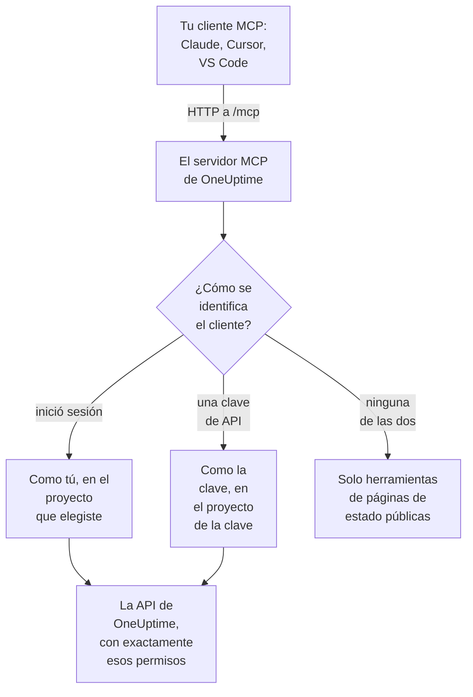

# Servidor MCP

El servidor MCP de OneUptime permite que un asistente de IA trabaje directamente con tu proyecto de OneUptime. Conecta Claude, Cursor, VS Code con GitHub Copilot o cualquier otro cliente del Model Context Protocol (MCP) y pídele que examine un incidente, consulte logs y trazas, reconozca una alerta o configure un monitor: llama a las herramientas de OneUptime con tus permisos, o con los de una clave de API.

:::cards
- [Conectar un cliente](#conectar-un-cliente): Dale a tu cliente la dirección del servidor e inicia sesión.
- [Iniciar sesión con OneUptime](#iniciar-sesión-con-oneuptime): Qué puede hacer un cliente conectado y cómo desconectarlo.
- [Obtener tu clave de API](#obtener-tu-clave-de-api): Para un agente que se ejecuta sin supervisión.
- [Solución de problemas](#solución-de-problemas): Problemas de inicio de sesión, de permisos y de conexión.
:::

Esta página trata de los asistentes de IA que se conectan a OneUptime. Para que, en cambio, OneUptime AI use las herramientas de otros servidores MCP, como los de AWS o GitHub, consulta [Servidores MCP externos](/docs/ai/external-mcp-servers).

## Cómo funciona

El servidor MCP forma parte de cada instancia de OneUptime, en `/mcp` en la misma dirección que el panel, y usa el transporte streamable HTTP. No hay nada que instalar.

- **OneUptime Cloud**: `https://oneuptime.com/mcp`
- **Autoalojado**: `https://your-oneuptime-domain.com/mcp`



El servidor no tiene estado: no emite ids de sesión y cada petición es independiente, así que funciona detrás de balanceadores de carga y con varias réplicas.

## Qué cubren las herramientas

- **Monitores**: crear y configurar monitores, comprobar su estado y revisar su historial.
- **Respuesta a incidentes**: crear, reconocer y resolver incidentes, añadir notas internas o públicas y seguirlos hasta su resolución.
- **Alertas**: reconocer y resolver alertas, añadir notas y gestionar los estados y las severidades de las alertas.
- **Equipos y guardias**: gestionar equipos y políticas de guardia.
- **Páginas de estado**: gestionar páginas de estado y publicar anuncios.
- **Mantenimiento programado**: crear y gestionar eventos de mantenimiento.
- **Telemetría**: consultar logs, métricas, trazas, excepciones, logs de monitores, eventos de seguridad y más, solo lectura.

Hay herramientas de crear, obtener, listar, actualizar, eliminar y contar para 30 tipos de registro, herramientas de listar y contar para 9 tipos de telemetría, y herramientas pensadas para la respuesta a incidentes. Las herramientas de solo lectura llevan `readOnlyHint`, toda herramienta que cambia algo lleva `destructiveHint` y solo las herramientas de páginas de estado públicas llevan `openWorldHint`, así que un cliente puede ejecutar por su cuenta las llamadas de solo lectura y preguntarte antes de cualquier cambio. Una llamada a herramienta fallida vuelve como resultado de la herramienta (`isError: true`) con un `statusCode`, los detalles y una sugerencia, no como un error del protocolo MCP, así que el agente puede leer el fallo y corregirse.

## Antes de empezar

- Una instancia de OneUptime: OneUptime Cloud o autoalojada.
- Un cliente MCP, como Claude Code, Claude, VS Code con GitHub Copilot o Cursor.
- Una cuenta de OneUptime con la que iniciar sesión, o una clave de API de OneUptime para un agente que se ejecuta sin supervisión. Las herramientas de páginas de estado públicas no necesitan ninguna de las dos.
- En OneUptime Cloud, el plan Growth o superior: conectar un cliente MCP está disponible en los mismos planes que las claves de API.

## Conectar un cliente

Dale al cliente la dirección del servidor y nada más. La primera vez que necesite tus datos, abrirá OneUptime en tu navegador para que inicies sesión (consulta [Iniciar sesión con OneUptime](#iniciar-sesión-con-oneuptime)). En una instancia autoalojada, usa `https://your-oneuptime-domain.com/mcp` en lugar de `https://oneuptime.com/mcp`.

:::tabs
@tab Claude Code
```bash
claude mcp add --transport http oneuptime https://oneuptime.com/mcp
```
Después ejecuta `/mcp` dentro de Claude Code y elige **oneuptime** para iniciar sesión.
@tab Claude
En Claude, abre **Customize → Connectors**, elige **Add custom connector** e introduce `https://oneuptime.com/mcp`. Claude te pide que inicies sesión en OneUptime la primera vez que necesita tus datos.
@tab VS Code
Añade esto a tu configuración de MCP (consulta [VS Code con GitHub Copilot](#vs-code-con-github-copilot) para saber dónde está). VS Code abre OneUptime para que inicies sesión cuando arrancas el servidor:
```json
{
  "servers": {
    "oneuptime": {
      "type": "http",
      "url": "https://oneuptime.com/mcp"
    }
  }
}
```
@tab Cursor
```json
{
  "mcpServers": {
    "oneuptime": {
      "url": "https://oneuptime.com/mcp"
    }
  }
}
```
:::

Cualquier otro cliente que admita la autorización de MCP funciona igual: dale la dirección y descubre todo lo demás. Consulta [Iniciar sesión (OAuth 2.1)](#iniciar-sesión-oauth-21) para el protocolo.

El panel también tiene estos pasos, con la dirección de tu instancia ya rellenada: **Ajustes del proyecto → IA → Servidor MCP**. Y desde cualquier recurso (un monitor, un incidente, una página de estado, etc.), despliega **Desarrolladores** en su menú lateral y elige **Asistentes de IA**: esa página también sugiere prompts que nombran el recurso y su ID, para que el asistente lo encuentre enseguida. Para un recurso para el que el servidor MCP aún no tiene herramientas, como un flujo de trabajo, la página muestra cómo un asistente que puede ejecutar comandos puede trabajar con él a través de la API REST.

## Iniciar sesión con OneUptime

La forma más sencilla de conectar es darle a tu cliente MCP la dirección del servidor y nada más. La primera vez que el cliente necesite tus datos, abrirá una página de OneUptime en tu navegador:

:::steps
1. Inicia sesión en OneUptime, si todavía no lo has hecho.
2. Elige el proyecto en el que debe trabajar el cliente.
3. Elige **Lectura y escritura** o **Solo lectura**.
4. Haz clic en **Autorizar**.
:::

Entonces el cliente actúa como tú en ese proyecto. No hay ninguna clave de API que crear, copiar o rotar, y no se guarda nada secreto en un archivo de configuración.

Lo que puede hacer un cliente conectado:

- **Tiene tus permisos, y nunca más.** Lo que tus equipos te permiten hacer en el proyecto es lo que puede hacer el cliente. Si cambia tu rol o dejas el proyecto, eso se aplica desde la siguiente petición del cliente. Dejar el proyecto también desconecta el cliente: se elimina su autorización, y lo vuelves a conectar si regresas al proyecto.
- **Solo lectura significa solo lectura.** Un cliente autorizado como solo lectura puede usar las herramientas `get_`, `list_` y `count_`. Las herramientas que crean, actualizan, eliminan, reconocen o resuelven se rechazan, tanto en el servidor MCP como en la API de OneUptime que hay detrás. Nunca puedes dar a un cliente más acceso del que pidió.
- **Es para un solo proyecto.** Para usar un segundo proyecto, vuelve a conectar el cliente y elige ese proyecto.
- **Solo funciona a través del servidor MCP.** El token de acceso del cliente lo acepta el endpoint MCP y ningún otro sitio. No se puede usar para llamar directamente a la API REST de OneUptime.
- **Los administradores de la instancia no reciben un trato especial.** Un cliente conectado por un administrador maestro tiene lo que los equipos de esa persona le conceden en el proyecto, no acceso a toda la instancia.

### Gestionar los clientes conectados

Cada cliente conectado iniciando sesión aparece en **Ajustes del proyecto → IA → Servidor MCP**, en **Clientes MCP conectados**, con quién lo conectó, qué puede hacer y cuándo se usó por última vez. Ves los clientes que conectaste tú; los propietarios y administradores del proyecto ven los de todos.

Haz clic en **Desconectar** para cerrar la sesión de un cliente. Deja de funcionar al instante.

Un cliente sigue conectado mientras se use. Uno que no se ha usado en 30 días tiene que volver a iniciar sesión.

### Controlar quién puede conectar clientes

Por defecto, cualquier miembro del proyecto puede conectar un cliente MCP. Para impedírselo a los miembros de un equipo, abre la página **Permisos** del equipo, abre **Más ajustes** al final y añade el permiso **Authorize MCP Client** en **Bloquear permisos**. Los clientes que esos miembros ya habían conectado dejan de funcionar al instante.

Si el proyecto exige inicio de sesión único, inicia sesión en el proyecto con SSO en tu navegador antes de autorizar un cliente. La conexión del cliente dura lo mismo que ese inicio de sesión SSO; cuando caduca, o el proveedor de SSO con el que iniciaste sesión se desactiva o se elimina, vuelve a conectar el cliente.

En OneUptime Cloud, conectar un cliente MCP está disponible en los mismos planes que las claves de API (Growth y superiores).

En la Enterprise Edition, cada cambio que hace un cliente conectado queda registrado en el registro de auditoría a nombre de la persona que lo conectó, con el nombre del cliente. Los cambios hechos con una clave de API muestran el nombre de la clave.

## Obtener tu clave de API

Usa una clave de API para un agente que se ejecuta sin supervisión, como una tarea programada o un pipeline de CI, donde no hay nadie para iniciar sesión.

:::steps
### Crea la clave

Ve a **Ajustes del proyecto → Avanzado → Claves de API** y haz clic en **Crear Clave de API**. Ponle un nombre, como "MCP Server".

### Elige qué puede hacer

En **Acceso**, elige **Viewer** para un agente que solo lee, o **Project Admin** para uno que además crea, actualiza y elimina (consulta [Permisos de las claves de API](#permisos-de-las-claves-de-api)).

### Copia la clave

Haz clic en **Crear Clave de API**: se abre la página de la clave. Copia la clave desde ahí.
:::

Las claves de API pertenecen a un proyecto: el servidor MCP toma el proyecto de la clave, así que las herramientas de creación nunca necesitan un argumento `projectId`.

> [!WARNING]
> Nunca le des a un agente de IA una clave maestra. Una clave de API maestra de OneUptime también se acepta en esta cabecera y concede acceso de administrador a toda la instancia. Usa siempre una clave de API de proyecto con lo mínimo que necesita el agente: una clave de solo lectura basta para todas las herramientas `get_`, `list_` y `count_`.

## Conectar con una clave de API

Envía la clave en la cabecera `x-api-key`. A una petición que lleva una clave de API nunca se le pide iniciar sesión. En una instancia autoalojada, usa tu propio dominio en lugar de `oneuptime.com`.

:::tabs
@tab Claude Code
```bash
claude mcp add --transport http oneuptime https://oneuptime.com/mcp --header "x-api-key: your-api-key-here"
```
@tab Claude Desktop
Añade esto a `claude_desktop_config.json`, en `~/Library/Application Support/Claude/` en macOS, `%APPDATA%\Claude\` en Windows o `~/.config/Claude/` en Linux:
```json
{
  "mcpServers": {
    "oneuptime": {
      "transport": "streamable-http",
      "url": "https://oneuptime.com/mcp",
      "headers": {
        "x-api-key": "your-api-key-here"
      }
    }
  }
}
```
@tab VS Code
La variable de entrada con `"password": true` pide la clave cuando arranca el servidor, en lugar de guardarla en texto plano:
```json
{
  "servers": {
    "oneuptime": {
      "type": "http",
      "url": "https://oneuptime.com/mcp",
      "headers": {
        "x-api-key": "${input:oneuptime-api-key}"
      }
    }
  },
  "inputs": [
    {
      "type": "promptString",
      "id": "oneuptime-api-key",
      "description": "OneUptime API Key",
      "password": true
    }
  ]
}
```
@tab Cursor
```json
{
  "mcpServers": {
    "oneuptime": {
      "url": "https://oneuptime.com/mcp",
      "headers": {
        "x-api-key": "your-api-key-here"
      }
    }
  }
}
```
:::

## VS Code con GitHub Copilot

VS Code 1.99 y posteriores admiten servidores MCP de forma nativa en GitHub Copilot Chat.

:::steps
### Comprueba lo que necesitas

VS Code 1.99 o posterior, con la extensión GitHub Copilot instalada y con la sesión iniciada, y GitHub Copilot Chat activado.

### Abre la configuración de MCP

Pulsa `Ctrl+Shift+P` (`Cmd+Shift+P` en macOS), escribe "MCP: Open User Configuration" y pulsa Intro. Abre, o crea, el archivo `mcp.json`. Para un solo espacio de trabajo, crea en su lugar `.vscode/mcp.json` dentro de él.

### Añade OneUptime

Pega la configuración de VS Code de arriba: la que no lleva clave, para iniciar sesión, o la que lleva una clave de API.

### Arranca el servidor

Pulsa `Ctrl+Shift+P` (`Cmd+Shift+P` en macOS), escribe "MCP: List Servers" y elige **oneuptime** para arrancarlo. VS Code te pide la primera vez que confíes en el servidor, y después que inicies sesión o que introduzcas tu clave de API.

### Pregunta a Copilot

Abre GitHub Copilot Chat en modo agente y pregunta, por ejemplo, "¿Qué monitores tengo en OneUptime?", "Muéstrame los incidentes recientes" o "Crea un nuevo monitor para https://example.com".
:::

## Autenticación

El servidor MCP funciona de tres maneras.

### Herramientas públicas (sin autenticación)

Sin una clave de API ni un inicio de sesión, un cliente puede usar las herramientas públicas:

- **`oneuptime_help`**: ayuda y orientación sobre las herramientas MCP de OneUptime
- **`oneuptime_list_resources`**: los recursos y lo que puedes hacer con cada uno
- **`get_public_status_page_overview`**: la vista general de una página de estado pública
- **`get_public_status_page_incidents`**: los incidentes de una página de estado pública
- **`get_public_status_page_scheduled_maintenance`**: sus eventos de mantenimiento programado
- **`get_public_status_page_announcements`**: sus anuncios

Las herramientas de páginas de estado públicas reciben el ID de una página de estado (un UUID) o su nombre de dominio. Para usar solo estas, conéctate con la dirección y sin credenciales:

```json
{
  "mcpServers": {
    "oneuptime": {
      "transport": "streamable-http",
      "url": "https://oneuptime.com/mcp"
    }
  }
}
```

Los propietarios de una página de estado pueden desactivar el acceso MCP para esa página: en la página de estado, abre **MCP** en la sección **IA** de su menú lateral y desactiva **Habilitar servidor MCP**. El interruptor se guarda en cuanto lo cambias. El acceso MCP está activado por defecto. Mientras está desactivado, las cuatro herramientas `get_public_status_page_*` devuelven un error para esa página de estado; el sitio web de la página de estado, su feed RSS y su API JSON pública no se ven afectados, y las herramientas de páginas de estado que necesitan inicio de sesión (`get_status_page`, `list_status_pages`, etc.) siguen funcionando para el propio proyecto de la página.

### Iniciar sesión (OAuth 2.1)

Cualquier otra herramienta necesita saber quién llama. Un cliente que no envía credenciales y llama a una de ellas recibe `401 Unauthorized` con una cabecera `WWW-Authenticate` que apunta a los metadatos de recurso protegido del servidor. Esa es la señal a la que reacciona un cliente MCP para que inicies sesión; `initialize`, `tools/list` y las herramientas públicas nunca la piden.

El servidor implementa la [especificación de autorización de MCP](https://modelcontextprotocol.io/specification/latest/basic/authorization):

- **Flujo**: authorization code de OAuth 2.1 con PKCE (solo `S256`). Los tokens de acceso se envían como `Authorization: Bearer`.
- **Descubrimiento**: metadatos de recurso protegido (RFC 9728) y metadatos del servidor de autorización (RFC 8414). El emisor y el recurso son ambos `https://<host>/mcp`.
- **Identidad del cliente**: un Client ID Metadata Document (el ID de cliente es una URL `https` que el servidor obtiene) o el registro dinámico de clientes (RFC 7591). Ningún cliente tiene que ser registrado por un administrador.
- **Alcances**: `mcp:read` para las herramientas `get_`, `list_` y `count_`; `mcp:write` añade todas las herramientas que cambian algo e incluye `mcp:read`. Un token de solo lectura que llama a una herramienta de escritura recibe `403` con `error="insufficient_scope"`.
- **Duración de los tokens**: un token de acceso dura una hora. Un token de actualización dura 30 días y se sustituye cada vez que se usa; usar un token de actualización que ya se sustituyó termina la conexión.
- **Indicadores de recurso** (RFC 8707): un token se emite para `https://<host>/mcp` y no se acepta en ningún otro sitio.
- **Revocación** (RFC 7009): revocar cualquiera de los dos tokens termina la conexión.

### Clave de API

Un agente que se ejecuta sin supervisión envía una clave de API de OneUptime en una de estas cabeceras:

- `x-api-key`: tu clave de API de OneUptime
- `Authorization`: un token bearer con tu clave de API (p. ej. `Bearer your-api-key-here`)

El esquema `Bearer` no distingue entre mayúsculas y minúsculas. A una petición que lleva una clave de API nunca se le pide iniciar sesión.

En OneUptime Cloud, las claves de API solo funcionan mientras el proyecto está en **Growth** o superior. Por debajo, cada herramienta que necesita la clave responde `402` con un mensaje que nombra el plan, y se le indica al agente que no lo reintente. No se elimina nada: la clave vuelve a funcionar tal cual en cuanto el proyecto vuelve a Growth, sin nada que reconectar. Un cliente conectado iniciando sesión actúa como una persona y sigue funcionando ([Claves de API y SCIM por debajo de su plan](/docs/api-reference/api-reference#claves-de-api-y-scim-por-debajo-de-su-plan)).

## Endpoints disponibles

| Endpoint | Método | Descripción |
| --- | --- | --- |
| `/mcp` | POST | Peticiones JSON-RPC para llamadas a herramientas y otras operaciones |
| `/mcp` | GET | Sin una cabecera SSE `Accept`: una descripción JSON breve del servidor. Con una: `405`, porque el servidor sin estado no ofrece un flujo SSE independiente (los clientes que siguen la especificación continúan sin él) |
| `/mcp` | DELETE | No hace nada: el servidor no tiene estado, así que no hay ninguna sesión que terminar |
| `/mcp/health` | GET | Comprobación de estado |
| `/mcp/tools` | GET | La lista de herramientas, como REST simple |

Los clientes MCP que inician sesión también usan los endpoints OAuth de abajo. Un cliente los encuentra por sí mismo; se enumeran para quienes escriben un cliente o configuran un proxy.

| Endpoint | Método | Descripción |
| --- | --- | --- |
| `/mcp/.well-known/oauth-protected-resource` | GET | Metadatos de recurso protegido (RFC 9728). También en `/.well-known/oauth-protected-resource/mcp` |
| `/.well-known/oauth-authorization-server/mcp` | GET | Metadatos del servidor de autorización (RFC 8414). También en `/mcp/.well-known/oauth-authorization-server` |
| `/mcp/oauth/authorize` | GET | Endpoint de autorización: adonde el cliente envía tu navegador para iniciar sesión |
| `/mcp/oauth/token` | POST | Endpoint de token: canjea un código de autorización o un token de actualización |
| `/mcp/oauth/register` | POST | Registro dinámico de clientes (RFC 7591) |
| `/mcp/oauth/revoke` | POST | Revocación de tokens (RFC 7009) |

Para comprobar que el servidor está en marcha y listar sus herramientas:

```bash
curl https://oneuptime.com/mcp/health
curl https://oneuptime.com/mcp/tools
```

## Herramientas para la respuesta a incidentes

Además de las herramientas para cada tipo de registro, el servidor tiene herramientas pensadas para responder a incidentes y alertas:

- **`acknowledge_incident`** / **`resolve_incident`**: llevar un incidente al estado Acknowledged o Resolved del proyecto, como hace el botón del panel
- **`acknowledge_alert`** / **`resolve_alert`**: lo mismo para las alertas
- **`add_incident_note`**: añadir una nota a un incidente con `visibility: "internal"` (solo el equipo, por defecto) o `visibility: "public"` (publicada en la página de estado). Admite Markdown
- **`add_alert_note`**: añadir una nota interna a una alerta

Un ciclo típico: `list_incidents` → `acknowledge_incident` → investigar con `list_logs` → `add_incident_note` (pública) → `resolve_incident`.

La herramienta **`oneuptime_whoami`** devuelve el proyecto al que pertenecen tus credenciales (su ID y su nombre). Para un cliente que inició sesión, también dice con qué usuario inició sesión y si puede hacer cambios. Es una buena primera llamada para que un agente se oriente, y como las herramientas de creación toman `projectId` de las credenciales, el agente nunca tiene que pasar un ID de proyecto.

## Consultar la telemetría

Los logs, las métricas, las trazas (spans), las excepciones, los logs de monitores y los demás tipos de telemetría llegan como herramientas `list_` y `count_` de solo lectura (`list_logs`, `list_metrics`, `list_spans`, `list_exception_instances`, `list_monitor_logs` y sus gemelas `count_`). La telemetría llega a través de OpenTelemetry, así que no hay herramientas de creación.

Consulta siempre la telemetría con un rango de tiempo. Un campo de consulta acepta un valor o un objeto de operador:

```json
{
  "query": {
    "time": { "_type": "GreaterThan", "value": "2026-07-04T00:00:00.000Z" }
  },
  "sort": { "time": "DESC" },
  "limit": 50
}
```

Los operadores son `EqualTo`, `NotEqual`, `IsNull`, `NotNull`, `EqualToOrNull`, `GreaterThan`, `LessThan`, `GreaterThanOrEqual`, `LessThanOrEqual`, `InBetween`, `Search` e `Includes`. Los valores de ordenación son `"ASC"` o `"DESC"`.

## Selección de campos y paginación

Las herramientas `get_` y `list_` aceptan un array opcional `select` con nombres de campos. Por defecto se devuelven todos los campos legibles excepto los pesados (columnas JSON, de texto muy largo y HTML), que hay que pedir en `select`.

Las herramientas de listado paginan con `limit` (10 por defecto, 100 como máximo) y `skip`, y cada respuesta de listado dice exactamente lo que devolvió:

```json
{
  "returnedCount": 10,
  "totalCount": 42,
  "skip": 0,
  "limit": 10,
  "hasMore": true,
  "data": ["..."]
}
```

## Ejemplos de uso

### Preguntas del día a día

```text
"What's the current status of all my monitors?"
"Show me incidents from the last 24 hours"
"List the teams in this project"
"Show me our on-call policies"
```

### Monitores e incidentes

```text
"Create a new website monitor for https://example.com that checks every 5 minutes"
"Set up an API monitor for https://api.example.com/health with a 30-second timeout"
"Disable the monitor for staging.example.com while we're doing maintenance"
"Create a high-priority incident for the database outage affecting user authentication"
"Add a note to incident #123 saying 'Database connection restored, monitoring for stability'"
"Mark incident #456 as resolved"
```

### Páginas de estado

```text
"Update our status page to show 'Investigating Payment Issues' for the payment service"
"Create a status page announcement about scheduled maintenance this weekend"
```

### Consultas a páginas de estado públicas (sin clave de API)

Estas funcionan sin credenciales, solo con las herramientas de páginas de estado públicas:

```text
"What's the current status of status.example.com?"
"Show me recent incidents from the OneUptime status page"
"Are there any scheduled maintenance events on status.acme.com?"
"Get the latest announcements from my public status page with ID abc123-..."
```

### Varios pasos a la vez

```text
"Create a scheduled maintenance window for Saturday 2-4 AM, disable all monitors for api.example.com during that time, and update the status page"
"Show me all monitors that have been down in the last hour, create incidents for any that don't already have one"
```

## Permisos de las claves de API

| Lo que hace el agente | Elegir en **Acceso** |
| --- | --- |
| Solo lee | **Viewer**, o añade permisos de lectura en la página de la clave |
| También crea, actualiza y elimina | **Project Admin**, o añade el rol Project Admin en la página de la clave |

Da a cada clave lo mínimo que necesita, rota las claves con regularidad, usa una clave distinta para cada entorno y vigila en OneUptime lo que hace cada clave.

## Configuración autoalojada

El inicio de sesión funciona sin más en una instancia autoalojada. Dos ajustes lo cambian:

| Variable de entorno | Valor de Helm | Qué hace |
| --- | --- | --- |
| `DISABLE_MCP_OAUTH` | `mcpOAuth.disabled` | Ponla en `true` para desactivar el inicio de sesión. Los endpoints OAuth dejan de servirse y el servidor MCP solo acepta claves de API. No se elimina nada; los clientes conectados vuelven a funcionar cuando se reactiva. |
| `DISABLE_MCP_OAUTH_CLIENT_ID_METADATA_DOCUMENTS` | `mcpOAuth.disableClientIdMetadataDocuments` | Ponla en `true` en una instancia que no puede llegar a internet. Un cliente puede identificarse con una URL que OneUptime obtiene; con este ajuste, los clientes se registran directamente en tu instancia, lo que no necesita ninguna petición saliente. |

Si usas tu propio proxy inverso delante de OneUptime, reenvía `/.well-known/oauth-protected-resource` y `/.well-known/oauth-authorization-server` (y todo lo que cuelga de ellos) a OneUptime junto con `/mcp`. El ingress incluido ya lo hace.

El servidor construye cada URL de OAuth a partir de los ajustes `HOST` y `HTTP_PROTOCOL`, así que tienen que coincidir con la dirección que la gente usa para llegar a tu instancia.

## Solución de problemas

### Problemas al iniciar sesión

- **El cliente nunca me pide iniciar sesión**: puede que el cliente no admita la autorización de MCP, o que esté configurado con una cabecera de clave de API, que tiene prioridad. Quita la cabecera para iniciar sesión en su lugar.
- **Mi proyecto aparece en gris en la página de autorización**: la página dice por qué junto al nombre del proyecto: el plan del proyecto no incluye conectar clientes MCP, el proyecto exige SSO y este navegador no ha iniciado sesión en él con SSO, o tu equipo tiene bloqueado conectar clientes.
- **Una herramienta se rechaza como "read-only"**: el cliente se autorizó como solo lectura. Vuelve a conectarlo y elige **Lectura y escritura**.
- **El cliente dejó de funcionar**: se desconectó, no se usó durante 30 días, te quitaron del proyecto, o el inicio de sesión SSO del proyecto caducó o su proveedor se desactivó. Vuelve a conectarlo.
- **Autoalojado - el cliente dice que no encuentra el servidor de autorización**: comprueba que `HOST` y `HTTP_PROTOCOL` coinciden con tu dirección pública, y que tu proxy reenvía las rutas `/.well-known/oauth-*`.

### Errores de permisos

La clave de API, o tu propia cuenta en el caso de un cliente que inició sesión, necesita los permisos adecuados: acceso de lectura para listar registros, acceso de escritura para crearlos y actualizarlos, y acceso de eliminación para quitarlos.

### Problemas de conexión

Comprueba que la dirección de OneUptime es correcta y accesible, que la clave de API es válida y que el endpoint de estado responde (consulta [Endpoints disponibles](#endpoints-disponibles)).

### Clave de API no válida

- Comprueba la clave de API en tus ajustes de OneUptime, sin espacios ni caracteres de más
- Comprueba que la clave no ha caducado
- En OneUptime Cloud, un `402` que dice que las claves de API necesitan el plan Growth significa que el proyecto está por debajo: mejora el plan del proyecto en **Ajustes del proyecto → Facturación y facturas → Facturación**, y la misma clave vuelve a funcionar

### Errores de sesión

El servidor MCP no tiene estado: ni emite ni rastrea ids de sesión, así que cada petición funciona contra cualquier réplica. Un cliente que envía una cabecera `mcp-session-id` de una versión anterior del servidor puede omitirla; se ignora. Actualiza una configuración de cliente antigua que espere que el servidor devuelva un id de sesión.

## Recursos disponibles

| Área | Registros con herramientas de crear, obtener, listar, actualizar, eliminar y contar |
| --- | --- |
| Monitorización | Monitor, Monitor Status, Monitor Status Event |
| Incidentes | Incident, Incident State, Incident Severity, Incident State Timeline, Incident Public Note, Incident Internal Note, Incident Alert, Postmortem Status |
| Alertas | Alert, Alert State, Alert Severity, Alert State Timeline, Alert Internal Note |
| Páginas de estado | Status Page, Status Page Announcement |
| Mantenimiento programado | Scheduled Maintenance Event, Scheduled Maintenance State, Scheduled Maintenance State Timeline |
| Equipos y guardias | Team, On-Call Policy |
| Etiquetas | Label |
| Seguridad | Security Case, Security Case Note, Security Case Priority, Security Case Status, Security Detection, Security Playbook |

| Área | Telemetría solo con herramientas de listar y contar |
| --- | --- |
| Observabilidad | Log, Metric, Span, Exception Instance, Monitor Log |
| Seguridad | Security Event, Threat Intel Indicator |
| Cambios y costes | Change Event, Kubernetes Cost Allocation |

Las herramientas se nombran en snake case: `create_incident`, `get_incident`, `list_incidents`, `update_incident`, `delete_incident` y `count_incidents`, o `list_logs` y `count_spans` para la telemetría.

## Próximos pasos

:::cards
- [Preguntar a la IA](/docs/ai/ask-ai): Pregunta por tu proyecto desde dentro de OneUptime.
- [Referencia de la API de OneUptime](/docs/api-reference/api-reference): La API REST que hay detrás de cada herramienta.
- [Permisos](/docs/permissions/index): Lo que puede hacer un rol, un equipo o una clave de API.
:::
