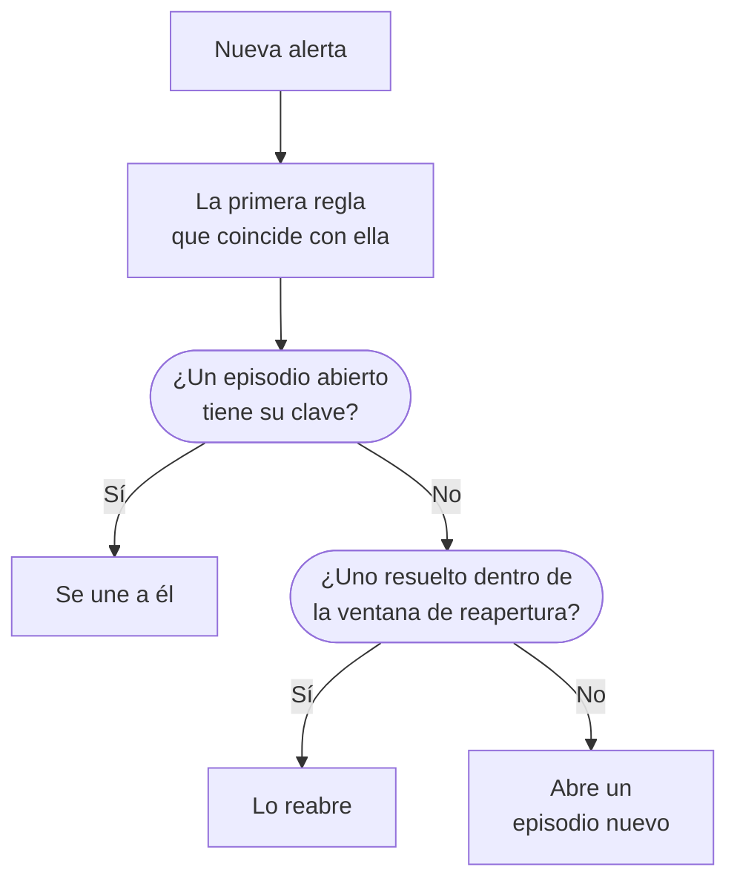

# Episodios de alertas y reglas de agrupación

Cuando se cae una base de datos, veinte monitores pueden generar veinte alertas en pocos minutos. Un episodio las reúne en un solo registro que tu equipo reconoce y resuelve a la vez, y una regla de agrupación decide qué alertas entran en él. Esta página muestra cómo funciona la agrupación, cómo configurar una regla y cómo se comporta un episodio una vez abierto.

:::cards
- [Cómo funciona la agrupación](#cómo-funciona-la-agrupación): Reglas, claves de agrupación y ventanas de tiempo.
- [Crear una regla de agrupación](#crear-una-regla-de-agrupación): Desde una plantilla con un clic, o la tuya propia.
- [Cómo se comporta un episodio](#cómo-se-comporta-un-episodio): Su gravedad, sus estados y cuándo se resuelve.
- [A quién avisa un episodio](#a-quién-avisa-un-episodio): Las políticas de guardia de la regla y las de las propias alertas.
:::

## Cómo funciona la agrupación

La agrupación se ejecuta una vez por cada alerta nueva, justo después de que se ejecuten sus políticas de guardia. La alerta se compara con tus reglas de agrupación habilitadas, de arriba abajo en la lista, y la primera regla que coincide con ella decide su episodio. Una alerta con la que no coincide ninguna regla se queda sola.



- **Las condiciones de la regla** deciden a qué alertas se aplica. Una regla sin condiciones se aplica a todas las alertas nuevas.
- **La clave de agrupación** decide qué alertas comparten un episodio: las del mismo monitor, la misma gravedad, el mismo título o la combinación por la que agrupe la regla. Una regla que no agrupa por nada pone en un solo episodio todas las alertas con las que coincide.
- **La ventana de tiempo** decide durante cuánto tiempo sigue aceptando alertas un episodio. Si está activada, una alerta solo se une si llega dentro de la ventana desde la última alerta del episodio. Si está desactivada, las alertas que coinciden siguen uniéndose hasta que el episodio se resuelve.

La agrupación ocurre cuando se crea una alerta. Una regla que añades hoy agrupa las alertas creadas después; no vuelve a agrupar las que ya existen.

> [!NOTE]
> Una alerta creada ya reconocida puede unirse a un episodio abierto, pero nunca abre uno, y una alerta creada resuelta no se agrupa en absoluto. Consulta [Creada ya reconocida o resuelta](/docs/alerts/index#creada-ya-reconocida-o-resuelta).

## Crear una regla de agrupación

Ve a **Alertas → Reglas → Reglas de agrupación**. La sección **Reglas** del menú lateral empieza plegada, así que despliégala primero.

### Empezar desde una plantilla

Un proyecto sin reglas de agrupación ve cuatro reglas ya preparadas en lugar de una lista vacía; cuando ya tienes reglas, **Crear desde plantilla** en la tarjeta las abre. **Añadir regla** guarda una con un solo clic, habilitada, al final de la lista y aplicada a todas las alertas nuevas. Edítala después como cualquier otra regla.

| Plantilla                                      | Agrupa                                                                    | Ventana de tiempo |
| ---------------------------------------------- | ------------------------------------------------------------------------- | ----------------- |
| **Agrupar alertas del mismo monitor**          | Un episodio por monitor                                                   | 30 minutos        |
| **Agrupar alertas que ocurren a la vez**       | Un episodio compartido, sea cual sea el monitor                           | 10 minutos        |
| **Agrupar alertas por gravedad**               | Un episodio por gravedad                                                  | 30 minutos        |
| **Agrupar repeticiones de la misma alerta**    | Un episodio por título de alerta, sin tener en cuenta números ni mayúsculas | 1 hora          |

### Crear la tuya

:::steps
#### Responder cómo agrupar

Haz clic en **Crear regla personalizada** debajo de las plantillas, o en **Crear regla de agrupación de alertas** en la tarjeta cuando ya tengas reglas. En el paso **Agrupación**, **Agrupar alertas por** hace una sola pregunta: **Monitor**, **Todo junto**, **Gravedad**, **Título** o **Personalizado**. El **Nombre** sigue tu respuesta hasta que escribas uno propio.

#### Fijar la ventana de tiempo

**Agrupar solo las alertas que llegan seguidas** está activado, con una ventana de 30 minutos. Cambia los minutos, o desactívalo para mantener un episodio abierto hasta que se resuelva.

#### Combinar campos, para Personalizado

**Personalizado** añade un paso **Agrupar por** con cinco interruptores: **Agrupar por monitor**, **Agrupar por gravedad de alerta**, **Agrupar por título de alerta**, **Agrupar por etiquetas de alerta** y **Agrupar por etiquetas de monitor**. Las etiquetas agrupan por su conjunto exacto.

#### Acotarla

En **Qué alertas**, **Todas las alertas**, donde empieza una regla nueva, agrupa todas las alertas nuevas. Para acotarla, elige **Solo las alertas que cumplen las condiciones** y añade condiciones sobre monitores, gravedades, etiquetas, títulos y descripciones. Después haz clic en **Crear regla de agrupación de alertas**.
:::

Todo lo demás que puede hacer una regla está plegado en **Más campos**, al final del paso **Agrupación**, en tres grupos. Plegado, su encabezado nombra lo que contiene y dice el valor de cada ajuste que usa la regla, así que editar una regla nunca oculta lo que hace.

| Grupo                            | Ajustes                                                                                                    |
| -------------------------------- | ---------------------------------------------------------------------------------------------------------- |
| **Guardia y propiedad**          | **Políticas de guardia** que se ejecutan cuando la regla abre un episodio, y **Propietarios del episodio**. |
| **Ciclo de vida del episodio**   | **Reabrir episodios resueltos recientemente**, **Esperar antes de resolver un episodio** y **Resolver episodios inactivos**, cada uno un interruptor con sus minutos. |
| **Detalles**                     | La **Descripción** de la regla, la **Plantilla del título del episodio**, la **Plantilla de descripción del episodio** y las **Etiquetas del episodio**. |

Las reglas se comprueban de arriba abajo en la lista, y gana la primera que coincide: arrastra una regla para cambiar su posición. Pon las reglas específicas por encima de las generales. La columna **Agrupación** de la lista dice en una frase lo que hace cada regla, por ejemplo "Un episodio por monitor".

## Títulos de los episodios

Sin plantilla, un episodio recibe el nombre del monitor de su primera alerta, o los primeros 50 caracteres del título de la alerta cuando no tiene monitor. Con una **Plantilla del título del episodio** o una **Plantilla de descripción del episodio**, se rellenan estas variables. Escribe `{{` en cualquiera de los dos campos para elegir una.

| Variable               | Se rellena con                                                                                  |
| ---------------------- | ----------------------------------------------------------------------------------------------- |
| `{{alertTitle}}`       | El título de la primera alerta.                                                                 |
| `{{alertDescription}}` | La descripción de la primera alerta.                                                            |
| `{{alertSeverity}}`    | La gravedad de la primera alerta.                                                               |
| `{{monitorName}}`      | El nombre del monitor de la primera alerta.                                                     |
| `{{alertCount}}`       | Cuántas alertas contiene el episodio, reescrito a medida que se unen o salen alertas.           |

Una variable para la que la primera alerta no tiene valor, o una que no está en esta lista, se omite. Cuando la primera alerta es privada, `{{alertTitle}}` y `{{alertDescription}}` dicen "Private alert", porque el episodio no es privado.

## Cómo se comporta un episodio

Un episodio recorre tus estados de alerta, la misma lista que usan las alertas, y tiene sus propios propietarios, notas, causa raíz y notas de remediación.

- **Su gravedad sube con sus alertas.** Empieza con la gravedad de su primera alerta y toma la de cualquier alerta más grave que se le una, entendiendo por "más grave" la que está más arriba en **Alertas → Ajustes → Gravedad de la alerta**.
- **Su estado mueve sus alertas.** Reconoce o resuelve un episodio, o llévalo a un estado propio, y cada alerta que contiene se mueve también, salvo una alerta que ya esté en ese estado o después.
- **Se resuelve solo** cuando todas sus alertas están resueltas. **Esperar antes de resolver un episodio** lo mantiene abierto antes durante esos minutos, por si vuelve una alerta.
- **Puede reabrirse.** Con **Reabrir episodios resueltos recientemente** activado, una alerta que coincide y llega dentro de los minutos posteriores a la resolución del episodio lo reabre, en lugar de abrir otro. Es el único paso de vuelta hacia arriba en la lista de estados, y no reabre las alertas del episodio.

> [!WARNING]
> **Resolver episodios inactivos** resuelve un episodio cuando no se le ha unido ninguna alerta nueva durante los minutos que fijes, y resuelve también cada alerta que siga abierta en él. Úsalo para el ruido que seguro que no necesita respuesta.

## A quién avisa un episodio

Las políticas de guardia propias de una alerta se ejecutan cuando se crea, antes de la agrupación, tanto si se une a un episodio como si no. Un episodio añade las suyas:

```mermaid title="Una alerta que abre un episodio avisa dos veces; una que se une, una vez"
flowchart TB
    alert["Nueva alerta"] --> own["Se ejecutan sus<br/>propias políticas"]
    own --> grouped{"Agrupación"}
    grouped -->|"Abre un episodio"| ep["También se ejecutan las<br/>políticas del episodio"]
    grouped -->|"Se une a un episodio"| none["No se ejecuta nada más"]
```

- **Un episodio nuevo** ejecuta las **Políticas de guardia** de la regla, más las de cualquier regla que coincida en la pestaña **Reglas de episodios** de **Alertas → Reglas → Reglas de guardia**.
- **Una alerta que se une a un episodio abierto** solo ejecuta sus propias políticas. Las del episodio no se vuelven a ejecutar.
- **Responder al aviso de un episodio** reconoce el episodio y, con él, cada alerta que contiene.

> [!TIP]
> Para avisar una vez por problema en lugar de una vez por alerta, pon las políticas de guardia en tus reglas de agrupación y quítalas de las alertas: de los criterios del monitor, del formulario de creación y de tus reglas de guardia de alertas.

Los propietarios del episodio también se enteran: **Episodio de alerta creado**, **El estado del episodio de alerta ha cambiado** y **Alerta añadida al episodio de alerta** están activados por correo electrónico por defecto, en **Ajustes de usuario → Ajustes de notificaciones**, en la pestaña **Alertas**. Los **Propietarios del episodio** de la regla pasan a ser propietarios de cada episodio que abre, y se les notifica como a cualquier otro propietario.

## Crear un episodio a mano

:::steps
### Abrir el formulario

Ve a **Alertas → Todos los episodios** y haz clic en **Crear episodio**. Se abre el formulario **Crear nuevo episodio de alerta**.

### Describir el episodio

En **Detalles del episodio**, rellena el **Título** y, si quieres, una **Gravedad de la alerta** y una **Descripción**. **Estado inicial** y **Etiquetas** esperan en **Más campos**.

### Elegir a quién se avisa y quién es el propietario

En **Guardia y propietarios**, elige una **Política de guardia** que se ejecute cuando se cree el episodio, y sus **Propietarios**. Después haz clic en **Crear episodio**.

Cada equipo del que eres miembro está a un clic bajo **Propietarios**, y el resumen lista las reglas de propietario que añadirán más.

### Añadir las alertas

Abre la página **Alertas miembro** del episodio, haz clic en **Añadir alertas** y marca las alertas que le pertenecen, tantas como necesites a la vez. Para empezar por las alertas, selecciónalas en la lista **Alertas** y elige **Añadir a un episodio nuevo** en **Acciones masivas** (consulta [Episodios](/docs/incidents/episodes)).
:::

Un episodio que creas tú no tiene regla de agrupación, así que la lista muestra su **Regla de agrupación** como **Manual**, y no se le aplica ningún ajuste de ciclo de vida. Aun así se resuelve solo cuando todas sus alertas están resueltas.

## Qué muestra cada página de un episodio

| Sección del menú lateral | Páginas                                                                     |
| ------------------------ | --------------------------------------------------------------------------- |
| **Vista general** | **Vista general**, **Cronología de estados** |
| **Investigación** | **Descripción**, **Causa raíz**, **Notas de remediación** |
| **Equipo** | **Propietarios** |
| **Alertas** | **Alertas miembro** |
| **Notas** | **Notas privadas** |
| **Desarrolladores** | **Terraform**, **API**, **Asistentes de IA** |
| **Avanzado** | **Registros de auditoría**, **Eliminar episodio** |

**Desarrolladores** y **Avanzado** empiezan plegadas. En la **Vista general**, la cabecera nombra a los **Propietarios** del episodio, primero los equipos, y el primer recuadro, **Creado**, dice cuándo se creó el episodio —**Automáticamente**, cuando lo abrió una regla de agrupación—. La tarjeta **Qué pasó** encabeza la página —la descripción del episodio y su **Causa raíz**—, después **Alertas de este episodio** y el **Feed del episodio**, junto a la tarjeta **Detalles del episodio**: su número, estado, gravedad, número de alertas, regla de agrupación y políticas de guardia. Su cabecera tiene **Reconocer** y **Resolver**, y **Mover el episodio a** en el menú **⋯**.

**Alertas → Episodios activos** muestra los episodios que aún no se han resuelto, y la insignia a su lado los cuenta.

## Solución de problemas

:::details Una alerta nueva no se unió al episodio que esperaba
Comprueba, en este orden: que la regla está habilitada; que ninguna regla por encima coincidió antes con la alerta; que la alerta cumple las condiciones de la regla; que tiene la misma clave de agrupación que las alertas del episodio, como el mismo monitor; y, con la ventana de tiempo activada, que llegó dentro de la ventana desde la última alerta del episodio. Una alerta creada ya reconocida nunca abre un episodio, y una creada resuelta nunca se agrupa.
:::

:::details Nos avisaron dos veces por un solo problema
Se ejecutó la política de guardia propia de la alerta, y también la del episodio nuevo. Deja las políticas en la regla de agrupación y quítalas de los criterios, el formulario o las reglas de guardia de la alerta.
:::

:::details Un episodio se resolvió solo
Todas sus alertas estaban resueltas, así que el episodio se resolvió al terminar su espera. Cuando **Resolver episodios inactivos** está activado, también resuelve un episodio que no ha recibido ninguna alerta nueva durante ese tiempo.
:::

## Próximos pasos

:::cards
- [Reglas y ajustes de alertas](/docs/alerts/settings): Las demás reglas que actúan sobre las alertas y los episodios nuevos.
- [Estados y severidades de alertas](/docs/alerts/states-and-severities): Los estados por los que pasa un episodio.
- [Reglas de escalado](/docs/on-call/escalation-rules): Cómo avisan a las personas las políticas que ejecuta un episodio.
- [Configuración y automatización de incidentes](/docs/incidents/settings): Reglas de agrupación para incidentes.
:::
