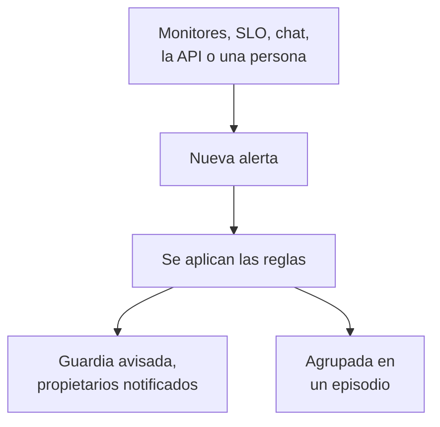

# Visión general de las alertas

Una alerta avisa a tu equipo de un problema que conviene revisar antes de que tus usuarios lo noten: un disco que se llena, un certificado a punto de caducar, una tasa de errores que va subiendo. Puede avisar a quien esté de guardia y notificar a sus propietarios, pero nunca aparece en una página de estado ni avisa a tus suscriptores. Esta página explica de dónde vienen las alertas, dónde están en el panel y cómo trabaja tu equipo con ellas.

:::cards
- [Alertas e incidentes](#alertas-e-incidentes): Cuál de los dos debería ser un problema y cómo se relacionan.
- [De dónde vienen las alertas](#de-dónde-vienen-las-alertas): Monitores, SLO, chat, la API o a mano.
- [Crear una alerta a mano](#crear-una-alerta-a-mano): Dos pasos en el panel.
- [Responder a una alerta](#responder-a-una-alerta): Reconócela, resuélvela o declara un incidente.
:::

## Cómo funciona

La mayoría de las alertas las genera un monitor cuyos criterios coinciden. Otras vienen de un SLO que consume su presupuesto de errores, de una regla de seguridad, de un aviso enviado desde Slack o Microsoft Teams, o de una persona. Llegue como llegue, una alerta es siempre el mismo registro y se le aplican las mismas reglas.

- **Las reglas le dan forma.** Las reglas de privacidad, de propietario, de etiquetas y de guardia se ejecutan en cuanto se crea una alerta, y las reglas de runbook ponen en marcha los procedimientos que coinciden. Consulta [Reglas y ajustes de alertas](/docs/alerts/settings).
- **Las políticas de guardia avisan a las personas.** Las políticas que nombra la alerta, más las que añaden sus reglas de guardia, avisan a sus personas hasta que alguien reconoce la alerta.
- **Los episodios agrupan el ruido.** Una regla de agrupación reúne las alertas relacionadas en un episodio, de modo que veinte alertas de una caída sean una sola cosa que atender. Consulta [Episodios de alertas y reglas de agrupación](/docs/alerts/episodes).

## Alertas e incidentes

Ambos registran un problema y ambos pueden avisar a quien esté de guardia. Lo que cambia es a quién afecta el problema.

|                                  | Alerta                                                 | Incidente                                         |
| -------------------------------- | ------------------------------------------------------ | ------------------------------------------------- |
| **Qué es**                       | Un problema que tu equipo debe revisar antes de que afecte a los usuarios | Un problema que afecta a tus usuarios, como una caída |
| **En páginas de estado**         | Nunca                                                  | Puede aparecer y avisa a los suscriptores         |
| **Notas**                        | Notas privadas, solo para tu equipo                    | Notas públicas para los clientes y notas privadas |
| **Estados iniciales**            | **Identificado**, **Reconocido**, **Resuelto**         | **Identificado**, **Reconocido**, **Resuelto**    |
| **Gravedades iniciales**         | **Alta**, **Baja**                                      | Critical Incident, Major Incident, Minor Incident |
| **Números en un proyecto nuevo** | `ALT-42`, y `AE-42` para los episodios                 | `INC-42`, y `IE-42` para los episodios            |

Genera una alerta cuando tu equipo deba mirar antes de que nadie de fuera lo note, y declara un incidente cuando los usuarios se vean afectados. Si una alerta resulta ser parte de una caída, declara un incidente a partir de ella o vincúlala al incidente que la explica: consulta [Alertas vinculadas](/docs/incidents/linked-alerts).

## De dónde vienen las alertas

- **Los criterios de un monitor.** En las **Acciones** de un criterio, activa **Cuando los filtros coinciden, crear una alerta.** y completa la alerta que crea: **Título de la alerta** y **Gravedad**, y después, cada uno plegado, **Descripción**, **Propiedad y etiquetas**, **De guardia** y **Más campos**, que contiene **Resolver alerta automáticamente**, **Alerta privada** y **Notas de remediación**. Un criterio mantiene una sola alerta abierta a la vez, una por serie en un monitor que agrupa por un campo, y **Resolver alerta automáticamente** la resuelve cuando el criterio deja de coincidir. Consulta [Crear un monitor](/docs/monitor/create-monitor) y [Plantillas de incidentes y alertas](/docs/monitor/incident-alert-templating).
- **A mano.** Haz clic en **Crear alerta** en la lista de alertas, o en la pestaña **Alertas** de un monitor, un host, un dispositivo de red u otro recurso, que elige ese recurso por ti. Consulta [Crear una alerta a mano](#crear-una-alerta-a-mano).
- **La tasa de consumo de un SLO.** Una regla de tasa de consumo puede crear una alerta cuando un SLO gasta su presupuesto de errores demasiado rápido. Consulta [Alertas e incidentes de tasa de consumo](/docs/slo/burn-rate-alerts).
- **Sitios de red y eventos de seguridad.** Un sitio de red configurado para alertar cuando no está sano abre una alerta cuando su resumen deja de estar operativo, y tus reglas de detección de eventos de seguridad también abren alertas. Consulta [Sitios de red (resumen de salud y tiempo de actividad)](/docs/monitor/network-sites) y [Eventos de seguridad (SIEM)](/docs/telemetry/security-events).
- **Un aviso.** `/oneuptime page` en Slack o Microsoft Teams, en cualquier lugar salvo el canal propio de un incidente o de una alerta, abre una alerta cuyo título es tu mensaje y avisa a las personas que nombres. Los bloques de aviso de un flujo de trabajo hacen lo mismo con el título y el mensaje que les des. Consulta [Avisar a alguien desde Slack](/docs/workspace-connections/slack#avisar-a-alguien-desde-slack) y [Paging](/docs/workflows/components#paging).
- **La API, Terraform y los flujos de trabajo.** Las alertas son un recurso como cualquier otro: `/api/alert`, el recurso de Terraform `oneuptime_alert` y el paso **Create One Alert** de un flujo de trabajo.

## Dónde están las alertas en el panel

Abre **Alertas** desde el menú **Productos** de la barra superior. La lista de alertas está en `/dashboard/{projectId}/alerts`, y su menú lateral reúne todo lo relativo a las alertas:

| Sección                | Qué haces allí                                                                                                            |
| ---------------------- | ------------------------------------------------------------------------------------------------------------------------- |
| **Alertas**            | **Todas las alertas** y **Alertas activas**, cuya insignia roja cuenta las alertas que aún no se han resuelto.              |
| **Episodios** | **Todos los episodios** y **Episodios activos**: alertas relacionadas, agrupadas en un solo problema en el que trabajar. |
| **IA**                 | **Análisis**, **Registros** y **Ajustes**: lo que OneUptime AI ha aprendido de tus alertas, todo lo que ha hecho y lo que puede hacer. |
| **Espacio de trabajo** | **Slack** y **Microsoft Teams**, según lo que haya conectado el proyecto, o **Conectar Slack o Teams** si no tiene ninguno. |
| **Reglas**             | **Reglas de agrupación**, **Reglas de guardia**, **Reglas del propietario**, **Reglas de runbook**, **Reglas de privacidad**, **Reglas de etiquetas**, **Reglas de recordatorio**. |
| **Ajustes**            | **Estado de la alerta**, **Gravedad de la alerta**, **Plantillas de notas**, **Campos personalizados**, **Mediciones**, **Pertenencia a episodios**, **Numeración**. |

**Alertas** y **Episodios** están abiertas; **IA**, **Espacio de trabajo**, **Reglas**, **Ajustes** y **Desarrolladores** empiezan plegadas, y una sección se abre sola cuando estás en una de sus páginas. La configuración de las alertas está aquí, no en **Ajustes del proyecto**.

La lista muestra **Número de alerta**, **Título**, **Estado**, **Gravedad**, **Recursos afectados** (primero el monitor de la alerta), **Creado**, **Duración**, **Etiquetas** y **Propietarios**. Selecciona alertas para actuar sobre varias a la vez: **Reconocer**, **Resolver**, **Cambiar estado**, **Cambiar gravedad**, **Asignarme**, **Añadir propietario**, **Quitar propietario**, **Añadir etiquetas**, **Quitar etiquetas**, **Vincular a incidente**, **Declarar incidente** o eliminarlas.

El menú **⋯** al final de la fila de cada alerta hace lo mismo solo para esa alerta: **Reconocer** y **Resolver** mientras la alerta pueda dar ese paso, **Cambiar estado**, **Cambiar gravedad**, **Asignarme** hasta que seas su propietario y **Añadir propietario** para pasársela a otra persona.

## Crear una alerta a mano

:::steps
### Abrir el formulario

Ve a **Alertas → Todas las alertas** y haz clic en **Crear alerta**. El formulario **Crear nueva alerta** se abre en su primer paso, **Detalles de la alerta**.

### Describir la alerta

Rellena el **Título** y elige una **Gravedad de la alerta**; ambos son obligatorios. Añade una **Descripción** si ayuda. En **Más campos**, plegado, puedes elegir un **Estado inicial**, añadir **Etiquetas** o activar **Alerta privada**. Ahí espera también **Propietarios**: te conviertes en propietario de la alerta que creas de todos modos, y cada equipo del que eres miembro está a un clic bajo el selector. Un administrador maestro, que gestiona toda la instalación, es la única excepción: no se convierte en propietario de lo que crea.

### Elegir a qué afecta y a quién se avisa

Haz clic en **Siguiente** para llegar a **Recursos y guardia**. Elige el **Monitor** del que trata y cualquier **Otros recursos afectados**, como hosts, dispositivos de red, clústeres de Kubernetes o servicios. En **Política de guardia**, elige las políticas que se ejecutarán cuando se cree la alerta.

### Crearla

Haz clic en **Siguiente** para revisar el resumen y después en **Crear alerta**. Se abre la página de la alerta y las reglas empiezan a ejecutarse. En el resumen, la fila **Propietarios** lista cada regla de propietario que añadirá a alguien, y a quién: consulta [Quién será su propietario](/docs/incidents/declaring-incidents#quién-será-su-propietario).
:::

Si dejas **Estado inicial** vacío, la alerta empieza donde empieza toda alerta nueva: en tu estado de creación, **Identificado** en un proyecto nuevo. Elegir un estado posterior registra una alerta de la que alguien ya se está ocupando, o que ya ha terminado; consulta [Creada ya reconocida o resuelta](#creada-ya-reconocida-o-resuelta).

## Qué pasa cuando se crea una alerta

En cuanto se crea una alerta, OneUptime recorre estos pasos, en este orden:

1. **Recibe un número y un estado.** El número de alerta sale de un contador por proyecto y se muestra con tu prefijo (`ALT-42`). La alerta empieza en tu estado de creación, salvo que el formulario, la API o un flujo de trabajo hayan elegido otro.
2. **Las reglas de privacidad se ejecutan primero**, para que todo lo que viene después sepa si la alerta es privada.
3. **El feed y tus herramientas de chat se enteran.** Se escribe una entrada **Alerta creada** en el **Feed de la alerta**, y se avisa a los canales que nombran tus reglas de Slack y Microsoft Teams; una regla puede crear un canal para la alerta.
4. **Se añaden propietarios y etiquetas**: los que nombran los criterios del monitor o la solicitud, y después los de las reglas de propietario y de etiquetas que coinciden.
5. **Las reglas de guardia añaden sus políticas**, y después las reglas de runbook ponen en marcha los runbooks que coinciden.
6. **Se ejecutan las políticas de guardia.** Cada política de la alerta avisa a sus personas en paralelo; si una falla, no detiene a las demás.
7. **Las reglas de agrupación la meten en un episodio**, cuando alguna coincide. Consulta [Episodios de alertas y reglas de agrupación](/docs/alerts/episodes).
8. **Se programan los recordatorios**, cuando coincide una regla de recordatorio, y **OneUptime AI** investiga la alerta cuando **Investigar las alertas nuevas** está activado en **Alertas → IA → Ajustes**, y la corrige cuando **Corregir automáticamente las alertas nuevas** está activado. Consulta [AI SRE](/docs/ai/ai-sre).

Un trabajo en segundo plano avisa a los propietarios de la alerta en menos de un minuto, y el disparador de flujo de trabajo **On Create Alert** inicia cualquier flujo de trabajo basado en él.

### Creada ya reconocida o resuelta

Una alerta que empieza en un estado posterior registra un problema del que alguien ya se ocupa, así que no se trata como una nueva emergencia:

- **En tu estado reconocido o después**, no se ejecuta ninguna política de guardia. La alerta conserva sus políticas, y su feed explica en una línea por qué no se avisó a nadie. Puede unirse a un episodio abierto, pero nunca abre uno, porque avisaría a través de las políticas del episodio.
- **En tu estado resuelto o después**, la alerta ha terminado: no se agrupa en un episodio, ningún runbook ni remediación automática actúa sobre ella, OneUptime AI no la investiga y no se crea ningún canal de Slack ni de Microsoft Teams para ella.

Sus reglas, sus propietarios, su feed y su primer estado siguen ocurriendo en ambos casos. Los incidentes siguen la misma regla: consulta [Declarado ya reconocido o resuelto](/docs/incidents/declaring-incidents#declarado-ya-reconocido-o-resuelto).

## Responder a una alerta

Abre la alerta. Su cabecera muestra su estado, su gravedad, cuánto ha durado, sus propietarios y el monitor y el episodio a los que pertenece, con los botones que necesita tu siguiente paso:

- **Reconocer** indica que alguien se está ocupando. Impide que las políticas de guardia de la alerta avisen al siguiente nivel.
- **Resolver** la cierra. La alerta sale de **Alertas activas** y sus recordatorios se detienen.
- **Cambiar el estado a**, en el menú **⋯** junto a ellos, la lleva a un estado propio, como "Investigando".
- **Declarar incidente** abre un incidente nuevo rellenado a partir de la alerta, cuando el problema resulta afectar a los usuarios. Consulta [Alertas vinculadas](/docs/incidents/linked-alerts).

Pasar a otro estado te pide confirmación, con una nota privada opcional plegada en **Añadir una nota privada**. Lo que hace cada estado está en [Estados y severidades de alertas](/docs/alerts/states-and-severities).

Mientras trabajas en ella, anota lo que vayas aprendiendo como **Notas privadas**, completa sus páginas **Causa raíz** y **Remediación** y añade **Propietarios**. El menú **Acciones** del **Feed de la alerta** también ejecuta un runbook con **Ejecutar runbook** o avisa a más personas con **Ejecutar política de guardia**.

## Qué muestra cada página de una alerta

| Sección del menú lateral | Páginas                                                                                                     |
| ------------------------ | ----------------------------------------------------------------------------------------------------------- |
| **Vista general** | **Vista general** y **Cronología de estados** |
| **Investigación** | **Descripción**, **Causa raíz**, **Remediación**, **Runbooks**, **Incidentes vinculados** |
| **Equipo** | **Ejecuciones de guardia** y **Propietarios**: a quién se avisó por la alerta y quién es su propietario |
| **Notificaciones**            | **Registros de notificación** y **Registros de IA**: cada mensaje enviado sobre la alerta y todo lo que la IA hizo por ella |
| **Notas**      | **Notas privadas**                                                                                          |
| **Desarrolladores**      | **Terraform**, **API** y **Asistentes de IA**: la alerta gestionada desde código                           |
| **Avanzado** | **Campos personalizados**, **Ajustes**, **Registros de auditoría**, **Eliminar alerta** |

**Vista general**, **Investigación**, **Equipo** y **Notas** están abiertas; las demás secciones empiezan plegadas hasta que haces clic en ellas.

- **Vista general** — la cabecera nombra a los **Propietarios** de la alerta, primero los equipos, junto a su monitor y su episodio. El recuadro **Creado** muestra cuándo y por qué se creó, y otros dos cuánto tardó en ser reconocida y resuelta; cuánto ha durado es el primer dato de la cabecera. La tarjeta **Qué pasó** encabeza la página —la descripción de la alerta y su **Causa raíz**—, después la tarjeta **OneUptime AI**, con **Ask OneUptime AI** al pie, y el **Feed de la alerta** registra todo lo que le ha pasado a la alerta. A su lado están la tarjeta **Recursos afectados**, la tarjeta **Detalles de la alerta** y las mediciones de la alerta.
- **Cronología de estados** — cada estado en el que ha estado la alerta, cuándo y durante cuánto tiempo. Consulta [La cronología de estados](/docs/alerts/states-and-severities#la-cronología-de-estados).
- **Incidentes vinculados** — los incidentes de los que forma parte esta alerta, con **Vincular incidente** y **Declarar incidente**.
- **Ajustes** — **Quién puede ver esta alerta**, con el interruptor **Alerta privada**, y **Recordatorios**, con **Enviar recordatorios**. Cada interruptor guarda en el momento en que lo cambias.

## Alertas privadas

Una alerta privada solo la ven sus propietarios, es decir, los usuarios propietarios y los miembros de sus equipos propietarios, y los administradores y propietarios de tu proyecto. Nadie más en el proyecto puede abrirla.

Haz privada una alerta con **Alerta privada** en **Más campos** del formulario de creación o en los criterios de un monitor, con **Alertas → Reglas → Reglas de privacidad**, o más tarde en su página **Ajustes**, que pregunta **¿Hacer privada esta alerta?** antes de ocultarla. Si no eres ninguna de esas personas, también pierdes el acceso.

Un episodio que abre una alerta privada no es privado, así que nunca muestra el título ni la descripción de la alerta: donde su título o su descripción los incluirían, pone "Private alert".

## Quién se entera de una alerta

- **La guardia.** Las políticas de guardia de la alerta avisan a sus personas, cada una como lo haya configurado en **Ajustes de usuario → Reglas de guardia**, en la pestaña **Alertas**. Responder al aviso reconoce la alerta y los avisos se detienen.
- **Sus propietarios.** Por correo electrónico, salvo que hayan elegido otros canales en **Ajustes de usuario → Ajustes de notificaciones**, en la pestaña **Alertas**: **Alerta creada**, **El estado de la alerta ha cambiado** y **Recordatorio de alerta** están activados por defecto, y **Nota de alerta publicada** y **Añadido como propietario de la alerta** están desactivados hasta que alguien los active. Una alerta sin propietarios notifica en su lugar a los propietarios del proyecto.
- **Tus herramientas de chat.** **Alertas → Espacio de trabajo** contiene las reglas de Slack y Microsoft Teams que publican alertas y episodios en canales. Consulta [Slack](/docs/workspace-connections/slack) y [Microsoft Teams](/docs/workspace-connections/microsoft-teams).

## Solución de problemas

:::details Nadie recibió un aviso por una alerta nueva
Abre la página **Ejecuciones de guardia** de la alerta. Si está vacía, la alerta no tenía política de guardia: no se eligió ninguna en el formulario ni en los criterios del monitor, y ninguna regla de guardia coincidió con ella. Si la alerta se creó ya reconocida o resuelta, su feed dice que no se avisó a nadie y por qué.
:::

:::details El monitor sigue fallando, pero no aparece ninguna alerta nueva
Un criterio mantiene una sola alerta abierta a la vez. Hasta que esa alerta se resuelva, el monitor no añade nada nuevo para el mismo criterio. Resuélvela, o activa **Resolver alerta automáticamente** para que el monitor la resuelva cuando el criterio deje de coincidir.
:::

:::details Un compañero puede abrir una alerta que yo no encuentro
Probablemente la alerta es privada. Pide a un administrador del proyecto que te añada como propietario o que desactive **Alerta privada** en la página **Ajustes** de la alerta.
:::

## Próximos pasos

:::cards
- [Estados y severidades de alertas](/docs/alerts/states-and-severities): Qué hacen reconocer y resolver, y cómo añadir tus propios estados.
- [Episodios de alertas y reglas de agrupación](/docs/alerts/episodes): Convierte una avalancha de alertas en una sola cosa que atender.
- [Reglas y ajustes de alertas](/docs/alerts/settings): Avisa, asigna propietarios, etiqueta y recuerda automáticamente.
- [Alertas vinculadas](/docs/incidents/linked-alerts): Vincula alertas al incidente que las explica.
:::
