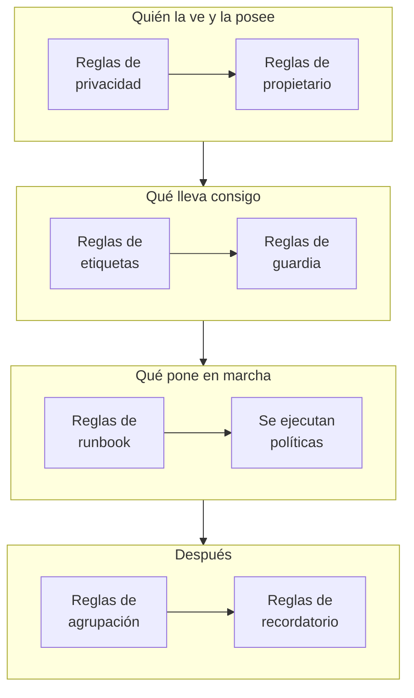

# Reglas y ajustes de alertas

La configuración de las alertas está dentro de **Alertas**, no en **Ajustes del proyecto**: las reglas que actúan sobre cada alerta nueva y los ajustes que dan forma a cada alerta del proyecto. Esta página es la referencia de cada uno de ellos y de lo que se ejecuta por sí solo cuando se crea una alerta.

:::cards
- [Las reglas por las que pasa una nueva alerta](#las-reglas-por-las-que-pasa-una-nueva-alerta): En orden, y qué hace cada una.
- [Reglas de guardia](#reglas-de-guardia): Avisa a las personas adecuadas sin elegir una política cada vez.
- [Reglas de recordatorio](#reglas-de-recordatorio): Recuerda a los propietarios mientras una alerta sigue abierta.
- [Ajustes](#ajustes): Plantillas de notas, campos personalizados, mediciones, pertenencia a episodios y numeración.
:::

## Dónde están los ajustes de las alertas

Abre **Alertas** desde el menú **Productos** de la barra superior. Las secciones **Reglas** y **Ajustes** de su menú lateral empiezan plegadas, así que despliégalas primero. Cada página de aquí se aplica a todo el proyecto, en direcciones que empiezan por `/dashboard/{projectId}/alerts/settings/`.

| Página de reglas              | Qué hace                                                                                       |
| ----------------------------- | ---------------------------------------------------------------------------------------------- |
| **Reglas de agrupación**      | Reúne las alertas relacionadas en episodios. Consulta [Episodios de alertas y reglas de agrupación](/docs/alerts/episodes). |
| **Reglas de guardia**         | Ejecuta políticas de guardia para las alertas y los episodios que coinciden.                   |
| **Reglas del propietario**    | Añade propietarios a las alertas y los episodios que coinciden.                                |
| **Reglas de runbook**         | Pone en marcha runbooks para las alertas que coinciden.                                        |
| **Reglas de privacidad**      | Hace privados las alertas y los episodios que coinciden.                                       |
| **Reglas de etiquetas**       | Añade etiquetas a las alertas y los episodios que coinciden.                                   |
| **Reglas de recordatorio**    | Recuerda a los propietarios a intervalos mientras una alerta está abierta.                     |

La sección **Ajustes** contiene **Estado de la alerta** y **Gravedad de la alerta**, que se tratan en [Estados y severidades de alertas](/docs/alerts/states-and-severities), y después **Plantillas de notas**, **Campos personalizados**, **Mediciones**, **Pertenencia a episodios** y **Numeración**, que se tratan más abajo.

Otras dos secciones actúan sobre las alertas. **Alertas → IA → Ajustes** decide lo que OneUptime AI hace por su cuenta: **Investigar las alertas nuevas**, activado en los proyectos nuevos, y **Corregir automáticamente las alertas nuevas**, desactivado hasta que lo actives. Consulta [AI SRE](/docs/ai/ai-sre). **Alertas → Espacio de trabajo** contiene las reglas de Slack y Microsoft Teams que publican alertas y episodios en canales, y su pestaña **Resumen**. Consulta [Slack](/docs/workspace-connections/slack).

## Las reglas por las que pasa una nueva alerta

Las reglas se diferencian en cómo se resuelven varias coincidencias:

- **Reglas de agrupación** y **Reglas de recordatorio** se comprueban de arriba abajo en su lista, y gana la primera que coincide. Arrastra una regla para cambiar su posición; una regla nueva va al final.
- **Reglas de guardia**, **Reglas del propietario**, **Reglas de etiquetas**, **Reglas de privacidad** y **Reglas de runbook** actúan todas cuando coinciden. Las políticas de guardia, los propietarios y las etiquetas que añaden varias reglas se añaden una sola vez.

**Reglas de guardia**, **Reglas del propietario**, **Reglas de etiquetas** y **Reglas de privacidad** tienen dos pestañas: **Reglas de alerta**, para las alertas, y **Reglas de episodios**, que actúan igual sobre cada episodio de alerta nuevo. Una regla nueva empieza habilitada; desactiva **Habilitado** en su formulario de edición para pausarla, y la lista muestra un **Habilitado** verde o un **Deshabilitado** rojo para cada regla.

La mayoría de las reglas actúan sobre las alertas y los episodios creados después de guardarlas. Para aplicar una regla de propietario, de etiquetas o de privacidad a los que ya tienes, usa **Ejecutar ahora**: consulta [Ejecutar reglas sobre recursos existentes](/docs/configuration/run-rules-now). Las reglas de recordatorio son la excepción: al guardar una se vuelven a comprobar todas las alertas abiertas.

### Condiciones

Las condiciones de una regla deciden sobre qué alertas actúa, y se leen como frases: "Si **Título de la alerta** contiene `database`", "Y **Etiquetas del monitor** tiene alguno de *Production*". Una regla sin condiciones coincide con todas las alertas.

| Condición                                                     | Compara con                                                                                                    |
| ------------------------------------------------------------- | -------------------------------------------------------------------------------------------------------------- |
| **Monitores**, **Gravedades de alerta**, **Etiquetas de alertas**, **Etiquetas del monitor** | **Tiene alguno de**, **Tiene todos los** o **No tiene ninguno de** los valores que elijas. |
| **Título de la alerta**, **Descripción de la alerta**, **Nombre del monitor**, **Descripción del monitor** | **Contiene**, **No contiene**, **Es igual a**, **No es igual a**, **Empieza por**, **Termina en**, sin distinguir mayúsculas, o **Coincide con el patrón** y **No coincide con el patrón**, para una expresión regular o un comodín `*`. |

Con dos o más condiciones, elige **Coincidir con todas**, donde deben cumplirse todas, o **Coincidir con cualquiera**, donde basta con una. Las reglas de episodios coinciden en su lugar con la gravedad, las etiquetas, el título y la descripción de un episodio.

## Reglas de guardia

**Alertas → Reglas → Reglas de guardia** automatiza los avisos. Cada regla que coincide añade sus políticas a la nueva alerta, y la alerta las ejecuta junto con las políticas que ya tenía, cada una una sola vez.

:::steps
### Elegir las alertas

Haz clic en **Crear Regla de guardia de alertas**. En **Coincidencia**, **Todas las alertas**, donde empieza una regla nueva, coincide con todas las alertas nuevas. Para acotarla, elige **Solo las alertas que cumplen las condiciones** y añade las condiciones que debe cumplir una alerta.

### Elegir las políticas

En **Políticas de guardia**, elige las **Políticas de guardia** que activa la regla. Su **Nombre** las sigue, como "Avisar a Platform on-call", hasta que escribas uno propio, y una **Descripción** espera en **Más campos**. Después crea la regla.
:::

Una gravedad no avisa a nadie por sí sola: una regla de guardia que coincide con **Gravedades de alerta** es la forma de configurar "avisar al equipo de base de datos por cada alerta de gravedad Alta". Para ver lo que se ejecutó para una alerta, abre su página **Ejecuciones de guardia**. Después se localiza a cada persona como la haya configurado en **Ajustes de usuario → Reglas de guardia**, en la pestaña **Alertas**; consulta [Reglas de escalado](/docs/on-call/escalation-rules).

Una regla avisa en cuanto una alerta coincide con ella. Para que espere al horario laboral, responde **¿Cuándo debe avisar esta regla?** en **Más campos** con **Solo en horario laboral**. El **Horario laboral** empieza de lunes a viernes, de 09:00 a 17:00, en tu propia zona horaria: elige otros días, otra **Hora de inicio** u **Hora de finalización**, u otra **Zona horaria**, y una frase bajo la opción dice lo que pasará. En la lista, la regla muestra su horario bajo su nombre. Una alerta que coincide fuera de ese horario recibe una ejecución que espera y no avisa a nadie; cuando empieza el horario, la política activa su primera regla de escalado y escala como siempre. Si la alerta se reconoce o se resuelve antes, no se avisa a nadie. Si la alerta cambia mientras espera y ahora coincide con una regla que avisa de inmediato, por ejemplo porque se sube su gravedad, la ejecución empieza a avisar en ese momento, y el feed de la alerta dice por qué. Dos reglas que activan la misma política la activan en cuanto cualquiera de ellas lo permite: una regla para tus gravedades más altas que avisa de inmediato, junto a una regla para el resto que espera al horario laboral, mantiene tranquilas las noches.

## Reglas de propietario y de etiquetas

Las **Reglas del propietario** añaden usuarios y equipos propietarios a las alertas nuevas que coinciden, y las **Reglas de etiquetas** añaden etiquetas. Crear una lleva dos pasos: **Coincidencia**, las condiciones, y después **Propietarios** o **Etiquetas**, lo que añade la regla. El **Nombre** de la regla sigue lo que elijas hasta que escribas uno propio.

- **Una regla puede heredar.** Plegados en **Heredar propietarios** o **Heredar etiquetas**, seis interruptores transmiten los propietarios o las etiquetas del monitor, los hosts, los clústeres de Kubernetes, los hosts de Docker, los hosts de Podman y los servicios de la alerta. Las reglas de episodios no tienen esos interruptores. La sección **Heredar propietarios** de una regla de propietarios termina con **Equipo del creador**: de los equipos que figuran ahí, cada uno en el que está la persona que crea la alerta también pasa a ser propietario.
- **Una regla nueva tiene que añadir algo**: elige al menos un propietario o una etiqueta, o activa un interruptor. En una regla de propietarios de incidentes o alertas, también basta un equipo en **Equipo del creador**.
- **Notificar a los propietarios**, en **Más campos** de una regla de propietario, decide si se avisa a las personas añadidas.

[Reglas de etiquetas y propietarios](/docs/configuration/label-and-owner-rules) explica el formulario paso a paso, para cada tipo de recurso.

## Reglas de privacidad y de runbook

Las **Reglas de privacidad** hacen privadas las alertas nuevas que coinciden, antes de que se ejecute nada más: solo sus propietarios y los administradores y propietarios del proyecto pueden verlas. Una regla tiene dos pasos: **Coincidencia**, las alertas que hace privadas, y luego **Nombre**, ya rellenado como "Hacer privadas las alertas". Consulta [Alertas privadas](/docs/alerts/index#alertas-privadas).

Las **Reglas de runbook** ponen en marcha un runbook cuando coincide una alerta nueva, salvo que la alerta se haya creado resuelta. Consulta [Reglas de runbook](/docs/runbooks/rules).

## Reglas de recordatorio

**Alertas → Reglas → Reglas de recordatorio** recuerda a los propietarios de una alerta mientras sigue abierta. Cada alerta nueva recibe la primera regla que coincide con ella, de arriba abajo en la lista.

:::steps
### Elegir de qué alertas recordar

Haz clic en **Crear Regla de recordatorio de alertas**. En **Coincidencia**, deja marcado **Todas las alertas** para recordar todas las alertas, o elige **Solo las alertas que cumplen las condiciones** y luego las **Gravedades de alerta** y las **Etiquetas** a las que se aplica.

### Fijar el intervalo

En **Recordatorios**, fija el **Intervalo de recordatorio (minutos)**, cada cuánto se recuerda a los propietarios, y **Dejar de recordar cuando**: **Resuelto**, el valor por defecto, o **Reconocido**. Su **Nombre** sigue a ambos, por ejemplo "Recordar cada 30 minutos hasta que se resuelva", hasta que escribas uno propio. Después crea la regla.
:::

Los propietarios reciben cada recordatorio como **Recordatorio de alerta**, que está activado por correo electrónico por defecto. La regla de una alerta se vuelve a comprobar cuando cambian su gravedad o sus etiquetas. Para detener los recordatorios de una alerta, desactiva **Enviar recordatorios** en su página **Ajustes**; se guarda en el momento en que lo cambias.

## Ajustes

### Plantillas de notas

**Alertas → Ajustes → Plantillas de notas** contiene texto preparado para notas privadas. La tarjeta **Plantillas de notas privadas para alertas** las muestra; **Crear Plantilla de nota de alerta** pide un **Nombre de la plantilla**, una **Descripción de la plantilla** y la **Nota**. Una plantilla se ofrece cuando alguien escribe una nota privada en una alerta o un episodio, y cuando reconoce o resuelve uno, y su texto se puede editar antes de publicarlo. Las plantillas de notas de alerta son texto plano: a diferencia de las plantillas de notas de incidente, no rellenan variables.

### Campos personalizados

**Alertas → Ajustes → Campos personalizados** añade tus propios campos a cada alerta, como un nivel de cliente o una referencia de ticket. Rellénalos en la página **Campos personalizados** de una alerta, o a través de la API como `customFields`. Un campo puede copiar su valor de un campo personalizado del monitor en lugar de escribirse a mano: consulta [Campos copiados de un monitor](/docs/incidents/settings#campos-copiados-de-un-monitor), que funciona igual para las alertas.

### Mediciones

**Alertas → Ajustes → Mediciones** mide cuánto tardan las cosas en cada alerta. Elige **Tiempo hasta el reconocimiento** o **Tiempo hasta la resolución**, o dos momentos propios, como cuando **Se crea la alerta** y cuando entra en un estado que elijas. Cada medición se muestra en la página de la alerta y se representa en gráficos como `oneuptime.alert.measurement.<key>`. Consulta [Mediciones](/docs/incidents/settings#mediciones), que funciona igual para las alertas.

La medición **Tiempo hasta el reconocimiento tras el aviso** cuenta desde **Se avisa a alguien por primera vez**, cuando una política de guardia o un aviso directo notificó por primera vez a alguien sobre la alerta, en lugar de desde que se creó: a una alerta que salta de noche y de la que se avisa por la mañana no se le cuenta la noche. Una alerta por la que no se avisó a nadie no tiene valor. Consulta [Tiempo hasta el reconocimiento tras el aviso](/docs/incidents/settings#tiempo-hasta-el-reconocimiento-tras-el-aviso).

### Pertenencia a episodios

**Alertas → Ajustes → Pertenencia a episodios** decide si una alerta puede estar en más de un episodio. Activa **Una alerta solo puede estar en un episodio** y una alerta que está en un episodio no se añade a ningún otro, ni desde el panel ni con la API, un flujo de trabajo o una regla de agrupación, hasta que se quita de ese episodio. Está desactivado hasta que lo actives, y solo los Project Owners y los Project Admins pueden cambiarlo. Activarlo no saca ninguna alerta de un episodio. Consulta [Un solo episodio por incidente](/docs/incidents/episodes#un-solo-episodio-por-incidente), que funciona igual para las alertas.

### Numeración

**Alertas → Ajustes → Numeración** fija el texto delante de los números de alerta y de episodio: `ALT-` y `AE-` en un proyecto nuevo, o `#` sin ninguno. **Actualizar** abre **Prefijo de número de alerta** y **Prefijo de número del episodio de alerta**, con una vista previa mientras escribes. Solo las alertas y los episodios creados después reciben el nuevo prefijo. Las reglas de un prefijo están en [Prefijos de número](/docs/incidents/settings#prefijos-de-número).

La tarjeta **Próximo número** de debajo fija el número que reciben la próxima alerta y el próximo episodio, para continuar los números de otra herramienta: **Actualizar** abre **Próximo número de alerta** y **Próximo número de episodio de alerta**, cada uno mayor que el más alto usado hasta ahora. Consulta [Próximos números](/docs/incidents/settings#próximos-números).

> [!NOTE]
> En OneUptime Cloud, las plantillas de notas y los campos personalizados requieren el plan **Growth** o superior.

## Flujos de trabajo

Cada modelo de alerta tiene disparadores y acciones de flujo de trabajo con su nombre: **On Create Alert**, **On Update Alert**, **On Create or Update Alert** y **On Delete Alert**, lo mismo para **Episodio de alerta**, **Cronología de estados de la alerta** y los demás, y acciones como **Create One Alert** y **Update One Alert**. Las definiciones de campos personalizados de alerta son la única excepción: no tienen disparadores de flujo de trabajo. Consulta [Visión general de los flujos de trabajo](/docs/workflows/index).

## Quién puede cambiarlos

Las reglas, los campos personalizados y las mediciones requieren un Project Owner o un Project Admin, o un rol personalizado con el permiso propio de esa regla. **Miembro de alertas** trabaja con alertas y episodios, sus notas, propietarios y cronologías de estados, y con las plantillas de notas, y **Administrador de alertas** además gestiona los estados y las gravedades de alerta. Consulta [Usuarios, equipos y permisos](/docs/permissions/index).

## Próximos pasos

:::cards
- [Episodios de alertas y reglas de agrupación](/docs/alerts/episodes): Las reglas de agrupación, en detalle.
- [Reglas de escalado](/docs/on-call/escalation-rules): Qué pasa cuando una regla de guardia ejecuta una política.
- [Reglas de etiquetas y propietarios](/docs/configuration/label-and-owner-rules): El formulario de reglas, paso a paso.
- [AI SRE](/docs/ai/ai-sre): Investigar y corregir las alertas nuevas por sí solo.
:::
