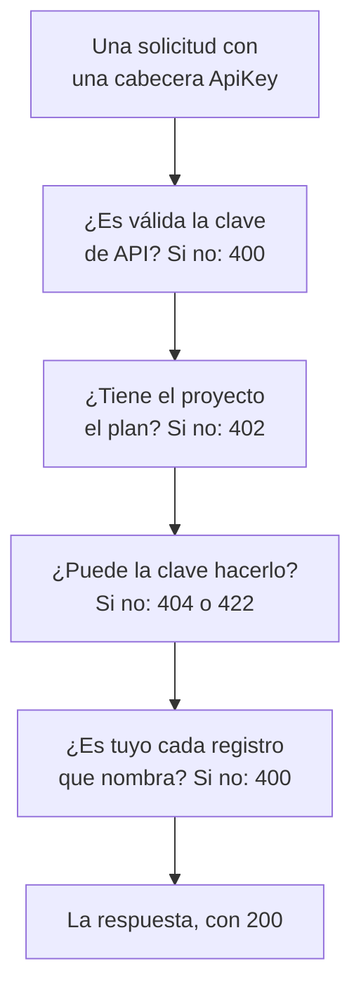

# Referencia de la API de OneUptime

Todo lo que puedes hacer en el panel de OneUptime también puedes hacerlo mediante su API REST: automatizar trabajo repetitivo, conectar OneUptime con tus otras herramientas o crear tus propias integraciones. Esta página muestra cómo hacer tu primera solicitud y las reglas que sigue cada solicitud. Cada endpoint y cada campo aparecen en la [referencia completa de la API](/reference).

:::cards
- [Haz tu primera solicitud](#haz-tu-primera-solicitud): Una clave de API, una cabecera y un comando curl.
- [Solicitudes y respuestas](#solicitudes-y-respuestas): Las seis solicitudes que tiene cada recurso y qué significa cada código de estado.
- [Los planes y la API](#los-planes-y-la-api): Qué vende un plan y qué sigue funcionando por debajo de él.
- [Nombrar y escribir registros](#nombrar-y-escribir-registros): ID, referencias, interruptores y los campos que pone OneUptime.
- [Estados y episodios](#estados-y-episodios): El estado en el que empieza un registro y por los que pasa.
- [Qué puede alcanzar una solicitud](#qué-puede-alcanzar-una-solicitud): Lecturas, cambios y eliminaciones, un proyecto cada vez.
:::

## Cómo se responde una solicitud

La API está organizada según REST: métodos y códigos de estado HTTP estándar, JSON de entrada y de salida. Cada solicitud lleva una clave de API y pasa unas cuantas comprobaciones. La primera comprobación que no supera responde con un código de estado y `{ "message": "..." }`, así que el mensaje dice qué la detuvo.



## Haz tu primera solicitud

Todas las solicitudes a la API se autentican con una clave de API. Una clave pertenece a un proyecto y hace lo que permiten sus permisos.

:::steps
### Crear una clave de API

Abre **Ajustes del proyecto → Avanzado → Claves de API** y haz clic en **Crear Clave de API**. Dale un **Nombre** y, en **Acceso**, elige qué puede hacer: **Administrador del proyecto**, **Miembro del proyecto**, **Visor**, o **Elegir los permisos más tarde** para añadir permisos sueltos en la página de la clave. La clave caduca dentro de un año, salvo que elijas otra fecha en **Avanzado**.

### Copiar la clave

Se abre la página de la clave. Copia la **Clave de API** de la tarjeta **Detalles de la clave de API** y mantenla fuera de tu código:

```bash
export ONEUPTIME_API_KEY="your-api-key"
```

### Enviar una solicitud

Enumera los diez primeros monitores. La clave lee su propio proyecto, así que la solicitud no nombra ningún proyecto:

```bash
curl -X POST 'https://oneuptime.com/api/monitor/get-list?skip=0&limit=10' \
  -H "ApiKey: $ONEUPTIME_API_KEY" \
  -H 'Content-Type: application/json' \
  -d '{ "select": { "name": true } }'
```

La respuesta es `{ "data": [...], "count": ... }`: los monitores y cuántos hay en total. En una instalación autoalojada, usa tu propia dirección de OneUptime en lugar de `https://oneuptime.com`.
:::

### Ejemplos para cada recurso

Cada recurso del panel de OneUptime tiene una sección **Desarrolladores** en su menú lateral, plegada hasta que la abres. Su página **API** tiene comandos `curl` listos para ejecutar para ese recurso, dirigidos a tu OneUptime y rellenados con datos de tu propio proyecto: leerlo, cambiarlo y eliminarlo desde la propia página del recurso, o enumerar, contar y crear desde una página de lista (por ejemplo **Monitores**). Los comandos leen tu clave de API de la variable de entorno `ONEUPTIME_API_KEY`.

Los ejemplos están escritos para el recurso. En la lista **Incidentes**, por ejemplo, la solicitud de lista muestra su respuesta con tu primer incidente, los filtros encuentran incidentes no resueltos, de una gravedad, sobre un monitor o de los últimos siete días, con tus propios estados, gravedades y monitores, y la solicitud de creación declara un incidente con una de tus gravedades, con una línea sobre para qué sirve cada campo. La propia página de un incidente lo lee con su respuesta real, lo pasa a otra de tus gravedades y tiene sus tareas habituales: reconocerlo y resolverlo (con los estados propios de tu proyecto) y añadir notas internas o públicas. Cada página API termina con los endpoints del recurso.

## Solicitudes y respuestas

Cada recurso tiene las mismas solicitudes, bajo `https://oneuptime.com/api` y la ruta del recurso, como `/monitor` o `/incident`:

| Solicitud | Método y ruta | Qué lleva el cuerpo |
| --- | --- | --- |
| Enumerar | `POST /api/<resource>/get-list` | `query`, `select` y `sort` |
| Contar | `POST /api/<resource>/count` | `query` |
| Leer uno | `POST /api/<resource>/<id>/get-item` | `select` |
| Crear | `POST /api/<resource>` | `{ "data": { ... } }` |
| Cambiar uno | `PUT /api/<resource>/<id>` | `{ "data": { ... } }`, los campos que cambian |
| Eliminar uno | `DELETE /api/<resource>/<id>` | Nada |

`POST /api/<resource>/<id>/update-item` y `POST /api/<resource>/<id>/delete-item` también cambian y eliminan un registro, para clientes que solo envían `POST`.

### Filtrar, ordenar y paginar

Una lista o un recuento acepta una `query`. Un campo con un valor coincide con ese valor; un objeto con un `_type` compara:

| `_type` | Coincide con |
| --- | --- |
| `Search` | Texto que contiene `value` |
| `NotEqual` | Todo salvo `value` |
| `GreaterThan`, `LessThan` | Fechas posteriores o números mayores, o anteriores y menores |
| `InBetween` | Fechas o números entre `startValue` y `endValue` |
| `Includes` | Cualquiera de los valores de `value` |
| `IsNull`, `NotNull` | Ningún valor, o cualquier valor |

Un campo de un registro que nombra el recurso se filtra bajo su relación: `"user": { "name": { "_type": "Search", "value": "ada" } }` encuentra los miembros del equipo cuyo usuario tiene un nombre que contiene «ada». Filtrar por un campo requiere permiso para leerlo, a través de una relación igual que en el propio recurso: un filtro sobre un campo que no puedes leer se rechaza con un `422` que nombra el campo.

Un recurso con propietarios - un monitor, un incidente, una política de guardia y cualquier otro con propietarios de usuario y de equipo - también se filtra por quién es su propietario, bajo `owners`: `"owners": { "_type": "OwnedBy", "userIds": ["..."], "teamIds": ["..."] }` encuentra los registros de los que son propietarios una o más de esas personas y equipos. `match` es `AnyOf` salvo que lo fijes: `NoneOf` encuentra los registros de los que no es propietario ninguno de ellos, incluidos los registros sin propietarios, y `AnyOwner` y `NoOwner` encuentran los registros con algún propietario o sin ninguno, sin nombrar a nadie. Los miembros de un equipo no son propietarios de lo que es del equipo. Un filtro nombra como máximo 1000 personas y equipos en total, un recurso sin propietarios lo rechaza con un `400`, y filtrar por propietarios sin permiso para leerlos se rechaza con un `422`.

`select` nombra los campos que se devuelven, y `_id` siempre vuelve. `sort` los ordena, `ASC` o `DESC`; sin orden, los más recientes van primero. Una lista devuelve 10 registros salvo que fijes `limit`, hasta 10 000, y `skip` se salta antes esa cantidad: sigue aumentando `skip` en `limit` hasta tener `count` de ellos. Añade `?output-type=csv` a una solicitud de lista para obtener CSV en lugar de JSON.

Por ejemplo, los monitores cuyo nombre contiene «checkout», creados desde el inicio de 2026, los más recientes primero:

```bash
curl -X POST 'https://oneuptime.com/api/monitor/get-list' \
  -H "ApiKey: $ONEUPTIME_API_KEY" \
  -H 'Content-Type: application/json' \
  -d '{
    "query": {
      "name": { "_type": "Search", "value": "checkout" },
      "createdAt": { "_type": "GreaterThan", "value": "2026-01-01T00:00:00.000Z" }
    },
    "select": { "name": true, "createdAt": true },
    "sort": { "createdAt": "DESC" },
    "limit": 100
  }'
```

Las fechas y los ID que no son `_id` vuelven envueltos, como `{ "_type": "DateTime", "value": "..." }` y `{ "_type": "ObjectID", "value": "..." }`: léelos de `value`.

Cada ID por el que una solicitud filtra o que escribe - `_id`, un campo como `monitorId` y cada registro que enumera una relación, como `"labels": [{ "_id": "..." }]` - es un UUID, enviado como texto o envuelto tal como vuelve. Cualquier otra cosa, como un texto que no es un UUID o un objeto en lugar de un ID, se rechaza con un `400` que nombra el campo y dice si estaba en `query` o en `data`, y no se lee ni se escribe nada:

```text
Invalid ID for "currentIncidentStateId" in the query: "resolved". An ID is a UUID, such as "550e8400-e29b-41d4-a716-446655440000".
```

### Códigos de estado

| Código | Qué significa | Más información |
| --- | --- | --- |
| `200` | Ha salido bien. Una lista o un recuento responde con los registros que puedes leer, ninguno si no hay. | [Leer un registro por su ID](#leer-un-registro-por-su-id) |
| `400` | La solicitud es incorrecta: la clave de API no es válida, un valor no está permitido, un campo no se puede escribir, un registro que nombra no es tuyo, o cambia varios proyectos a la vez. El mensaje dice qué está mal. | [Los registros que nombra una solicitud](#los-registros-que-nombra-una-solicitud) |
| `402` | El plan del proyecto no incluye lo que usa la solicitud. El mensaje nombra el plan. | [Funciones que tu plan no incluye](#funciones-que-tu-plan-no-incluye) |
| `404` | El registro no existe, está en otro proyecto o es uno que no puedes leer: la misma respuesta en cada caso. | [Cambiar o eliminar un registro que no puedes leer](#cambiar-o-eliminar-un-registro-que-no-puedes-leer) |
| `422` | No puedes hacer esto: la clave de API no tiene ningún permiso para este tipo de registro, puedes leer el registro pero no cambiarlo, o las etiquetas de un permiso lo dejan fuera. El mensaje dice por qué. | [Cambiar o eliminar un registro que no puedes leer](#cambiar-o-eliminar-un-registro-que-no-puedes-leer) |
| `500` | Algo falló en el servidor. Cuando no se puede escribir el propietario de un registro nuevo, el registro se vuelve a quitar, así que la creación se puede reintentar. | [Los registros que nombra una solicitud](#los-registros-que-nombra-una-solicitud) |

## Los planes y la API

### Funciones que tu plan no incluye

En OneUptime Cloud, algunos recursos se venden en un plan: los proveedores de inicio de sesión único y las conexiones SCIM en **Scale**; las claves de API, los calendarios de guardia y las reglas de notificación y resúmenes de Slack y Microsoft Teams en **Growth**, entre otros. Crear uno, cambiarlo o activarlo requiere ese plan. Por debajo, la solicitud se rechaza con `402 Payment Required`, y el mensaje nombra el plan.

Algunos ajustes de un recurso se venden en un plan de la misma forma. Por ejemplo: una página de estado privada, que oculta una de sus listas o que tiene HTML, CSS o JavaScript personalizados, informes por correo electrónico, suscriptores de SMS, Slack, Microsoft Teams o webhook, o una lista de IP permitidas; un panel compartido públicamente, o su lista de IP permitidas; la lista de IP permitidas de un formulario; los registros de auditoría de un proyecto. La guía de cada uno, y el panel junto al ajuste, nombran el plan que necesita. Un ajuste así necesita su plan siempre que se escribe - tanto cuando el recurso se crea con él como cuando se cambia más tarde -, así que una creación que activa uno por debajo del plan también se rechaza con `402`. Un ajuste que se deja en su valor por defecto, o que se devuelve a él, funciona en todos los planes: una creación que no toca estos ajustes sale adelante, y también una configuración de Terraform que no los define.

Lo que un proyecto ya tiene sigue siendo gestionable sea cual sea su plan, por ejemplo cuando termina una prueba o el plan baja:

- puedes eliminar esos registros;
- puedes desactivar uno, en un recurso con un campo `isEnabled`, enviando `"isEnabled": false` y nada más;
- puedes enumerar y leer los que un proyecto tiene que encontrar después de que baje el plan - para desactivarlos, o para ver qué se ha detenido: proveedores de inicio de sesión único, conexiones SCIM, claves de API y sus permisos, calendarios de guardia, y reglas de notificación y resúmenes de Slack y Microsoft Teams.

Los permisos habituales siguen decidiendo quién puede hacer cada cosa, exactamente igual que con el plan. Leer los demás recursos que vende un plan, como plantillas, campos personalizados, grupos de monitores, registros de guardia y envíos de formularios, sigue necesitando el plan: leerlos es usar la función. Los permisos de una clave de API no se eliminan uno a uno por debajo de **Growth**, porque eliminar un permiso de bloqueo daría más acceso a la clave; elimina la clave en su lugar.

### Claves de API y SCIM por debajo de su plan

En OneUptime Cloud, las claves de API de un proyecto solo funcionan mientras el proyecto está en **Growth** o superior, y sus conexiones SCIM - las del propio proyecto y las de sus páginas de estado - solo funcionan del todo mientras está en **Scale** o superior. Cuando el proyecto baja de ese plan:

- Cada solicitud hecha con una de las claves de API del proyecto se rechaza con `402 Payment Required`, pida lo que pida: la API REST y todo lo que la llama con una clave de API - Terraform, la CLI `oneuptime`, los clientes MCP conectados con una clave de API, los workflows que envían una en una cabecera de solicitud y tus propios scripts. El mensaje nombra el plan: `API keys need the Growth plan. This project's plan does not include them, so its API keys stopped working. The keys are kept: upgrade the project to Growth in Project Settings > Billing and Invoices > Billing and they work again.`
- Sus conexiones SCIM solo quitan personas. Desactivar y eliminar personas, y quitarlas de grupos, sigue funcionando, así que quien se va pierde igualmente su acceso; cada solicitud SCIM que añadiría o cambiaría personas o grupos se rechaza con `402`, en el formato de error de SCIM, para que tu proveedor de identidad muestre el motivo ([SCIM por debajo del plan Scale](/docs/identity/scim#por-debajo-del-plan-scale)).

No se elimina ni se desactiva nada. Las claves y las conexiones se conservan, y vuelven a funcionar del todo, tal cual, en cuanto el proyecto vuelve al plan: no hay que crear claves nuevas ni volver a configurar nada en tu proveedor de identidad. Un cambio de plan surte efecto en menos de un minuto.

Por debajo de **Growth**, **Ajustes del proyecto** > **Avanzado** > **Claves de API** enumera las claves que el proyecto aún tiene e indica que se han detenido, así que cualquiera de ellas se puede eliminar (revocar) en todos los planes. Crear o cambiar claves necesita **Growth**. **Ajustes del proyecto** > **Facturación y facturas** > **Facturación** indica cuántas claves de API detiene un plan inferior y cuántas conexiones SCIM limita, en cada plan que puedes elegir, y qué ha detenido el plan del proyecto; los propietarios del proyecto reciben un correo cuando un cambio de plan las detiene. Los propietarios de proyectos que ya estaban por debajo de estos planes cuando empezó esto reciben un único correo que dice qué se detuvo y cómo volver a activarlo.

Solo se ven afectadas las claves de API y las conexiones SCIM de un proyecto. Las personas no: iniciar sesión en el panel, y los clientes MCP conectados iniciando sesión, funcionan como antes. Las claves de ingesta de telemetría, las claves de sonda y las claves de agente no son claves de API, y siguen funcionando. Las instalaciones autoalojadas no tienen planes, así que para ellas no cambia nada.

## Nombrar y escribir registros

### Encontrar el ID de un recurso

Las solicitudes que leen, cambian o eliminan un recurso lo nombran por su ID, un UUID. En la propia página del recurso, su tarjeta de detalles termina con una pequeña línea **ID** que muestra el principio del ID: haz clic en el ID, o en el botón de copiar que hay al lado, para copiar el ID completo. Las listas que lo ofrecen tienen **Mostrar ID** en el menú **⋯** de una fila, y el ID es también la última parte de la dirección de la página. El ID de tu proyecto es lo primero de la tarjeta **Detalles del proyecto** en **Ajustes del proyecto → Proyecto**.

### Los registros que nombra una solicitud

Muchos recursos nombran otros registros: un monitor sus etiquetas y sondas, un suscriptor de una página de estado su página de estado, un dispositivo de red su sitio, un miembro de un incidente el incidente y el rol. Cada regla de abajo se aplica por igual a la API, Terraform y los workflows:

| Cuando una solicitud | debe | Si no |
| --- | --- | --- |
| nombra un registro por su ID | nombrar un registro de tu proyecto | `400` |
| crea un registro que se lee a través de otro, como una nota | crearlo bajo uno que puedas leer | `400`, o `422` sin permiso para leer ese tipo de registro |
| mueve un registro bajo otro | moverlo bajo uno que puedas leer | `400` |
| enumera registros, o nombra uno en un campo propio | nombrar registros a los que llega tu permiso de lectura | `400` |
| nombra un ajuste que contiene credenciales | venir de alguien que puede leer ese tipo de ajuste | `400` |
| crea o reetiqueta un registro con un permiso limitado a etiquetas | dar al registro una de esas etiquetas | `422` |
| nombra un registro de dos formas | nombrar el mismo registro las dos veces | `400` |

#### Cada ID debe ser de tu proyecto

Cada ID que envías para un registro que nombra un recurso debe ser un registro de tu proyecto — los selectores del panel no ofrecen nada más — y las solicitudes de Terraform y de los workflows cumplen la misma regla. Un ID de un registro de otro proyecto y un ID que no existe se rechazan igual, con un `400` que nombra el campo y el ID:

```text
This network device references records that are not in this project: Network Site "…". Please pick values from this project and try again.
```

Las personas se comprueban por su pertenencia: alguien que no es miembro del proyecto se rechaza de la misma forma. Una sonda global, que cualquier proyecto puede usar, cuenta como de tu proyecto. Cambiar un recurso solo comprueba los ID que añade el cambio, así que un recurso que nombra algo que ya no existe se puede seguir guardando.

#### Registros que se leen a través de otro

Un registro que se lee a través de otro - las notas y la cronología de estados de un incidente o de una alerta, los anuncios, dominios y grupos de una página de estado - también debe nombrar uno que puedas leer, según la regla que sigue su lectura: un incidente fuera de las etiquetas o propietarios a los que llega tu permiso de leer incidentes, con una etiqueta que quita un bloqueo de lectura de incidentes, o marcado como privado sin que estés entre sus propietarios, directamente o a través de un equipo (los propietarios y administradores del proyecto ven todos los incidentes, alertas y episodios privados), se rechaza con el mismo `400`, y no se escribe nada. Cada página de estado que nombra un anuncio debe ser una que puedas leer, y una clave cuyo permiso de leer páginas de estado solo llega a algunas debe nombrar al menos una. Un permiso para crear un registro así necesita uno para leer el registro bajo el que se crea; sin él, la creación se rechaza con un `422` que nombra los permisos que la permitirían:

```text
You do not have permissions to create Incident Internal Note. It is read through its Incident, and you need one of these permissions to read Incidents: …
```

Un cambio que mueve un registro así sigue la misma regla: cada registro que añade como padre - otra página de estado para un anuncio, otro servicio para un registro que se lee a través de su servicio - debe ser uno que puedas leer, o el cambio se rechaza con el mismo `400` y no se escribe nada. Los padres que un registro ya tiene no se vuelven a comprobar, y un cambio que lo deja sin ninguno necesita un permiso de lectura de ese tipo de registro que llegue a todos ellos, como una creación que no nombra ninguno.

#### Propietarios

Los propietarios de un recurso - los registros de propietarios de usuario y de equipo de un monitor, una política de guardia, un panel y cualquier otro recurso con propietarios - se leen a través del recurso del que son propietarios de la misma forma: enumerarlos, leerlos, añadirlos y quitarlos necesita un permiso para leer ese recurso, bajo sus etiquetas y propietarios, y un registro de propietario de un recurso que no puedes leer se responde como si no existiera. Añadirlos y quitarlos también se ajusta al alcance del permiso que lo permite: uno con el alcance `Owned` solo llega a los propietarios de los recursos de los que tú o uno de tus equipos son propietarios, y añadir un propietario a cualquier otro recurso se rechaza con un `422` que lo indica.

#### Registros que una escritura enumera o nombra

Los registros que enumera una creación o un cambio - los monitores y políticas de guardia de un incidente, los servicios de una alerta, las páginas de estado de un evento de mantenimiento programado, los runbooks de una regla - se ajustan a tu permiso para leer ese tipo de registro cuando tienes uno, y en todo caso a un bloqueo con etiquetas sobre su lectura: uno fuera de ellos se rechaza con el mismo `400`. Un cambio solo comprueba los registros que añade a una lista, así que los que la lista ya contiene se quedan.

El único registro que una creación o un cambio nombra en un campo propio - el monitor de una alerta, el monitor que muestra un recurso de página de estado, el servicio de un presupuesto de costes, el incidente al que está vinculada una ejecución de runbook - sigue la misma regla, con cualquiera de sus dos nombres: uno fuera de tu permiso para leer ese tipo de registro, o con una etiqueta que quita un bloqueo de su lectura, se rechaza con el mismo `400`. Un cambio solo lo comprueba cuando nombra un registro distinto del que el campo ya contiene. Las sondas globales y los agentes de IA de OneUptime, que cualquier proyecto puede usar, siguen abiertos a todos los proyectos. Los registros que una plantilla rellena por ti se comprueban de la misma forma una vez rellenados, antes de guardar nada: los monitores, páginas de estado y políticas de guardia que una plantilla de incidente añade a un incidente declarado a partir de ella deben ser registros que puedas leer, como si los hubieras elegido tú.

#### Ajustes que contienen credenciales

Un ajuste que contiene credenciales - un servidor SMTP, un proveedor de llamadas y SMS, credenciales SNMP, una conexión de videollamada, una clave de API, un servidor MCP externo - solo lo nombra quien puede leer ese tipo de ajuste: `smtpConfig` y `callSmsConfig` de una página de estado, `projectCallSMSConfig` de una política de llamadas entrantes, `snmpCredentialProfile` de un dispositivo de red o un sitio, la conexión de videollamada `videoCallConnection` de un incidente o una alerta, `apiKey` de un permiso de clave de API y `externalMcpServers` de una regla de IA. Nombrar uno sin permiso para leer ese tipo de ajuste - o con uno que quita un bloqueo sin etiquetas - se rechaza con el mismo `400`, con cualquiera de sus dos nombres; un cambio que mantiene el ajuste que un registro ya nombra no se pregunta. La búsqueda de números y la lista de números propios de una política de llamadas entrantes requieren la misma lectura de la configuración de llamadas y SMS que nombran.

#### Etiquetas y propietarios al crear

Un permiso de creación limitado a etiquetas solo crea registros que llevan una de sus etiquetas - para un registro sin etiquetas propias, registros bajo uno que lleva una -, salvo que otro permiso para crear ese tipo de registro llegue a todo el proyecto, y un bloqueo con etiquetas sobre un permiso de creación rechaza un registro que lleva una de sus etiquetas. Una creación fuera de ellas se rechaza con un `422` que nombra las etiquetas:

```text
Your access lets you create Status Pages only with one of these labels: Production. Add one of them and try again.
```

Un permiso de creación con ámbito **Owned** crea un monitor, una página de estado u otro registro con propietarios propios solo para una persona, que pasa a ser uno de sus propietarios, y una nota u otro registro que toma sus propietarios del registro al que pertenece solo bajo uno que tú o uno de tus equipos poseéis.

El creador pasa a ser propietario justo después de guardar el registro, antes de que le ocurra cualquier otra cosa. Si no se puede escribir la fila de propietario, el registro se vuelve a quitar y la creación se rechaza con un `500`, para que no quede ningún registro al que su creador no pueda llegar.

#### Un cambio de etiquetas

Un cambio de las etiquetas que lleva un registro - sus propias etiquetas o, para un registro sin etiquetas propias, los registros que nombra - se ajusta de la misma forma a tu permiso para cambiar ese tipo de registro: con uno limitado a etiquetas, el registro conserva al menos una de ellas, salvo que otro permiso para cambiarlo llegue a todo el proyecto, y un bloqueo con etiquetas sobre un permiso de cambio impide darle una de sus etiquetas. Un cambio así se rechaza con un `422` que nombra las etiquetas:

```text
Your access lets you change Monitors only with one of these labels: Production. Keep one of them and try again.
```

#### Nombrar un registro de dos formas

Un registro se puede nombrar de dos formas: por su campo de ID (`monitorId`), o por la relación (`"monitor": { "_id": "…" }`), que es lo que envían los formularios del panel. Envía una de las dos. Si una solicitud envía ambas, deben nombrar el mismo registro: una solicitud cuyas dos no coinciden — dos ID distintos, o un ID y un valor vacío — se rechaza con un `400` que nombra ambos campos:

```text
Conflicting Monitor references were provided. monitorId and monitor are names for the same field and must hold the same value: send only one of them, or the same id in each.
```

Ambos nombres se comprueban de la misma forma. Las reglas sobre el registro que nombras se aplican con cualquiera de los dos nombres con los que lo envíes: el grupo padre de un grupo de página de estado debe estar en la misma página de estado, una página de estado admite como mucho tres enlaces de cabecera, y el nombre de un grupo debe ser único en su página de estado.

### Interruptores

Un campo que está activado o desactivado - `isEnabled`, `isVisibleOnStatusPage`, `isArchived` y cualquier otro campo `true` o `false` - acepta `true` o `false`. El texto y los números que la base de datos lee como uno de ellos se toman como ese valor, igual para la API, Terraform y los workflows: `"true"`, `"yes"`, `"on"`, `"1"` y `1` son `true`, y `"false"`, `"no"`, `"off"`, `"0"` y `0` son `false`, en mayúsculas o minúsculas. Todo lo que OneUptime hace con el registro lo trata también como ese valor: un evento de mantenimiento programado enviado con `"isVisibleOnStatusPage": "true"` muestra sus imágenes en la página de estado, y `"isEnabled": "false"` desactiva un recurso por debajo de su plan igual que `false`. Cualquier otro valor, como `"maybe"`, `""` o `2`, se rechaza con un `400` que nombra el campo:

```text
isVisibleOnStatusPage must be true or false.
```

Una actualización que escribe los valores de un registro tal como ya están no cambia nada: no inicia los workflows **On Update** del registro, no envía actualizaciones en vivo ni añade una entrada al registro de auditoría. `false` escrito sobre `false` cuenta como el mismo valor, igual que `"false"` escrito sobre `false`, un número escrito como texto, una hora escrita como el mismo instante en otro formato y unas etiquetas escritas como las mismas etiquetas en cualquier orden. Cuando una actualización cambia unos valores y vuelve a escribir otros tal como están, su entrada del registro de auditoría solo enumera los valores que cambiaron, y el **Fields to watch** de un workflow solo oye esos.

### Dónde se compró un proyecto

El revendedor, el plan del revendedor y la licencia del revendedor de un proyecto (`resellerId`, `resellerPlanId`, `resellerLicenseId`, y las relaciones `reseller` y `resellerPlan`) los pone solo OneUptime: cuando se crea un proyecto con el código promocional de un revendedor, y cuando el revendedor cambia el plan. Una creación o un cambio de un proyecto que envía uno de ellos se rechaza con un `400` que nombra el campo, lo envíe quien lo envíe:

```text
User is not allowed to create on resellerId column of Project. No permission allows it: the column is set by the server, not by a request.
```

### Quién creó un registro

OneUptime registra quién creó un registro — y quién lo archivó, lo resolvió, lo reconoció o lo activó — a partir de la propia solicitud: la persona que ha iniciado sesión, o nadie cuando la solicitud llega con una clave de API o desde un workflow. Estos campos (`createdByUserId` y los demás campos que terminan en `ByUserId`, con sus relaciones como `createdByUser`) son de solo lectura, igual que el momento en que se archivó o resolvió un registro (`archivedAt`, `markedAsResolvedAt`, `markedAsArchivedAt`): activar `isArchived` o `isResolved` registra quién lo hizo y cuándo, y desactivarlo borra ambos. Enviar un interruptor tal como ya está conserva quién lo cambió, y cuándo.

La referencia de la API marca estos campos como de solo lectura. Un valor que una solicitud envía para uno de ellos junto a otros cambios se ignora, así que el resto del cambio sale adelante; una actualización que no envía nada más se rechaza con un mensaje que nombra los campos. Los registros que OneUptime crea por sí mismo en nombre de alguien — una nota publicada desde Slack o Microsoft Teams, una cuenta creada por una invitación — nombran a esa persona.

## Estados y episodios

### El estado en el que empieza un registro nuevo

Un incidente, una alerta, un episodio de incidente y un episodio de alerta se pueden crear en cualquiera de los estados de tu proyecto, como hace el campo **Estado inicial** de sus formularios de creación: envía `currentIncidentStateId` (incidentes y episodios de incidente) o `currentAlertStateId` (alertas y episodios de alerta), o la relación. El registro empieza en ese estado y su cronología de estados comienza con él. Si lo omites, empieza en el estado de creación de tu proyecto, el que tiene la marca `isCreatedState` — o, para un incidente declarado a partir de una plantilla que tiene un estado inicial, en el de la plantilla. Un estado de otro proyecto se rechaza como cualquier otro registro. `current_incident_state_id` y `current_alert_state_id` de Terraform funcionan igual. Un registro creado en tu estado de reconocido o después no avisa a nadie, y uno creado resuelto además no se agrupa, no se corrige automáticamente, no lo investiga la IA y no obtiene canal de Slack ni de Microsoft Teams — consulta [Declarado ya reconocido o resuelto](/docs/incidents/declaring-incidents#declarado-ya-reconocido-o-resuelto).

### Cambiar el estado de un registro

El estado de un registro cambia mediante una fila de su cronología de estados - `POST /api/incident-state-timeline`, `/api/alert-state-timeline`, `/api/incident-episode-state-timeline`, `/api/alert-episode-state-timeline` o `/api/scheduled-maintenance-state-timeline` - o mediante una actualización que escribe su estado actual (`currentIncidentStateId`, `currentAlertStateId`, `currentScheduledMaintenanceStateId`, o la relación), que registra la misma fila. En ambos casos rige una sola regla para el cambio, para un episodio igual que para un incidente, una alerta o un evento de mantenimiento programado: un estado anterior en el orden de tu proyecto al estado actual del registro se rechaza antes de guardar nada, igual que el estado en el que ya está:

```text
Episode cannot transition to Acknowledged state from Resolved state because Acknowledged is before Resolved in the order of incident states.
```

Un estado puesto por error se corrige eliminando su fila de la cronología de estados del registro. Consulta [El orden es una restricción real](/docs/incidents/states-and-severities#el-orden-es-una-restricción-real-no-una-preferencia-de-visualización).

### El episodio en el que está un incidente o una alerta

`incidentEpisodeId` de un incidente y `alertEpisodeId` de una alerta — y sus relaciones `incidentEpisode` y `alertEpisode` — nombran el último episodio al que se añadió y del que sigue siendo miembro, o nada. Son de solo lectura: OneUptime los pone a partir de los miembros del episodio. Para meter un incidente en un episodio, crea un Incident Episode Member (`POST /api/incident-episode-member` con `incidentEpisodeId` e `incidentId`); para sacarlo, elimina ese miembro, y el incidente nombra entonces el último episodio en el que sigue, o ninguno. Las alertas funcionan igual mediante Alert Episode Members (`/api/alert-episode-member`, con `alertEpisodeId` y `alertId`). Las reglas de agrupación añaden incidentes y alertas a los episodios de la misma forma. Una creación o actualización de un incidente o una alerta que envía su episodio se rechaza, la envíe quien la envíe — la API, Terraform, las herramientas MCP o un workflow. En Terraform, `incident_episode_id` y `alert_episode_id` se pueden leer pero no definir; los recursos `oneuptime_incident_episode_member` y `oneuptime_alert_episode_member` gestionan la pertenencia.

## Qué puede alcanzar una solicitud

### Cambiar o eliminar un registro que no puedes leer

Un cambio o una eliminación solo alcanza los registros que la clave de API - o la persona que ha iniciado sesión - puede leer. Un registro fuera de sus etiquetas o propietarios, detrás de un bloqueo de lectura, o que se lee a través de otro registro que no puede leer (la nota de un incidente, el anuncio de una página de estado) tampoco se puede cambiar ni eliminar. Un permiso para cambiar o eliminar un tipo de registro funciona junto con el permiso para leerlo, y uno para cambiar las notas de un incidente junto con uno para leer incidentes.

Una solicitud que cambia o elimina un registro por su ID - `PUT /api/<resource>/<id>` o `POST /api/<resource>/<id>/update-item`, `DELETE /api/<resource>/<id>` o `POST /api/<resource>/<id>/delete-item` - y no alcanza nada responde:

- `404` cuando el registro no existe, está en otro proyecto o es uno que no puedes leer - la misma respuesta en cada caso:

```text
Incident not found.
```

- `422` cuando puedes leer el registro pero no cambiarlo ni eliminarlo, con el motivo:

```text
You do not have permission to update this incident.
```

Una eliminación que no alcanzaba nada respondía antes `200`. Las actualizaciones y eliminaciones por consulta, como los pasos de actualizar y eliminar de un workflow, responden con cuántos registros cambiaron, `0` cuando no alcanzaron ninguno. Terraform interpreta un `404` en `terraform destroy` como un recurso que ya no existe.

La telemetría sigue la misma regla. Una eliminación de registros, trazas, métricas, excepciones, perfiles o grabaciones de sesión alcanza las filas de los recursos - servicios, hosts, clústeres y similares - cuya telemetría puedes tanto leer como eliminar, y se hace en un proyecto cada vez: una solicitud sobre todos tus proyectos se rechaza. Una eliminación de una fila por su ID que no alcanza nada responde `404` o `422` como arriba.

### Los cambios se hacen en un proyecto cada vez

Una actualización o una eliminación de los registros de un proyecto se hace en el proyecto que nombra la solicitud: la cabecera `tenantid` o, para una clave de API, el propio proyecto de la clave. Una actualización o eliminación de un usuario que ha iniciado sesión que no nombra ningún proyecto, o que pregunta en todos sus proyectos con la cabecera `is-multi-tenant-query`, se rechaza con `400`:

```text
Changes to incidents are made in one project at a time. Please pass the project ID in the 'tenantid' header.
```

Una solicitud así fallaba antes con `500`. Las lecturas pueden seguir preguntando en todos tus proyectos.

### Leer un registro por su ID

Una lectura de un registro por su ID - `POST /api/<resource>/<id>/get-item` - responde `404` cuando el registro no existe, está en otro proyecto o es uno que no puedes leer, la misma respuesta en cada caso:

```text
Incident not found.
```

Antes respondía `200` con un cuerpo vacío. Una lista (`get-list`) y un recuento siguen respondiendo `200` con los registros que puedes leer, ninguno si no hay. El proveedor de Terraform interpreta un `404` al refrescar como un recurso que ya no existe y lo quita del estado, así que el siguiente plan lo vuelve a crear: da a la clave de API que usa los permisos, y las etiquetas, para leer cada recurso que gestiona. Las herramientas MCP responden a un `404` con un error que remite a la herramienta de lista correspondiente, y la CLI termina con el código `3`.

## La referencia completa de endpoints

Cada recurso, endpoint y campo aparece en la [referencia de la API de OneUptime](/reference). Está disponible en varios idiomas: tu idioma se toma de tu navegador, y puedes cambiarlo en cualquier momento con el selector de la parte superior de la página.

## Solución de problemas

:::details Cada solicitud responde 400 Invalid API Key
La cabecera `ApiKey` está vacía, no es una clave o nombra una clave que ha caducado o se ha restablecido. Vuelve a copiar la clave desde su página en **Ajustes del proyecto → Avanzado → Claves de API**, donde también está su fecha de **Caduca**.
:::

:::details Cada solicitud responde 402 Payment Required
En OneUptime Cloud, las claves de API solo funcionan mientras el proyecto está en el plan **Growth** o superior. Las claves se conservan y vuelven a funcionar tal cual en cuanto el proyecto vuelve al plan: consulta [Claves de API y SCIM por debajo de su plan](#claves-de-api-y-scim-por-debajo-de-su-plan).
:::

:::details Cada solicitud responde 422 You do not have permissions
La clave de API no tiene ningún permiso para ese tipo de registro. Una clave creada con **Elegir los permisos más tarde** no puede hacer nada hasta que recibe uno: ábrela en **Ajustes del proyecto → Avanzado → Claves de API** y haz clic en **Añadir rol** o **Añadir permiso**. El mensaje nombra los permisos que dejarían pasar la solicitud.
:::

:::details Un registro que veo en el panel responde 404
La clave de API solo lee aquello a lo que llegan sus permisos, y sus etiquetas, y una clave puede llegar a menos cosas que tu propia cuenta. Da a la clave un permiso que llegue al registro: consulta [Leer un registro por su ID](#leer-un-registro-por-su-id).
:::

:::details Una actualización responde 400 Invalid request body
Una actualización envía los campos que cambian dentro de `data`, como `{ "data": { "name": "New name" } }`. Un cuerpo sin él se rechaza, en lugar de responder `200` y no cambiar nada:

```text
Invalid request body. The update payload should be an object of the form { "data": { ...fields to update... } }.
```
:::

:::details Una escritura responde 400 y nombra un campo y un ID
El ID nombra un registro de otro proyecto, uno que no existe o uno al que no llegan tus permisos. Consulta [Los registros que nombra una solicitud](#los-registros-que-nombra-una-solicitud).
:::

## Próximos pasos

:::cards
- [Usuarios, equipos y permisos](/docs/permissions/index): A qué llegan los permisos y las etiquetas de una clave de API.
- [Proveedor de Terraform](/docs/terraform/index): Gestionar los recursos de OneUptime como código, mediante la misma API.
- [CLI de OneUptime](/docs/cli/index): Llamar a la API desde tu terminal y tus scripts.
- [Servidor MCP](/docs/ai/mcp-server): Dejar que asistentes de IA trabajen con tu proyecto.
:::
