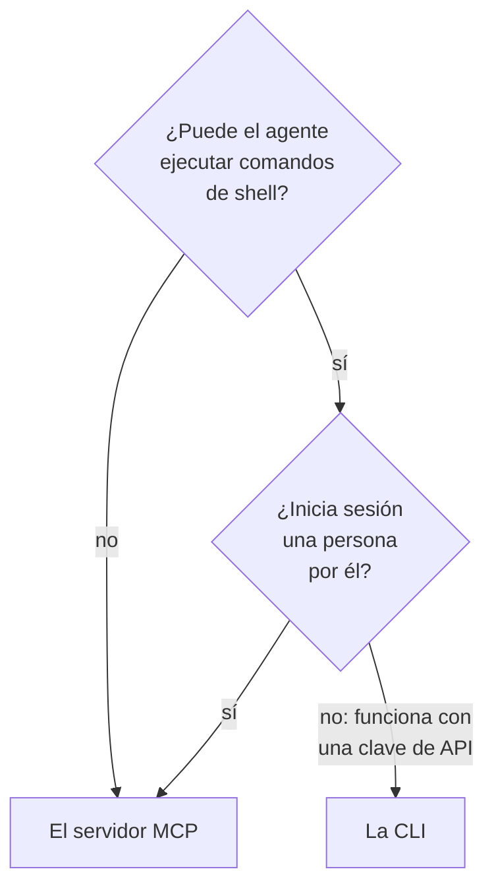

# CLI para agentes de IA

Un agente de IA que puede ejecutar comandos de shell, como un agente de programación en su editor o un trabajo de su pipeline, puede trabajar con OneUptime a través de la CLI en lugar del [servidor MCP](/docs/ai/mcp-server). Esta página dice cuándo encaja cada uno, y cómo un agente instala la CLI, se orienta y lee sus respuestas.

:::cards
- [La CLI o el servidor MCP](#la-cli-o-el-servidor-mcp): Cuál debería usar un agente.
- [Prepararla para un agente](#prepararla-para-un-agente): Instálela y dele una clave en el entorno.
- [Cómo se orienta un agente](#cómo-se-orienta-un-agente): Los recursos, sus campos y la ayuda.
- [Leer las respuestas](#leer-las-respuestas): JSON de cada comando, errores incluidos.
:::

## La CLI o el servidor MCP

Ambos llegan a la API de OneUptime y hacen lo que sus credenciales permiten. Se diferencian en lo que el agente necesita para llegar a ellos:



| | La CLI | El servidor MCP |
| --- | --- | --- |
| El agente necesita | Una shell y Node.js 22 o posterior | Un cliente MCP, como Claude o Cursor |
| Inicia sesión con | Una clave de API del proyecto, en `ONEUPTIME_API_KEY` | Su cuenta de OneUptime, o una clave de API |
| Llega a | Cada recurso de la API, 450 y más | Los registros y la telemetría para los que tiene herramientas, y herramientas de respuesta a incidentes |
| Le conviene a | Scripts que el agente escribe para que las personas los conserven, comprobaciones en un pipeline y el trabajo con muchos registros | Una conversación: investigar un incidente, configurar un monitor |

Use la CLI cuando el agente ya ejecuta comandos, como hace un agente de programación, o cuando lo que construye debe seguir funcionando sin él: un script en un repositorio, un paso de un pipeline. Use el servidor MCP cuando una persona habla con el agente en un cliente de chat, para que el agente trabaje con sus permisos y el cliente pregunte antes de un cambio.

## Prepararla para un agente

Cada OneUptime sirve el script de instalación de la CLI de su propia versión: los comandos de abajo lo descargan desde `https://oneuptime.com`, así que en un OneUptime autoalojado sustitúyala por su URL. El script se guarda primero como `install.sh`, para que pueda leerlo antes de ejecutarlo:

```bash
curl -fsSL https://oneuptime.com/install/cli -o install.sh
ONEUPTIME_URL=https://oneuptime.com bash install.sh
```

Dé al agente una clave de API del proyecto con solo el acceso que necesita su trabajo, en el entorno y no en la línea de comandos, y haga que compruebe primero la clave:

```bash
export ONEUPTIME_API_KEY="your-api-key"
export ONEUPTIME_URL=https://oneuptime.com
oneuptime whoami --check -o json
```

Cree la clave en **Ajustes del proyecto → Avanzado → Claves de API**: consulte [Crear una clave de API](/docs/api-reference/api-reference#crear-una-clave-de-api). Una clave que solo puede leer deja que el agente mire, y nada más.

## Cómo se orienta un agente

La CLI dice lo que puede hacer, sin clave de API y sin solicitud:

| Comando | Qué responde |
| --- | --- |
| `oneuptime resources -o json` | Cada recurso: su comando, sus nombres, su ruta de API, sus operaciones y sus acciones |
| `oneuptime incident fields -o json` | Los campos de un recurso: para qué sirve cada uno, su tipo, si una creación lo necesita y su opción |
| `oneuptime incident create --help` | Los argumentos y las opciones de un comando |

Un campo que contiene un ID dice de qué recurso es el ID que toma, así que el agente lista primero ese recurso: `incidentSeverityId` toma un ID de `oneuptime incident-severity list`. Un campo que nombra a una persona también admite su dirección de correo, como con `--user-email`.

## Leer las respuestas

Haga que el agente añada `-o json`, o `--json`, a cada comando. Entonces cada comando responde con JSON, incluidos aquellos cuya respuesta es una frase, y un error es un único objeto JSON en la salida de error estándar:

```bash
oneuptime incident acknowledge 6f1c2a40-3b1e-4c55-9a0b-3e2f8d7c1a11 -o json
```

```json
{
  "_id": "6f1c2a40-3b1e-4c55-9a0b-3e2f8d7c1a11",
  "action": "acknowledge",
  "changed": true,
  "state": {
    "_id": "0b7d5e2c-8f4a-4d1b-9c3e-5a6f7b8c9d0e",
    "name": "Acknowledged"
  }
}
```

El código de salida dice qué pasó: `0` cuando funcionó, `1` cuando falló, `2` cuando falta la clave de API o se rechaza, y `3` cuando el registro no existe. El JSON de un error tiene el mismo código en `exitCode`, y en `hint` qué hacer a continuación. Consulte [Formatos de salida](/docs/cli/output-formats#json) y [Códigos de salida](/docs/cli/scripting#códigos-de-salida).

## Próximos pasos

:::cards
- [Operaciones de recursos](/docs/cli/resource-operations): Cada operación, con sus opciones y filtros.
- [Referencia de comandos](/docs/cli/command-reference): Cada comando, opción y valor predeterminado.
- [Servidor MCP](/docs/ai/mcp-server): Conecte en su lugar un cliente de chat a OneUptime.
:::
