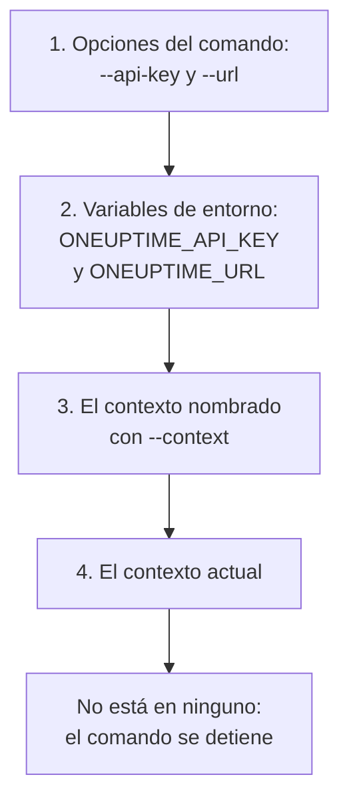

# Autenticación

Cada solicitud que envía la CLI lleva una clave de API de su proyecto. Guarde las claves una vez con `oneuptime login`, un contexto para cada entorno, o páselas a un comando en opciones o variables de entorno, como hacen los scripts. Esta página muestra cada forma, y cuál usa un comando cuando hay varias.

:::cards
- [Iniciar sesión](#iniciar-sesión): Guardar una clave de API y la dirección de su OneUptime.
- [Contextos](#contextos): Un inicio de sesión guardado para cada proyecto o entorno, y el cambio entre ellos.
- [Qué credenciales usa un comando](#qué-credenciales-usa-un-comando): Primero las opciones, luego las variables de entorno, luego los contextos.
- [Solución de problemas](#solución-de-problemas): Credenciales no encontradas, claves no válidas y rechazos.
:::

## Antes de empezar

Necesita una clave de API de su proyecto. Cree una en **Ajustes del proyecto → Avanzado → Claves de API** con **Crear Clave de API**, y dele el acceso que necesitan sus comandos: consulte [Crear una clave de API](/docs/api-reference/api-reference#crear-una-clave-de-api). Una clave hace lo que sus permisos permiten: una clave que solo puede leer registros puede listarlos y leerlos, pero no cambiarlos.

En OneUptime Cloud, las claves de API solo funcionan mientras el proyecto está en el plan **Growth** o superior. Por debajo, cada comando responde `API error (402)` con un mensaje que nombra el plan, hasta que el proyecto se mejora; entonces la misma clave vuelve a funcionar. Consulte [Claves de API y SCIM por debajo de su plan](/docs/api-reference/api-reference#claves-de-api-y-scim-por-debajo-de-su-plan).

## Iniciar sesión

`oneuptime login` guarda una clave de API y la dirección de su OneUptime como contexto, y lo convierte en el contexto actual:

```bash
oneuptime login <api-key> <instance-url> [--context-name <name>]
```

| Argumento u opción | Qué es |
| --- | --- |
| `<api-key>` | Una clave de API de su proyecto |
| `<instance-url>` | La dirección de su OneUptime: `https://oneuptime.com`, o la de su propio servidor, como `https://oneuptime.example.com` |
| `--context-name <name>` | El nombre con el que se guarda el contexto. Predeterminado: `default` |

Por ejemplo, un contexto llamado `production`:

```bash
oneuptime login <api-key> https://oneuptime.com --context-name production
```

Responde `Logged in successfully. Context "production" is now active.` Una barra al final de la dirección se elimina, y volver a iniciar sesión con el mismo nombre reemplaza ese contexto.

> [!NOTE]
> `login` guarda la clave sin consultarla con OneUptime. Ejecute un comando, como `oneuptime incident count`, para ver que la clave funciona.

## Contextos

Un contexto es un inicio de sesión guardado: un nombre, una dirección y una clave de API. Guarde uno para cada proyecto o entorno y luego elija uno para todos los comandos que siguen, o para un solo comando.

:::steps
### Guardar un contexto para cada entorno

```bash
oneuptime login <production-api-key> https://oneuptime.com --context-name production
oneuptime login <staging-api-key> https://oneuptime.example.com --context-name staging
```

Cada inicio de sesión convierte su contexto en el actual, así que ahora el actual es `staging`.

### Listarlos

```bash
oneuptime context list
```

```text
┌───┬────────────┬───────────────────────────────┐
│   │ Name       │ URL                           │
├───┼────────────┼───────────────────────────────┤
│   │ production │ https://oneuptime.com         │
├───┼────────────┼───────────────────────────────┤
│ * │ staging    │ https://oneuptime.example.com │
└───┴────────────┴───────────────────────────────┘
```

El `*` marca el contexto actual. Las claves de API nunca se listan.

### Cambiar a otro contexto

```bash
oneuptime context use production
```

Responde `Switched to context "production".` y los comandos que siguen lo usan.

### Usar un contexto para un solo comando

```bash
oneuptime incident list --context staging
```

El contexto actual queda como estaba.
:::

| Comando | Qué hace |
| --- | --- |
| `oneuptime context list` | Lista los contextos guardados; `*` marca el actual. Con `-o json`, el `name`, `apiUrl` e `isCurrent` de cada contexto, nunca su clave |
| `oneuptime context use <name>` | Convierte un contexto guardado en el actual |
| `oneuptime context current` | Muestra el nombre, la URL y la clave de API del contexto actual, con la clave oculta salvo sus cuatro primeros y cuatro últimos caracteres |
| `oneuptime context delete <name>` | Elimina un contexto guardado. Si era el actual, el primer contexto que queda pasa a ser el actual |

## Qué credenciales usa un comando

Un comando necesita una clave de API y una URL. Toma cada una de las dos del primero de estos lugares que la tenga:



Así que puede combinarlos: por ejemplo, una clave de API de una variable de entorno con la URL del contexto actual. Las variables de entorno se adaptan a los scripts y a los trabajos de CI, que no tienen contextos guardados:

:::tabs
@tab Linux
```bash
export ONEUPTIME_API_KEY=<api-key>
export ONEUPTIME_URL=https://oneuptime.com
oneuptime incident list
```
@tab macOS
```bash
export ONEUPTIME_API_KEY=<api-key>
export ONEUPTIME_URL=https://oneuptime.com
oneuptime incident list
```
@tab Windows
```powershell
$env:ONEUPTIME_API_KEY = "<api-key>"
$env:ONEUPTIME_URL = "https://oneuptime.com"
oneuptime incident list
```
:::

Las opciones van antes que todo lo demás, para un solo comando:

```bash
oneuptime --api-key <api-key> --url https://oneuptime.com incident list
```

> [!WARNING]
> Una clave pasada como opción queda en el historial de su shell, y otros usuarios de la máquina pueden verla en la lista de procesos. En una máquina compartida, use en su lugar un contexto o una variable de entorno.

## Comprobar qué usará la CLI

`oneuptime whoami` muestra la URL y la clave de API que usará el siguiente comando, y el contexto del que proceden:

```bash
oneuptime whoami
```

```text
URL:     https://oneuptime.com
API Key: 4f1c****0a13
Context: production
```

Solo se muestran los cuatro primeros y los cuatro últimos caracteres de la clave. La línea `Context` aparece solo cuando la URL y la clave son las del propio contexto, no valores que una opción o una variable de entorno reemplazó. `whoami` lee su configuración sin llamar a OneUptime: muestra lo que enviará un comando, no si OneUptime lo acepta. Sin nada guardado ni definido, responde:

```text
Not authenticated. Run `oneuptime login` to authenticate.
```

## El archivo de configuración

`oneuptime login` guarda los contextos en `~/.oneuptime/config.json`, en su carpeta de inicio (`%USERPROFILE%\.oneuptime\config.json` en Windows). La CLI lo crea de modo que solo su usuario pueda leerlo y escribirlo (modo `0600`):

```json title="~/.oneuptime/config.json"
{
  "currentContext": "production",
  "contexts": {
    "production": {
      "name": "production",
      "apiUrl": "https://oneuptime.com",
      "apiKey": "<api-key>"
    },
    "staging": {
      "name": "staging",
      "apiUrl": "https://oneuptime.example.com",
      "apiKey": "<api-key>"
    }
  }
}
```

El archivo contiene las claves de API tal cual: manténgalo fuera de carpetas compartidas, copias de seguridad y repositorios. Para cerrar la sesión de un contexto, elimínelo con `oneuptime context delete <name>`; para cerrar la de todos, elimine el archivo. Una clave que pueda haberse filtrado sigue siendo válida hasta que la elimine en OneUptime, en **Ajustes del proyecto → Avanzado → Claves de API**.

Los formatos de salida y los tamaños de lista no se guardan aquí: pase `-o` y `--limit` a cada comando.

## Solución de problemas

:::details El mensaje "No credentials found"
`Authentication error: No credentials found.` significa que ninguna opción, variable de entorno ni contexto guardado dio al comando su clave de API y su URL. Ejecute `oneuptime login`, o defina tanto `ONEUPTIME_API_KEY` como `ONEUPTIME_URL`. El comando termina con el código `2`.
:::

:::details El mensaje "API error (400): Invalid API Key"
La clave no es una clave de API de OneUptime, ha caducado o se restableció. Cópiela de nuevo desde su página en **Ajustes del proyecto → Avanzado → Claves de API**, donde también está su fecha en **Caduca**, y vuelva a iniciar sesión con el mismo nombre de contexto. El comando termina con el código `2`.
:::

:::details El mensaje "API error (402): API keys need the Growth plan"
En OneUptime Cloud, el proyecto está por debajo del plan **Growth**, así que sus claves de API dejaron de funcionar. Mejore el plan del proyecto, y la misma clave vuelve a funcionar: no hay nada que cambiar en la CLI.
:::

:::details El mensaje "API error (422): You do not have permissions"
Los permisos de la clave no alcanzan lo que pide el comando. Dé a la clave un rol o un permiso en su página en **Ajustes del proyecto → Avanzado → Claves de API**: el mensaje nombra los permisos que dejarían pasar la solicitud.
:::

:::details El mensaje "Context "staging" does not exist"
No hay ningún contexto guardado con ese nombre. `oneuptime context list` muestra los nombres que existen.
:::

:::details whoami muestra una URL o una clave distintas de las del contexto
Una variable de entorno o una opción reemplaza el valor del contexto. `env | grep ONEUPTIME` muestra las variables definidas, y `unset ONEUPTIME_API_KEY ONEUPTIME_URL` vuelve a sus contextos.
:::

:::details La solicitud a la dirección falla
`Error: Request failed to https://...` significa que la CLI no pudo llegar a OneUptime en esa dirección. Compruebe la URL con `oneuptime whoami`: es la dirección en la que abre OneUptime, con `https://`, como `https://oneuptime.com`.
:::

## Próximos pasos

:::cards
- [Operaciones de recursos](/docs/cli/resource-operations): Listar, leer, crear, cambiar, eliminar y contar registros.
- [Scripts y CI/CD](/docs/cli/scripting): Dar a una pipeline su clave en variables de entorno.
- [Referencia de la API de OneUptime](/docs/api-reference/api-reference): Qué puede hacer una clave de API, y qué significa cada respuesta.
:::
