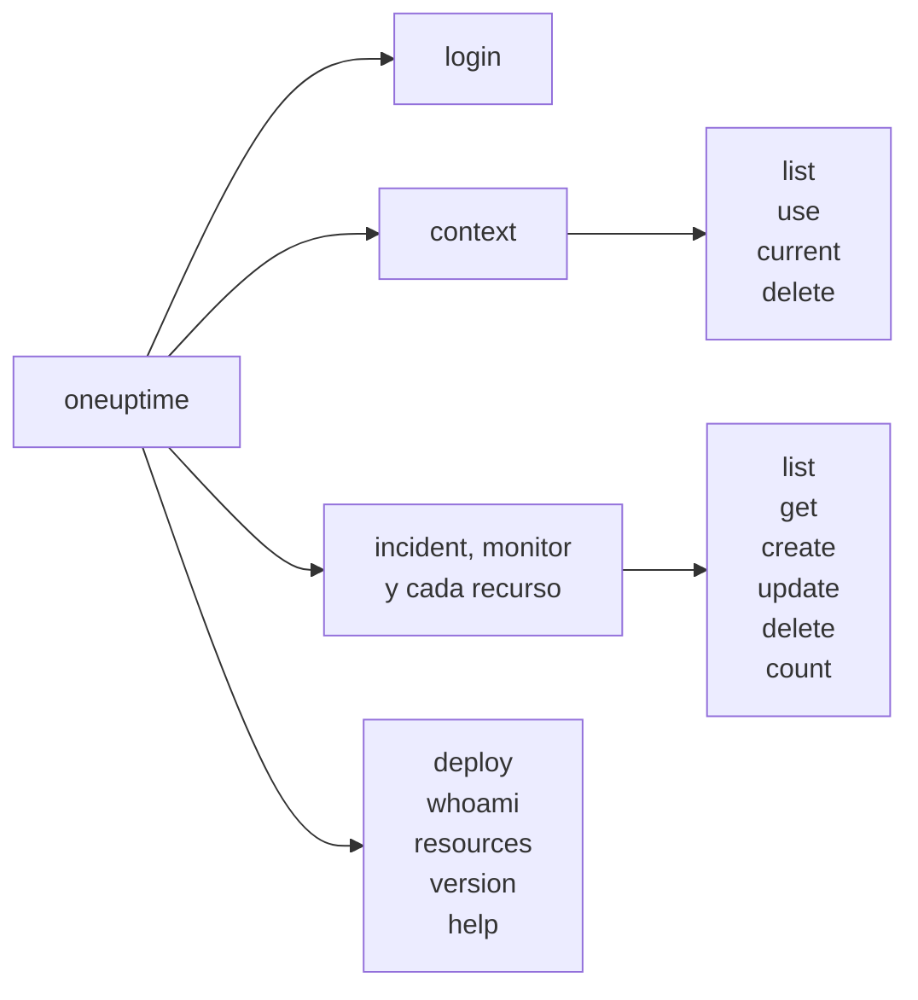

# Referencia de comandos

Cada comando de la CLI `oneuptime`, con sus argumentos, opciones y valores predeterminados. Añada `--help` a cualquier comando para ver lo mismo en su terminal.

:::cards
- [Opciones globales](#opciones-globales): Las opciones que admite cada comando.
- [Inicio de sesión y contextos](#inicio-de-sesión-y-contextos): login y los comandos context.
- [Comandos de recursos](#comandos-de-recursos): list, get, create, update, delete y count.
- [Otros comandos](#otros-comandos): deploy, whoami, resources, version y help.
:::

## Los comandos



## Opciones globales

| Opción | Qué hace | Predeterminado |
| --- | --- | --- |
| `--api-key <key>` | La clave de API para este comando | `ONEUPTIME_API_KEY`, luego la clave del contexto |
| `--url <url>` | La dirección de su OneUptime para este comando | `ONEUPTIME_URL`, luego la URL del contexto |
| `--context <name>` | El contexto guardado que usar para este comando | El contexto actual |
| `-o, --output <format>` | `json`, `table` o `wide` | `table` en una terminal, `json` en una tubería |
| `--no-color` | Imprime sin colores | Colores, salvo que `NO_COLOR` esté definida |
| `-V, --version` | Imprime la versión de la CLI | |
| `-h, --help` | Muestra la ayuda de un comando | |

Las opciones van antes o después del comando: `oneuptime --context staging incident list` y `oneuptime incident list --context staging` hacen lo mismo.

## Inicio de sesión y contextos

### `oneuptime login`

Guarda una clave de API y una dirección como contexto, y lo convierte en el actual. Consulte [Iniciar sesión](/docs/cli/authentication#iniciar-sesión).

```bash
oneuptime login <api-key> <instance-url> [--context-name <name>]
```

| Argumento u opción | Obligatorio | Qué es | Predeterminado |
| --- | --- | --- | --- |
| `<api-key>` | Sí | Una clave de API de su proyecto | |
| `<instance-url>` | Sí | La dirección de su OneUptime, como `https://oneuptime.com` | |
| `--context-name <name>` | No | El nombre con el que se guarda el contexto | `default` |

### `oneuptime context list`

Lista los contextos guardados; `*` marca el actual. Las claves de API nunca se listan.

```bash
oneuptime context list [-o <format>]
```

| Opción | Obligatorio | Qué es |
| --- | --- | --- |
| `-o, --output <format>` | No | `json`, `table` o `wide`. JSON da el `name`, `apiUrl` e `isCurrent` de cada contexto |

### `oneuptime context use`

Convierte un contexto guardado en el actual.

```bash
oneuptime context use <name>
```

| Argumento | Obligatorio | Qué es |
| --- | --- | --- |
| `<name>` | Sí | El nombre de un contexto guardado |

### `oneuptime context current`

Muestra el nombre y la URL del contexto actual, y su clave de API oculta salvo sus cuatro primeros y cuatro últimos caracteres.

```bash
oneuptime context current
```

### `oneuptime context delete`

Elimina un contexto guardado. Si era el actual, el primer contexto que queda pasa a ser el actual.

```bash
oneuptime context delete <name>
```

| Argumento | Obligatorio | Qué es |
| --- | --- | --- |
| `<name>` | Sí | El nombre de un contexto guardado |

## Comandos de recursos

`<resource>` es el comando de un tipo de registro, de las tablas de [Recursos](#recursos), como `incident` o `monitor`. Consulte [Operaciones de recursos](/docs/cli/resource-operations) para ver ejemplos.

### `oneuptime <resource> list`

Lista registros, los más recientes primero. Las etiquetas, en cambio, se listan por nombre, primero las numeradas (`2. Team` antes que `10. Owner`).

```bash
oneuptime <resource> list [--query <json>] [--limit <n>] [--skip <n>] [--sort <json>] [-o <format>]
```

| Opción | Qué hace | Predeterminado |
| --- | --- | --- |
| `--query <json>` | Un filtro, en JSON | Cada registro que la clave puede leer |
| `--limit <n>` | El máximo de registros que devolver, hasta 10.000 | `10` |
| `--skip <n>` | Cuántos registros saltar primero | `0` |
| `--sort <json>` | El orden, en JSON: `{"<field>":"ASC"}` o `{"<field>":"DESC"}` | Los más recientes primero |
| `-o, --output <format>` | `json`, `table` o `wide` | `table` en una terminal, `json` en una tubería |

### `oneuptime <resource> get`

Lee un registro. Solo registros: la telemetría no tiene `get`.

```bash
oneuptime <resource> get <id> [-o <format>]
```

| Argumento u opción | Obligatorio | Qué es |
| --- | --- | --- |
| `<id>` | Sí | El ID del registro, un UUID |
| `-o, --output <format>` | No | `json`, `table` o `wide` |

### `oneuptime <resource> create`

Crea un registro y lo imprime.

```bash
oneuptime <resource> create (--data <json> | --file <path>) [-o <format>]
```

| Opción | Obligatorio | Qué es |
| --- | --- | --- |
| `--data <json>` | Una de las dos | El registro, en JSON |
| `--file <path>` | Una de las dos | Un archivo JSON con el registro. Si se indica junto con `--data`, se usa el archivo |
| `-o, --output <format>` | No | `json`, `table` o `wide` |

### `oneuptime <resource> update`

Cambia los campos que indique. Solo registros: la telemetría no tiene `update`.

```bash
oneuptime <resource> update <id> --data <json> [-o <format>]
```

| Argumento u opción | Obligatorio | Qué es |
| --- | --- | --- |
| `<id>` | Sí | El ID del registro |
| `--data <json>` | Sí | Los campos que cambiar, en JSON |
| `-o, --output <format>` | No | `json`, `table` o `wide` |

### `oneuptime <resource> delete`

Elimina un registro de inmediato, sin preguntar. Solo registros: la telemetría no tiene `delete`.

```bash
oneuptime <resource> delete <id> [--force]
```

| Argumento u opción | Obligatorio | Qué es |
| --- | --- | --- |
| `<id>` | Sí | El ID del registro |
| `--force` | No | Se acepta y no cambia nada: `delete` nunca pide confirmación |

### `oneuptime <resource> count`

Cuenta registros e imprime el número.

```bash
oneuptime <resource> count [--query <json>] [-o <format>]
```

| Opción | Obligatorio | Qué es |
| --- | --- | --- |
| `--query <json>` | No | Un filtro, en JSON. Sin él, cada registro que la clave puede leer |
| `-o, --output <format>` | No | `json`, `table` o `wide` |

### Recursos

Los registros admiten `list`, `get`, `create`, `update`, `delete` y `count`:

| Área | Comandos |
| --- | --- |
| Monitorización | `monitor`, `monitor-status`, `monitor-status-event` |
| Incidentes | `incident`, `incident-state`, `incident-severity`, `incident-state-timeline`, `incident-public-note`, `incident-internal-note`, `incident-alert`, `postmortem-status` |
| Alertas | `alert`, `alert-state`, `alert-severity`, `alert-state-timeline`, `alert-internal-note` |
| Páginas de estado | `status-page`, `status-page-announcement` |
| Mantenimiento programado | `scheduled-maintenance-event`, `scheduled-maintenance-state`, `scheduled-maintenance-state-timeline` |
| Equipos y guardias | `team`, `on-call-policy` |
| Seguridad | `security-case`, `security-case-evidence`, `security-case-note`, `security-case-priority`, `security-case-status`, `security-case-task`, `security-detection`, `security-playbook` |
| Etiquetas | `label` |

La telemetría admite `list`, `create` y `count`:

| Área | Comandos |
| --- | --- |
| Observabilidad | `log`, `metric`, `span`, `exception-instance`, `monitor-log` |
| Seguridad | `security-event`, `threat-intel-indicator` |
| Cambios y costes | `change-event`, `kubernetes-cost-allocation` |

La CLI se publica junto con OneUptime, así que `oneuptime resources` lista los comandos de la versión que instaló.

### Solicitudes a la API

Cada operación es una solicitud a la API, con la clave en la cabecera `APIKey`. `<path>` es la ruta de API del recurso, que da `oneuptime resources`: `/incident` para `incident`, `/on-call-duty-policy` para `on-call-policy`.

| Operación | Solicitud | Cuerpo |
| --- | --- | --- |
| `list` | `POST /api/<path>/get-list` | `query`, `select`, `skip`, `limit` y `sort` |
| `get` | `POST /api/<path>/<id>/get-item` | `select` |
| `create` | `POST /api/<path>` | `{"data": ...}` |
| `update` | `PUT /api/<path>/<id>/` | `{"data": ...}` |
| `delete` | `DELETE /api/<path>/<id>/` | Ninguno |
| `count` | `POST /api/<path>/count` | `query` |

## Otros comandos

### `oneuptime deploy`

Registra un despliegue, u otro cambio, desde un pipeline: se dibuja en los gráficos del servicio y OneUptime AI lo lee cuando investiga un incidente. Escribe con una clave de ingesta de telemetría, no con una clave de API. Consulte [Despliegues y cambios](/docs/telemetry/change-events).

```bash
oneuptime deploy [--service <name>] [--service-version <version>] [--previous-version <version>] [--commit <sha>] [--repository <url>] [--branch <name>] [--pull-request <number>] [--environment <name>] [--title <title>] [--description <text>] [--type <type>] [--time <time>] [--attribute <key=value...>] [--ingestion-key <key>]
```

| Opción | Obligatorio | Qué es | Predeterminado |
| --- | --- | --- | --- |
| `--service <name>` | No | El servicio que se desplegó | Un cambio de todo el proyecto |
| `--service-version <version>` | No | La versión desplegada | |
| `--previous-version <version>` | No | La versión a la que sustituyó | |
| `--commit <sha>` | No | El commit desplegado | |
| `--repository <url>` | No | El repositorio en el que está el commit | |
| `--branch <name>` | No | La rama desplegada | |
| `--pull-request <number>` | No | El pull request desplegado | |
| `--environment <name>` | No | El entorno en el que se desplegó | |
| `--title <title>` | No | El título del cambio; un tipo distinto de un despliegue lo necesita | `Deploy <version>` |
| `--description <text>` | No | Los detalles del cambio | |
| `--type <type>` | No | El tipo de cambio, como `config-change` o `rollback` | `deployment` |
| `--time <time>` | No | Cuándo ocurrió, como `2026-10-19T10:00:00Z` | Ahora |
| `--attribute <key=value...>` | No | Más atributos, como `key=value`, uno o varios | |
| `--ingestion-key <key>` | No | Una clave de ingesta de telemetría del proyecto | `ONEUPTIME_TELEMETRY_INGESTION_KEY` |

### `oneuptime whoami`

Muestra la URL y la clave de API que usará el siguiente comando, con la clave enmascarada, y el contexto del que proceden. No llama a OneUptime. Consulte [Comprobar qué usará la CLI](/docs/cli/authentication#comprobar-qué-usará-la-cli).

```bash
oneuptime whoami
```

### `oneuptime resources`

Lista cada tipo de registro para el que la CLI tiene un comando: su comando, sus nombres en singular y en plural, su tipo y su ruta de API, y el total.

```bash
oneuptime resources [--type <type>] [-o <format>]
```

| Opción | Obligatorio | Qué es | Predeterminado |
| --- | --- | --- | --- |
| `--type <type>` | No | `database` para registros, `analytics` para telemetría | Ambos |
| `-o, --output <format>` | No | `json`, `table` o `wide`. JSON da el `name`, `singularName`, `pluralName`, `modelType` y `apiPath` de cada uno | `table` en una terminal, `json` en una tubería |

### `oneuptime version`

Imprime la versión de la CLI, como hace `oneuptime --version`.

```bash
oneuptime version
```

### `oneuptime help`

Muestra la ayuda de la CLI, o la de un comando.

```bash
oneuptime help [command]
```

## Variables de entorno

| Variable | Qué hace |
| --- | --- |
| `ONEUPTIME_API_KEY` | La clave de API, cuando ninguna opción `--api-key` da una |
| `ONEUPTIME_URL` | La dirección de su OneUptime, cuando ninguna opción `--url` da una |
| `ONEUPTIME_TELEMETRY_INGESTION_KEY` | La clave de ingesta de telemetría con la que escribe `oneuptime deploy`, cuando ninguna opción `--ingestion-key` da una |
| `NO_COLOR` | Definida con cualquier valor, desactiva los colores |

## Archivos

| Archivo | Qué contiene |
| --- | --- |
| `~/.oneuptime/config.json` | Los contextos guardados, sus claves de API y el contexto actual |

## Códigos de salida

| Código | Significado |
| --- | --- |
| `0` | Funcionó |
| `1` | Falló: OneUptime rechazó la solicitud, o el comando era incorrecto |
| `2` | Ninguna clave de API utilizable: no se encontró ninguna, no es válida o está por debajo de su plan |
| `3` | No encontrado: OneUptime respondió `404` |

Consulte [Códigos de salida](/docs/cli/scripting#códigos-de-salida) para ver ejemplos.

## Próximos pasos

:::cards
- [Visión general de la CLI](/docs/cli/index): Instalar la CLI y ejecutar sus primeros comandos.
- [Operaciones de recursos](/docs/cli/resource-operations): Ejemplos de cada operación.
- [Scripts y CI/CD](/docs/cli/scripting): La CLI en scripts y pipelines.
:::
