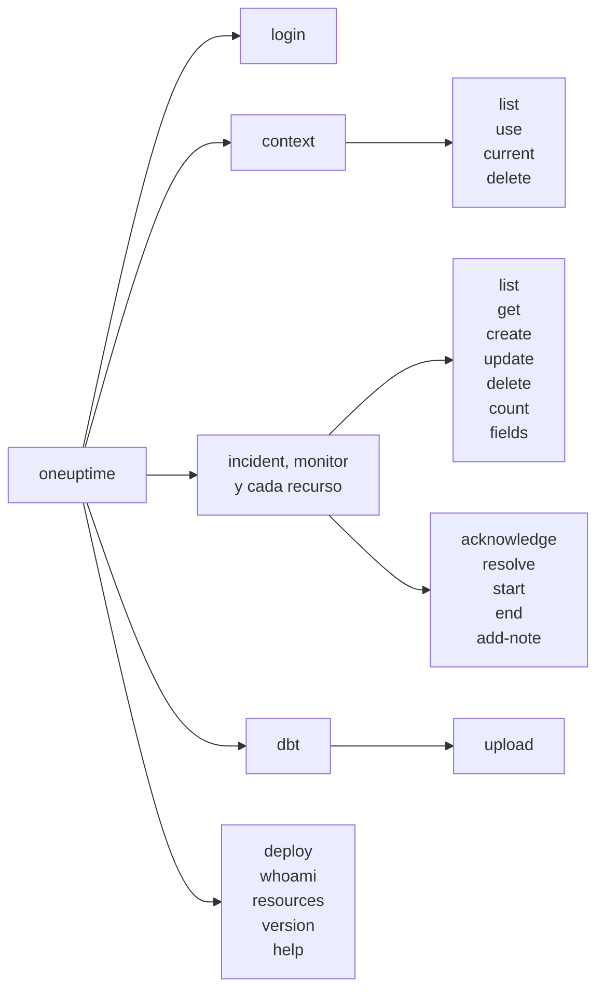

# Referencia de comandos

Cada comando de la CLI `oneuptime`, con sus argumentos, opciones y valores predeterminados. Añada `--help` a cualquier comando para ver lo mismo en su terminal.

:::cards
- [Opciones globales](#opciones-globales): Las opciones que admite cada comando.
- [Inicio de sesión y contextos](#inicio-de-sesión-y-contextos): login y los comandos context.
- [Comandos de recursos](#comandos-de-recursos): Las operaciones, los campos y las acciones de cada recurso.
- [Otros comandos](#otros-comandos): deploy, dbt upload, data-checks apply, whoami, resources, version y help.
:::

## Los comandos



## Opciones globales

| Opción | Qué hace | Predeterminado |
| --- | --- | --- |
| `--api-key <key>` | La clave de API para este comando | `ONEUPTIME_API_KEY`, luego la clave del contexto |
| `--url <url>` | La dirección de su OneUptime para este comando | `ONEUPTIME_URL`, luego la URL del contexto |
| `--context <name>` | El contexto guardado que usar para este comando | El contexto actual |
| `-o, --output <format>` | `json`, `table` o `wide` | `table` en una terminal, `json` en una tubería |
| `--json` | Lo mismo que `-o json` | |
| `--no-color` | Imprime sin colores | Colores, salvo que `NO_COLOR` esté definida |
| `-V, --version` | Imprime la versión de la CLI | |
| `-h, --help` | Muestra la ayuda de un comando | |

Las opciones van antes o después del comando: `oneuptime --context staging incident list` y `oneuptime incident list --context staging` hacen lo mismo.

Cada comando admite `-o` y `--json`, así que las tablas de abajo los omiten. Un comando cuya respuesta es una frase, como `delete`, imprime la frase salvo que `-o json` o `--json` pida JSON: consulte [Formatos de salida](/docs/cli/output-formats#json).

## Inicio de sesión y contextos

### `oneuptime login`

Guarda una clave de API y una dirección como contexto, y lo convierte en el actual. Consulte [Iniciar sesión](/docs/cli/authentication#iniciar-sesión).

```bash
oneuptime login <api-key> <instance-url> [--context-name <name>]
```

| Argumento u opción | Obligatorio | Qué es | Predeterminado |
| --- | --- | --- | --- |
| `<api-key>` | Sí | Una clave de API de su proyecto | |
| `<instance-url>` | Sí | La dirección de su OneUptime, como `https://oneuptime.com` | |
| `--context-name <name>` | No | El nombre con el que se guarda el contexto | `default` |

### `oneuptime context list`

Lista los contextos guardados; `*` marca el actual. Las claves de API nunca se listan: JSON da de cada contexto `name`, `apiUrl` e `isCurrent`.

```bash
oneuptime context list
```

### `oneuptime context use`

Convierte un contexto guardado en el actual.

```bash
oneuptime context use <name>
```

| Argumento | Obligatorio | Qué es |
| --- | --- | --- |
| `<name>` | Sí | El nombre de un contexto guardado |

### `oneuptime context current`

Muestra el nombre y la URL del contexto actual, y su clave de API oculta salvo sus cuatro primeros y cuatro últimos caracteres.

```bash
oneuptime context current
```

### `oneuptime context delete`

Elimina un contexto guardado. Si era el actual, el primer contexto que queda pasa a ser el actual.

```bash
oneuptime context delete <name>
```

| Argumento | Obligatorio | Qué es |
| --- | --- | --- |
| `<name>` | Sí | El nombre de un contexto guardado |

## Comandos de recursos

`<resource>` es el comando de un tipo de registro, de la tabla de [Recursos](#recursos), como `incident` o `monitor`. Un recurso tiene las operaciones que la API admite para él, la mayoría las seis, y `oneuptime <resource> --help` lista las suyas. Consulte [Operaciones de recursos](/docs/cli/resource-operations) para ver ejemplos.

### `oneuptime <resource> list`

Lista registros, los más recientes primero. Las etiquetas, en cambio, se listan por nombre, primero las numeradas (`2. Team` antes que `10. Owner`).

```bash
oneuptime <resource> list [--query <json>] [--limit <n>] [--skip <n>] [--sort <json>] [--fields <names>] [--all]
```

| Opción | Qué hace | Predeterminado |
| --- | --- | --- |
| `--query <json>` | Un filtro, en JSON | Cada registro que la clave puede leer |
| `--limit <n>` | El máximo de registros que devolver, hasta 10.000 | `10` |
| `--skip <n>` | Cuántos registros saltar primero | `0` |
| `--sort <json>` | El orden, en JSON: `{"<field>":"ASC"}` o `{"<field>":"DESC"}` | Los más recientes primero |
| `--fields <names>` | Los campos que devolver, separados por comas; un campo de un registro relacionado tras un punto, como en `currentIncidentState.name` | Cada campo que la clave puede leer |
| `--all` | Cada registro que coincide, 100 cada vez, hasta 100.000, en lugar de `--limit` y `--skip`. Solo registros: la telemetría no tiene `--all` | |

### `oneuptime <resource> get`

Lee un registro.

```bash
oneuptime <resource> get <id> [--fields <names>]
```

| Argumento u opción | Obligatorio | Qué es |
| --- | --- | --- |
| `<id>` | Sí | El ID del registro, un UUID |
| `--fields <names>` | No | Los campos que devolver, separados por comas. Predeterminado: cada campo que la clave puede leer |

### `oneuptime <resource> create`

Crea un registro y lo imprime.

```bash
oneuptime <resource> create [--<field> <value>]... [--data <json>] [--file <path>]
```

| Opción | Obligatorio | Qué es |
| --- | --- | --- |
| `--<field> <value>` | Los campos que una creación debe indicar | El valor de un campo: `--title <text>`, `--incident-severity-id <id>`, `--labels <ids>`. `oneuptime <resource> create --help` los lista. Solo registros |
| `--data <json>` | No | El registro, como JSON |
| `--file <path>` | No | Un archivo JSON con el registro. Si se indica junto con `--data`, se usa el archivo |

Las opciones se aplican encima de `--data` o `--file`. Un campo que nombra a una persona por su ID de usuario también tiene una opción que la nombra por su dirección de correo: `--user-email` junto a `--user-id`.

### `oneuptime <resource> update`

Cambia los campos que indica.

```bash
oneuptime <resource> update <id> [--<field> <value>]... [--data <json>] [--file <path>]
```

| Argumento u opción | Obligatorio | Qué es |
| --- | --- | --- |
| `<id>` | Sí | El ID del registro |
| `--<field> <value>` | No | Un campo que cambiar: `oneuptime <resource> update --help` los lista. Solo registros |
| `--data <json>` | No | Los campos que cambiar, como JSON |
| `--file <path>` | No | Un archivo JSON con los campos que cambiar. Si se indica junto con `--data`, se usa el archivo |

### `oneuptime <resource> delete`

Elimina un registro de inmediato, sin preguntar.

```bash
oneuptime <resource> delete <id> [--force]
```

| Argumento u opción | Obligatorio | Qué es |
| --- | --- | --- |
| `<id>` | Sí | El ID del registro |
| `--force` | No | Se acepta y no cambia nada: `delete` nunca pide confirmación |

### `oneuptime <resource> count`

Cuenta registros e imprime el número.

```bash
oneuptime <resource> count [--query <json>]
```

| Opción | Obligatorio | Qué es |
| --- | --- | --- |
| `--query <json>` | No | Un filtro, en JSON. Sin él, cada registro que la clave puede leer |

### `oneuptime <resource> fields`

Lista los campos del recurso: para qué sirve cada uno, su tipo, si una creación debe indicarlo y la opción que lo define. Los lee de la propia CLI, sin clave de API y sin solicitud.

```bash
oneuptime <resource> fields
```

### `oneuptime <resource> acknowledge`

Pasa un incidente, una alerta o un episodio de cualquiera de ellos al estado de reconocido de su proyecto, como hace el botón del panel. Un registro ya reconocido, o más allá, se deja tal cual.

```bash
oneuptime <resource> acknowledge <id>
```

| Argumento | Obligatorio | Qué es |
| --- | --- | --- |
| `<id>` | Sí | El ID del registro |

### `oneuptime <resource> resolve`

Pasa un incidente, una alerta o un episodio de cualquiera de ellos al estado de resuelto de su proyecto.

```bash
oneuptime <resource> resolve <id>
```

| Argumento | Obligatorio | Qué es |
| --- | --- | --- |
| `<id>` | Sí | El ID del registro |

### `oneuptime <resource> start`

Pasa un evento de mantenimiento al estado en curso de su proyecto.

```bash
oneuptime <resource> start <id>
```

| Argumento | Obligatorio | Qué es |
| --- | --- | --- |
| `<id>` | Sí | El ID del evento |

### `oneuptime <resource> end`

Pasa un evento de mantenimiento al estado de finalizado de su proyecto.

```bash
oneuptime <resource> end <id>
```

| Argumento | Obligatorio | Qué es |
| --- | --- | --- |
| `<id>` | Sí | El ID del evento |

### `oneuptime <resource> add-note`

Añade una nota a un incidente, una alerta, un episodio de cualquiera de ellos o un evento de mantenimiento.

```bash
oneuptime <resource> add-note <id> --note <markdown> [--public]
```

| Argumento u opción | Obligatorio | Qué es |
| --- | --- | --- |
| `<id>` | Sí | El ID del registro |
| `--note <markdown>` | Sí | La nota, en Markdown |
| `--public` | No | La publica en las páginas de estado del registro, donde se avisa a sus suscriptores. Solo incidentes, sus episodios y mantenimientos programados |

### Recursos

Cada recurso de la API de OneUptime es un comando, con las operaciones que la API admite para él, `fields` y las acciones de los registros que las tienen:

{{CLI_RESOURCE_COMMANDS}}

La CLI se publica junto con OneUptime, así que `oneuptime resources` lista los comandos de la versión que instaló.

### Solicitudes a la API

Cada operación es una solicitud a la API, con la clave en la cabecera `APIKey`. `<path>` es la ruta de API del recurso, que da `oneuptime resources`: `/incident` para `incident`, `/on-call-duty-policy` para `on-call-policy`.

| Operación | Solicitud | Cuerpo |
| --- | --- | --- |
| `list` | `POST /api/<path>/get-list` | `query`, `select`, `skip`, `limit` y `sort` |
| `get` | `POST /api/<path>/<id>/get-item` | `select` |
| `create` | `POST /api/<path>` | `{"data": ...}` |
| `update` | `PUT /api/<path>/<id>/` | `{"data": ...}` |
| `delete` | `DELETE /api/<path>/<id>/` | Ninguno |
| `count` | `POST /api/<path>/count` | `query` |

Una acción lee los estados de su proyecto y el registro, y luego crea una fila en la línea de tiempo de estados del registro, como hace el botón del panel: `acknowledge` en un incidente crea un `incident-state-timeline`. `add-note` crea un `incident-internal-note`, o con `--public` un `incident-public-note`. Una opción de correo lista primero los miembros de equipo del proyecto con esa dirección. Cuando OneUptime rechaza un campo que la clave no puede leer, una lista o una lectura vuelve a pedir sin él.

## Otros comandos

### `oneuptime deploy`

Registra un despliegue, u otro cambio, desde un pipeline: se dibuja en los gráficos del servicio y OneUptime AI lo lee cuando investiga un incidente. Escribe con una clave de ingesta de telemetría, no con una clave de API. Consulte [Despliegues y cambios](/docs/telemetry/change-events).

```bash
oneuptime deploy [--service <name>] [--service-version <version>] [--previous-version <version>] [--commit <sha>] [--repository <url>] [--branch <name>] [--pull-request <number>] [--environment <name>] [--title <title>] [--description <text>] [--type <type>] [--time <time>] [--attribute <key=value...>] [--ingestion-key <key>]
```

| Opción | Obligatorio | Qué es | Predeterminado |
| --- | --- | --- | --- |
| `--service <name>` | No | El servicio que se desplegó | Un cambio de todo el proyecto |
| `--service-version <version>` | No | La versión desplegada | |
| `--previous-version <version>` | No | La versión a la que sustituyó | |
| `--commit <sha>` | No | El commit desplegado | |
| `--repository <url>` | No | El repositorio en el que está el commit | |
| `--branch <name>` | No | La rama desplegada | |
| `--pull-request <number>` | No | El pull request desplegado | |
| `--environment <name>` | No | El entorno en el que se desplegó | |
| `--title <title>` | No | El título del cambio; un tipo distinto de un despliegue lo necesita | `Deploy <version>` |
| `--description <text>` | No | Los detalles del cambio | |
| `--type <type>` | No | El tipo de cambio, como `config-change` o `rollback` | `deployment` |
| `--time <time>` | No | Cuándo ocurrió, como `2026-10-19T10:00:00Z` | Ahora |
| `--attribute <key=value...>` | No | Más atributos, como `key=value`, uno o varios | |
| `--ingestion-key <key>` | No | Una clave de ingesta de telemetría del proyecto | `ONEUPTIME_TELEMETRY_INGESTION_KEY` |

### `oneuptime dbt upload`

Envía los artefactos de un proyecto de dbt después de una compilación, desde la CI o un trabajo de dbt Cloud, a Observabilidad de datos. Sus modelos aparecen en las tablas que construyen, con su linaje, sus pruebas aparecen junto a las comprobaciones de OneUptime y pueden generar alertas, y cada compilación es una ejecución de la canalización del proyecto. Lee `manifest.json` y `run_results.json` de la carpeta de destino de dbt, envía solo lo que Observabilidad de datos lee de ellos y escribe con una clave de ingesta de telemetría, no con una clave de API. La página Documentación de Observabilidad de datos, en su panel, lo muestra en un trabajo de CI.

```bash
oneuptime dbt upload [--target-path <dir>] [--manifest <file>] [--run-results <file>] [--project <name>] [--ingestion-key <key>]
```

| Opción | Obligatorio | Qué es | Predeterminado |
| --- | --- | --- | --- |
| `--target-path <dir>` | No | La carpeta en la que dbt escribió sus artefactos | `target` |
| `--manifest <file>` | No | El manifiesto que se envía | `manifest.json` en la carpeta de destino |
| `--run-results <file>` | No | Los resultados de ejecución que se envían | `run_results.json` en la carpeta de destino |
| `--project <name>` | No | El nombre del proyecto de dbt, necesario solo cuando no se envía ningún manifiesto | El proyecto del manifiesto |
| `--ingestion-key <key>` | No | Una clave de ingesta de telemetría del proyecto | `ONEUPTIME_TELEMETRY_INGESTION_KEY` |

### `oneuptime data-checks apply`

Hace que las comprobaciones de datos del proyecto coincidan con un archivo YAML, de modo que se guardan en un repositorio y se revisan como código. Un error en cualquier parte del archivo no aplica nada y termina con un error. El formato del archivo está en [Comprobaciones y conciliaciones](/docs/data-observability/checks).

```bash
oneuptime data-checks apply <file> [--dry-run] [--prune]
```

| Opción | Obligatorio | Qué es | Predeterminado |
| --- | --- | --- | --- |
| `--dry-run` | No | Indica qué cambiaría, y no cambia nada | Desactivado |
| `--prune` | No | Elimina las comprobaciones que creó una aplicación anterior y que el archivo ya no nombra | Desactivado |

### `oneuptime whoami`

Muestra la URL y la clave de API que usará el siguiente comando, con la clave enmascarada, y el contexto del que vienen. Sin `--check`, no llama a OneUptime. Consulte [Comprobar qué usará la CLI](/docs/cli/authentication#comprobar-qué-usará-la-cli).

```bash
oneuptime whoami [--check]
```

| Opción | Obligatorio | Qué es |
| --- | --- | --- |
| `--check` | No | Pregunta a OneUptime si acepta la clave, y muestra el proyecto de la clave, la versión de su OneUptime y la de la CLI |

### `oneuptime resources`

Lista cada tipo de registro para el que la CLI tiene un comando: su comando, sus nombres en singular y plural, su tipo y su ruta de API, y el total. JSON da de cada uno `name`, `singularName`, `pluralName`, `modelType`, `apiPath`, `operations` y `actions`.

```bash
oneuptime resources [--type <type>]
```

| Opción | Obligatorio | Qué es | Predeterminado |
| --- | --- | --- | --- |
| `--type <type>` | No | `database` para registros, `analytics` para telemetría | Ambos |

### `oneuptime version`

Imprime la versión de la CLI, como hace `oneuptime --version`.

```bash
oneuptime version
```

### `oneuptime help`

Muestra la ayuda de la CLI, o la de un comando.

```bash
oneuptime help [command]
```

## Variables de entorno

| Variable | Qué hace |
| --- | --- |
| `ONEUPTIME_API_KEY` | La clave de API, cuando ninguna opción `--api-key` da una |
| `ONEUPTIME_URL` | La dirección de su OneUptime, cuando ninguna opción `--url` da una |
| `ONEUPTIME_TELEMETRY_INGESTION_KEY` | La clave de ingesta de telemetría con la que escribe `oneuptime deploy`, cuando ninguna opción `--ingestion-key` da una |
| `NO_COLOR` | Definida con cualquier valor, desactiva los colores |

## Archivos

| Archivo | Qué contiene |
| --- | --- |
| `~/.oneuptime/config.json` | Los contextos guardados, sus claves de API y el contexto actual |

## Códigos de salida

| Código | Significado |
| --- | --- |
| `0` | Funcionó |
| `1` | Falló: OneUptime rechazó la solicitud, o el comando era incorrecto |
| `2` | Ninguna clave de API utilizable: no se encontró ninguna, no es válida o está por debajo de su plan |
| `3` | No encontrado: OneUptime respondió `404` |

Consulte [Códigos de salida](/docs/cli/scripting#códigos-de-salida) para ver ejemplos.

## Próximos pasos

:::cards
- [Visión general de la CLI](/docs/cli/index): Instalar la CLI y ejecutar sus primeros comandos.
- [Operaciones de recursos](/docs/cli/resource-operations): Ejemplos de cada operación.
- [Scripts y CI/CD](/docs/cli/scripting): La CLI en scripts y pipelines.
:::
