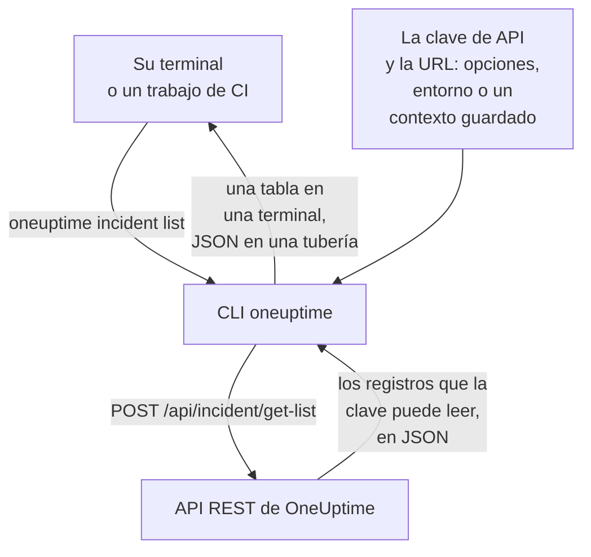

# Visión general de la CLI

La CLI de OneUptime, `oneuptime`, gestiona su proyecto de OneUptime desde una terminal o un script. Lista, lee, crea, cambia, elimina y cuenta monitores, incidentes, alertas, páginas de estado y los demás registros que ofrece la API de OneUptime, con una clave de API de su proyecto.

:::cards
- [Cómo funciona la CLI](#cómo-funciona-la-cli): Un comando, una solicitud a la API, una respuesta.
- [Instalar la CLI](#instalar-la-cli): Un comando de npm, y la versión que elegir.
- [Ejecutar sus primeros comandos](#ejecutar-sus-primeros-comandos): Guarde su clave de API y luego liste sus incidentes.
- [Los comandos de un vistazo](#los-comandos-de-un-vistazo): Cada comando, y la página que lo explica.
:::

## Cómo funciona la CLI

Cada comando envía una solicitud a la API REST de OneUptime e imprime la respuesta. La CLI toma la clave de API y la dirección de su OneUptime de opciones, variables de entorno o un contexto que guardó `oneuptime login`. La clave decide qué puede leer y cambiar un comando, exactamente igual que en la API.



Los comandos de los registros vienen con la CLI: cada tipo de registro que la API de OneUptime abre a las herramientas tiene uno, los mismos registros para los que el [servidor MCP](/docs/ai/mcp-server) tiene herramientas. Ejecute `oneuptime resources` para listarlos.

## Antes de empezar

- **Node.js y npm**, en una versión LTS actual, para instalar la CLI.
- **Una clave de API de su proyecto.** Cree una en **Ajustes del proyecto → Avanzado → Claves de API** con **Crear Clave de API**: consulte [Crear una clave de API](/docs/api-reference/api-reference#crear-una-clave-de-api).
- **En OneUptime Cloud, el plan Growth o superior.** Las claves de API de un proyecto solo funcionan con él: consulte [Claves de API y SCIM por debajo de su plan](/docs/api-reference/api-reference#claves-de-api-y-scim-por-debajo-de-su-plan).

## Instalar la CLI

Instale el paquete `@oneuptime/cli` desde npm. Añade el comando `oneuptime`, y `--version` imprime la versión que instaló:

```bash
npm install -g @oneuptime/cli
oneuptime --version
```

La CLI se publica junto con OneUptime y tiene el mismo número de versión. En un OneUptime autoalojado, instale la CLI de la versión de su OneUptime, para que sus comandos coincidan con los registros que tiene su servidor:

```bash
npm install -g @oneuptime/cli@<your-oneuptime-version>
```

> [!WARNING]
> Las versiones de la CLI anteriores a la 14.0.64 se detienen en cuanto arrancan, con un error como `Cannot find module 'Common/Models/DatabaseModels/Index'`. Instale la 14.0.64 o una posterior con `npm install -g @oneuptime/cli@latest`. En un OneUptime autoalojado anterior a la 14.0.64, [actualice primero OneUptime](/docs/installation/upgrading#cómo-actualizar) y después instale la CLI de la versión a la que actualizó.

## Ejecutar sus primeros comandos

:::steps
### Guardar su clave de API

Inicie sesión con la clave y la dirección de su OneUptime. La CLI las guarda como un contexto llamado `default` y lo usa a partir de ahora:

```bash
oneuptime login <your-api-key> https://oneuptime.com
```

Responde `Logged in successfully. Context "default" is now active.` En un OneUptime autoalojado, use su dirección en lugar de `https://oneuptime.com`.

### Listar sus incidentes

```bash
oneuptime incident list
```

Los diez incidentes más recientes aparecen como una tabla. `login` guarda la clave sin comprobarla, así que este es el primer comando que muestra que la clave funciona: si se rechaza, consulte [Solución de problemas](/docs/cli/authentication#solución-de-problemas).

### Ver qué más puede gestionar

```bash
oneuptime resources
```

La lista muestra cada tipo de registro con el que puede trabajar, y su comando, como `monitor`, `status-page` u `on-call-policy`.
:::

## Los comandos de un vistazo

| Comando | Qué hace | Más información |
| --- | --- | --- |
| `oneuptime login <api-key> <instance-url>` | Guarda una clave de API y una dirección como contexto | [Autenticación](/docs/cli/authentication#iniciar-sesión) |
| `oneuptime context list`, `use`, `current`, `delete` | Lista, cambia, muestra y elimina contextos guardados | [Autenticación](/docs/cli/authentication#contextos) |
| `oneuptime whoami` | Muestra la URL y la clave de API que usará el siguiente comando | [Autenticación](/docs/cli/authentication#comprobar-qué-usará-la-cli) |
| `oneuptime deploy` | Registra un despliegue, u otro cambio, para los gráficos y OneUptime AI | [Despliegues y cambios](/docs/telemetry/change-events) |
| `oneuptime <resource> list`, `get`, `create`, `update`, `delete`, `count` | Trabaja con un tipo de registro | [Operaciones de recursos](/docs/cli/resource-operations) |
| `oneuptime resources` | Lista los tipos de registro, con sus comandos | [Referencia de comandos](/docs/cli/command-reference#oneuptime-resources) |
| `oneuptime version` | Imprime la versión de la CLI | [Referencia de comandos](/docs/cli/command-reference#oneuptime-version) |
| `oneuptime help [command]` | Muestra la ayuda de un comando | [Obtener ayuda](#obtener-ayuda) |

## Opciones globales

Estas opciones funcionan con cada comando, antes o después de él:

| Opción | Qué hace |
| --- | --- |
| `--api-key <key>` | La clave de API para este comando, en lugar de la guardada |
| `--url <url>` | La dirección de su OneUptime para este comando |
| `--context <name>` | Un contexto guardado para este comando, en lugar del actual |
| `-o, --output <format>` | `table`, `json` o `wide`: consulte [Formatos de salida](/docs/cli/output-formats) |
| `--no-color` | Imprime sin colores |
| `-V, --version` | Imprime la versión de la CLI |
| `-h, --help` | Muestra la ayuda del comando |

## Obtener ayuda

Cada comando tiene su propia ayuda, con sus argumentos, opciones y valores predeterminados:

```bash
oneuptime --help
oneuptime help incident
oneuptime incident list --help
```

## Próximos pasos

:::cards
- [Autenticación](/docs/cli/authentication): Contextos para cada entorno, y qué clave usa un comando.
- [Operaciones de recursos](/docs/cli/resource-operations): Listar, leer, crear, cambiar, eliminar y contar registros.
- [Formatos de salida](/docs/cli/output-formats): Tablas para las personas, JSON para los scripts.
- [Scripts y CI/CD](/docs/cli/scripting): Códigos de salida, jq y pipelines.
- [Referencia de comandos](/docs/cli/command-reference): Cada comando, opción y valor predeterminado.
:::
