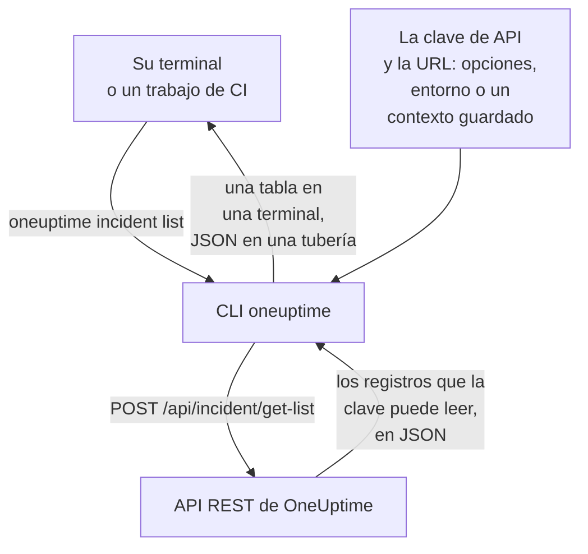

# Visión general de la CLI

La CLI de OneUptime, `oneuptime`, gestiona su proyecto de OneUptime desde una terminal o un script. Lista, lee, crea, cambia, elimina y cuenta monitores, incidentes, alertas, páginas de estado y los demás registros que ofrece la API de OneUptime, con una clave de API de su proyecto.

:::cards
- [Cómo funciona la CLI](#cómo-funciona-la-cli): Un comando, las solicitudes a la API que envía y su respuesta.
- [Instalar la CLI](#instalar-la-cli): El instalador que sirve su OneUptime, o npm.
- [Ejecutar sus primeros comandos](#ejecutar-sus-primeros-comandos): Guarde su clave de API, compruébela y luego liste sus incidentes.
- [Los comandos de un vistazo](#los-comandos-de-un-vistazo): Cada comando, y la página que lo explica.
:::

## Cómo funciona la CLI

La mayoría de los comandos envían una solicitud a la API REST de OneUptime e imprimen la respuesta; una acción, como `acknowledge`, envía las pocas que envía el botón del panel. La CLI toma la clave de API y la dirección de su OneUptime de opciones, variables de entorno o un contexto que guardó `oneuptime login`. La clave decide qué puede leer y cambiar un comando, exactamente igual que en la API.



Cada recurso de la API de OneUptime es un comando, 450 y más, desde `incident` y `monitor` hasta `status-page-subscriber` y `telemetry-ingestion-key`, cada uno con las operaciones que la API admite para él. La CLI se publica junto con OneUptime, así que la CLI de la versión de su OneUptime tiene un comando para cada recurso que tiene su servidor. Ejecute `oneuptime resources` para listarlos.

## Antes de empezar

- **Node.js y npm**, en una versión LTS actual, para instalar la CLI.
- **Una clave de API de su proyecto.** Cree una en **Ajustes del proyecto → Avanzado → Claves de API** con **Crear Clave de API**: consulte [Crear una clave de API](/docs/api-reference/api-reference#crear-una-clave-de-api).
- **En OneUptime Cloud, el plan Growth o superior.** Las claves de API de un proyecto solo funcionan con él: consulte [Claves de API y SCIM por debajo de su plan](/docs/api-reference/api-reference#claves-de-api-y-scim-por-debajo-de-su-plan).

## Instalar la CLI

Cada OneUptime sirve el script de instalación de la CLI de su propia versión: los comandos de abajo lo descargan desde `https://oneuptime.com`, así que en un OneUptime autoalojado sustitúyala por su URL. El script se guarda primero como `install.sh`, para que pueda leerlo antes de ejecutarlo. Pregunta a su OneUptime su versión e instala la CLI de la misma versión con npm:

```bash
curl -fsSL https://oneuptime.com/install/cli -o install.sh
ONEUPTIME_URL=https://oneuptime.com bash install.sh
```

O instale usted mismo el paquete `@oneuptime/cli` desde npm. Añade el comando `oneuptime`, y `--version` imprime la versión que instaló:

```bash
npm install -g @oneuptime/cli
oneuptime --version
```

La CLI se publica junto con OneUptime y tiene el mismo número de versión. En un OneUptime autoalojado, instale la CLI de la versión de su OneUptime, para que sus comandos coincidan con los registros que tiene su servidor:

```bash
npm install -g @oneuptime/cli@<your-oneuptime-version>
```

> [!WARNING]
> Las versiones de la CLI anteriores a la 14.0.64 se detienen en cuanto arrancan, con un error como `Cannot find module 'Common/Models/DatabaseModels/Index'`. Instale la 14.0.64 o una posterior con `npm install -g @oneuptime/cli@latest`. En un OneUptime autoalojado anterior a la 14.0.64, [actualice primero OneUptime](/docs/installation/upgrading#cómo-actualizar) y después instale la CLI de la versión a la que actualizó.

## Ejecutar sus primeros comandos

:::steps
### Guardar su clave de API

Inicie sesión con la clave y la dirección de su OneUptime. La CLI las guarda como un contexto llamado `default` y lo usa a partir de ahora:

```bash
oneuptime login <your-api-key> https://oneuptime.com
```

Responde `Logged in successfully. Context "default" is now active.` En un OneUptime autoalojado, use su dirección en lugar de `https://oneuptime.com`.

### Comprobar la clave

```bash
oneuptime whoami --check
```

`login` guarda la clave sin consultarla con OneUptime. `--check` sí la consulta: muestra el proyecto de la clave, la versión de su OneUptime y la de la CLI, y qué instalar cuando las dos difieren. Si OneUptime rechaza la clave, consulte [Solución de problemas](/docs/cli/authentication#solución-de-problemas).

### Listar sus incidentes

```bash
oneuptime incident list
```

Los diez incidentes más recientes aparecen como una tabla.

### Ver qué más puede gestionar

```bash
oneuptime resources
```

La lista muestra cada tipo de registro con el que puede trabajar, y su comando, como `monitor`, `status-page` u `on-call-policy`. `oneuptime monitor fields` lista los campos de un monitor y las opciones que los definen.
:::

## Los comandos de un vistazo

| Comando | Qué hace | Más información |
| --- | --- | --- |
| `oneuptime login <api-key> <instance-url>` | Guarda una clave de API y una dirección como contexto | [Autenticación](/docs/cli/authentication#iniciar-sesión) |
| `oneuptime context list`, `use`, `current`, `delete` | Lista, cambia, muestra y elimina contextos guardados | [Autenticación](/docs/cli/authentication#contextos) |
| `oneuptime whoami` | Muestra la URL y la clave de API que usará el siguiente comando, y con `--check` si OneUptime acepta la clave | [Autenticación](/docs/cli/authentication#comprobar-qué-usará-la-cli) |
| `oneuptime deploy` | Registra un despliegue, u otro cambio, para los gráficos y OneUptime AI | [Despliegues y cambios](/docs/telemetry/change-events) |
| `oneuptime <resource> list`, `get`, `create`, `update`, `delete`, `count` | Trabaja con un tipo de registro | [Operaciones de recursos](/docs/cli/resource-operations) |
| `oneuptime <resource> fields` | Lista los campos de un recurso y las opciones que los definen | [Operaciones de recursos](/docs/cli/resource-operations#ver-los-campos-de-un-recurso) |
| `oneuptime <resource> acknowledge`, `resolve`, `start`, `end`, `add-note` | Hace lo que hacen los botones del panel en incidentes, alertas y mantenimientos programados | [Operaciones de recursos](/docs/cli/resource-operations#reconocer-resolver-y-añadir-notas) |
| `oneuptime resources` | Lista los tipos de registro, con sus comandos | [Referencia de comandos](/docs/cli/command-reference#oneuptime-resources) |
| `oneuptime version` | Imprime la versión de la CLI | [Referencia de comandos](/docs/cli/command-reference#oneuptime-version) |
| `oneuptime help [command]` | Muestra la ayuda de un comando | [Obtener ayuda](#obtener-ayuda) |

## Opciones globales

Estas opciones funcionan con cada comando, antes o después de él:

| Opción | Qué hace |
| --- | --- |
| `--api-key <key>` | La clave de API para este comando, en lugar de la guardada |
| `--url <url>` | La dirección de su OneUptime para este comando |
| `--context <name>` | Un contexto guardado para este comando, en lugar del actual |
| `-o, --output <format>` | `table`, `json` o `wide`: consulte [Formatos de salida](/docs/cli/output-formats) |
| `--json` | Lo mismo que `-o json` |
| `--no-color` | Imprime sin colores |
| `-V, --version` | Imprime la versión de la CLI |
| `-h, --help` | Muestra la ayuda del comando |

## Obtener ayuda

Cada comando tiene su propia ayuda, con sus argumentos, opciones y valores predeterminados:

```bash
oneuptime --help
oneuptime help incident
oneuptime incident list --help
```

## Próximos pasos

:::cards
- [Autenticación](/docs/cli/authentication): Contextos para cada entorno, y qué clave usa un comando.
- [Operaciones de recursos](/docs/cli/resource-operations): Listar, leer, crear, cambiar, eliminar y contar registros.
- [Formatos de salida](/docs/cli/output-formats): Tablas para las personas, JSON para los scripts.
- [Scripts y CI/CD](/docs/cli/scripting): Códigos de salida, jq y pipelines.
- [CLI para agentes de IA](/docs/cli/ai-agents): Cuándo un agente ejecuta la CLI y cuándo usa el servidor MCP.
- [Referencia de comandos](/docs/cli/command-reference): Cada comando, opción y valor predeterminado.
:::
