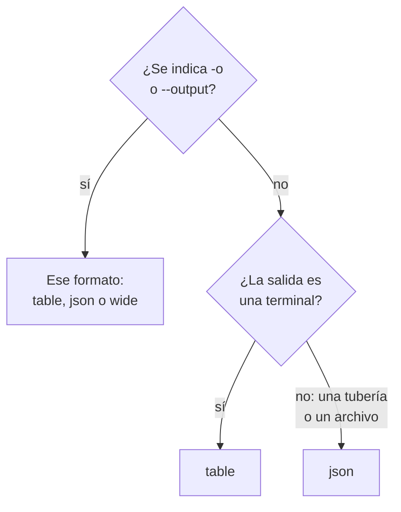

# Formatos de salida

La CLI imprime una tabla cuando usted lee su respuesta en una terminal, y JSON cuando la lee un script u otro programa. Elija el formato de cualquier comando con `-o` o `--output`.

:::cards
- [Cómo se elige el formato](#cómo-se-elige-el-formato): Una terminal recibe una tabla, una tubería recibe JSON.
- [Tabla](#tabla): Seis columnas, cada valor cortado a 60 caracteres.
- [JSON](#json): Cada campo, completo, para scripts y jq.
- [Ancho](#ancho): Una tabla con todas las columnas.
:::

## Cómo se elige el formato



| Formato | Qué imprime | Ideal para |
| --- | --- | --- |
| `table` | Una tabla de hasta seis columnas; un solo registro como una fila por campo | Leer en una terminal |
| `json` | La respuesta tal como la envió OneUptime, con sangría de dos espacios | Scripts, `jq` y archivos |
| `wide` | Una tabla con una columna por cada campo | Comparar muchos campos de un vistazo |

`-o` funciona en cada comando que imprime registros: `list`, `get`, `create`, `update` y `count` de un recurso, `oneuptime resources` y `oneuptime context list`. Puede ir en cualquier parte de la línea de comandos. Cualquier otro valor se rechaza antes de enviar una solicitud:

```text
error: option '-o, --output <format>' argument 'yaml' is invalid. Allowed choices are json, table, wide.
```

## Tabla

Una tabla es el formato predeterminado en una terminal. `oneuptime resources --type analytics`, por ejemplo, imprime esta:

```text
┌────────────────────────────┬────────────────────────────┬─────────────────────────────┬───────────┬─────────────────────────────┐
│ Command                    │ Singular                   │ Plural                      │ Type      │ API Path                    │
├────────────────────────────┼────────────────────────────┼─────────────────────────────┼───────────┼─────────────────────────────┤
│ log                        │ Log                        │ Logs                        │ analytics │ /logs                       │
├────────────────────────────┼────────────────────────────┼─────────────────────────────┼───────────┼─────────────────────────────┤
│ span                       │ Span                       │ Spans                       │ analytics │ /span                       │
├────────────────────────────┼────────────────────────────┼─────────────────────────────┼───────────┼─────────────────────────────┤
│ metric                     │ Metric                     │ Metrics                     │ analytics │ /metrics                    │
├────────────────────────────┼────────────────────────────┼─────────────────────────────┼───────────┼─────────────────────────────┤
│ exception-instance         │ Exception Instance         │ Exception Instances         │ analytics │ /exceptions                 │
├────────────────────────────┼────────────────────────────┼─────────────────────────────┼───────────┼─────────────────────────────┤
│ monitor-log                │ Monitor Log                │ Monitor Logs                │ analytics │ /monitor-log                │
├────────────────────────────┼────────────────────────────┼─────────────────────────────┼───────────┼─────────────────────────────┤
│ kubernetes-cost-allocation │ Kubernetes Cost Allocation │ Kubernetes Cost Allocations │ analytics │ /kubernetes-cost-allocation │
├────────────────────────────┼────────────────────────────┼─────────────────────────────┼───────────┼─────────────────────────────┤
│ security-event             │ Security Event             │ Security Events             │ analytics │ /security-events            │
├────────────────────────────┼────────────────────────────┼─────────────────────────────┼───────────┼─────────────────────────────┤
│ change-event               │ Change Event               │ Change Events               │ analytics │ /change-events              │
├────────────────────────────┼────────────────────────────┼─────────────────────────────┼───────────┼─────────────────────────────┤
│ threat-intel-indicator     │ Threat Intel Indicator     │ Threat Intel Indicators     │ analytics │ /threat-intel-indicators    │
└────────────────────────────┴────────────────────────────┴─────────────────────────────┴───────────┴─────────────────────────────┘

Total: 9 resources
```

Para una lista de registros, una tabla muestra hasta seis columnas: primero `_id`, `name`, `title`, `status`, `createdAt` y `updatedAt`, las que tengan los registros, y después los siguientes campos de los registros por orden. Las columnas se toman del primer registro. Un valor de más de 60 caracteres se corta a sus 57 primeros, seguidos de `...`.

Un solo registro, como lo imprimen `get` y `create`, es una tabla de dos columnas: el nombre del campo y su valor, una fila por campo.

OneUptime envía las fechas y los ID de otros registros como objetos, como `{"_type":"DateTime","value":"2026-10-14T09:12:44.000Z"}`, y una tabla los muestra como ese texto. Su valor está en `value`: consulte [JSON](#json).

## JSON

JSON es la respuesta tal como la envió OneUptime, con sangría de dos espacios: una lista es un array de registros, y un solo registro es un objeto.

```bash
oneuptime incident list --limit 1 -o json
```

```json
[
  {
    "_id": "6f1c2a40-3b1e-4c55-9a0b-3e2f8d7c1a11",
    "createdAt": {
      "_type": "DateTime",
      "value": "2026-10-14T09:12:44.000Z"
    },
    "title": "Checkout API is down",
    "currentIncidentStateId": {
      "_type": "ObjectID",
      "value": "0b7d5e2c-8f4a-4d1b-9c3e-5a6f7b8c9d0e"
    }
  }
]
```

Un registro tiene cada campo que la clave puede leer; este se ha recortado a cuatro. El `_id` propio de un registro es texto, y los demás ID y las fechas son objetos cuyo `value` los contiene:

```bash
oneuptime incident list -o json | jq -r '.[] | "\(.createdAt.value)  \(.title)"'
```

Cuando la salida no es una terminal, como en `oneuptime incident list | jq '.[].title'`, la CLI imprime JSON sin `-o json`. Escriba `-o json` en los scripts de todos modos, para que no dependan de ello.

## Ancho

`-o wide` es una tabla con una columna por cada campo de los registros. Cada valor se sigue cortando a 60 caracteres, y los registros tienen muchos campos, así que una tabla ancha es muy ancha: recórrala con `less -S`.

```bash
oneuptime incident list -o wide | less -S
```

## Colores

Los encabezados de las tablas son cian; los mensajes son verdes cuando algo funcionó, azules para la información y rojos para los errores. Desactive los colores con `--no-color`, o dando cualquier valor a `NO_COLOR`:

```bash
oneuptime incident list --no-color
NO_COLOR=1 oneuptime incident list
```

## Qué imprime cada comando

Los registros y los recuentos van a la salida estándar, y los errores a la salida de error estándar, así que una tubería lee solo la respuesta.

| Comando | En una tabla | En JSON |
| --- | --- | --- |
| Un `list` que no encuentra nada | `No results found.` | `[]` |
| Un `get` o un `create` | Una fila por campo | El registro |
| Un `count` | El número | El número |
| Un `update` | Una línea vacía | `{}` |
| Un `delete` | `Monitor <id> deleted successfully.` | La misma línea |

## Próximos pasos

:::cards
- [Scripts y CI/CD](/docs/cli/scripting): Leer el JSON con jq en scripts y pipelines.
- [Operaciones de recursos](/docs/cli/resource-operations): Las operaciones cuyas respuestas son estas.
- [Referencia de comandos](/docs/cli/command-reference): Cada comando y cada opción.
:::
