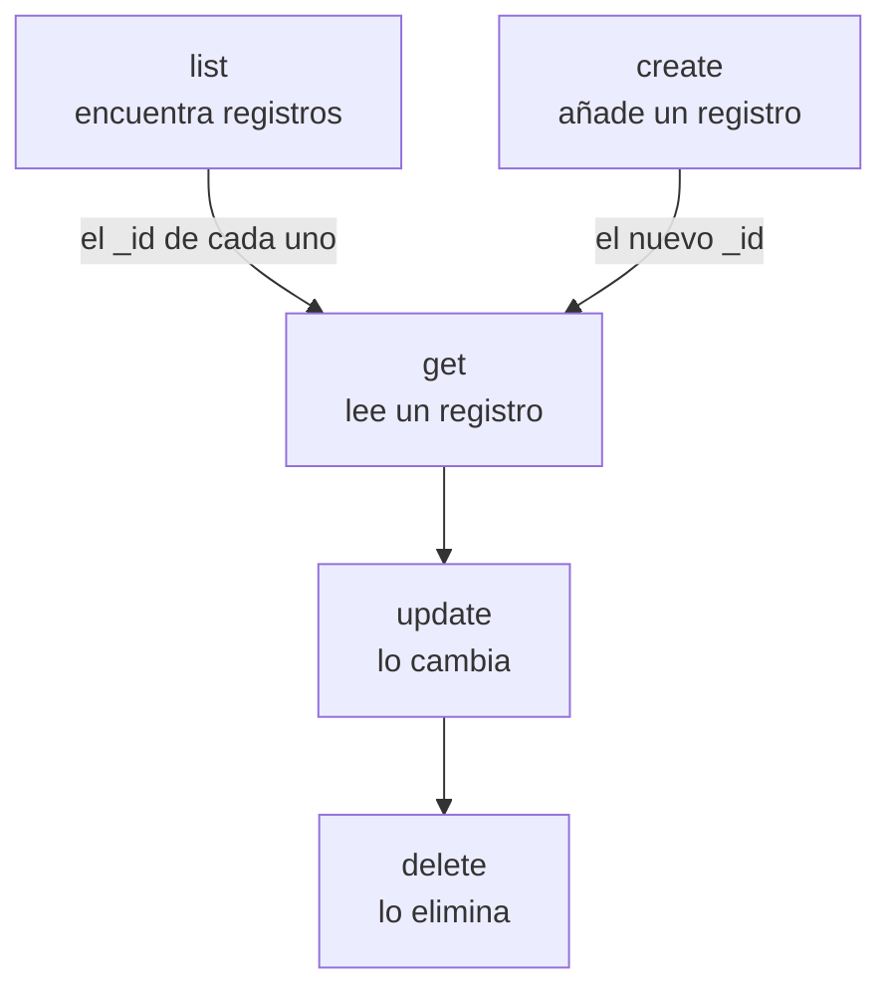

# Operaciones de recursos

Cada tipo de registro es un comando propio, como `incident`, `monitor` o `status-page`, con las operaciones que la API admite para él: para la mayoría, `list`, `get`, `create`, `update`, `delete` y `count`. Esta página muestra cada operación, con filtros, paginación y las opciones con las que se escribe un registro, y los comandos que hacen lo que hacen los botones del panel.

:::cards
- [Encontrar el comando de un registro](#encontrar-el-comando-de-un-registro): oneuptime resources los lista todos.
- [Listar registros](#listar-registros): Filtrar, ordenar y paginar.
- [Crear un registro](#crear-un-registro): Una opción para cada campo, o el registro como JSON.
- [Reconocer, resolver y añadir notas](#reconocer-resolver-y-añadir-notas): Los botones del panel, como comandos.
- [Eliminar un registro](#eliminar-un-registro): De inmediato, sin deshacer.
:::

## Cómo encajan las operaciones

Leer, cambiar y eliminar un registro necesitan su ID. Listar, contar y crear no necesitan ninguno, y una lista o una creación le dan los ID que toman las demás:



Un ID es un UUID, como `6f1c2a40-3b1e-4c55-9a0b-3e2f8d7c1a11`. También puede copiar uno desde la página del registro en OneUptime: consulte [Encontrar el ID de un recurso](/docs/api-reference/api-reference#encontrar-el-id-de-un-recurso).

## Encontrar el comando de un registro

```bash
oneuptime resources
```

La lista muestra cada tipo de registro con su comando, sus nombres, su tipo y su ruta de API. Hay dos tipos:

| Tipo | Qué contiene |
| --- | --- |
| `database` | Registros que usted gestiona: monitores, incidentes, alertas, páginas de estado, equipos y más |
| `analytics` | Telemetría: logs, spans, métricas, excepciones y otros eventos |

Muestre un solo tipo con `oneuptime resources --type database` o `--type analytics`. La [Referencia de comandos](/docs/cli/command-reference#recursos) lista cada comando.

Un recurso admite las operaciones que la API admite para él. La mayoría admite las seis; uno que OneUptime escribe por sí mismo, como un registro de correos, es de solo lectura. `oneuptime <resource> --help` lista los subcomandos de un recurso.

## Ver los campos de un recurso

`fields` lista los campos de un recurso desde la propia CLI, sin clave de API y sin solicitud:

```bash
oneuptime incident fields
```

Cada campo tiene su tipo, para qué sirve, si una creación debe indicarlo y la opción que lo define. Un campo que contiene un ID nombra el recurso al que pertenece el ID: `incidentSeverityId` toma uno de `oneuptime incident-severity list`. Con `-o json`, un script o un agente de IA lee lo mismo, con las mismas claves para cada campo: `name`, `title`, `type`, `description`, `required`, `create`, `update`, `read`, `flag`, `emailFlag` y `relatedResource`.

## Listar registros

```bash
oneuptime <resource> list [--query <json>] [--limit <n>] [--skip <n>] [--sort <json>] [--fields <names>] [--all] [-o <format>]
```

| Opción | Qué hace | Predeterminado |
| --- | --- | --- |
| `--query <json>` | Devuelve solo los registros que coinciden: consulte [Filtrar una lista](#filtrar-una-lista) | Cada registro que la clave puede leer |
| `--limit <n>` | El máximo de registros que devolver, hasta 10.000 | `10` |
| `--skip <n>` | Cuántos registros coincidentes saltar primero | `0` |
| `--sort <json>` | El orden, como `{"createdAt":"ASC"}`, o `"DESC"` para los más recientes primero | Los más recientes primero |
| `--fields <names>` | Los campos que devolver, separados por comas, como `title,createdAt` | Cada campo que la clave puede leer |
| `--all` | Cada registro que coincide, página tras página, en lugar de `--limit` y `--skip`. Solo registros | |
| `-o, --output <format>` | `table`, `json` o `wide` | `table` en una terminal, `json` en una tubería |

```bash
# The ten newest incidents
oneuptime incident list

# The oldest monitors first, 50 at a time: the second page
oneuptime monitor list --sort '{"createdAt":"ASC"}' --limit 50 --skip 50

# Every field of each incident, as JSON
oneuptime incident list -o json

# The title, the state and the creation date of every incident
oneuptime incident list --all --fields title,currentIncidentState.name,createdAt -o json
```

Una lista pide a OneUptime cada campo de cada registro que la clave puede leer. `--fields` pide en su lugar los que nombra y, tras un punto, un campo de un registro relacionado, como en `currentIncidentState.name`. Una tabla muestra seis campos; JSON los muestra todos (consulte [Formatos de salida](/docs/cli/output-formats)). `--all` lee cada página, 100 registros cada vez, hasta 100.000; `count` dice cuántos hay.

Las etiquetas se listan por nombre en lugar de las más recientes primero: primero las etiquetas cuyo nombre empieza por un número, en el orden de ese número (`2. Team` antes que `10. Owner`), y después las demás por orden alfabético. Para listarlas en otro orden, indique `--sort`.

### Filtrar una lista

`--query` admite el mismo filtro que la API: un campo con un valor coincide con ese valor, y un objeto con un `_type` compara.

| Filtro | Coincide con |
| --- | --- |
| `{"title":"Checkout API is down"}` | Registros con exactamente ese valor |
| `{"title":{"_type":"Search","value":"checkout"}}` | Texto que contiene el valor |
| `{"createdAt":{"_type":"GreaterThan","value":"2026-10-01T00:00:00.000Z"}}` | Fechas posteriores, o números mayores |
| `{"currentIncidentState":{"isResolvedState":false}}` | Un campo de un registro que nombra el recurso: aquí, los incidentes que no están resueltos |

```bash
oneuptime incident list --query '{"title":{"_type":"Search","value":"checkout"}}'
```

[Filtrar, ordenar y paginar](/docs/api-reference/api-reference#filtrar-ordenar-y-paginar) en la referencia de la API lista cada `_type`.

## Leer un registro

```bash
oneuptime <resource> get <id> [--fields <names>] [-o <format>]
```

```bash
oneuptime incident get 6f1c2a40-3b1e-4c55-9a0b-3e2f8d7c1a11
```

Una tabla muestra una fila por cada campo del registro, con cada valor cortado a 60 caracteres; `-o json` muestra los valores completos. Un ID que no nombra ningún registro que su clave pueda leer responde `Not found`, y el comando termina con el código `3`.

## Crear un registro

```bash
oneuptime <resource> create [--<field> <value>]... [--data <json>] [--file <path>] [-o <format>]
```

Cada campo que admite una creación tiene una opción: `--title <text>`, `--incident-severity-id <id>`, `--labels <ids>` para ID separados por comas, `--is-visible-on-status-page [true|false]` para un campo de sí o no, verdadero cuando se indica solo, y `--monitor-steps <json>` para un campo que contiene JSON. `oneuptime <resource> create --help` los lista, y [`fields`](#ver-los-campos-de-un-recurso) dice para qué sirve cada uno. El proyecto viene de la clave de API, así que un registro nunca lo nombra.

```bash
# A manual monitor
oneuptime monitor create --name "Checkout API" --monitor-type Manual

# An incident with one of your severities
oneuptime incident create --title "Checkout API is down" --incident-severity-id <severity-id>

# The same incident, from a file
oneuptime incident create --file incident.json
```

`--data` toma el registro como JSON, y `--file` lo lee de un archivo JSON, con los campos de la API: la [referencia de la API](/reference) lista los de cada recurso. Si indica ambos, se usa el archivo, y las opciones se aplican encima de cualquiera de los dos.

Un campo que nombra a una persona por su ID de usuario tiene una segunda opción que la nombra por su dirección de correo: `--user-email` junto a `--user-id`, `--owner-user-emails` junto a `--owner-users`. La CLI la busca entre los miembros del proyecto de la clave de API y las personas invitadas a él. Un miembro de equipo nombrado por una dirección que nadie tiene en el proyecto queda invitado a él, como al invitarlo desde el panel:

```bash
oneuptime team-member create --team-id <team-id> --user-email alice@example.com
```

La CLI imprime el nuevo registro, con su `_id`. Un incidente empieza en el estado de creado de su proyecto, salvo que `currentIncidentStateId` nombre otro: consulte [El estado en el que empieza un registro nuevo](/docs/api-reference/api-reference#el-estado-en-el-que-empieza-un-registro-nuevo). Para encontrar los ID de sus gravedades:

```bash
oneuptime incident-severity list -o json | jq -r '.[] | "\(._id)  \(.name)"'
```

> [!TIP]
> En Windows, indique los campos con sus opciones, o ponga el JSON en un archivo y use `--file`: PowerShell y el Símbolo del sistema entrecomillan el JSON en la línea de comandos de forma distinta que Bash.

## Actualizar un registro

```bash
oneuptime <resource> update <id> [--<field> <value>]... [--data <json>] [--file <path>] [-o <format>]
```

Indique solo los campos que cambiar, con sus opciones o como JSON:

```bash
# Rename a monitor
oneuptime monitor update <monitor-id> --name "Checkout API (EU)"

# Record an incident's root cause
oneuptime incident update <incident-id> --root-cause "A full disk on the primary database"
```

OneUptime responde a una actualización con un objeto vacío: la CLI imprime una línea vacía, o `{}` con `-o json`. Ejecute `get` para ver el registro tal como está ahora. Para pasar un incidente a otro estado, indique `--current-incident-state-id`: el cambio se registra en su línea de tiempo, como hace el panel, y se rechaza un estado anterior al actual. [`acknowledge` y `resolve`](#reconocer-resolver-y-añadir-notas) encuentran el estado por usted. Para encontrar el ID del estado resuelto, el primero en el orden de su proyecto:

```bash
oneuptime incident-state list --query '{"isResolvedState":true}' --sort '{"order":"ASC"}' --limit 1 -o json | jq -r '.[0]._id'
```

## Reconocer, resolver y añadir notas

Los incidentes, las alertas, sus episodios y los eventos de mantenimiento tienen comandos para lo que hacen en ellos los botones del panel:

| Comando | Qué hace | Recursos |
| --- | --- | --- |
| `acknowledge <id>` | Pasa el registro al estado de reconocido de su proyecto | `incident`, `alert`, `incident-episode`, `alert-episode` |
| `resolve <id>` | Lo pasa al estado de resuelto de su proyecto | Los mismos cuatro |
| `start <id>` | Pasa el evento al estado en curso de su proyecto | `scheduled-maintenance-event` |
| `end <id>` | Lo pasa al estado de finalizado de su proyecto | `scheduled-maintenance-event` |
| `add-note <id> --note <markdown>` | Añade una nota que solo puede leer quien puede ver el registro, o con `--public` una en las páginas de estado del registro | Los cinco |

```bash
oneuptime incident acknowledge 6f1c2a40-3b1e-4c55-9a0b-3e2f8d7c1a11
oneuptime incident add-note 6f1c2a40-3b1e-4c55-9a0b-3e2f8d7c1a11 --note "Rolled back the 14:05 deploy."
oneuptime incident resolve 6f1c2a40-3b1e-4c55-9a0b-3e2f8d7c1a11
```

`acknowledge` responde `Incident 6f1c2a40-3b1e-4c55-9a0b-3e2f8d7c1a11 acknowledged: it is in Acknowledged now.` Un registro que ya está en ese estado, o más allá, se deja tal cual: el comando lo dice y termina con `0`. Con `-o json`, responde con el `_id` del registro, la `action`, si algo cambió (`changed`) y el estado `state` en el que está el registro. Las alertas y los episodios de alertas solo admiten notas internas.

## Eliminar un registro

```bash
oneuptime <resource> delete <id>
```

```bash
oneuptime monitor delete 6f1c2a40-3b1e-4c55-9a0b-3e2f8d7c1a11
```

Responde `Monitor 6f1c2a40-3b1e-4c55-9a0b-3e2f8d7c1a11 deleted successfully.` Con `-o json`, responde con el `_id` del registro y `"deleted": true`.

> [!CAUTION]
> `delete` elimina el registro de inmediato. La CLI no le pide confirmación, y no se puede deshacer. Acepta `--force`, para los scripts escritos con él, y `--force` no cambia nada.

## Contar registros

```bash
oneuptime <resource> count [--query <json>]
```

```bash
# Every incident
oneuptime incident count

# Incidents that are not resolved
oneuptime incident count --query '{"currentIncidentState":{"isResolvedState":false}}'
```

La CLI imprime un solo número, el mismo en una tabla y en JSON, así que un script puede leerlo tal cual.

## Solución de problemas

:::details El mensaje "Not found: API error (404)"
El registro no existe, está en otro proyecto, o la clave no puede leerlo: OneUptime responde lo mismo en cada caso. Compruebe el ID con `list`, y los permisos de la clave. El comando termina con el código `3`.
:::

:::details El mensaje "Left out fields this API key may not read"
Una lista o una lectura pide cada campo del registro, y OneUptime rechaza un campo que la clave no puede leer: la CLI vuelve a pedir sin él y nombra los campos que dejó fuera en la salida de error estándar. Dé a la clave un permiso que los lea, o nombre los campos que necesita con `--fields`: un campo nombrado que la clave no puede leer detiene el comando con `API error (422)`.
:::

:::details El mensaje "Error: Invalid JSON"
El valor de `--query`, `--sort` o `--data` no es JSON. En Bash y zsh, póngalo entre comillas simples; en Windows, indique los campos con sus opciones, o ponga un registro en un archivo y use `--file`.
:::

:::details API error (400) al crear o actualizar
OneUptime rechazó un campo: el mensaje lo nombra, y `oneuptime <resource> fields` lista los campos con las opciones que los definen. Un comando que no indica ningún campo se rechaza antes de enviarse, con las opciones que indicar.
:::

:::details El mensaje "No one in this project, or invited to it, has the email address"
Una opción de correo nombra a alguien que no es miembro del proyecto de la clave de API ni está invitado a él. Invítelo con `oneuptime team-member create --team-id <team-id> --user-email <email>`, o nómbrelo por su ID de usuario.
:::

## Próximos pasos

:::cards
- [Formatos de salida](/docs/cli/output-formats): Leer las respuestas como tablas o como JSON.
- [Scripts y CI/CD](/docs/cli/scripting): Usar estas operaciones en scripts y pipelines.
- [Referencia de comandos](/docs/cli/command-reference): Cada comando, opción y valor predeterminado.
:::
