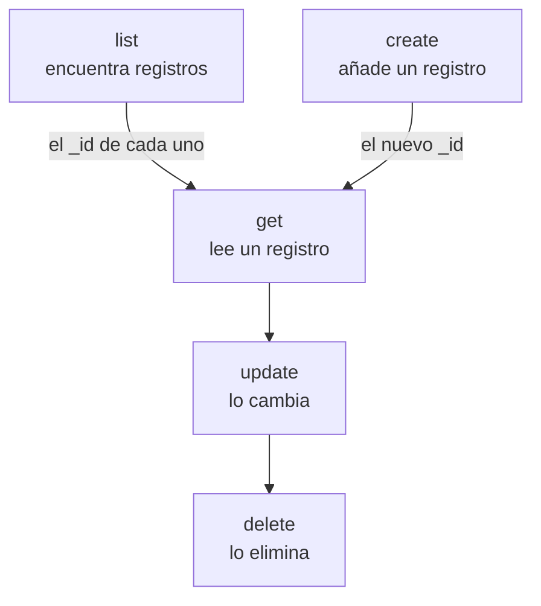

# Operaciones de recursos

Cada tipo de registro es un comando propio, como `incident`, `monitor` o `status-page`, y cada uno admite las mismas operaciones: `list`, `get`, `create`, `update`, `delete` y `count`. Esta página muestra cada operación, con filtros, paginación y el JSON en el que se escribe un registro.

:::cards
- [Encontrar el comando de un registro](#encontrar-el-comando-de-un-registro): oneuptime resources los lista todos.
- [Listar registros](#listar-registros): Filtrar, ordenar y paginar.
- [Crear un registro](#crear-un-registro): A partir de JSON en la línea de comandos o en un archivo.
- [Eliminar un registro](#eliminar-un-registro): De inmediato, sin deshacer.
:::

## Cómo encajan las operaciones

Leer, cambiar y eliminar un registro necesitan su ID. Listar, contar y crear no necesitan ninguno, y una lista o una creación le dan los ID que toman las demás:



Un ID es un UUID, como `6f1c2a40-3b1e-4c55-9a0b-3e2f8d7c1a11`. También puede copiar uno desde la página del registro en OneUptime: consulte [Encontrar el ID de un recurso](/docs/api-reference/api-reference#encontrar-el-id-de-un-recurso).

## Encontrar el comando de un registro

```bash
oneuptime resources
```

La lista muestra cada tipo de registro con su comando, sus nombres, su tipo y su ruta de API. Hay dos tipos:

| Tipo | Qué contiene | Operaciones |
| --- | --- | --- |
| `database` | Registros que usted gestiona: monitores, incidentes, alertas, páginas de estado, equipos y más | `list`, `get`, `create`, `update`, `delete`, `count` |
| `analytics` | Telemetría: logs, spans, métricas, excepciones y otros eventos | `list`, `create`, `count` |

Muestre un solo tipo con `oneuptime resources --type database` o `--type analytics`. La [Referencia de comandos](/docs/cli/command-reference#recursos) lista cada comando.

## Listar registros

```bash
oneuptime <resource> list [--query <json>] [--limit <n>] [--skip <n>] [--sort <json>] [-o <format>]
```

| Opción | Qué hace | Predeterminado |
| --- | --- | --- |
| `--query <json>` | Devuelve solo los registros que coinciden: consulte [Filtrar una lista](#filtrar-una-lista) | Cada registro que la clave puede leer |
| `--limit <n>` | El máximo de registros que devolver, hasta 10.000 | `10` |
| `--skip <n>` | Cuántos registros coincidentes saltar primero | `0` |
| `--sort <json>` | El orden, como `{"createdAt":"ASC"}`, o `"DESC"` para los más recientes primero | Los más recientes primero |
| `-o, --output <format>` | `table`, `json` o `wide` | `table` en una terminal, `json` en una tubería |

```bash
# The ten newest incidents
oneuptime incident list

# The oldest monitors first, 50 at a time: the second page
oneuptime monitor list --sort '{"createdAt":"ASC"}' --limit 50 --skip 50

# Every field of each incident, as JSON
oneuptime incident list -o json
```

Una lista pide a OneUptime cada campo de cada registro que la clave puede leer. Una tabla muestra seis de ellos; JSON los muestra todos (consulte [Formatos de salida](/docs/cli/output-formats)). Para recorrer todos los registros, aumente `--skip` en `--limit` hasta que una página vuelva vacía; `count` dice cuántos hay.

### Filtrar una lista

`--query` admite el mismo filtro que la API: un campo con un valor coincide con ese valor, y un objeto con un `_type` compara.

| Filtro | Coincide con |
| --- | --- |
| `{"title":"Checkout API is down"}` | Registros con exactamente ese valor |
| `{"title":{"_type":"Search","value":"checkout"}}` | Texto que contiene el valor |
| `{"createdAt":{"_type":"GreaterThan","value":"2026-10-01T00:00:00.000Z"}}` | Fechas posteriores, o números mayores |
| `{"currentIncidentState":{"isResolvedState":false}}` | Un campo de un registro que nombra el recurso: aquí, los incidentes que no están resueltos |

```bash
oneuptime incident list --query '{"title":{"_type":"Search","value":"checkout"}}'
```

[Filtrar, ordenar y paginar](/docs/api-reference/api-reference#filtrar-ordenar-y-paginar) en la referencia de la API lista cada `_type`.

## Leer un registro

```bash
oneuptime <resource> get <id> [-o <format>]
```

```bash
oneuptime incident get 6f1c2a40-3b1e-4c55-9a0b-3e2f8d7c1a11
```

Una tabla muestra una fila por cada campo del registro, con cada valor cortado a 60 caracteres; `-o json` muestra los valores completos. Un ID que no nombra ningún registro que su clave pueda leer responde `Not found`, y el comando termina con el código `3`.

## Crear un registro

```bash
oneuptime <resource> create --data <json> [-o <format>]
oneuptime <resource> create --file <path> [-o <format>]
```

`--data` toma el registro como JSON, y `--file` lo lee de un archivo JSON. Indique uno de los dos; si indica ambos, se usa el archivo. Los campos son los de la API, y la [referencia de la API](/reference) lista los de cada recurso. El proyecto viene de la clave de API, así que un registro nunca lo nombra.

```bash
# A manual monitor
oneuptime monitor create --data '{"name":"Checkout API","monitorType":"Manual"}'

# An incident with one of your severities
oneuptime incident create --data '{"title":"Checkout API is down","incidentSeverityId":"<severity-id>"}'

# The same incident, from a file
oneuptime incident create --file incident.json
```

La CLI imprime el nuevo registro, con su `_id`. Un incidente empieza en el estado de creado de su proyecto, salvo que `currentIncidentStateId` nombre otro: consulte [El estado en el que empieza un registro nuevo](/docs/api-reference/api-reference#el-estado-en-el-que-empieza-un-registro-nuevo). Para encontrar los ID de sus gravedades:

```bash
oneuptime incident-severity list -o json | jq -r '.[] | "\(._id)  \(.name)"'
```

> [!TIP]
> En Windows, ponga el JSON en un archivo y use `--file`: PowerShell y el Símbolo del sistema entrecomillan el JSON en la línea de comandos de forma distinta que Bash.

## Actualizar un registro

```bash
oneuptime <resource> update <id> --data <json> [-o <format>]
```

`--data` es obligatorio y contiene solo los campos que cambiar:

```bash
# Rename a monitor
oneuptime monitor update <monitor-id> --data '{"name":"Checkout API (EU)"}'

# Move an incident to your resolved state
oneuptime incident update <incident-id> --data '{"currentIncidentStateId":"<resolved-state-id>"}'
```

OneUptime responde a una actualización con un objeto vacío: la CLI imprime una línea vacía, o `{}` con `-o json`. Ejecute `get` para ver el registro tal como está ahora. Pasar un incidente a otro estado de esta forma registra el cambio en su línea de tiempo, como hace el panel, y se rechaza un estado anterior al actual. Para encontrar el ID del estado resuelto, el primero en el orden de su proyecto:

```bash
oneuptime incident-state list --query '{"isResolvedState":true}' --sort '{"order":"ASC"}' --limit 1 -o json | jq -r '.[0]._id'
```

## Eliminar un registro

```bash
oneuptime <resource> delete <id>
```

```bash
oneuptime monitor delete 6f1c2a40-3b1e-4c55-9a0b-3e2f8d7c1a11
```

Responde `Monitor 6f1c2a40-3b1e-4c55-9a0b-3e2f8d7c1a11 deleted successfully.`

> [!CAUTION]
> `delete` elimina el registro de inmediato. La CLI no le pide confirmación, y no se puede deshacer. Acepta `--force`, para los scripts escritos con él, y `--force` no cambia nada.

## Contar registros

```bash
oneuptime <resource> count [--query <json>]
```

```bash
# Every incident
oneuptime incident count

# Incidents that are not resolved
oneuptime incident count --query '{"currentIncidentState":{"isResolvedState":false}}'
```

La CLI imprime un solo número, el mismo en una tabla y en JSON, así que un script puede leerlo tal cual.

## Qué admite cada tipo

| Operación | `database` | `analytics` |
| --- | --- | --- |
| `list` | Sí | Sí |
| `get` | Sí | No |
| `create` | Sí | Sí |
| `update` | Sí | No |
| `delete` | Sí | No |
| `count` | Sí | Sí |

## Solución de problemas

:::details El mensaje "Not found: API error (404)"
El registro no existe, está en otro proyecto, o la clave no puede leerlo: OneUptime responde lo mismo en cada caso. Compruebe el ID con `list`, y los permisos de la clave. El comando termina con el código `3`.
:::

:::details El mensaje "API error (422): You do not have permissions to select on"
Una lista o una lectura pide cada campo del registro, y la clave no puede leer uno de ellos: el mensaje nombra el campo y los permisos que pueden leerlo. Dé a la clave uno de esos permisos.
:::

:::details El mensaje "Error: Invalid JSON"
El valor de `--query`, `--sort` o `--data` no es JSON. En Bash y zsh, póngalo entre comillas simples; en Windows, ponga un registro en un archivo y use `--file`.
:::

:::details API error (400) al crear o actualizar
OneUptime rechazó un campo: el mensaje lo nombra. `No fields to update` significa que `--data` no contenía ningún campo que cambiar.
:::

## Próximos pasos

:::cards
- [Formatos de salida](/docs/cli/output-formats): Leer las respuestas como tablas o como JSON.
- [Scripts y CI/CD](/docs/cli/scripting): Usar estas operaciones en scripts y pipelines.
- [Referencia de comandos](/docs/cli/command-reference): Cada comando, opción y valor predeterminado.
:::
