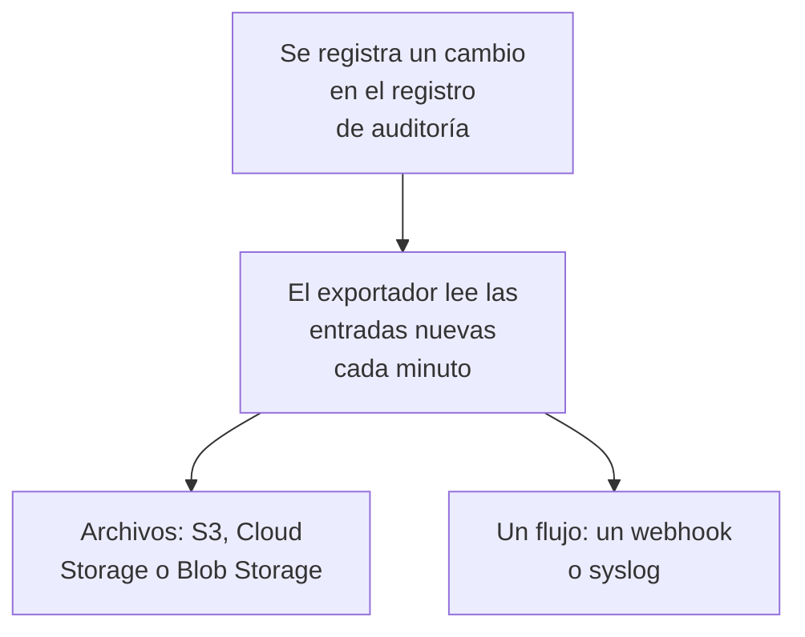

# Exportación del registro de auditoría

Envíe el registro de auditoría, a medida que se registra, al almacenamiento o al servicio que elija: Amazon S3 o un almacenamiento compatible con S3, Google Cloud Storage, Azure Blob Storage, un webhook o syslog. Conserve allí las entradas tanto tiempo como lo exijan sus revisiones de cumplimiento, y búsquelas en su SIEM. Los propietarios y administradores de un proyecto exportan su registro de auditoría desde los ajustes del proyecto, y los administradores maestros exportan el de todos los proyectos desde el Admin Dashboard. Forma parte del plan Enterprise en OneUptime Cloud, y de la Enterprise Edition cuando lo aloja usted mismo.

:::cards
- [Configurar una exportación](#configurar-una-exportación): Elegir un destino, probarlo y guardarlo.
- [Qué se envía](#qué-se-envía): Un objeto JSON por entrada, con un esquema estable.
- [Cuándo se envían las entradas](#cuándo-se-envían-las-entradas): Cada minuto, cada entrada una vez, en orden.
- [Cuando un destino falla](#cuando-un-destino-falla): Los reintentos, el error, y nada se omite.
:::

## Cómo llega una entrada a su destino



- **Una exportación, un destino.** Un proyecto puede tener varias exportaciones, y cada una envía todas las entradas a su propio destino.
- **La de un proyecto, o la de la instancia.** La exportación de un proyecto envía las entradas de ese proyecto. Una exportación configurada en el Admin Dashboard envía las entradas de todos los proyectos que registran auditoría.
- **Desde que se guarda.** Una exportación envía lo que se registra después de guardarla, salvo que ponga **Exportar desde** en una fecha anterior.

## Antes de empezar

- **En OneUptime Cloud, el plan Enterprise.** En otros planes, la página muestra qué hace la función y cómo obtenerla.
- **Si lo aloja usted mismo, la Enterprise Edition**, con una licencia que incluya los registros de auditoría. Consulte [Edición Enterprise](/docs/self-hosted/enterprise).
- **El registro de auditoría activado** en cada proyecto que exporte. Consulte [Registros de auditoría](/docs/configuration/audit-logs).
- **Un Project Owner o un Project Admin** para exportar el registro de auditoría de un proyecto, o un administrador maestro para exportar el de la instancia.

## Configurar una exportación

:::steps
### Abrir la página de exportación

Para un proyecto, vaya a **Ajustes del proyecto → Registros de auditoría → Exportar**. Para toda la instancia, vaya a **Ajustes → Exportación del registro de auditoría** en el Admin Dashboard.

### Elegir un destino

Haga clic en **Añadir exportación** y elija uno de los seis destinos de abajo. El destino de una exportación no se puede cambiar después.

### Indicar cómo llegar a él

Rellene lo que pide el destino. Los ajustes que casi todos dejan como están esperan en **Más campos**, y **Guía de configuración** abre la sección del destino en esta página.

### Enviar una prueba

Haga clic en **Escribir un archivo de prueba** o en **Enviar una entrada de prueba**. Un almacenamiento recibe el archivo `oneuptime-audit-log-export-test.ndjson.gz` en su carpeta, y un webhook o syslog recibe una entrada cuya acción es `Test`. Una prueba fallida dice qué hay que corregir.

### Empezar a exportar

Haga clic en **Siguiente**, ponga un nombre a la exportación y haga clic en **Empezar a exportar**. Las primeras entradas llegan en pocos minutos.
:::

La fila de la exportación muestra cómo va: **Exportando**, **Fallando**, **Pausado**, **Esperando entradas** o **Iniciando**. **Envía una prueba** envía una prueba con los ajustes guardados, y **Editar** los cambia: una credencial que deje vacía conserva la guardada.

## Destinos

| Destino | Qué llega | Se identifica con |
| --- | --- | --- |
| [Amazon S3](#amazon-s3) | Archivos NDJSON comprimidos | Una clave de acceso |
| [Almacenamiento compatible con S3](#almacenamiento-compatible-con-s3) | Archivos NDJSON comprimidos | Una clave de acceso |
| [Google Cloud Storage](#google-cloud-storage) | Archivos NDJSON comprimidos | Una clave de cuenta de servicio |
| [Azure Blob Storage](#azure-blob-storage) | Archivos NDJSON comprimidos | Un token SAS o una clave de acceso |
| [Webhook](#webhook) | Solicitudes HTTPS | Un encabezado y un secreto de firma opcionales |
| [Syslog](#syslog) | Mensajes RFC 5424 | Nada |

### Amazon S3

| Campo | Qué introducir |
| --- | --- |
| **Bucket** | El bucket en el que se escriben los archivos. |
| **Región** | La región del bucket. Empieza en `us-east-1`. |
| **ID de clave de acceso** | Una clave de acceso que pueda escribir objetos en el bucket. |
| **Clave de acceso secreta** | El secreto de la clave. |
| **Carpeta** | En **Más campos**. Si se deja vacía, los archivos van a `oneuptime/audit-logs/`. |

La clave solo necesita `s3:PutObject` sobre la carpeta:

```json
{
  "Version": "2012-10-17",
  "Statement": [
    {
      "Effect": "Allow",
      "Action": "s3:PutObject",
      "Resource": "arn:aws:s3:::my-audit-logs/oneuptime/audit-logs/*"
    }
  ]
}
```

### Almacenamiento compatible con S3

Los mismos campos que Amazon S3, tras un **Endpoint**: la dirección S3 del almacenamiento, como `https://minio.example.com:9000` o `https://<account>.r2.cloudflarestorage.com`. Ponga en **Región** la que espera el almacenamiento: `us-east-1` para MinIO y el valor predeterminado de Wasabi, `auto` para Cloudflare R2.

### Google Cloud Storage

Introduzca el **Bucket** y pegue una **Clave de cuenta de servicio** (JSON) cuya cuenta de servicio tenga el rol Storage Object Creator sobre el bucket. **Carpeta** espera en **Más campos**.

### Azure Blob Storage

Introduzca la **Cuenta de almacenamiento** y el **Contenedor**, y elija en **Iniciar sesión con** cómo identificarse: un **Token SAS** con permiso Create y Write sobre el contenedor, o una **Clave de acceso** de la cuenta de almacenamiento. Un token SAS se puede limitar a este contenedor, así que es la opción más segura. **Nube** y **Carpeta** esperan en **Más campos**.

### Webhook

OneUptime envía cada lote con POST a la **URL**, como un array JSON (`application/json`) o una entrada por línea (`application/x-ndjson`), según indique **Formato del cuerpo**, con estos encabezados:

| Encabezado | Valor |
| --- | --- |
| `X-OneUptime-Event` | `audit-log-export` |
| `X-OneUptime-Batch-Id` | El id de la primera entrada del lote: el mismo lote enviado de nuevo lleva el mismo id. |
| `X-OneUptime-Entry-Count` | Cuántas entradas contiene el cuerpo. |
| `X-OneUptime-Signature` | `sha256=` y el HMAC-SHA256 del cuerpo, con el **Secreto de firma**, cuando hay uno. |

La **Credencial**, como `Bearer <token>`, se envía en el encabezado que elija en **Nombre del encabezado**, `Authorization` salvo que lo cambie. **Formato del cuerpo**, **Nombre del encabezado** y **Secreto de firma** esperan en **Más campos**. Cualquier respuesta 2xx cuenta como entrega. Un `413` parte el lote en dos, y cualquier otro rechazo vuelve a enviar el lote entero más tarde.

### Syslog

Cada entrada es un mensaje RFC 5424 al **Host** y al **Puerto**, por TLS en el puerto `6514` salvo que **Protocolo** indique TCP, con facility 13 (log audit) y severity 6 (informational):

```text
<110>1 2026-10-24T09:15:03.000Z oneuptime.example.com oneuptime - audit-log - {"schemaVersion":1,"id":"..."}
```

Los mensajes se delimitan por conteo de octetos (RFC 5425), salvo que **Delimitación** indique un mensaje por línea. Un receptor cuyo certificado firmó una CA privada necesita el certificado de esa CA en **Certificado de la CA**. Ambos esperan en **Más campos**.

## Qué se envía

Cada entrada es un objeto JSON, con sus claves siempre en este orden:

| Clave | Qué contiene |
| --- | --- |
| `schemaVersion` | `1`. Un cambio en el esquema llega con una versión nueva. |
| `id` | El id de la entrada. La misma entrada enviada dos veces tiene el mismo id. |
| `createdAt` | Cuándo se registró el cambio, en UTC. |
| `projectId` | El proyecto en el que se hizo el cambio. |
| `action` | `Create`, `Update`, `Delete` o `Download`. |
| `resourceType`, `resourceId`, `resourceName` | Qué se cambió. |
| `rootResourceType`, `rootResourceId` | El recurso al que pertenece, como un SLO para su regla. |
| `userId`, `userName`, `userEmail`, `userType` | Quién hizo el cambio. |
| `apiKeyId`, `apiKeyName` | La clave de API con la que se hizo, si la hubo. |
| `mcpOAuthGrantId`, `mcpClientName` | El cliente MCP a través del cual se hizo, si lo hubo. |
| `workflowId`, `workflowName` | El flujo de trabajo que lo hizo, si lo hubo. |
| `changes` | Cada campo cambiado: `field`, con `oldValue` y `newValue`. |

Un archivo contiene una entrada por línea, comprimido con gzip, y se archiva por la hora de su primera entrada: `oneuptime/audit-logs/2026/10/24/09/20261024T091503Z_<first entry id>.ndjson.gz`.

Las claves, los tokens y las contraseñas nunca salen: se registran como `[REDACTED]`, y los campos que nadie puede leer quedan fuera de todas las entradas.

## Cuándo se envían las entradas

- **Cada minuto.** Las entradas registradas hace más de un minuto se leen de la más antigua a la más reciente y se envían en lotes: hasta 5.000 entradas o 16 MB por archivo, y 500 entradas por solicitud de webhook o conexión de syslog.
- **No se escribe un archivo por cada entrada.** Un archivo se escribe cuando un lote está lleno o su primera entrada tiene cinco minutos.
- **Cada entrada una vez, en orden.** Tras cada entrega, la exportación recuerda la última entrada enviada, así que un reinicio u otro worker continúa desde ahí.
- **Una repetición se puede reconocer.** Un lote enviado de nuevo tras una caída escribe el mismo nombre de archivo o lleva el mismo `X-OneUptime-Batch-Id`, y cada entrada lleva su `id`.

## Cuando un destino falla

Un lote se intenta tres veces, con pocos segundos de diferencia, y luego la exportación espera antes de volver a intentarlo: un minuto, luego dos, cuatro y así sucesivamente, hasta una hora. Su fila dice **Fallando**, y **Ver error** muestra qué respondió el destino y cuándo se intentará de nuevo.

Nada se omite: las entradas esperan en el registro de auditoría, y la siguiente entrega que funcione se pone al día desde la más antigua. Una entrada más antigua que la retención del registro de auditoría de su proyecto se elimina antes de poder enviarse, así que corrija una exportación que falla dentro de ese plazo.

Para pausar una exportación, desactive **Exportar** en **Editar**: conserva su posición y, al volver a activarla, envía lo que se registró mientras tanto. En OneUptime Cloud, un proyecto que deja el plan Enterprise deja de exportar, y sus exportaciones esperan bajo la tarjeta de mejora, donde se pueden desactivar o eliminar. Si lo aloja usted mismo, la exportación se detiene mientras la licencia no incluya los registros de auditoría, y continúa desde donde se detuvo en cuanto una los incluya.

## Solución de problemas

:::details La prueba dice que se deniega el acceso
La clave, el token o la cuenta de servicio no puede escribir donde escribe la exportación. Dele permiso para crear objetos en la carpeta, como muestra arriba la sección de cada destino, y vuelva a enviar la prueba.
:::

:::details La prueba no llega a la dirección
La exportación de un proyecto en OneUptime Cloud no puede llegar a una dirección de red privada. Si lo aloja usted mismo, sí puede, salvo que `DATA_SOURCE_BLOCK_PRIVATE_ADDRESSES` sea `true`, y una exportación configurada en el Admin Dashboard siempre puede. Las direcciones de loopback y link-local nunca se alcanzan.
:::

:::details No llega nada
Compruebe que el registro de auditoría está activado en el proyecto y que alguien cambió algo después de guardar la exportación. Un almacenamiento recibe un archivo solo cuando un lote está lleno o tiene cinco minutos.
:::

## Próximos pasos

:::cards
- [Registros de auditoría](/docs/configuration/audit-logs): Qué se registra y cuánto tiempo se conserva.
- [Usuarios, equipos y permisos](/docs/permissions/index): Decidir quién puede configurar una exportación.
- [Edición Enterprise](/docs/self-hosted/enterprise): Los registros de auditoría en una instalación autoalojada.
:::
