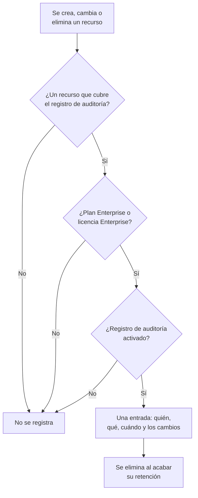

# Registros de auditoría

El registro de auditoría guarda quién cambió qué en su proyecto: cada creación, modificación y eliminación de los recursos que cubre, con los valores de antes y después, y cada vez que alguien inicia o cierra sesión. Úselo para saber quién desactivó un monitor o cambió una clave de API, quién inició sesión y desde dónde, y para conservar constancia ante revisiones de cumplimiento. Forma parte del plan Enterprise en OneUptime Cloud, y de la Enterprise Edition cuando lo aloja usted mismo.

:::cards
- [Activar el registro de auditoría](#activar-el-registro-de-auditoría): Empieza desactivado en cada proyecto.
- [Leer el registro de auditoría](#leer-el-registro-de-auditoría): Quién cambió qué, y cuándo.
- [Qué se registra](#qué-se-registra): Los recursos y las acciones que cubre.
- [Inicios de sesión y sesiones](#inicios-de-sesión-y-sesiones): Quién inició sesión, y cómo terminó cada sesión.
- [Cuánto tiempo se conservan las entradas](#cuánto-tiempo-se-conservan-las-entradas): De 7 a 180 días.
:::

## Cómo un cambio se convierte en una entrada

- **Empieza desactivado.** Un proyecto no registra nada hasta que alguien activa el registro de auditoría, ni nada de antes de ese momento.
- **Registra lo que hacen las personas.** Se registra un cambio hecho por una persona, una clave de API, un cliente MCP o un workflow. Un cambio que OneUptime hace por sí mismo, como el de una tarea en segundo plano, queda fuera salvo que active **Almacenar eventos del sistema**.
- **Las entradas no se pueden cambiar.** Nadie puede editar ni eliminar una entrada, ni en el panel ni a través de la API. Una entrada solo desaparece cuando acaba su retención.

## Antes de empezar

- **En OneUptime Cloud, el plan Enterprise.** En otros planes, las páginas del registro de auditoría muestran qué hace la función y cómo obtenerla.
- **Si lo aloja usted mismo, la Enterprise Edition**, con una licencia que incluya los registros de auditoría. Consulte [Edición Enterprise](/docs/self-hosted/enterprise).
- **Un rol que pueda leer el registro de auditoría.** Project Owner, Project Admin, Settings Admin o el permiso **Read Audit Log**. Activar el registro de auditoría y cambiar sus ajustes requiere un Project Owner, un Project Admin o el permiso para editar el proyecto.

## Activar el registro de auditoría

:::steps
### Abrir los ajustes del registro de auditoría

Vaya a **Ajustes del proyecto → Registros de auditoría → Ajustes**. **Registros de auditoría** empieza plegado en el menú lateral: haga clic en él para abrirlo.

### Editar los ajustes

Haga clic en **Edit Audit Log Settings**.

### Activarlo

Active **Habilitar registros de auditoría**, fije **Retención (días)** y decida si quiere **Almacenar eventos del sistema**. Haga clic en **Guardar cambios**.
:::

| Ajuste | Valor inicial | Qué hace |
| --- | --- | --- |
| **Habilitar registros de auditoría** | Desactivado | Registra desde ahora los cambios en los recursos del proyecto. |
| **Retención (días)** | 7 | Cuántos días se conserva cada entrada: de 7 a 180. |
| **Almacenar eventos del sistema** | Desactivado | Registra también los cambios que OneUptime hace por sí mismo, que no inició ninguna persona ni clave. |

Un cambio en estos ajustes se aplica en menos de un minuto.

## Leer el registro de auditoría

**Ajustes del proyecto → Registros de auditoría → Registros de auditoría** enumera cada entrada del proyecto, las más recientes primero:

| Columna | Qué muestra |
| --- | --- |
| **Cuándo** | Hace cuánto, con la fecha y la hora. |
| **Acción** | `Create`, `Update` o `Delete`, `Download` para un archivo de captura de paquetes que alguien descargó, o `Sign In`, `Sign Out`, `Session Timeout` o `Session Revoked` para una sesión. |
| **Recurso** | El nombre del recurso, que lo abre mientras existe, y su tipo. |
| **Actor** | Quién hizo el cambio: una persona, una clave de API, un workflow o `System` para un cambio que OneUptime hizo por sí mismo. El cambio de una persona hecho a través de un cliente MCP indica cuál. |
| **Cambios** | Cuántos campos cambiaron, o se capturaron en una creación o una eliminación. En una sesión, cómo se inició o por qué terminó. Haga clic para ver cada campo. |

Filtre por **Tipo de recurso**, **Nombre del recurso**, **Acción**, **Correo electrónico del usuario** u **Hora**. Una modificación solo enumera los campos que cambiaron, antes y después, y un guardado que no cambia nada no añade ninguna entrada.

Un recurso sin nombre propio recibe el nombre de lo que lo nombra en OneUptime: una excepción, por su tipo y el comienzo de su mensaje, con los identificadores, las direcciones y todo lo que parezca un secreto enmascarados; una ejecución de un runbook, por su runbook; el número de teléfono de una política de llamadas entrantes, por el número; y una plantilla o un dominio, por su propio nombre.

Los monitores, incidentes, alertas, páginas de estado, SLO y muchos otros recursos tienen también su propia página **Registros de auditoría**, en una sección plegada de su menú lateral como **Avanzado**. Solo enumera las entradas de ese recurso, con las de lo que le pertenece: la página de un SLO muestra también sus reglas y propietarios.

## Qué se registra

Se registra todo lo que las personas crean, cambian o eliminan en un proyecto: monitores, incidentes, alertas, páginas de estado, flujos de trabajo y sus pasos, colas, paneles, políticas de guardia, equipos y quién está en ellos, claves de API y cada ajuste. **Tipo de recurso** indica de qué trata una entrada, por ejemplo `Monitor`, `Workflow` o `Queue`.

| No se registra | Por qué |
| --- | --- |
| Registros de mensajes | Cada uno ya es la constancia de un correo, SMS, llamada, notificación push o mensaje de chat que OneUptime envió o recibió. |
| Registros de ejecuciones | Cada uno ya es la constancia de una ejecución de un flujo de trabajo, una escalada de guardia, un análisis, una importación o una ejecución de IA. |
| Lo que informan los agentes y la telemetría | Los recursos descubiertos, las lecturas y el uso cambian con cada informe, no porque alguien los haya cambiado. |
| Fuentes de actividad | Una fuente muestra cambios que el registro de auditoría ya registra. |
| El estado de trabajo de OneUptime | Sesiones de los lectores de páginas de estado, trabajos en cola y otro estado que OneUptime guarda mientras trabaja. |
| La configuración de notificaciones propia de una persona | Las direcciones, los números y las reglas de guardia personales de cada persona son solo suyos. |
| Las preferencias propias de una persona | Los productos que cada persona fija en su propia barra superior son solo suyos, y solo esa persona los ve. |

También se registra que un administrador añada o quite un método de notificación o una regla de guardia personal en la cuenta de otra persona, sin la dirección ni el número en sí.

Los campos que solo escribe OneUptime, como cuándo se vio un host por última vez, se omiten en cada entrada, igual que los campos que nadie puede leer. Cuando OneUptime escribe uno porque alguien se lo pidió, como al fusionar una excepción con otra o restablecer una URL de webhook, la entrada lo registra como un cambio de esa persona. Las claves, los tokens y las contraseñas se registran como `[REDACTED]`: la entrada muestra que cambiaron, nunca su valor. Los pasos de un flujo de trabajo se registran como lo que cambió, con los nombres de los ajustes de un paso, pero nunca lo que se escribió en ellos, y mover un paso en el lienzo no se registra.

Lo que OneUptime hace porque alguien se lo pidió también se registra como un cambio de esa persona, guarde o no el proyecto los eventos del sistema:

- Iniciar, aprobar, completar, omitir y cancelar una ejecución de un runbook. Sus pasos se registran como lo que se le hizo a cada uno, por ejemplo `Approved "Restart the API" (step 3)`, nunca con lo que imprimió un paso.
- Lo que cambia una regla cuando alguien la ejecuta: las etiquetas y los propietarios que añade, los registros que una regla de privacidad hace privados, los dispositivos que mueve una regla de asignación de sitio, los dispositivos y monitores que crea una regla de importación automática, y lo que una regla de monitores de una página de estado o de un SLO cambia en su página o en su SLO.
- Comprar, asociar y liberar el número de teléfono de una política de llamadas entrantes.
- Resolver una alerta de datos que alguien marca como esperada o como que no es un problema.
- Restablecer el enlace de un feed de calendario.
- Los equipos a los que alguien se une al iniciar sesión con SSO.

Lo que una regla hace por sí sola es un cambio del propio OneUptime y se registra con **Almacenar eventos del sistema** activado: las etiquetas y los propietarios que una regla añade al crearse un registro, y un registro que hace privado entonces; los dispositivos y monitores que una regla de importación automática crea a partir de nuevos resultados de escaneo; y lo que una regla de monitores de una página de estado o de un SLO cambia cuando se guarda una regla, un monitor o una etiqueta.

Restablecer el agente de IA de un host, un clúster o una cuenta en la nube se registra en la propia página **Registros de auditoría** de ese recurso, como el cambio de `aiAgentResetAt` hecho por quien lo restableció: quién, y cuándo. Lo mismo ocurre al crear una clave para el agente de IA de una cuenta en la nube: las claves aparecen como cambiadas, nunca con una clave o un hash. Lo que un agente informa al conectarse y al reportarse queda fuera, como antes.

## Inicios de sesión y sesiones

Cada vez que un miembro del proyecto inicia sesión en OneUptime, el registro de auditoría lo guarda, y otra vez cuando esa sesión termina. Un inicio de sesión es en OneUptime, no en un solo proyecto, así que lo guarda cada proyecto del que la persona es miembro.

| Acción | Cuándo se registra |
| --- | --- |
| `Sign In` | Alguien inicia sesión: con una contraseña o un enlace de inicio de sesión, una clave de acceso, Google, Microsoft, Vercel o el inicio de sesión único. |
| `Sign Out` | La persona cierra sesión. |
| `Session Timeout` | OneUptime termina la sesión al cumplirse su tiempo: el tiempo de inactividad o la duración de la sesión que fijó un administrador del servidor, o 30 días sin uso. |
| `Session Revoked` | OneUptime termina la sesión porque la contraseña cambió, la cuenta se bloqueó, o un administrador del servidor restableció o exigió la autenticación de dos factores. |

El **Recurso** de una entrada es la sesión, que recibe el nombre del dispositivo desde el que se inició, por ejemplo `Chrome 130 on macOS`. Su **Actor** es la persona a quien pertenece la sesión, así que filtrar por **Correo electrónico del usuario** encuentra todos sus inicios de sesión y sesiones. Sus detalles indican cómo inició sesión la persona y con qué segundo factor, la dirección IP y la ubicación, y, en una sesión que terminó, cuándo se inició, cuándo se usó por última vez y cuándo caducó. El proveedor de SSO propio de un proyecto solo se nombra en el registro de auditoría de ese proyecto.

Los inicios de sesión y las sesiones se registran guarde o no el proyecto los eventos del sistema. Una duración de la sesión o 30 días sin uso se registran a los pocos minutos de cumplirse. Un tiempo de inactividad se registra cuando la pestaña abierta de la persona o la aplicación móvil vuelve a comunicarse con OneUptime.

## Cuánto tiempo se conservan las entradas

Cada entrada se conserva durante la **Retención (días)** que tenía el proyecto cuando se registró, y después se elimina. Una retención nueva se aplica a las entradas nuevas: las ya registradas conservan sus fechas. También a través de la API, una retención es un número entero de días de 7 a 180: cualquier otro valor se rechaza.

Para conservar entradas más de 180 días, envíelas a su propio almacenamiento o SIEM a medida que se registran: consulte [Exportación del registro de auditoría](/docs/configuration/audit-log-export). También puede leerlas a través de la API con una clave de API que tenga **Read Audit Log**, y guardarlas donde las necesite. Consulte [Referencia de la API de OneUptime](/docs/api-reference/api-reference).

## Cuando el plan o la licencia ya no incluyen los registros de auditoría

- **En OneUptime Cloud**, un proyecto que deja el plan Enterprise deja de registrar, y sus páginas del registro de auditoría muestran la tarjeta de mejora hasta que vuelve a ese plan.
- **Si lo aloja usted mismo**, el registro de auditoría deja de registrar cuando la prueba de Enterprise o el periodo de gracia termina sin licencia, o cuando la licencia no incluye los registros de auditoría. El registro de auditoría lo indica en rojo. Las entradas ya registradas se conservan, y el registro se reanuda con los mismos ajustes en cuanto se activa una licencia. Consulte [Cuando una licencia caduca o falta](/docs/self-hosted/enterprise#cuando-una-licencia-caduca-o-falta).

## Solución de problemas

:::details El registro de auditoría está vacío
El registro de auditoría empieza desactivado y no registra nada de antes de activarse. Si la lista dice que el registro de auditoría está desactivado, siga su enlace a los ajustes y actívelo. Si no, cambie un monitor o un incidente y actualice la lista.
:::

:::details Falta un cambio en el registro de auditoría
Compruebe que el recurso está en [Qué se registra](#qué-se-registra), y que el cambio se hizo después de activar el registro de auditoría. Un cambio que OneUptime hizo por sí mismo solo se registra con **Almacenar eventos del sistema** activado.
:::

## Próximos pasos

:::cards
- [Exportación del registro de auditoría](/docs/configuration/audit-log-export): Enviar el registro de auditoría a su propio almacenamiento o SIEM.
- [Usuarios, equipos y permisos](/docs/permissions/index): Decidir quién puede leer el registro de auditoría.
- [Ajustes del proyecto](/docs/configuration/project-settings): Los demás ajustes del proyecto.
- [Facturación y uso](/docs/configuration/billing): Cambiar el plan del proyecto.
- [Edición Enterprise](/docs/self-hosted/enterprise): Los registros de auditoría en una instalación autoalojada.
:::
