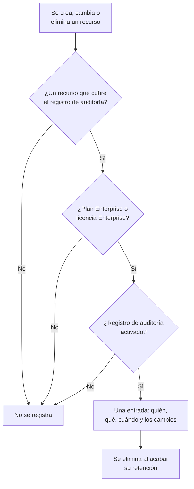

# Registros de auditoría

El registro de auditoría guarda quién cambió qué en su proyecto: cada creación, modificación y eliminación de los recursos que cubre, con los valores de antes y después. Úselo para saber quién desactivó un monitor o cambió una clave de API, y para conservar constancia ante revisiones de cumplimiento. Forma parte del plan Enterprise en OneUptime Cloud, y de la Enterprise Edition cuando lo aloja usted mismo.

:::cards
- [Activar el registro de auditoría](#activar-el-registro-de-auditoría): Empieza desactivado en cada proyecto.
- [Leer el registro de auditoría](#leer-el-registro-de-auditoría): Quién cambió qué, y cuándo.
- [Qué se registra](#qué-se-registra): Los recursos y las acciones que cubre.
- [Cuánto tiempo se conservan las entradas](#cuánto-tiempo-se-conservan-las-entradas): De 7 a 180 días.
:::

## Cómo un cambio se convierte en una entrada

- **Empieza desactivado.** Un proyecto no registra nada hasta que alguien activa el registro de auditoría, ni nada de antes de ese momento.
- **Registra lo que hacen las personas.** Se registra un cambio hecho por una persona, una clave de API, un cliente MCP o un workflow. Un cambio que OneUptime hace por sí mismo, como el de una tarea en segundo plano, queda fuera salvo que active **Almacenar eventos del sistema**.
- **Las entradas no se pueden cambiar.** Nadie puede editar ni eliminar una entrada, ni en el panel ni a través de la API. Una entrada solo desaparece cuando acaba su retención.

## Antes de empezar

- **En OneUptime Cloud, el plan Enterprise.** En otros planes, las páginas del registro de auditoría muestran qué hace la función y cómo obtenerla.
- **Si lo aloja usted mismo, la Enterprise Edition**, con una licencia que incluya los registros de auditoría. Consulte [Edición Enterprise](/docs/self-hosted/enterprise).
- **Un rol que pueda leer el registro de auditoría.** Project Owner, Project Admin, Settings Admin o el permiso **Read Audit Log**. Activar el registro de auditoría y cambiar sus ajustes requiere un Project Owner, un Project Admin o el permiso para editar el proyecto.

## Activar el registro de auditoría

:::steps
### Abrir los ajustes del registro de auditoría

Vaya a **Ajustes del proyecto → Registros de auditoría → Ajustes**. **Registros de auditoría** empieza plegado en el menú lateral: haga clic en él para abrirlo.

### Editar los ajustes

Haga clic en **Edit Audit Log Settings**.

### Activarlo

Active **Habilitar registros de auditoría**, fije **Retención (días)** y decida si quiere **Almacenar eventos del sistema**. Haga clic en **Guardar cambios**.
:::

| Ajuste | Valor inicial | Qué hace |
| --- | --- | --- |
| **Habilitar registros de auditoría** | Desactivado | Registra desde ahora los cambios en los recursos del proyecto. |
| **Retención (días)** | 7 | Cuántos días se conserva cada entrada: de 7 a 180. |
| **Almacenar eventos del sistema** | Desactivado | Registra también los cambios que OneUptime hace por sí mismo, que no inició ninguna persona ni clave. |

Un cambio en estos ajustes se aplica en menos de un minuto.

## Leer el registro de auditoría

**Ajustes del proyecto → Registros de auditoría → Registros de auditoría** enumera cada entrada del proyecto, las más recientes primero:

| Columna | Qué muestra |
| --- | --- |
| **Cuándo** | Hace cuánto, con la fecha y la hora. |
| **Acción** | `Create`, `Update` o `Delete`, o `Download` para un archivo de captura de paquetes que alguien descargó. |
| **Recurso** | El nombre del recurso, que lo abre mientras existe, y su tipo. |
| **Actor** | Quién hizo el cambio: una persona, una clave de API, un workflow o `System` para un cambio que OneUptime hizo por sí mismo. El cambio de una persona hecho a través de un cliente MCP indica cuál. |
| **Cambios** | Cuántos campos cambiaron, o se capturaron en una creación o una eliminación. Haga clic para ver cada campo. |

Filtre por **Tipo de recurso**, **Nombre del recurso**, **Acción**, **Correo electrónico del usuario** u **Hora**. Una modificación solo enumera los campos que cambiaron, antes y después, y un guardado que no cambia nada no añade ninguna entrada.

Los monitores, incidentes, alertas, páginas de estado, SLO y muchos otros recursos tienen también su propia página **Registros de auditoría**, en una sección plegada de su menú lateral como **Avanzado**. Solo enumera las entradas de ese recurso, con las de lo que le pertenece: la página de un SLO muestra también sus reglas y propietarios.

## Qué se registra

| Recurso | **Tipo de recurso** en el registro |
| --- | --- |
| Monitores | `Monitor` |
| Incidentes | `Incident` |
| Alertas | `Alert` |
| Páginas de estado | `Status Page` |
| Eventos de mantenimiento programado | `Scheduled Maintenance Event` |
| Políticas de guardia | `On-Call Policy` |
| SLO | `Service Level Objective` |
| Las reglas y propietarios de un SLO | `SLO Burn Rate Rule`, `SLO Monitor Rule`, `Service Level Objective User Owner`, `Service Level Objective Team Owner` |
| Equipos | `Team` |
| Roles personalizados, y los equipos y claves de API que reciben uno | `Custom Role`, `Team Custom Role`, `API Key Custom Role` |
| Etiquetas | `Label` |
| Estados y gravedades de incidente | `Incident State`, `Incident Severity` |
| Estados y gravedades de alerta | `Alert State`, `Alert Severity` |
| Estados de monitor | `Monitor Status` |
| Estados de mantenimiento programado | `Scheduled Maintenance State` |
| Roles de incidente | `Incident Role` |
| Estados de post mortem | `Postmortem Status` |
| Claves de API | `API Key` |
| Clientes MCP que conectan las personas | `MCP Client Authorization` |
| Elementos del inventario | `Inventory Item` |
| Configuraciones del recolector | `Collector Config` |
| vCenter | `vCenter` |
| Capturas de paquetes, y sus descargas | `Packet Capture` |
| Casos de seguridad y sus prioridades y estados, playbooks y sus ejecuciones, entidades protegidas, criticidad de entidades, y el riesgo de una entidad cuando alguien lo restablece | `Security Case`, `Security Case Priority`, `Security Case Status`, `Security Playbook`, `Security Playbook Run`, `Protected Entity`, `Entity Criticality`, `Entity Risk` |
| Excepciones de regla | `Rule Exception` |
| Listas de seguimiento | `Watchlist` |
| Valores de lista de seguimiento | `Watchlist Value` |
| Cacerías | `Hunt` |
| Tareas y evidencias de los casos de seguridad | `Security Case Task`, `Security Case Evidence` |
| Los almacenes de datos y sus hallazgos, y los problemas, los ajustes, los ajustes de las comprobaciones, los tipos de datos personalizados y las reglas de residencia de Seguridad de datos | `Data Store`, `Data Store Finding`, `Data Security Issue`, `Data Security Setting`, `Check Setting`, `Custom Data Type`, `Residency Rule` |
| Exportaciones del registro de auditoría | `Audit Log Export` |

También se registra que un administrador añada o quite un método de notificación o una regla de guardia personal en la cuenta de otra persona, sin la dirección ni el número en sí.

Otros datos no están en el registro de auditoría, como quién está en un equipo o un permiso añadido por separado a un equipo. Los campos que nadie puede leer se omiten en cada entrada, y las claves, los tokens y las contraseñas se registran como `[REDACTED]`: la entrada muestra que cambiaron, nunca su valor.

## Cuánto tiempo se conservan las entradas

Cada entrada se conserva durante la **Retención (días)** que tenía el proyecto cuando se registró, y después se elimina. Una retención nueva se aplica a las entradas nuevas: las ya registradas conservan sus fechas.

Para conservar entradas más de 180 días, envíelas a su propio almacenamiento o SIEM a medida que se registran: consulte [Exportación del registro de auditoría](/docs/configuration/audit-log-export). También puede leerlas a través de la API con una clave de API que tenga **Read Audit Log**, y guardarlas donde las necesite. Consulte [Referencia de la API de OneUptime](/docs/api-reference/api-reference).

## Cuando el plan o la licencia ya no incluyen los registros de auditoría

- **En OneUptime Cloud**, un proyecto que deja el plan Enterprise deja de registrar, y sus páginas del registro de auditoría muestran la tarjeta de mejora hasta que vuelve a ese plan.
- **Si lo aloja usted mismo**, el registro de auditoría deja de registrar cuando la prueba de Enterprise o el periodo de gracia termina sin licencia, o cuando la licencia no incluye los registros de auditoría. El registro de auditoría lo indica en rojo. Las entradas ya registradas se conservan, y el registro se reanuda con los mismos ajustes en cuanto se activa una licencia. Consulte [Cuando una licencia caduca o falta](/docs/self-hosted/enterprise#cuando-una-licencia-caduca-o-falta).

## Solución de problemas

:::details El registro de auditoría está vacío
El registro de auditoría empieza desactivado y no registra nada de antes de activarse. Si la lista dice que el registro de auditoría está desactivado, siga su enlace a los ajustes y actívelo. Si no, cambie un monitor o un incidente y actualice la lista.
:::

:::details Falta un cambio en el registro de auditoría
Compruebe que el recurso está en [Qué se registra](#qué-se-registra), y que el cambio se hizo después de activar el registro de auditoría. Un cambio que OneUptime hizo por sí mismo solo se registra con **Almacenar eventos del sistema** activado.
:::

## Próximos pasos

:::cards
- [Exportación del registro de auditoría](/docs/configuration/audit-log-export): Enviar el registro de auditoría a su propio almacenamiento o SIEM.
- [Usuarios, equipos y permisos](/docs/permissions/index): Decidir quién puede leer el registro de auditoría.
- [Ajustes del proyecto](/docs/configuration/project-settings): Los demás ajustes del proyecto.
- [Facturación y uso](/docs/configuration/billing): Cambiar el plan del proyecto.
- [Edición Enterprise](/docs/self-hosted/enterprise): Los registros de auditoría en una instalación autoalojada.
:::
