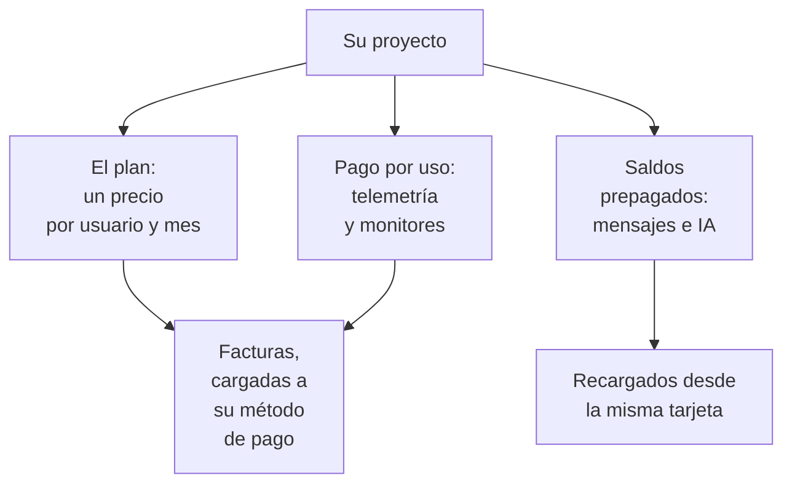

# Facturación y uso

En OneUptime Cloud, un proyecto paga su plan, por usuario, y lo que usa: telemetría, monitores activos, y los mensajes y el trabajo de la IA que paga con saldos prepagados. Esta página muestra dónde ver y cambiar cada uno, y quién puede hacerlo. Una instalación autoalojada no tiene facturación, ni ninguna de estas páginas.

:::cards
- [Su plan y sus asientos](#su-plan-y-sus-asientos): Lo que cuesta el plan, y quién cuenta como asiento.
- [Métodos de pago](#métodos-de-pago): La tarjeta a la que se cargan sus facturas.
- [Facturas](#facturas): Pagarlas, descargarlas y revisar lo que usó.
- [Saldos prepagados](#saldos-prepagados): Mensajes e IA, recargados a mano o automáticamente.
:::

## Lo que paga un proyecto

| Qué | Cómo se cobra |
| --- | --- |
| El plan | Un precio por usuario y mes, facturado mensual o anualmente. Cada persona del proyecto es un asiento. |
| Telemetría | $0.10 por GB ingerido, con 15 días de retención. Una retención más larga cuesta más, y una retención de menos de 7 días se factura como 7 días: consulte [Lo que cuesta la retención](/docs/telemetry/data-retention#lo-que-cuesta-la-retención). |
| Session Replays | $2 por GB, con 15 días de retención. |
| Monitores activos | $1 por monitor y mes. Todo monitor salvo uno manual está activo, incluso mientras está desactivado. |
| SMS, llamadas, WhatsApp y Telegram | Se pagan con el saldo del proyecto a medida que se envía cada mensaje. |
| OneUptime AI | Se paga con los créditos de IA del proyecto, salvo que funcione con su propio proveedor de LLM. |

La [página de precios](https://oneuptime.com/pricing) compara los planes.

## Antes de empezar

- **OneUptime Cloud.** La sección **Facturación y facturas** de los **Ajustes del proyecto** solo existe en OneUptime Cloud, y empieza plegada: haga clic en su título para abrirla.
- **Un rol que pueda leer la facturación.** Los Project Owners, las personas con **Manage Billing** y los tres roles de facturación leen todas las páginas de facturación. Consulte [Quién puede hacer qué](#quién-puede-hacer-qué).

## Su plan y sus asientos

Vaya a **Ajustes del proyecto → Facturación y facturas → Facturación**. La tarjeta **Plan actual** muestra el plan del proyecto y su precio por usuario, y **Asientos**: uno por cada persona del proyecto.

Una persona cuenta como asiento desde el momento en que la invita, antes de que acepte, hasta que la quita. Para cambiar el número de asientos, invite o quite personas: consulte [Invitar a personas](/docs/permissions/inviting-people).

## Cambiar el plan

:::steps
### Añadir primero un método de pago

Un cambio de plan necesita un método de pago. Sin uno, **Cambiar plan** abre **Añadir un método de pago** en su lugar: consulte [Métodos de pago](#métodos-de-pago).

### Hacer clic en Cambiar plan

En la tarjeta **Plan actual**, haga clic en **Cambiar plan**. **Plan anual** empieza activado: desactívelo para ver los precios mensuales.

### Elegir el plan

Cada plan muestra su precio por usuario. La nota bajo los planes dice qué pasa con su prueba: **Your free trial carries over** mientras el proyecto sigue en su prueba, y **Changing plan does not start a free trial** cuando ya no lo está.

### Guardar el cambio

Haga clic en **Guardar cambios**. Un plan de pago se factura desde el momento en que cambia a él, y cada persona que invita con ese plan se factura al invitarla.
:::

Las claves de API solo funcionan a partir del plan Growth, y por debajo del plan Scale las conexiones SCIM solo quitan personas. Un plan que las detiene dice cuántas antes de que lo elija, y la página **Facturación** muestra **No incluido en este plan** mientras están detenidas. No se elimina nada: vuelven a funcionar con un plan que las incluya.

> [!NOTE]
> ¿Compró OneUptime a través de un revendedor o de un marketplace en la nube (AWS Marketplace, Microsoft Marketplace, Google Cloud Marketplace o Vercel Marketplace)? La página **Facturación** lo indica. Un revendedor cambia su plan por usted, y un marketplace cobra el plan y el uso del proyecto en su factura de la nube.

## Métodos de pago

La tarjeta **Métodos de pago** enumera las tarjetas del proyecto. Las facturas se cargan automáticamente a la predeterminada.

:::steps
### Hacer clic en Añadir método de pago

En la tarjeta **Métodos de pago**, haga clic en **Añadir método de pago**.

### Introducir la tarjeta

Introduzca los datos de pago y haga clic en **Guardar método de pago**. El método que añade pasa a ser el predeterminado, y añadir uno activa el pago por uso. No cambia su plan.
:::

- **Establecer como predeterminado** convierte otro método de la lista en aquel al que se cargan las facturas.
- **Volver a sincronizar el pago automático**, en el método predeterminado, corrige una renovación que todavía carga una tarjeta antigua.
- El proyecto conserva al menos un método de pago: añada otro antes de eliminar el último.

## Dirección de facturación y correo de facturas

La tarjeta **Datos de la empresa / dirección de facturación** contiene lo que sus facturas dicen de usted. Haga clic en **Actualizar** y complete dos pasos:

| Paso | Campos |
| --- | --- |
| **Dirección de facturación** | **Datos de la empresa / dirección de facturación**: la razón social de su empresa, su dirección y su identificación fiscal o de IVA. **País**: su país de facturación. |
| **Facturas** | **Correo electrónico de finanzas / contabilidad**: adónde van las facturas, los recibos y los avisos de facturación, varias direcciones separadas por comas. **Enviar facturas por correo electrónico**: enviar allí cada factura cuando se emite. |

## Facturas

**Ajustes del proyecto → Facturación y facturas → Facturas** enumera las facturas del proyecto, cada una con su **Número de factura**, **Fecha de la factura**, **Importe** y **Estado de la factura**.

- **Pagar factura** paga una factura que aún debe dinero.
- **Descargar** abre la factura en PDF. En una factura que aún debe dinero, está en el menú **⋯** de la fila.

Cuando su banco todavía procesa un pago, OneUptime lo indica: algunos bancos tardan hasta 2 días en confirmar un pago con tarjeta, y la factura se actualiza sola. No la pague de nuevo.

## Historial de uso

**Ajustes del proyecto → Facturación y facturas → Historial de uso** muestra la telemetría que envió el proyecto, una fila por producto, servicio y día:

| Columna | Qué muestra |
| --- | --- |
| **Producto** | Registros, trazas, métricas y los demás tipos de telemetría. |
| **Día** | El día en que se envió. |
| **Servicio** | El servicio, o el host, el clúster u otro recurso, que la envió. |
| **Datos ingeridos (en GB)** | Cuánto llegó. |
| **Retención de datos (en días)** | Cuánto tiempo se conserva. |
| **Costo total** | Lo que costó, en dólares estadounidenses. |

El uso de un día aparece cuando el día termina. Filtre por **Producto**, **Día** o **Servicio** para encontrar lo que creció.

## Saldos prepagados

Los mensajes de SMS, llamadas, WhatsApp y Telegram se pagan con el saldo del proyecto, y OneUptime AI con sus créditos de IA. Usted recarga cada uno por adelantado:

| Saldo | Dónde |
| --- | --- |
| SMS, llamadas, WhatsApp y Telegram | **Ajustes del proyecto → Notificaciones → Ajustes de notificaciones** |
| OneUptime AI | **Ajustes del proyecto → IA → Créditos de IA** |

:::steps
### Recargarlo ahora

En la tarjeta **Saldo actual** de la página, haga clic en **Recargar saldo**. Introduzca un importe de $20 a $1,000 y haga clic en **Recargar**. El importe se carga a la tarjeta del proyecto.

### O dejar que se recargue solo

En la tarjeta **Recarga automática**, haga clic en **Editar recarga automática** y active **Habilitar recarga automática**. Empieza desactivada. Una vez activada, OneUptime añade $20 cada vez que el saldo baja a $10, o los importes que elija.
:::

Cuando un saldo no alcanza, el mensaje no se envía o OneUptime AI se detiene, y los propietarios del proyecto reciben un correo. Consulte [Cuando un aviso no se envía](/docs/on-call/escalation-rules#cuando-un-aviso-no-se-envía) y [Cuando se agotan los créditos de IA](/docs/ai/ai-sre#cuando-se-agotan-los-créditos-de-ia).

## Quién puede hacer qué

| Para | Se necesita |
| --- | --- |
| Leer las páginas de facturación: el plan, las facturas, el uso, los saldos y los métodos de pago | Project Owner, **Manage Billing**, **Billing Admin**, **Billing Member** o **Billing Viewer** |
| Descargar una factura | Project Owner, Project Admin, **Manage Billing**, **Read Invoices**, **Billing Admin** o **Billing Member** |
| Cambiar la dirección de facturación y el correo de facturas | Project Owner, **Manage Billing**, **Billing Admin** o **Billing Member** |
| Activar o desactivar SMS, llamadas, WhatsApp o Telegram | Project Owner, **Manage Billing** o **Billing Admin** |
| Añadir un método de pago | Project Owner, **Manage Billing** o **Create Payment Method** |
| Pagar una factura | Project Owner, **Manage Billing** o **Edit Invoices** |
| Cambiar el plan, recargar un saldo o cambiar la recarga automática | Project Owner o **Manage Billing** |

Un botón que no puede usar aparece bloqueado e indica quién puede. Consulte [Usuarios, equipos y permisos](/docs/permissions/index#equipos) para los roles de facturación.

## Ajustes que necesitan un plan

En OneUptime Cloud, estos ajustes de administración necesitan un plan. Una página cuyo plan no tiene muestra qué hace la función y el plan que necesita.

| Ajuste | El plan que necesita |
| --- | --- |
| Etiquetas | Growth |
| Claves de API | Growth |
| Sus propios servidores SMTP y cuentas de Twilio | Growth |
| Sus propios proveedores de LLM | Growth |
| Conectar clientes MCP | Growth |
| Crear equipos | Scale |
| SSO, OIDC y SCIM | Scale |
| Anulaciones de retención | Scale |
| Registros de auditoría | Enterprise |

## Cancelar el plan

Para dejar de pagar por un proyecto, elimínelo: la facturación se detiene cuando se elimina. Consulte [Eliminar el proyecto](/docs/configuration/project-settings#eliminar-el-proyecto). Un proyecto comprado a través de un revendedor se cancela con el revendedor, y uno comprado a través de un marketplace en la nube, en el marketplace.

## Solución de problemas

:::details "Add a payment method in Project Settings > Billing and Invoices > Billing before using paid monitoring or telemetry"
Un proyecto en el plan Free necesita un método de pago antes de crear monitores activos o enviar telemetría, porque se pagan por uso. Añada uno en [Métodos de pago](#métodos-de-pago). Los monitores manuales siguen siendo gratuitos.
:::

:::details Un aviso rojo dice que hay facturas sin pagar
Un proyecto con facturas sin pagar queda inactivo, y se elimina si siguen sin pagarse. Abra **Facturas** y haga clic en **Pagar factura** en cada una que aún deba dinero.
:::

:::details Cambiar plan abre Añadir un método de pago
El proyecto aún no tiene método de pago. Añada uno y después cambie el plan.
:::

:::details El historial de uso está vacío
El uso se cuenta por día, y un día aparece cuando termina. Un proyecto que no envió telemetría no tiene filas.
:::

## Próximos pasos

:::cards
- [Ajustes del proyecto](/docs/configuration/project-settings): Todo lo demás que se aplica al proyecto entero.
- [Invitar a personas](/docs/permissions/inviting-people): Añadir a las personas para las que son sus asientos.
- [Retención de datos](/docs/telemetry/data-retention): Conservar la telemetría el tiempo necesario, y no más.
- [Filtros de descarte y reglas de depuración](/docs/telemetry/drop-filters-and-scrub-rules): Dejar de pagar por telemetría que no usa.
:::
