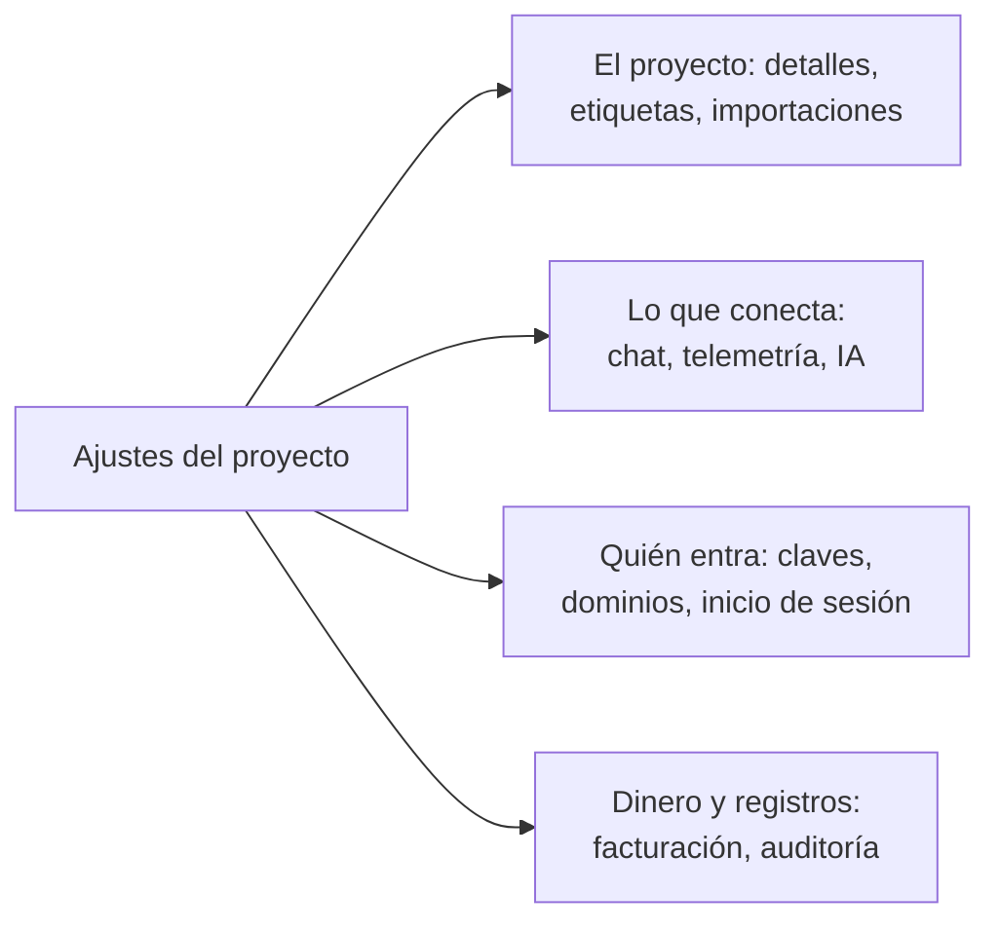

# Ajustes del proyecto

Los ajustes del proyecto contienen lo que se aplica al proyecto entero: su nombre, las herramientas a las que se conecta, sus claves, cómo inician sesión las personas, su facturación y su registro de auditoría. Casi todo se configura una vez y se revisa pocas veces. Esta página es un mapa de ellos, y cubre los ajustes que no tienen página propia: los detalles del proyecto, las etiquetas, los feature flags y la eliminación del proyecto.

:::cards
- [Encontrar un ajuste](#encontrar-un-ajuste): Qué contiene cada sección del menú lateral.
- [Los detalles del proyecto](#los-detalles-del-proyecto): Su nombre, su ID y el acceso del soporte.
- [Etiquetas](#etiquetas): Marcas para recursos, permisos y reglas.
- [Eliminar el proyecto](#eliminar-el-proyecto): Qué se necesita y qué se va con él.
:::

## Abrir los ajustes del proyecto

Vaya a **Productos → Ajustes → Ajustes del proyecto**. El menú lateral agrupa las páginas en secciones, y solo **Básico** empieza abierta: haga clic en el título de una sección para abrirla. Una sección se abre sola en cualquier página que contenga.

## Antes de empezar

- **Un rol que pueda cambiar el proyecto.** Los Project Owners y los Project Admins cambian la mayoría de estos ajustes. La facturación, los canales de notificación y la eliminación del proyecto requieren más, como dice cada sección.
- **En OneUptime Cloud, el plan que incluye un ajuste.** Algunos ajustes necesitan un plan: consulte [Ajustes que necesitan un plan](/docs/configuration/billing#ajustes-que-necesitan-un-plan).

## Encontrar un ajuste

| Sección | Páginas | Dónde leer más |
| --- | --- | --- |
| **Básico** | **Proyecto**, **Etiquetas** | [Los detalles del proyecto](#los-detalles-del-proyecto), [Etiquetas](#etiquetas) |
| **Espacio de trabajo** | **Slack**, **Microsoft Teams**, **Videollamadas** | [Slack](/docs/workspace-connections/slack), [Microsoft Teams](/docs/workspace-connections/microsoft-teams), [Videollamadas](/docs/workspace-connections/video-calls) |
| **Telemetría y APM** | **Claves de ingesta**, **Retención de datos** | [Claves de ingesta](/docs/telemetry/ingestion-keys), [Retención de datos](/docs/telemetry/data-retention) |
| **Notificaciones** | **Ajustes de notificaciones**, **Registros de notificación**, **Aplicaciones móviles** | [Notificaciones](#notificaciones) |
| **IA** | **Funciones de IA**, **Proveedores de LLM**, **Servidores MCP externos**, **Créditos de IA**, **Registros de IA**, **Servidor MCP** | [Proveedores de LLM](/docs/ai/llm-provider), [Servidores MCP externos](/docs/ai/external-mcp-servers), [Servidor MCP](/docs/ai/mcp-server), [AI SRE](/docs/ai/ai-sre#control-de-costes) |
| **Avanzado** | **Dominios**, **Claves de API**, **Feature flags**, **Importar desde otra herramienta** | [Dominios personalizados](/docs/status-pages/branding-and-domains#dominios-personalizados), [Claves de API](/docs/permissions/index#claves-de-api), [Feature flags](#feature-flags), [Migrar desde Opsgenie](/docs/moving-to-oneuptime/opsgenie) y las demás guías de migración |
| **Seguridad** | **SSO**, **SCIM** | [SSO](/docs/identity/sso), [SCIM](/docs/identity/scim) |
| **Facturación y facturas** | **Facturación**, **Historial de uso**, **Facturas** | [Facturación y uso](/docs/configuration/billing) |
| **Registros de auditoría** | **Registros de auditoría**, **Ajustes**, **Exportar** | [Registros de auditoría](/docs/configuration/audit-logs), [Exportación del registro de auditoría](/docs/configuration/audit-log-export) |
| **Zona de peligro** | **Zona de peligro** | [Eliminar el proyecto](#eliminar-el-proyecto) |

**Facturación y facturas** y **Créditos de IA** solo existen en OneUptime Cloud: una instalación autoalojada no tiene facturación.

## Los detalles del proyecto

**Ajustes del proyecto → Básico → Proyecto** contiene dos tarjetas.

**Detalles del proyecto** muestra el nombre del proyecto y su ID:

- **Nombre del proyecto**: haga clic en **Editar Proyecto** para cambiar el nombre del proyecto. Un nombre tiene al menos 2 caracteres. Cambiar el nombre requiere un Project Owner, o el permiso para editar el proyecto o para gestionar la facturación.
- **ID del proyecto**: cópielo para la API, la CLI y Terraform, o cuando escriba al soporte.
- **Residencia de datos**: en OneUptime Cloud, dónde deben guardarse los datos de su proyecto, cuando OneUptime lo ha registrado. Solo OneUptime lo establece.

**Acceso del soporte al cliente**, en OneUptime Cloud, decide si el equipo de soporte de OneUptime puede abrir el proyecto. Active **Permitir que el soporte de OneUptime acceda a este proyecto** cuando quiera su ayuda: OneUptime pregunta antes, porque entonces el soporte puede ver y cambiar todo en el proyecto, y usted hace clic en **Dejar entrar al soporte**. Desactívelo cuando terminen: se guarda al instante. Los Project Owners y los Project Admins lo cambian.

## Etiquetas

Las etiquetas son marcas que pone en monitores, incidentes, páginas de estado y otros recursos. Filtran y agrupan las listas, y limitan hasta dónde llegan los permisos de un equipo y las reglas del proyecto.

:::steps
### Abrir las etiquetas

Vaya a **Ajustes del proyecto → Básico → Etiquetas**.

### Crear una etiqueta

Haga clic en **Crear Etiqueta**. Dele un **Nombre** y, si quiere, una **Descripción**. **Color de la etiqueta** ya está elegido, un color que ninguna etiqueta de la página usa todavía: elija otro si lo prefiere. Haga clic en **Crear Etiqueta** para guardarla.
:::

En OneUptime Cloud, crear y cambiar etiquetas requiere el plan Growth. Consulte [Etiquetas](/docs/permissions/index#etiquetas) para ver cómo las etiquetas limitan los permisos, y [Reglas de etiquetas y propietarios](/docs/configuration/label-and-owner-rules) para etiquetar los recursos al crearlos.

En una lista, las etiquetas de un registro se muestran una debajo de otra; cuando hay más de cuatro, se muestran las tres primeras con un enlace al resto. Dondequiera que se listen etiquetas (en las listas, en la página de un registro y en cada selector de etiquetas), aparecen en orden natural: primero las etiquetas cuyo nombre empieza por un número, en el orden de ese número (`2. Team` antes que `10. Owner`), y después las demás por orden alfabético, sin distinguir mayúsculas y minúsculas. Para elegir el orden de sus etiquetas, empiece su nombre con un número, como `1. Category` y `2. Subcategory`.

### Archivar una etiqueta

Para retirar una etiqueta, archívela desde el menú **⋯** de su fila en lugar de eliminarla. Todo lo que tiene la etiqueta la conserva y puede seguir filtrando por ella, pero nadie puede volver a añadirla a nada: cada selector de etiquetas la omite, y la API, Terraform y MCP la rechazan. El diálogo enumera las reglas y los permisos configurados para usar la etiqueta, que la siguen usando hasta que los cambie. Las etiquetas archivadas se listan aparte, en la sección plegada **Etiquetas archivadas**, donde **Desarchivar** devuelve una. **Eliminar** enumera primero todo aquello de lo que se quitaría la etiqueta y ofrece **Archivar en su lugar**.

## Notificaciones

**Ajustes del proyecto → Notificaciones** contiene cómo envía notificaciones el proyecto:

- **Ajustes de notificaciones**: la tarjeta **Canales de notificación** activa o desactiva SMS, llamadas telefónicas, WhatsApp y Telegram para el proyecto. Los cuatro empiezan desactivados. Los activa un Project Owner, un **Administrador de facturación** o alguien con **Manage Billing**. La página también contiene los servidores de correo propios del proyecto, en **Configuraciones de SMTP personalizado** (consulte [SMTP](/docs/emails/smtp)), y su propia cuenta de Twilio (consulte [Integración de Twilio](/docs/self-hosted/twilio-integration)). En OneUptime Cloud, contiene el saldo con el que se pagan estos mensajes: consulte [Saldos prepagados](/docs/configuration/billing#saldos-prepagados).
- **Registros de notificación**: cada notificación que envió el proyecto, con una pestaña por canal: **Correo electrónico**, **SMS**, **WhatsApp**, **Telegram**, **Webhook**, **Llamada**, **Push** y **Espacio de trabajo**.
- **Aplicaciones móviles**: dónde conseguir las aplicaciones para iOS y Android. Consulte [Visión general de las aplicaciones](/docs/mobile-desktop-apps/index).

## Feature flags

**Ajustes del proyecto → Avanzado → Feature flags** activa o desactiva funciones opcionales para el proyecto. Cada una es un interruptor que se guarda al moverlo. Hoy contiene **Grupos de monitores**, desactivado en un proyecto nuevo: actívelo para añadir los grupos de monitores al menú Monitores. Desactivarlo no elimina ningún grupo. Consulte [Grupos de monitores](/docs/monitor/monitor-groups).

## Eliminar el proyecto

Eliminar un proyecto elimina todo lo que contiene, para cada miembro: sus monitores, incidentes, páginas de estado, configuración de guardias y telemetría. Nada lo recupera.

:::steps
### Abrir la zona de peligro

Vaya a **Ajustes del proyecto → Zona de peligro**.

### Hacer clic en Eliminar proyecto

Haga clic en **Eliminar proyecto**. Un diálogo le pide que confirme.

### Escribir el nombre del proyecto

Escriba el nombre exactamente como es. **Eliminar proyecto** sigue bloqueado hasta que lo haga. En OneUptime Cloud, el diálogo también pregunta por qué se va: la respuesta es opcional.

### Confirmar

Haga clic en **Eliminar proyecto**. OneUptime elimina el proyecto y le saca de él.
:::

> [!CAUTION]
> Eliminar el proyecto no se puede deshacer. Requiere un Project Owner, o el permiso para eliminar el proyecto.

En OneUptime Cloud, eliminar el proyecto es la forma de cancelar su plan: la facturación se detiene cuando se elimina el proyecto. Un proyecto facturado a través de un marketplace en la nube recibe un último cargo por su uso, y su compra en el marketplace sigue activa hasta que la cancele allí.

## Solución de problemas

:::details Parece que falta una sección del menú lateral
Todas las secciones salvo **Básico** empiezan plegadas. Haga clic en el título de la sección para abrirla. En una instalación autoalojada no hay sección **Facturación y facturas** ni página **Créditos de IA**.
:::

:::details Editar Proyecto está bloqueado
Cambiar el nombre del proyecto requiere un Project Owner, o el permiso para editar el proyecto o para gestionar la facturación. El botón bloqueado nombra el permiso que necesita.
:::

:::details Eliminar proyecto sigue bloqueado en el diálogo
Escriba el nombre del proyecto exactamente como lo muestra el diálogo: las mayúsculas y minúsculas cuentan.
:::

## Próximos pasos

:::cards
- [Invitar a personas](/docs/permissions/inviting-people): Traer a su equipo al proyecto.
- [Facturación y uso](/docs/configuration/billing): Su plan, métodos de pago, facturas y uso.
- [Registros de auditoría](/docs/configuration/audit-logs): Ver quién cambió qué en el proyecto.
- [SSO](/docs/identity/sso): Permitir que las personas inicien sesión con su proveedor de identidad.
:::
