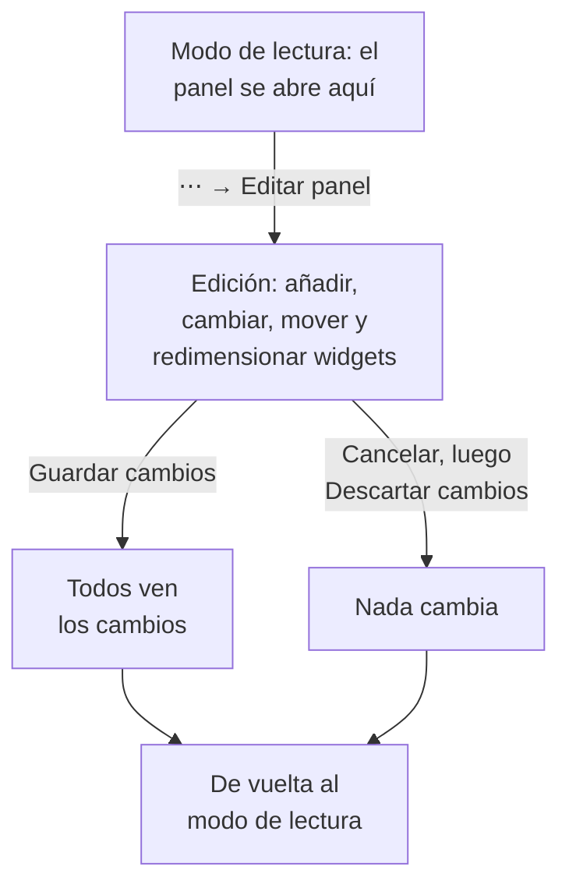

# Crear un panel

Para crear un panel, abre **Productos → Paneles** y haz clic en **Crear panel**. El cuadro de diálogo **Crear un panel** te pregunta cómo quieres empezar y después un nombre. **Empezar desde cero** te da un panel vacío; una plantilla crea sus widgets, y a menudo sus variables, por ti, y rellena su nombre (numerado, como "Kubernetes Dashboard 2", si el proyecto ya tiene uno). Haz clic en **Crear panel** y se abre el nuevo panel. Uno vacío se abre en su lienzo, con un botón **Añadir widget** para su primer widget.

:::cards
- [Crear el panel](#crear-el-panel): Empezar desde cero o desde una plantilla.
- [Editar y guardar](#editar-y-guardar): Nada cambia para nadie hasta que haces clic en Guardar cambios.
- [Añadir un widget](#añadir-un-widget): Elegirlo en el catálogo, configurarlo y colocarlo.
- [Hacer zoom en un pico](#hacer-zoom-en-un-pico): Arrastra sobre un gráfico para leer todo el panel en ese momento.
:::

## Antes de empezar

Los propietarios y administradores del proyecto pueden crear y editar todos los paneles. Los demás necesitan un permiso de equipo: `CreateDashboard` para crear paneles y `EditDashboard` para cambiarlos. Los miembros y observadores del proyecto pueden leer los paneles sin ninguno de los dos. Quien no puede editar un panel sigue abriendo su menú **⋯**, donde **Editar panel** está bloqueado e indica qué permiso necesita.

## Crear el panel

:::steps
### Elegir cómo empezar

Abre **Productos → Paneles** y haz clic en **Crear panel**. El cuadro de diálogo **Crear un panel** se abre en **Empezar desde cero**, un panel vacío para tus propios widgets. Debajo, **O empieza con una plantilla** muestra seis plantillas **Recomendadas**.

### Elegir una plantilla

Haz clic en una plantilla para ver lo que añade: sus widgets, con los nombres de **Añadir widget**, y las variables con las que lo acotas en su barra de herramientas. Para las demás, elige una categoría junto al cuadro de búsqueda, o **Todas las plantillas**, o escribe en **Buscar plantillas…**: cada palabra que escribes tiene que coincidir. Después haz clic en **Usar esta plantilla**, o haz doble clic en la plantilla. En el cuadro de búsqueda, las flechas eligen una plantilla e **Intro** la usa.

### Poner nombre al panel

El nombre de una plantilla viene rellenado, numerado después de los nombres que el proyecto ya tiene. **Empezar desde cero** lo deja vacío: escribe uno. La descripción es opcional, está plegada en **Más campos**, y puedes añadirla más tarde en la página **Vista general** del panel. **Atrás** te lleva a las plantillas tal como las dejaste.

### Crearlo

Haz clic en **Crear panel**. Se abre el nuevo panel: los widgets de una plantilla de inmediato, o un lienzo vacío con **Añadir widget** encima.
:::

Las plantillas, según la categoría en la que las muestra el selector:

| Categoría | Plantillas |
| --- | --- |
| Monitoreo y APM | Monitor Dashboard, Metrics Dashboard, Real User Monitoring Dashboard, SLO Dashboard |
| Respuesta a incidentes | Incident Dashboard, Alert Dashboard |
| Infraestructura | Kubernetes Dashboard, Kubernetes Cost Dashboard, Hosts Dashboard, Proxmox Dashboard, VMware Dashboard, Ceph Dashboard, Storage Array Dashboard, Docker Swarm Dashboard, Network Dashboard |

**Recomendadas** reúne Monitor Dashboard, Incident Dashboard, Alert Dashboard, Kubernetes Dashboard, Hosts Dashboard y Metrics Dashboard. Una plantilla es un punto de partida, no un vínculo: una vez creado el panel, cámbialo como quieras. La plantilla no vuelve a actualizarlo después.

## Editar y guardar

Un panel se abre en modo de lectura. Para cambiarlo, abre el menú **⋯** de su barra de herramientas y elige **Editar panel**. La barra de herramientas muestra **Editando** junto al nombre, y sustituye el intervalo de tiempo y sus otros controles por **Añadir widget**, **Variables**, **Cancelar** y **Guardar cambios**, con una fila debajo para el **Intervalo de tiempo predeterminado** y la **Actualización automática predeterminada** del panel.

Tus cambios son solo tuyos hasta que los guardas. Nada se guarda mientras editas, así que los demás siguen viendo el panel tal como estaba.

- **Guardar cambios** guarda los widgets, sus posiciones y tamaños, las variables, y el intervalo de tiempo y la actualización automática predeterminados, todo a la vez, y vuelve al modo de lectura. Si el guardado se rechaza, por ejemplo porque has perdido el permiso entretanto, sigues en modo de edición con tus cambios, y el motivo aparece encima de la cuadrícula.
- **Cancelar** pregunta primero, porque descarta tus cambios: **Descartar cambios** vuelve al panel tal como se guardó, y **Seguir editando** te devuelve a tu trabajo.

Mientras editas, la actualización automática se pausa, y un intervalo de tiempo con zoom vuelve al intervalo que elegiste.

## Añadir un widget

:::steps
### Abrir el catálogo de widgets

Haz clic en **Añadir widget**: en la barra de herramientas mientras editas, o en el lienzo de un panel vacío. El catálogo agrupa sus widgets según lo que muestran. Escribe en su cuadro de búsqueda para encontrar uno por su nombre o su finalidad ("error budget", "pods"), y pulsa Intro para añadir el primer resultado.

### Elegir un widget

Haz clic en él. El widget se coloca en el primer hueco libre de la cuadrícula en el que cabe, y se abren sus ajustes.

### Definir lo que muestra

El cuadro de diálogo de ajustes muestra una **Vista previa en vivo** del widget encima de sus ajustes, y la vista previa sigue cada cambio que haces. Elige lo que lee el widget (una consulta de métricas, un filtro, un texto) y su aspecto, y haz clic en **Hecho**.

### Colocarlo

Arrastra el widget para moverlo, y arrastra sus bordes o esquinas para cambiar su tamaño. Consulta [Los widgets en la cuadrícula](#los-widgets-en-la-cuadrícula).
:::

[Widgets del panel](/docs/dashboards/widgets) enumera cada widget y sus ajustes.

## Los widgets en la cuadrícula

El lienzo es una cuadrícula de doce columnas de ancho. Los widgets se ajustan a ella, y la página crece hacia abajo a medida que añades filas. Mientras arrastras un widget, un contorno discontinuo muestra dónde va a quedar, con su columna y su fila; mientras cambias el tamaño de uno, el contorno muestra su tamaño en unidades de la cuadrícula. Los widgets que estorban se apartan, así que dos widgets nunca se solapan.

Cada tipo de widget tiene un tamaño mínimo, para que lo que dibuja siga siendo legible: un gráfico mide al menos seis columnas de ancho y tres filas de alto, mientras que un solo número cabe en una celda.

La cuadrícula es tan ancha como la pantalla. En una pantalla más estrecha, sus columnas se estrechan y sus filas conservan su altura. En un teléfono, los widgets se muestran uno debajo de otro, cada uno tan ancho como la pantalla, en el orden en que están en la cuadrícula: fila por fila desde arriba y, dentro de una fila, de izquierda a derecha. Allí un gráfico se dibuja más alto, para que su trazado tenga espacio. Al editar en un teléfono ves la cuadrícula, que se desplaza en horizontal.

Para cambiar un widget más tarde, haz clic en él mientras editas. Sus ajustes se abren de nuevo, con dos botones más en la parte inferior:

- **Duplicar widget** añade una copia, con los mismos ajustes, en el primer hueco libre.
- **Eliminar widget** lo quita, una vez que lo confirmas.

## Intervalo de tiempo y actualización automática

En modo de lectura, el selector de intervalo de tiempo de la barra de herramientas fija la ventana que leen todos los widgets de gráficos, números, registros y trazas. Elige un preajuste, desde los últimos 5 minutos hasta los últimos 3 meses, o un inicio y un fin personalizados. El panel se abre en su intervalo de tiempo predeterminado: la última hora, salvo que alguien que lo edite elija otro.

Las listas de incidentes, alertas, monitores y recursos muestran su estado actual, sea cual sea el intervalo de tiempo.

Junto al intervalo de tiempo, el menú de actualización automática vuelve a leer cada widget cada 5 segundos, 10 segundos, 30 segundos, 1 minuto, 5 minutos o 15 minutos, con una cuenta atrás hasta la siguiente actualización. Déjala desactivada mientras investigas, para que la vista se quede quieta. El panel se abre con su actualización automática predeterminada: desactivada, salvo que alguien que lo edite elija otra.

El selector de intervalo de tiempo, las variables y la actualización automática aparecen en cuanto el panel tiene un widget.

### Los valores predeterminados del panel

Mientras editas el panel, la fila bajo los botones de la barra de herramientas fija con qué lo abre todo el mundo: **Intervalo de tiempo predeterminado**, un preajuste desde los últimos 5 minutos hasta los últimos 3 meses, y **Actualización automática predeterminada**. **Guardar cambios** los guarda con el resto del panel, tanto para tu equipo como para los visitantes de su enlace público. Un inicio y un fin personalizados no pueden ser un valor predeterminado: el panel se quedaría en ese momento para siempre. La fila aparece en cuanto el panel tiene un widget.

Los paneles guardados antes de estos ajustes se abren en la última hora, con la actualización automática que tenían. Mediante la API y Terraform, ambos están en el `dashboardViewConfig` del panel: `timeRange`, un preajuste escrito como en la referencia de la API, por ejemplo `Past 1 Day`, y `refreshInterval`, por ejemplo `1m`. Cualquier otro valor se rechaza.

### Tus propias elecciones

El intervalo de tiempo y la actualización automática que eliges en modo de lectura son solo tuyos, y tu navegador los recuerda para cada panel: una recarga, un reinicio del navegador o el de una pantalla mural abren el panel tal como lo dejaste. Solo se recuerda un preajuste. Un intervalo personalizado o un zoom dura hasta que sales de la página, para que el panel nunca se quede fijo en un momento pasado.

La primera opción de cada selector nombra el valor predeterminado del panel, como en Predeterminado (Último día). Elígela para volver al valor predeterminado: tu navegador olvida tu elección, y el panel vuelve a seguir su valor predeterminado, incluso cuando alguien lo cambia más tarde. Cuando guardas tú mismo nuevos valores predeterminados, los ves al instante.

### Hacer zoom en un pico

No hace falta recurrir al selector de intervalo de tiempo para examinar un pico. Arrastra sobre el tramo interesante de cualquier gráfico de líneas o de áreas y **todo el panel** pasa a esa ventana, igual que si la hubieras elegido en el selector de intervalo de tiempo: cada widget que usa el intervalo de tiempo vuelve a consultar a la vez, así que lees un mismo momento en todo el panel en lugar de un gráfico a una escala distinta de sus vecinos. Las listas en vivo siguen mostrando lo que ocurre ahora, como siempre.

**Haz doble clic en cualquier gráfico** para deshacerlo: el panel vuelve al intervalo que tenía antes de que empezaras a hacer zoom, por muchas veces que hayas profundizado. Mientras hay un zoom activo, aparece un botón **Restablecer zoom** junto al selector de intervalo de tiempo, y hacer doble clic en un panel sin zoom no hace nada.

Una ventana con zoom es fija, así que deja de avanzar mientras la actualización automática está activa; es deliberado, porque una ventana que se desplazara en plena investigación sería peor. Restablece el zoom para que vuelva a avanzar.

El zoom solo funciona en modo de lectura; en modo de edición, arrastrar mueve y redimensiona los widgets. Los gráficos de barras hacen zoom igual (arrastra sobre las barras), y hacer doble clic en uno restablece el panel como cualquier otro gráfico. Solo un arrastre hace zoom: un clic simple en un gráfico nunca cambia el intervalo del panel. Los mismos gestos funcionan en los gráficos de todo OneUptime; consulta [Hacer zoom en un intervalo de tiempo](/docs/telemetry/charts-and-time-ranges).

## Pantalla completa

**⋯ → Pantalla completa** muestra los widgets del panel en toda la pantalla, para una pantalla mural o una reunión. Pulsa Esc para salir.

## Consejos para paneles que envejecen bien

- **Un tema por panel.** Unos pocos paneles centrados valen más que una página con todo lo que vigilas.
- **Pon el widget más importante arriba.** La gente lee de arriba abajo, así que haz que lo primero que vea responda a "¿está todo sano?"
- **Nombra las secciones con widgets de Texto.** Un encabezado corto cada pocas filas ("Latencia", "Errores", "Capacidad") hace que la página se pueda recorrer de un vistazo desde el otro lado de la sala.
- **Usa variables en lugar de copias.** Si estás a punto de crear el mismo panel para un segundo servicio, añade en su lugar una variable `service`. Consulta [Variables y filtros del panel](/docs/dashboards/variables).
- **Haz una copia antes de un cambio grande.** **Duplicar Panel**, en la página **Ajustes** del panel, crea una copia segura en la que probar tus ideas.

## Próximos pasos

:::cards
- [Widgets del panel](/docs/dashboards/widgets): Cada widget, sus ajustes y cuál elegir.
- [Variables y filtros del panel](/docs/dashboards/variables): Un panel para cada servicio, host o cliente.
- [Compartir y paneles públicos](/docs/dashboards/sharing): Comparte el panel fuera de tu equipo.
- [Configuración y permisos del panel](/docs/dashboards/configuration): Propietarios, etiquetas, archivado y quién puede hacer qué.
:::
