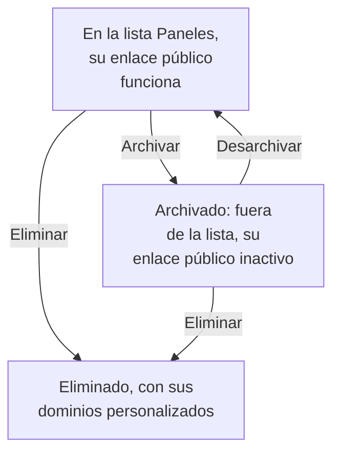

# Configuración y permisos del panel

Una vez que tienes un panel que merece la pena conservar, esta página explica quién puede leerlo y cambiarlo, cómo organizan tus paneles los propietarios y las etiquetas, y cómo copiar, exportar, archivar y eliminar uno.

:::cards
- [Quién puede hacer qué](#quién-puede-hacer-qué): Los permisos detrás de cada acción, y quién los tiene.
- [Propietarios](#propietarios): Los usuarios y equipos a los que pertenece un panel.
- [Duplicar un panel](#duplicar-un-panel): Una copia segura, ya numerada.
- [Archivar un panel](#archivar-un-panel): Guardar un panel sin eliminarlo.
:::

## Quién puede hacer qué

Los paneles siguen los [permisos](/docs/permissions/index) de tu proyecto. Cada acción requiere uno de estos, obtenido a través de un equipo:

| Para | Se necesita |
| --- | --- |
| Leer paneles | `ReadDashboard`, o un rol del proyecto: Project Owner, Project Admin, Project Member, Viewer o un rol Settings |
| Crear paneles | `CreateDashboard`, Project Owner o Project Admin |
| Cambiar un panel: sus widgets, variables, uso compartido y marca, y archivarlo | `EditDashboard`, Project Owner o Project Admin |
| Eliminar un panel | `DeleteDashboard`, Project Owner o Project Admin |
| Añadir y quitar propietarios | Los permisos de propietarios de paneles, Project Owner, Project Admin o Project Member |
| Añadir y cambiar dominios personalizados | Los permisos de dominios de paneles, Project Owner, Project Admin, Project Member, Settings Admin o Settings Member |
| Crear reglas del propietario y reglas de etiquetas | Los permisos de reglas, Project Owner o Project Admin |

Así, un Project Member lee todos los paneles, pero necesita `CreateDashboard` y `EditDashboard` para construirlos. Leer, editar y eliminar pueden limitarse cada uno a los paneles que posee un equipo, o a los paneles que llevan ciertas etiquetas: consulta [Alcance: hasta dónde llega un permiso concedido](/docs/permissions/index#alcance-hasta-dónde-llega-un-permiso-concedido).

Asígnalos en la página **Permisos** de un equipo: abre **Productos → Equipos** y elige el equipo.

Quién puede ver un panel fuera del proyecto es otra cuestión, que se responde en su página **Uso compartido**: consulta [Acceso a los paneles públicos](#acceso-a-los-paneles-públicos).

## Propietarios

Los **propietarios** de un panel son los usuarios y equipos a los que pertenece. Añádelos en la página **Propietarios** del panel, o selecciona varios paneles en la lista **Paneles** y añade propietarios a todos a la vez.

Los propietarios restringen el acceso cuando tú lo pides: un permiso de equipo limitado a los paneles que posee el equipo solo llega a los paneles que tienen como propietario a ese equipo, o a la persona que actúa. La propiedad por sí sola no concede nada.

La lista **Paneles** muestra los propietarios de cada panel, y su filtro **Propietario** encuentra los paneles que posee una persona o un equipo.

## Etiquetas

Las etiquetas son marcas para organizar los paneles. Añádelas en la página **Vista general** del panel, donde también editas su nombre y su descripción, o a varios paneles a la vez desde la lista **Paneles**.

Patrones habituales:

- **Por equipo**: `team:platform`, `team:checkout`, `team:growth`.
- **Por entorno**: `env:prod`, `env:staging`.
- **Por finalidad**: `purpose:oncall`, `purpose:exec`, `purpose:investigation`.

El filtro **Etiquetas** de la lista **Paneles** es la forma más rápida de encontrar un panel en un proyecto que ha acumulado muchos. Las etiquetas también limitan los permisos: un permiso de equipo restringido a ciertas etiquetas solo llega a los paneles que llevan alguna de ellas.

## Reglas del propietario y de etiquetas

En lugar de añadir propietarios y etiquetas a mano, deja que lo hagan las reglas. En **Ajustes**, en el menú lateral de **Paneles**, las **Reglas del propietario** añaden propietarios y las **Reglas de etiquetas** añaden etiquetas a cada panel nuevo que coincide con ellas: por las etiquetas que ya lleva, o por un patrón en su nombre o su descripción. [Reglas de etiquetas y propietarios](/docs/configuration/label-and-owner-rules) explica cómo coinciden las reglas, y cómo aplicar una a los paneles que ya tienes.

## Acceso a los paneles públicos

Quién puede ver un panel fuera del proyecto es una sola elección en su página **Uso compartido** (también **⋯ → Compartir** en el propio panel; consulta [Compartir y paneles públicos](/docs/dashboards/sharing)):

1. **Solo las personas de este proyecto** (la opción predeterminada): el panel no tiene enlace público; su dirección pública muestra una página de no encontrado.
2. **Cualquiera con el enlace**: cualquiera que tenga el enlace público puede verlo, sin iniciar sesión.
3. **Cualquiera con el enlace y una contraseña**: los visitantes introducen una contraseña antes de que aparezca el panel.

En **Más ajustes** de la misma página, la **Lista de IP permitidas** (plan Scale) rechaza las peticiones al enlace público desde cualquier dirección IP que no esté en ella. La configuración pública más restringida es **Cualquiera con el enlace y una contraseña** con una lista de IP permitidas, útil para portales de socios en los que quieres las dos capas.

## Duplicar un panel

Para copiar un panel, ábrelo, ve a su página **Ajustes** y haz clic en **Duplicar Panel**. El nombre de la copia se rellena por ti: el nombre del panel, numerado después de los nombres que el proyecto ya tiene ("Checkout API" se copia como "Checkout API 2", y una copia de esa, como "Checkout API 3"). Cámbialo si quieres, confirma con **Duplicar Panel** y se abre la copia. Tiene los widgets, las variables, la descripción y las etiquetas del panel. La marca y los dominios personalizados se quedan con el original, y el uso compartido público siempre empieza desactivado, para que decidas si activarlo.

Es la opción adecuada cuando quieres bifurcar una plantilla (como "nuestro panel de guardia") en una copia para un servicio concreto.

## Exportar e importar

Un panel viaja como JSON:

- **Exportar Panel**, en la página **Ajustes** del panel, lo descarga como un archivo JSON. Para exportar varios, selecciónalos en la lista **Paneles** y elige **Exportar JSON**.
- **Importar JSON**, encima de la lista **Paneles**, crea paneles a partir de un archivo así, en este proyecto o en otro.

Una exportación contiene los ajustes propios del panel, entre ellos sus widgets y sus variables. Sus propietarios y etiquetas quedan fuera, y los widgets que apuntan a recursos de este proyecto, como un SLO o una fuente de datos, pueden necesitar que se vuelvan a elegir en otro proyecto.

## Archivar un panel

Archiva un panel que ya no usas pero quieres conservar. Un panel archivado sale de la lista **Paneles** y, si es público, su enlace público deja de funcionar: su URL y sus dominios personalizados responden "Dashboard not found". Sus widgets, variables, marca, dominios y ajustes públicos se conservan todos, así que desarchivarlo lo deja exactamente como estaba, enlace público incluido.

Para archivar un panel, ábrelo, ve a su página **Ajustes** y haz clic en **Archivar**. Para archivar varios, selecciónalos en la lista **Paneles** y elige **Archivar**. Para recuperar uno, abre **Paneles → Avanzado → Archivado**, selecciónalo y elige **Desarchivar**, o ábrelo y haz clic en **Desarchivar** en el aviso de la parte superior de sus páginas.

Archivar es la alternativa reversible a eliminar: recurre primero a ella cuando no estés seguro.

## Eliminar un panel

Abre la página **Eliminar** del panel. Eliminar no se puede deshacer: se quitan el panel, sus widgets y variables, y todos los dominios personalizados asociados a él. Tu telemetría no se toca.

Si el panel es público en un dominio personalizado, la dirección deja de responder en cuanto lo eliminas. Para seguir sirviendo la dirección, añade el dominio a otro panel después de eliminar este: un dominio pertenece a un solo panel a la vez.

## Registros de auditoría

La página **Registros de auditoría** del panel enumera cada cambio hecho en el panel, y quién lo hizo. Los registros de auditoría forman parte del plan Enterprise y de la [Edición Enterprise](/docs/self-hosted/enterprise).

## Retención de datos y copias de seguridad

Los paneles en sí no caducan. Los datos que muestran siguen los ajustes de retención de tu proyecto: con el intervalo de tiempo en los últimos 3 meses, un proyecto que conserva sus registros durante 15 días muestra los últimos 15 días de ellos.

Si alojas OneUptime tú mismo, basta con una copia de seguridad periódica de la base de datos: la configuración de un panel se guarda con el resto de tu proyecto. En OneUptime Cloud, las copias de seguridad se hacen por ti. Para tener una copia propia, exporta el panel como JSON, o léelo mediante la [API de OneUptime](/docs/api-reference/api-reference).

## Próximos pasos

:::cards
- [Compartir y paneles públicos](/docs/dashboards/sharing): Enlaces públicos, contraseñas, listas de IP permitidas y dominios personalizados.
- [Usuarios, equipos y permisos](/docs/permissions/index): Equipos, roles, alcances y bloqueos.
- [Variables y filtros del panel](/docs/dashboards/variables): Un panel para cada servicio.
- [Visión general de los paneles](/docs/dashboards/index): La visión de conjunto.
:::
