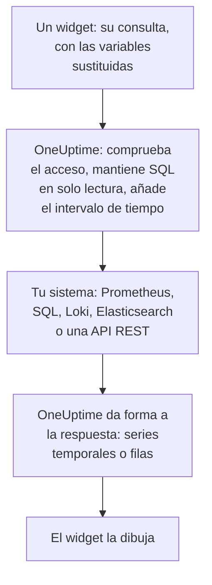

# Fuentes de datos externas

Una fuente de datos externa conecta un sistema ajeno a OneUptime, como Prometheus, una base de datos SQL, ClickHouse, Loki, Elasticsearch o una API REST, para que tus paneles puedan graficar sus datos junto a los tuyos. Conectas el sistema una vez; después, cada widget ejecuta una consulta de solo lectura en el propio lenguaje de ese sistema.

:::cards
- [Conectar una fuente de datos](#conectar-una-fuente-de-datos): Elige el tipo y luego indica dónde está y cómo iniciar sesión.
- [Escribir una consulta](#escribir-una-consulta): PromQL, SQL, LogQL, Query DSL o una petición.
- [Límites](#límites): Los tiempos de espera y topes que protegen a ambos lados.
- [Seguridad](#seguridad): Consultas de solo lectura y credenciales de solo escritura.
:::

## Cómo se ejecuta una consulta

El widget envía su consulta a OneUptime, con las variables ya sustituidas. OneUptime comprueba que puedes leer la fuente de datos, añade el intervalo de tiempo y pregunta a tu sistema con las credenciales que guarda. Después da forma a la respuesta como series temporales o filas para que el widget la dibuje.



## Antes de empezar

- **Un plan que la incluya.** En OneUptime Cloud, crear y cambiar fuentes de datos requiere el plan **Growth**. Eliminar una funciona en todos los planes.
- **Un permiso para añadirlas.** Los propietarios y administradores del proyecto pueden añadir fuentes de datos; los demás necesitan `CreateDataSource`, con `EditDataSource` y `DeleteDataSource` para cambiarlas y eliminarlas. Todos los que pueden leer las fuentes de datos del proyecto, miembros y observadores incluidos, ven los datos de sus widgets.
- **Una cuenta de solo lectura.** Los paneles solo leen. Conecta las bases de datos con una cuenta que solo pueda leer, y las fuentes HTTP con un token que solo pueda consultar.
- **Un camino de entrada.** El servidor de API de OneUptime se conecta a tu sistema, así que debe poder alcanzarlo: consulta [Seguridad](#seguridad) para ver las direcciones que se rechazan.

## Sistemas compatibles

| Tipo | Lenguaje de consulta | Funciona con |
| --- | --- | --- |
| Prometheus | PromQL | Prometheus, Thanos, Cortex, Mimir, VictoriaMetrics |
| PostgreSQL | SQL | PostgreSQL, TimescaleDB, CockroachDB |
| MySQL | SQL | MySQL, MariaDB |
| Microsoft SQL Server | T-SQL | SQL Server, Azure SQL |
| ClickHouse | SQL | ClickHouse, a través de su interfaz HTTP |
| Grafana Loki | LogQL | Loki y endpoints compatibles con Loki |
| Elasticsearch | Query DSL (JSON) | Elasticsearch, OpenSearch |
| REST API | Petición (JSON) | Cualquier API HTTP(S) que responda con JSON |

## Conectar una fuente de datos

:::steps
### Abrir Fuentes de datos

Abre **Productos → Paneles**, despliega **Ajustes** en el menú lateral y haz clic en **Fuentes de datos**.

### Elegir el tipo

Haz clic en **Crear Fuente de datos**. El cuadro de diálogo **Elige un tipo de fuente de datos** agrupa los tipos según lo que contienen: métricas, registros, bases de datos, búsqueda y API. Haz clic en uno.

### Ponerle nombre

En **Información básica**, dale un **Nombre**, como "Prometheus de producción", y una **Descripción** si quieres.

### Indicar dónde está

En **Conexión**, una fuente HTTP recibe la **URL** en la que responde. Una base de datos recibe su **Host de la base de datos**, su **Puerto de la base de datos** (déjalo vacío para 5432, 3306, 1433 u 8123) y su **Nombre de la base de datos**.

### Indicar cómo iniciar sesión

En **Autenticación**, introduce un **Nombre de usuario** y una **Contraseña** o, para una fuente HTTP, un **Token de API**, que se envía como token bearer. **Más campos** contiene **Encabezados HTTP personalizados**, como `{ "X-Scope-OrgID": "tenant-1" }`, y **Opciones adicionales**: `sslEnabled` y `sslRejectUnauthorized` para las bases de datos, y `elasticsearchIndex` para Elasticsearch, que sin él lee todos los índices (`*`).

### Probarla

Haz clic en **Crear Fuente de datos** y luego en **Probar** en su fila. OneUptime se conecta con los datos que diste, y dice si ha funcionado o qué ha fallado.
:::

Para cambiar una fuente de datos más tarde, ábrela desde la lista. **Editar** en **Detalles de la fuente de datos** cambia todo menos sus secretos; **Actualizar credenciales** sustituye la contraseña, el token o los encabezados, y deja como estaban los campos que dejes vacíos; **Probar** vuelve a comprobarla.

## Usarla en un widget

Edita un panel, haz clic en **Añadir widget** y elige un widget del grupo Fuentes de datos externas: un **Gráfico**, un **Valor**, un **Indicador** o una **Tabla**. En sus ajustes:

- Elige la **Fuente de datos** y escribe la **Consulta**. El editor indica el lenguaje de consulta y muestra un ejemplo para el tipo.
- En un gráfico, **Añadir consulta** superpone más consultas en los mismos ejes, y **Leyenda (opcional)** nombra cada serie a partir de sus etiquetas: `{{instance}} — errors` escribe delante la etiqueta `instance` de la serie.
- En un valor o un indicador, **Reduce** convierte los puntos en un solo número: el último valor (el predeterminado), el primero, la media, la suma, el mínimo o el máximo. **Unidad** añade un sufijo, y escala las unidades conocidas: `Bytes` se lee como 1,5 MB, y `ms` como 2,4 sec.
- En una tabla, cualquier consulta de solo lectura funciona, y sus filas se muestran tal como llegan.

## Escribir una consulta

Cada tipo usa su propio lenguaje, con las mismas reglas sobre lo que se devuelve:

- **Los gráficos, valores e indicadores necesitan series temporales.** Una consulta SQL devuelve una columna de tiempo llamada `time`, `timestamp`, `date` o `ts`, y una columna numérica `value` (o su primera columna numérica); cada una de las demás columnas se convierte en una etiqueta de la serie. Elasticsearch necesita una agregación `date_histogram`, y Loki una consulta de métricas como `rate()` o `count_over_time()`.
- **Las tablas muestran filas** tal como las devuelve la consulta: filas SQL, series de Prometheus, líneas de registro de Loki, resultados de Elasticsearch, o los objetos en el `rowsPath` de una API REST.

:::tabs
@tab Prometheus
```text title="PromQL"
sum by (job) (rate(http_requests_total{job=~"{{job}}"}[5m]))
```
@tab SQL
```sql title="SQL"
SELECT date_trunc('minute', created_at) AS time, COUNT(*) AS value
FROM orders
WHERE created_at BETWEEN $__startTime AND $__endTime
GROUP BY 1
ORDER BY 1
```
@tab Loki
```text title="LogQL"
sum by (app) (rate({app="api"} |= "error" [5m]))
```
@tab Elasticsearch
```json title="Query DSL"
{
  "query": { "range": { "@timestamp": { "gte": "$__startTime", "lte": "$__endTime" } } },
  "aggs": {
    "over_time": {
      "date_histogram": { "field": "@timestamp", "fixed_interval": "1m" }
    }
  }
}
```
@tab REST API
```json title="Request"
{
  "path": "/api/stats?from=$__startTimeMs&to=$__endTimeMs",
  "method": "GET",
  "rowsPath": "data.items",
  "timestampField": "time",
  "valueField": "count",
  "seriesField": "service"
}
```
:::

### Macros de tiempo

Prometheus y Loki reciben el intervalo de tiempo del panel con cada petición, así que sus consultas no necesitan nada más. Los demás tipos colocan el intervalo de tiempo donde escribes una macro:

| Macro | Se convierte en | En |
| --- | --- | --- |
| `$__startTime`, `$__endTime` | El inicio y el fin del intervalo, en UTC: `'2026-10-13 09:00:00'` en SQL, ISO 8601 en los demás | SQL, Elasticsearch, REST API |
| `$__startTimeMs`, `$__endTimeMs` | Lo mismo, en milisegundos desde 1970 | SQL, Elasticsearch, REST API |
| `$__rangeSeconds` | La duración del intervalo, en segundos | SQL |

Las macros SQL se escriben en UTC, así que ejecuta las sesiones de tu base de datos en UTC, o haz la conversión en la consulta.

### Variables del panel

Escribe `{{name}}` en cualquier parte de una consulta, y el widget pone ahí el valor de la variable antes de enviar la consulta. Los distintos valores de una variable de selección múltiple se unen con `|`, que es lo que necesita un selector de expresión regular de PromQL o LogQL: `job=~"{{job}}"`. Una variable sin nada elegido deja el marcador tal como está escrito, así que el error lo nombra. [Variables y filtros del panel](/docs/dashboards/variables) explica cómo añadir una.

## Límites

Cada consulta está acotada, para que un panel de veinte widgets que se actualiza cada minuto no pueda sobrecargar OneUptime ni tu sistema:

| Límite | Valor |
| --- | --- |
| Conexión | 10 segundos |
| Ejecución de una consulta | 30 segundos |
| Puntos en una respuesta de serie temporal | 11 000 |
| Filas en una tabla | 1000 |
| Series en una respuesta | 100 |
| Respuesta de una fuente HTTP | 20 MB |

Las consultas de rango de Prometheus y Loki piden unos 250 puntos a lo largo del intervalo de tiempo, con no menos de 10 segundos ni más de un día entre ellos.

## Seguridad

- **SQL sigue siendo de solo lectura.** Una consulta debe ser una sola sentencia que empiece por `SELECT`, `WITH`, `SHOW`, `EXPLAIN`, `DESCRIBE` o `DESC`. Las palabras que escriben o cambian una sesión, como `INSERT`, `UPDATE`, `DELETE`, `DROP`, `INTO` o `SET`, se rechazan en cualquier lugar fuera de las cadenas y los nombres entre comillas, así que pon entre comillas una columna que se llame como una de ellas. Escribe una comilla dentro de una cadena como dos comillas (`''`): una barra invertida delante de una comilla se rechaza. Las sesiones de PostgreSQL, MySQL y ClickHouse también son de solo lectura. SQL Server no tiene sesiones de solo lectura, así que conéctalo con un inicio de sesión de solo lectura.
- **Las credenciales son de solo escritura.** **Contraseña**, **Token de API** y **Encabezados HTTP personalizados** se cifran en reposo, y la API nunca los devuelve, ni siquiera a ti.
- **Las direcciones se comprueban.** Las direcciones de loopback, de enlace local (donde viven los metadatos de la nube) y las demás direcciones reservadas se rechazan en todas partes. Las direcciones privadas se rechazan en OneUptime Cloud, y se permiten en una instalación autoalojada salvo que `DATA_SOURCE_BLOCK_PRIVATE_ADDRESSES` sea `true`: consulta [Acceso a red privada](/docs/self-hosted/private-network-access).
- **Los paneles públicos nunca las ejecutan.** Los widgets de Fuentes de datos externas se quedan fuera de un [panel público](/docs/dashboards/sharing), con consultas y todo.

## Solución de problemas

:::details Probar dice que no puede conectarse
Comprueba la URL, o el host y el puerto, desde donde se ejecuta OneUptime: un cortafuegos, una dirección privada en OneUptime Cloud o una base de datos que solo escucha en su propia máquina se ven igual desde aquí. Para una base de datos que necesita TLS, añade `{ "sslEnabled": true }` en **Opciones adicionales**.
:::

:::details "Only read-only queries are allowed"
La consulta no empieza por `SELECT`, `WITH`, `SHOW`, `EXPLAIN`, `DESCRIBE` o `DESC`. Envía una sola sentencia que solo lea: una segunda sentencia después de un `;` también se rechaza, con "Only a single SQL statement is allowed per query."
:::

:::details "Query contains a keyword that is not allowed"
Una palabra que escribe aparece fuera de una cadena, a menudo como nombre de columna, como `delete` o `set`. Ponla entre comillas como lo hace la base de datos: `"delete"` en PostgreSQL, `[delete]` en SQL Server, y entre acentos graves en MySQL y ClickHouse.
:::

:::details El gráfico sigue vacío, pero la tabla muestra filas
La consulta devuelve filas, pero no series temporales. Llama `time` a la columna de tiempo y `value` al número en SQL, añade una agregación `date_histogram` en Elasticsearch, o convierte una consulta de registros de Loki en una consulta de métricas con `rate()` o `count_over_time()`.
:::

:::details Faltan algunos datos
La respuesta alcanzó un [límite](#límites). Acota el intervalo de tiempo, filtra la consulta o agrégala en menos series.
:::

## Próximos pasos

:::cards
- [Widgets del panel](/docs/dashboards/widgets): Cada widget, incluido el grupo Fuentes de datos externas.
- [Variables y filtros del panel](/docs/dashboards/variables): Variables para usar en tus consultas.
- [Acceso a red privada](/docs/self-hosted/private-network-access): Llega a sistemas de una red privada desde una instalación autoalojada.
- [Configuración y permisos del panel](/docs/dashboards/configuration): Quién puede añadir fuentes de datos, y quién las lee.
:::
