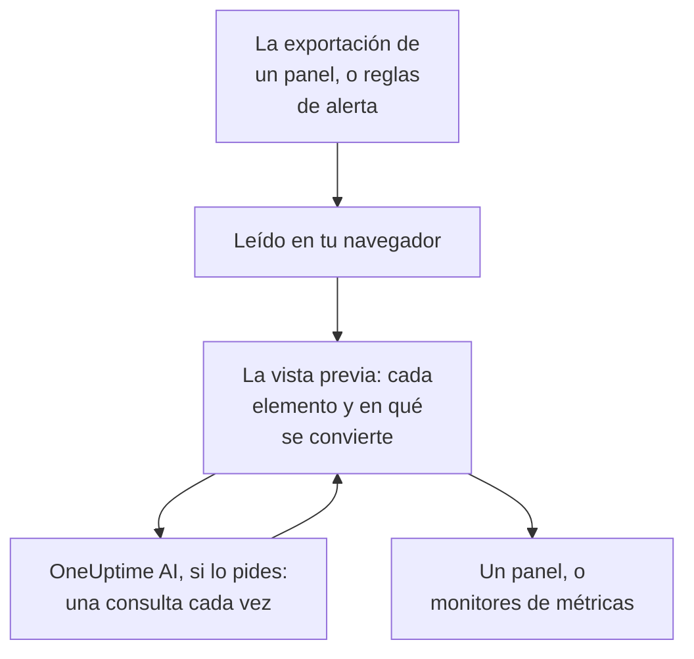

# Importar desde Grafana y Datadog

Trae a OneUptime un panel que creaste en Grafana o Datadog, o las reglas de alerta que escribiste para Prometheus, Grafana o Datadog. Pegas o subes el archivo, ves en qué se convierte cada panel y cada regla, y solo entonces creas el panel o los monitores.

:::cards
- [Importar un panel](#importar-un-panel): El modelo JSON de un panel de Grafana, o la exportación de un panel de Datadog.
- [Importar reglas de alerta](#importar-reglas-de-alerta): Archivos de reglas de Prometheus, reglas de alerta de Grafana y monitores de Datadog.
- [Cómo se convierte cada elemento](#cómo-se-convierte-cada-elemento): Con exactitud, de forma aproximada o nada, y por qué.
- [Convertir una consulta con OneUptime AI](#convertir-una-consulta-con-oneuptime-ai): Para una consulta que ninguna regla convierte.
:::

## Cómo funciona una importación

OneUptime lee el archivo en tu navegador y convierte cada panel, widget, variable y regla por separado. La vista previa los enumera todos con lo que se convierte cada uno. No se crea nada hasta que decides crearlo, y entonces se crea con tus propios permisos, como lo crean los formularios de paneles y monitores.

## Antes de empezar

- Los widgets y monitores importados leen las métricas propias de este proyecto con PromQL. Envíalas con Prometheus remote write, OpenTelemetry o el Datadog Agent, y conservan los nombres que tienen allí.
- Importar un panel requiere un rol que pueda crear paneles, e importar reglas de alerta, un rol que pueda crear monitores.
- Un archivo puede ocupar hasta 10 MB, y se leen hasta 500 de sus paneles o reglas.

## Importar un panel

:::steps
### Abrir la importación de paneles

Abre **Productos → Paneles** y luego **Más opciones → Import from Grafana or Datadog**.

### Pegar el panel

En Grafana, copia el modelo JSON desde los ajustes del panel. En Datadog, exporta el JSON del panel. Pégalo, o elige **Upload a File**, y luego elige **Vista previa**.

### Crear el panel

Revisa en qué se convierte cada panel y cada variable, da un nombre al panel y elige **Crear panel**. Se abre el panel nuevo.
:::

El PromQL de Grafana se conserva tal como está escrito: OneUptime completa `$__interval`, `$__rate_interval` y `$__range` como lo hace Grafana, y una variable en All coincide con todos los valores. Una consulta de Datadog se convierte en PromQL sobre las métricas que envió el Datadog Agent: `avg:system.cpu.user{host:web-1}` lee `system_cpu_user{host="web-1"}`.

## Importar reglas de alerta

:::steps
### Abrir la importación de alertas

Abre **Productos → Monitores** y luego **Más opciones → Import Alerts**.

### Pegar las reglas

Pega un archivo de reglas de Prometheus o un recurso PrometheusRule, la exportación de las reglas de alerta de Grafana o monitores de Datadog exportados como JSON, y luego elige **Vista previa**.

### Crear los monitores

Desmarca las reglas que no quieras, elige en **When a rule fires** qué abre una regla que se dispara y elige **Crear monitores**.
:::

Cada regla se convierte en un monitor de métricas con una consulta PromQL, la condición de la regla y su ventana. Abre una alerta, o un incidente, por cada serie que supera el umbral, y lo resuelve cuando la serie se recupera. Su título y su descripción salen del resumen o del mensaje de la regla, con las etiquetas de la serie ya completadas.

## Cómo se convierte cada elemento

| Estado | Qué significa |
| --- | --- |
| **Converted exactly** | Lee los mismos datos y los muestra de la misma manera. |
| **Converted approximately** | Se crea, y sus notas dicen qué cambia. |
| **Not converted** | No se crea nada para él, y sus notas dicen por qué. |

No se convierten las reglas de grabación, las reglas de alerta sobre registros, los widgets de Datadog que leen registros, trazas o eventos, ni los monitores de anomalías, valores atípicos y previsiones de Datadog.

## Convertir una consulta con OneUptime AI

Una consulta que ninguna regla convierte muestra **Convert with OneUptime AI**, que necesita la IA activada en el proyecto. Solo esa consulta, con los nombres de las variables del panel, se envía al [proveedor de LLM](/docs/ai/llm-provider) de tu proyecto. Su respuesta se comprueba como cualquier consulta y se te muestra: elige **Use This Query** para usarla. No se crea nada hasta que creas el panel o los monitores.

## Próximos pasos

:::cards
- [Widgets del panel](/docs/dashboards/widgets): Cambia lo que muestra un widget importado.
- [Variables y filtros del panel](/docs/dashboards/variables): Las variables que creó una importación.
- [Monitor de métricas](/docs/monitor/metrics-monitor): Los monitores que creó una importación.
- [PromQL](/docs/telemetry/promql): El lenguaje que leen los widgets y monitores importados.
:::
