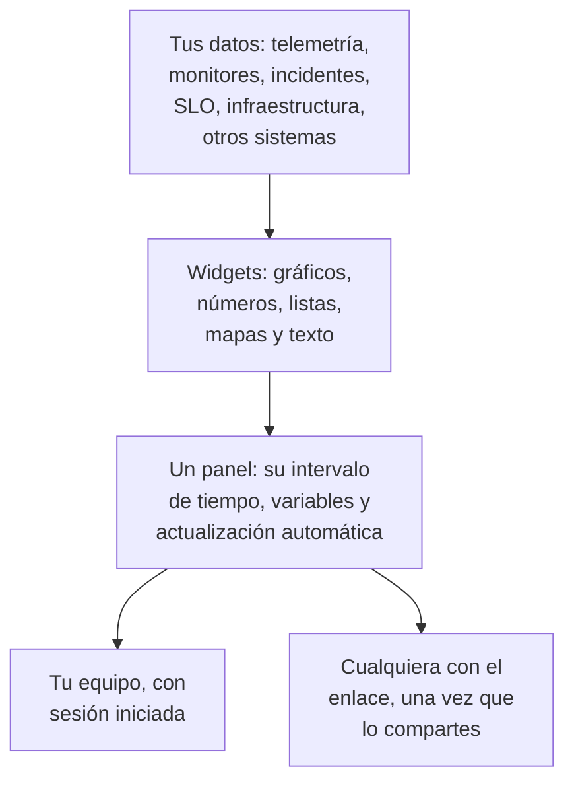

# Visión general de los paneles

Un panel es una página de widgets que tú mismo organizas: gráficos de tus métricas, registros y trazas, listas de incidentes, alertas y monitores, tus SLO y tu infraestructura, e incluso datos de sistemas ajenos a OneUptime. Crea uno para la pantalla de guardia, la revisión matinal de un equipo o una página para tus clientes, y compártelo con tu proyecto o con cualquiera que tenga el enlace.

:::cards
- [Cómo funciona un panel](#cómo-funciona-un-panel): De dónde vienen sus datos y quién lo ve.
- [Encontrar tus paneles](#encontrar-tus-paneles): La lista Paneles y las páginas propias de cada panel.
- [Crear tu primer panel](#crear-tu-primer-panel): De una plantilla a una página compartida en cinco pasos.
- [Un ejemplo: un panel de guardia](#un-ejemplo-un-panel-de-guardia): Una página que sirve para todos los servicios.
:::

## Cómo funciona un panel

Cada widget lee de una fuente, dentro del intervalo de tiempo del panel y filtrado por sus variables. Todos los que abren el panel ven los mismos widgets: tu equipo cuando inicia sesión, y los visitantes a través de su enlace público una vez que lo compartes.

| Término | Qué significa |
| --- | --- |
| Panel | Una página: un nombre, una cuadrícula de widgets, un intervalo de tiempo, variables y un ajuste de actualización automática. |
| Widget | Una casilla de la cuadrícula: un gráfico, un número, una lista, un mapa, un reloj o un bloque de texto. |
| Variable | Un selector en la barra de herramientas que limita cada widget compatible a un servicio, host o cliente. |
| Intervalo de tiempo | La ventana que leen todos los gráficos y números. Un panel se abre en su valor predeterminado, la última hora salvo que alguien que lo edite elija otro, y cada lector puede elegir el suyo. |
| Actualización automática | Con qué frecuencia los widgets vuelven a leer sus datos: desactivada, o de cada 5 segundos a cada 15 minutos. |
| Lectura y edición | Un panel se abre para leerlo. Editarlo es un paso aparte que termina guardando o descartando tus cambios. |

## Para qué sirven los paneles

- **Una página de "¿va todo bien?"** para la persona de guardia, la reunión diaria de un equipo o una pantalla en la pared.
- **Ver relaciones**: un pico de CPU junto a una subida de latencia y un incidente abierto salta a la vista en una sola página, y se pasa por alto repartido entre tres.
- **Investigar**: pon lado a lado los gráficos que sueles volver a abrir, y arrastra sobre un pico para leer todos los widgets en ese momento.
- **Compartir fuera del equipo**: una página de rendimiento para un cliente o un socio, protegida con una contraseña o una lista de IP permitidas si quieres.

## Encontrar tus paneles

Abre **Productos → Paneles**. La lista **Paneles** muestra los paneles del proyecto con sus descripciones, etiquetas y propietarios. Busca por nombre o descripción, acota la lista con los filtros **Propietario** y **Etiquetas**, o selecciona varios paneles para cambiar sus etiquetas o propietarios, archivarlos o exportarlos como JSON.

El menú lateral de la lista tiene las páginas que gestionan todos tus paneles:

| Página | Qué haces allí |
| --- | --- |
| **Paneles** | Los paneles del proyecto. Crea uno, o trae paneles con **Importar JSON**. |
| **Paneles → Listas de reproducción** | [Mostrar los paneles uno tras otro](/docs/dashboards/playlists) en una pantalla, como la pared de un NOC. |
| **Ajustes → Reglas del propietario** | Añadir propietarios a los paneles nuevos automáticamente. |
| **Ajustes → Reglas de etiquetas** | Añadir etiquetas a los paneles nuevos automáticamente. |
| **Ajustes → Fuentes de datos** | Conectar Prometheus, bases de datos SQL, ClickHouse, Loki, Elasticsearch o una API REST. |
| **Avanzado → Archivado** | Los paneles que archivaste. Desarchívalos desde aquí. |

Al abrir un panel, su propio menú lateral tiene estas páginas. Todas las secciones salvo **Básico** empiezan plegadas: haz clic en su título para abrirla.

| Página | Qué haces allí |
| --- | --- |
| **Panel** | El propio panel. Léelo, o edítalo desde su menú **⋯**. |
| **Vista general** | Su nombre, su descripción y sus etiquetas. |
| **Uso compartido** | Quién puede verlo, su enlace público y una lista de IP permitidas en Más ajustes. |
| **Propietarios** | Los usuarios y equipos a los que pertenece. |
| **Marca** | Título de la página, descripción, logotipo, tema y favicon del panel público. |
| **Dominios personalizados** | Alojar el panel público en tu propio dominio. |
| **Ajustes** | Duplicar, exportar o archivar el panel. |
| **Registros de auditoría** | Cada cambio hecho en el panel, y quién lo hizo. |
| **Eliminar** | Eliminar el panel para siempre. |

## Crear tu primer panel

:::steps
1. **Crear** — elige una plantilla, o **Empezar desde cero**. Una plantilla rellena el nombre y se abre con sus widgets; un panel empezado desde cero se abre vacío, con **Añadir widget** en su lienzo.
2. **Añadir widgets** — elige un widget del catálogo, define en sus ajustes lo que lee, y luego arrástralo a su sitio y ajusta su tamaño.
3. **Añadir variables, si las necesitas** — una variable `service`, por ejemplo, permite que un solo panel muestre cualquier servicio.
4. **Guardar** — haz clic en **Guardar cambios**. Nada de lo que cambias al editar se conserva hasta que lo haces.
5. **(Opcional) Compartir públicamente** — elige **⋯ → Compartir** en el panel y decide quién puede verlo: cualquiera con el enlace, o cualquiera con el enlace y una contraseña.
:::

[Crear un panel](/docs/dashboards/authoring) recorre cada paso.

## Un ejemplo: un panel de guardia

El objetivo: una página para el servicio de checkout, con su latencia, su tasa de errores, sus incidentes abiertos y sus últimos registros, que sirva también para cualquier otro servicio.

1. Haz clic en **Crear panel**, elige **Empezar desde cero** y llama al panel "Checkout de guardia".
2. Haz clic en **Añadir widget** y añade un **Gráfico** de tu métrica de latencia de las peticiones, agregada como P95.
3. Junto a él, añade un **Valor** de tu tasa de errores, con un umbral de advertencia de 1 y un umbral crítico de 5.
4. Debajo, añade una **Lista de incidentes** filtrada a los incidentes sin resolver, y un **Flujo de registros** con los registros del servicio.
5. Abre **Variables**, añade una variable llamada `service` con el origen Telemetry Attribute y la clave de atributo `service.name`, y dale el valor predeterminado `checkout`.
6. Haz clic en **Guardar cambios**. Elige `payments` en el selector `service` de la barra de herramientas: el gráfico, el valor y el flujo de registros pasan al servicio payments, y la lista de incidentes sigue mostrando todos los incidentes sin resolver.

## Cómo encajan los paneles con el resto de OneUptime

- **Los monitores y la telemetría** son el origen de los datos. Cada métrica, registro y traza que envías puede ir en un widget.
- **Los incidentes y las alertas** aparecen en los widgets **Lista de incidentes** y **Lista de alertas**. Un panel solo los muestra: se gestionan en sus propias páginas.
- **Las páginas de estado** dicen a tus clientes si tu servicio funciona. Los paneles muestran en detalle cómo se comporta. Los dos trabajan lado a lado.
- **Los flujos de trabajo** actúan sobre lo que ocurre. Los paneles son donde lo lees.

## Próximos pasos

:::cards
- [Crear un panel](/docs/dashboards/authoring): Crea un panel, edítalo y guarda tus cambios.
- [Widgets del panel](/docs/dashboards/widgets): Cada widget, y cuál elegir.
- [Variables y filtros del panel](/docs/dashboards/variables): Un panel para cada servicio, host o cliente.
- [Compartir y paneles públicos](/docs/dashboards/sharing): Enlaces públicos, contraseñas, listas de IP permitidas y dominios personalizados.
:::
