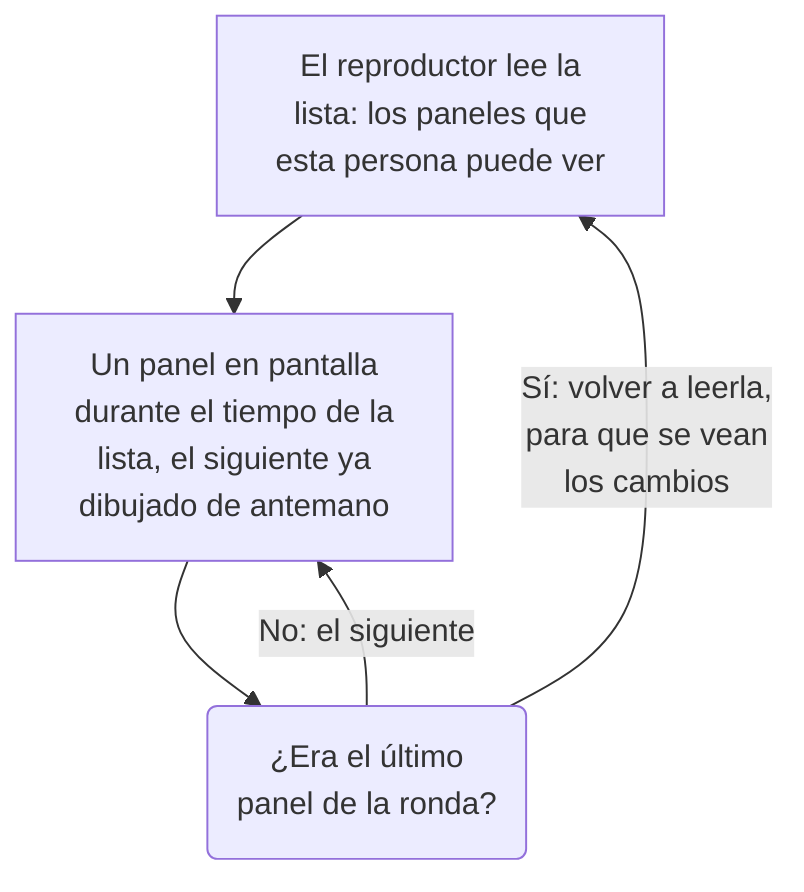

# Listas de reproducción de paneles

Una lista de reproducción muestra una serie de paneles uno tras otro en una pantalla que nadie toca, como la pared de un NOC o la televisión de un equipo: cada panel durante el tiempo que elijas, una y otra vez, hasta que alguien la pause. Crea la lista una vez, abre su reproductor en la pantalla y déjalo en marcha.

:::cards
- [Cómo se reproduce una lista](#cómo-se-reproduce-una-lista): El orden, los turnos y lo que muestra cada panel.
- [Crear una lista de reproducción](#crear-una-lista-de-reproducción): Un nombre, sus paneles en orden y cuánto tiempo se muestra cada uno.
- [Reproducirla en una pantalla](#reproducirla-en-una-pantalla): La barra del reproductor, sus botones y sus teclas.
- [Quién ve qué](#quién-ve-qué): Los permisos, y los paneles que una persona no puede leer.
:::

## Cómo se reproduce una lista

El reproductor muestra el primer panel de la lista, luego el siguiente cuando se acaba su tiempo, y vuelve a empezar por el primero después del último. Cada panel se abre tal como lo guardaron sus editores: con su propio intervalo de tiempo predeterminado, su actualización automática y sus variables, diga lo que diga la dirección del reproductor. Mientras un panel está en pantalla, el reproductor dibuja el siguiente fuera de la vista, así que la pantalla nunca se queda en blanco entre dos de ellos.

Una lista de reproducción nombra sus paneles y nunca los copia: un cambio que un editor guarda en un panel aparece en la pantalla la próxima vez que le toca. El reproductor vuelve a leer la lista antes de cada ronda, así que un panel añadido, movido o quitado aparece en el plazo de una ronda, sin recargar la pantalla; si esa lectura falla, la pantalla vuelve a reproducir la ronda que tiene.

## Crear una lista de reproducción

:::steps
### Abrir las listas de reproducción
Abre **Productos → Paneles** y luego **Listas de reproducción** en el menú lateral. La lista muestra cuántos paneles tiene cada lista de reproducción y cuánto tiempo se muestra cada uno, con **Reproducir** en cada fila.

### Darle un nombre
Haz clic en **Crear Lista de reproducción** y dale un **Nombre** que diga dónde se reproduce, como «Muro del NOC».

### Añadir sus paneles
En **Paneles**, elige cada uno en **Añadir un panel**, en el orden en que la pantalla los muestra. Los botones de la fila de un panel lo mueven hacia arriba o hacia abajo, o lo quitan. Los paneles archivados no se ofrecen.

### Elegir cuánto se muestra cada uno
**Mostrar cada panel durante** empieza en un minuto; elige un tiempo de 15 segundos a una hora. Haz clic en **Crear Lista de reproducción**.
:::

La página de la lista muestra sus paneles en orden, cuánto tiempo se muestra cada uno y el **Enlace del reproductor**. **Editar lista de reproducción** cambia el nombre, los paneles, su orden y el tiempo. **Eliminar Lista de reproducción de paneles**, al pie de la página, elimina la lista y nunca sus paneles.

A través de la API y de Terraform, una lista de reproducción es un `name`, sus `dashboards` como una lista del tipo `[{"dashboardId": "<id>"}]` en el orden en que se muestran, como máximo 100, y `intervalInSeconds`, cualquier número entero de segundos de 10 a 86400 (un día). Un valor fuera de estos límites se rechaza, indicando qué está mal.

## Reproducirla en una pantalla

Haz clic en **Reproducir** en la fila de la lista o en su página. El reproductor llena la ventana del navegador, por encima del resto de OneUptime; **Pantalla completa** llena toda la pantalla. Para arrancar una pantalla por su cuenta, abre en ella el **Enlace del reproductor** y guárdalo en favoritos: el enlace abre el reproductor al instante.

La barra del reproductor nombra el panel en pantalla, la lista, en qué punto va la ronda («2 de 5») y el panel que viene después. Una línea bajo la barra se llena mientras un panel tiene su turno. Los botones de la barra van al panel anterior, pausan o reproducen, y van al siguiente; en un ordenador, estas teclas hacen lo mismo:

| Teclas | Qué hace |
| --- | --- |
| `Space` | **Pausar o reproducir**. En pausa, el panel sigue en pantalla y la barra dice **Pausado**. |
| `Right Arrow` | **Panel siguiente**. |
| `Left Arrow` | **Panel anterior**. |
| `F` | **Pantalla completa**, o salir de ella. |
| `Esc` | **Salir del reproductor**, de vuelta a la página de la lista. En pantalla completa, el primer `Esc` solo sale de la pantalla completa. |
| `?` | **Mostrar atajos de teclado**. |

Un panel al que vas, el siguiente o el anterior, tiene un turno completo. En una página que se lee de derecha a izquierda, como en persa, las flechas se intercambian: `Left Arrow` va al panel siguiente. Mientras reproduce, el reproductor impide que la pantalla entre en reposo, donde el navegador lo permite.

## Quién ve qué

Las listas de reproducción tienen sus propios permisos, que se obtienen a través de un equipo como los de los paneles:

| Para | Se necesita |
| --- | --- |
| Ver y reproducir listas de reproducción | `ReadDashboardPlaylist`, o un rol del proyecto: Project Owner, Project Admin, Project Member, Viewer o un rol Settings |
| Crear listas de reproducción | `CreateDashboardPlaylist`, Project Owner o Project Admin |
| Cambiar una lista: su nombre, sus paneles y su tiempo | `EditDashboardPlaylist`, Project Owner o Project Admin |
| Eliminar una lista de reproducción | `DeleteDashboardPlaylist`, Project Owner o Project Admin |

Una lista de reproducción nunca muestra a nadie un panel que no pueda leer. El reproductor solo reproduce los paneles que la persona con la sesión iniciada en la pantalla puede leer y que no están archivados, y se salta el resto: un panel eliminado, uno archivado o uno que sus permisos le impiden ver. La página de la lista dice por qué se salta cada uno. Guardar una lista conserva los paneles que contiene y que el editor no puede ver, así que no se pierde nada de lo que otra persona puso en ella.

| Cuando el reproductor encuentra | Muestra |
| --- | --- |
| Paneles que puede mostrar | Cada uno por turno. |
| Ningún panel que pueda mostrar | **Aún no hay nada que mostrar**, y vuelve a mirar cada minuto. |
| La lista eliminada, o que esa persona no puede leer | **No se encontró la lista de reproducción**. |
| Una lectura que falló | **No se pudo cargar esta lista de reproducción**, y vuelve a intentarlo cada minuto, o con **Volver a intentar**. |

> [!NOTE]
> El reproductor es para alguien con la sesión iniciada en OneUptime. Para tener una lista en una pantalla, inicia sesión en esa pantalla con una cuenta que pueda leer la lista y sus paneles, como un miembro del equipo con el rol Viewer.

## Próximos pasos

:::cards
- [Crear un panel](/docs/dashboards/authoring): Construye los paneles que muestra una lista de reproducción.
- [Variables y filtros del panel](/docs/dashboards/variables): La selección guardada con la que se abre cada panel.
- [Compartir y paneles públicos](/docs/dashboards/sharing): Muestra un panel a personas que no inician sesión.
- [Configuración y permisos del panel](/docs/dashboards/configuration): Propietarios, etiquetas y quién puede leer un panel.
:::
