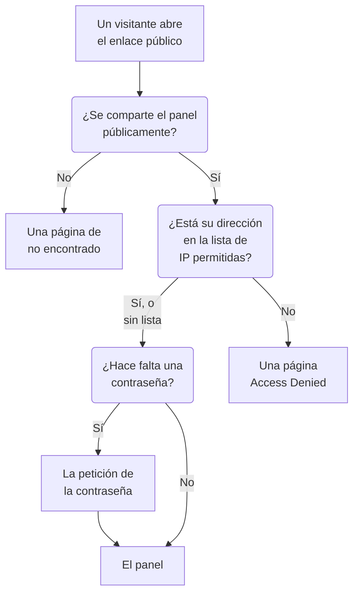

# Compartir y paneles públicos

De forma predeterminada, un panel es privado para tu proyecto: solo pueden verlo las personas que inician sesión en tu proyecto. También puedes compartirlo mediante un enlace público, proteger ese enlace con una contraseña, limitarlo a ciertas direcciones IP y alojarlo en tu propio dominio. Esta página cubre las cuatro cosas.

:::cards
- [Quién puede ver un panel](#quién-puede-ver-un-panel): Una opción entre tres, con el plan que necesita cada una.
- [Compartir con una contraseña](#compartir-con-una-contraseña): Comparte el enlace, y luego la contraseña, con quienes deben verlo.
- [Lista de IP permitidas](#lista-de-ip-permitidas): Abre el enlace público solo a tu oficina o tu VPN.
- [Dominios personalizados](#dominios-personalizados): Sirve el panel en tu propio dominio, con un certificado gratuito.
:::

## Lo que encuentra un visitante

Un visitante que abre el enlace público de un panel pasa por cada una de estas comprobaciones por orden. Los miembros del proyecto que inician sesión en OneUptime ven el panel dentro del producto, elijas lo que elijas aquí.



## Quién puede ver un panel

Abre el panel y elige **⋯ → Compartir**, o abre **Uso compartido** en el menú lateral del panel. La tarjeta **Quién puede ver este panel** es una sola elección:

- **Solo las personas de este proyecto** (la opción predeterminada): los miembros ven el panel cuando inician sesión en OneUptime. No tiene enlace público: su dirección pública muestra la misma página de no encontrado que una dirección sin panel, y nada del panel, ni siquiera su nombre.
- **Cualquiera con el enlace**: el panel es público. Cualquiera que tenga su enlace puede verlo, sin iniciar sesión.
- **Cualquiera con el enlace y una contraseña**: los visitantes abren el enlace y luego introducen una contraseña que tú compartes con ellos. Nadie necesita una cuenta.

Elegir una opción te pide confirmación, explicando qué cambia para los visitantes, y luego se aplica de inmediato. Elegir **Cualquiera con el enlace y una contraseña** pide la contraseña en el mismo cuadro de diálogo cuando el panel no tiene ninguna; mientras sea la opción elegida, **Cambiar contraseña** la sustituye. Mientras el panel es público, las direcciones en las que los visitantes lo abren aparecen bajo la elección: primero sus dominios personalizados y después su enlace público, cada una con **Copiar enlace**. Un dominio personalizado que aún no está activo aparece marcado como **Aún no activo**, con el motivo.

Dentro del proyecto, los propietarios y las etiquetas controlan quién ve qué: consulta [Configuración y permisos del panel](/docs/dashboards/configuration). Quien puede ver el panel pero no editarlo ve la elección y puede copiar el enlace público, pero no puede cambiarla.

En OneUptime Cloud, compartir un panel requiere el plan **Growth**: en un plan inferior, las dos opciones públicas muestran el plan que necesitan y no se pueden elegir. Volver a hacer privado un panel (**Solo las personas de este proyecto**) funciona en todos los planes, así que un panel que quedó público cuando terminó una prueba, o tras pasar a un plan inferior, siempre puede dejar de compartirse; el cuadro de diálogo indica que volver a compartirlo requiere **Growth**. Pasar de **Cualquiera con el enlace** a **Cualquiera con el enlace y una contraseña**, y cambiar la contraseña, funciona en todos los planes. Un panel creado mediante la API o Terraform está sujeto a los mismos planes: si se crea público necesita **Growth**, y si se crea con una lista de IP permitidas, **Scale**.

La elección se guarda en tres columnas, que la API y Terraform leen y escriben como antes: `isPublicDashboard`, `enableMasterPassword` y `masterPassword`. Solo un panel público tiene enlace público, y a sus visitantes se les pide la contraseña siempre que `enableMasterPassword` está activado. Un panel público con `enableMasterPassword` activado pero sin contraseña definida no deja entrar a nadie por su enlace público: la página **Uso compartido** lo muestra como **Cualquiera con el enlace y una contraseña**, indica que nadie puede abrir todavía el enlace y ofrece **Definir contraseña**. Elegir **Solo las personas de este proyecto** también desactiva `enableMasterPassword` y conserva la contraseña, para que volver a compartir con contraseña pueda reutilizarla.

## Paneles públicos

Un panel público:

- Siempre se abre para leerlo. Los visitantes no pueden editarlo y nunca ven sus controles de edición.
- Incluye las variables que has añadido. Los visitantes eligen en los mismos selectores que usa tu equipo, y pueden cambiar el intervalo de tiempo, hacer zoom, activar la actualización automática y pasar a pantalla completa. Se abre con el intervalo de tiempo y la actualización automática predeterminados del panel, y el navegador de cada visitante recuerda sus propias elecciones.
- Permite a los visitantes [ordenar sus listas y tablas](/docs/dashboards/widgets#ordenar-listas-y-tablas) haciendo clic en el encabezado de una columna, como lo hace tu equipo. El navegador de cada visitante recuerda su propio orden, y OneUptime ordena por sí mismo la lista entera, siempre por una de las columnas del propio widget.
- Usa la marca que defines en la página **Marca** del panel: título de la página, descripción, logotipo, tema y favicon.
- Permite a cada visitante cambiar entre el panel claro y el oscuro con un botón de sol o de luna en su barra de herramientas; [Tema](#tema) explica cómo.

Trata el compartir un panel como publicar una página web. Cada widget que contiene pasa a ser legible por cualquiera que tenga el enlace. Mira lo que hay en el lienzo antes de compartirlo.

Cada widget publica solo lo que dibuja, y solo de los recursos a los que se apuntó. Un widget SLO, por ejemplo, publica las cifras principales de ese SLO pero nunca su definición: consulta [SLO](/docs/dashboards/widgets#slo). Los widgets de **Fuente de datos** externa son la excepción: se quitan por completo de un panel público en lugar de renderizarse, porque su configuración es la propia consulta. Algunos widgets más no pueden mostrarse sin una sesión iniciada, y lo indican en su lugar: [En un panel público](/docs/dashboards/widgets#en-un-panel-público) los enumera.

## Compartir con una contraseña

Elige **Cualquiera con el enlace y una contraseña** e introduce la contraseña en el cuadro de diálogo. Los visitantes ven una petición de contraseña antes de que aparezca el panel. La petición muestra el nombre, el título de la página y el favicon del panel, con el tema del panel, y nada más: su descripción, su logotipo y sus widgets aparecen una vez introducida la contraseña. La contraseña se guarda como un hash: nadie puede volver a leerla. Una contraseña nueva funciona de inmediato; quienes introdujeron la anterior pueden seguir viendo el panel durante un máximo de 7 días.

Usa una contraseña cuando:

- Quieres compartir con un socio o un cliente, pero no quieres que la URL sirva de algo si se filtra.
- El panel es "semipúblico": lo bastante abierto como para no querer invitar a cada espectador como miembro del equipo, pero no tanto como para ponerlo en internet abierto.

Para un control más estricto (cuentas separadas para cada espectador, un registro de auditoría de quién vio qué), deja el panel en **Solo las personas de este proyecto** e invita a los espectadores como miembros del equipo de solo lectura.

## Lista de IP permitidas

En **Más ajustes** de la página **Uso compartido**, la sección **Lista de IP permitidas** (la columna `ipWhitelist`) limita el enlace público a las direcciones IP o los rangos IPv4 que enumeres, uno por línea, por ejemplo `203.0.113.7` o `10.0.0.0/8`. Se aplica con o sin contraseña; no afecta a los miembros del proyecto que inician sesión. Déjala vacía para permitir todas las direcciones. Se guarda por separado de la elección, y cambiarla requiere el plan **Scale** en OneUptime Cloud; vaciarla funciona en todos los planes. Mientras hay una lista en vigor, el encabezado plegado de **Más ajustes** muestra **Lista de IP permitidas** con el número de entradas que contiene. En instalaciones autoalojadas, cambiarla forma parte de la Enterprise Edition: en la Community Edition, una lista ya configurada sigue aplicándose y solo se puede quitar.

Úsala cuando:

- El panel solo deba ser accesible desde tu oficina o tu VPN.
- Un portal de proveedor solo deba ser accesible desde sus IP conocidas.
- Quieras una protección adicional además de una contraseña.

Las peticiones desde cualquier otra IP se rechazan con una página **Access Denied** que no muestra nada del panel: ni su nombre, ni su marca, ni su petición de contraseña. Una línea que no es una dirección IP ni un rango IPv4 se rechaza al guardar, porque el servidor la omitiría.

## Dominios personalizados

De entrada, un panel público se sirve en su enlace público, en la propia dirección de OneUptime. Para alojarlo en tu propio subdominio, como `dashboard.acme.com`, abre **Marca → Dominios personalizados** en el menú lateral del panel. Funciona exactamente igual que la página **Dominios personalizados** de una página de estado.

La tarjeta se titula **Dominios personalizados** y explica qué hacer: apunta el registro CNAME de cada dominio al registro CNAME de paneles de tu instalación, y OneUptime emite el certificado SSL del dominio y lo renueva por ti. La tabla tiene dos columnas, **Dominio** y **Estado**.

Poner el panel en tu propio dominio lleva tres pasos, y solo los dos primeros son cosa tuya:

1. **Añadir el dominio**: un subdominio y uno de tus dominios verificados.
2. **Añadir su registro CNAME** en tu proveedor de DNS. El cuadro de diálogo **Configuración de DNS** se abre con el registro en cuanto añades el dominio.
3. **El certificado SSL gratuito se emite automáticamente** en cuanto se encuentra el registro. No hay ningún botón que pulsar.

Una vez verificado, el panel es accesible tanto en tu dominio personalizado como en la URL original.

### Añadir el dominio

Haz clic en **Crear Dominio del panel**. El cuadro de diálogo es una sola página:

- **Subdominio**: solo la etiqueta, con el texto de ejemplo `dashboard (leave blank for root)`. Introduce solo `dashboard`, no el nombre de host completo. Déjalo vacío o introduce `@` para usar el dominio raíz (apex).
- **Dominio**: los dominios verificados en **Ajustes del proyecto → Avanzado → Dominios**, donde demuestras con un registro TXT que un dominio es tuyo. Un dominio que no has verificado no aparece en la lista, porque se rechazaría. El enlace **Añadir un dominio** junto al campo abre esa página en una pestaña nueva.
- **Más campos**: plegado. Mientras está plegado, su encabezado indica qué certificado usará el dominio: "Emitimos un certificado SSL gratuito para este dominio y lo renovamos automáticamente." Ábrelo solo para usar un certificado propio (consulta más abajo).

Haz clic en **Crear Dominio del panel**. El cuadro de diálogo se cierra y se abre la **Configuración de DNS** del nuevo dominio. El nombre completo de un dominio queda fijado al añadirlo, así que **Editar** solo cambia su certificado. Para usar otro subdominio, añade ese dominio y elimina el anterior.

### Configuración de DNS y Comprobar ahora

El cuadro de diálogo **Configuración de DNS** muestra el registro que debes añadir en tu proveedor de DNS, un campo por fila, cada uno con un botón de copiar: **Tipo** `CNAME`, **Nombre** el dominio completo que añadiste, y **Valor** el registro CNAME de paneles de tu instalación. Para un dominio raíz, sin subdominio, el cuadro de diálogo añade una nota: muchos proveedores de DNS no permiten ahí un registro CNAME, así que usa en su lugar el registro ALIAS, ANAME o de aplanamiento de CNAME de tu proveedor, con el mismo valor.

OneUptime comprueba cada dominio sin verificar cada 15 minutos, y cuando la comprobación encuentra el registro, solicita el certificado gratuito de Let's Encrypt del dominio en esa misma comprobación, vuelvas o no. Para comprobarlo en el momento, haz clic en **Comprobar ahora**:

- **El registro aún no se encuentra.** El cuadro de diálogo sigue abierto e indica qué registro buscó. Un registro DNS nuevo puede tardar un rato en aparecer. Vuelve a hacer clic en **Comprobar ahora** más tarde, o deja que lo haga la comprobación de cada 15 minutos.
- **El registro se encuentra.** El cuadro de diálogo dice "Tu registro CNAME está verificado." y qué pasa después con el certificado. El certificado gratuito se solicita en ese momento, y normalmente está activo en menos de 15 minutos.

Hasta que un dominio está verificado y su certificado está en su sitio, su fila tiene una acción **Configuración de DNS** que abre el mismo cuadro de diálogo. En un dominio verificado cuya solicitud de certificado sigue fallando, o cuyo certificado ha caducado, **Comprobar ahora** vuelve a solicitarlo desde ahí y muestra por qué falló la última solicitud. Solicita como máximo una vez por dominio cada 15 minutos; entre medias, OneUptime sigue reintentándolo por su cuenta, esperando un poco más después de cada fallo consecutivo. La renovación es automática, mucho antes de que caduque el certificado, y una comprobación de DNS fallida nunca quita un certificado que sigue siendo válido.

### Leer la columna Estado

La columna **Estado** indica en qué punto está cada dominio en su camino hacia HTTPS, en uno de ocho estados, los mismos que en las páginas de estado. Cuando una solicitud ha fallado, el motivo aparece en la línea de debajo.

| Lo que dice la columna Estado | Lo que significa |
| --- | --- |
| Esperando al DNS: añade el registro CNAME. | El registro CNAME aún no se encuentra. Abre **Configuración de DNS** para ver el registro, añádelo en tu proveedor de DNS y luego haz clic en **Comprobar ahora** o espera a la comprobación de cada 15 minutos. |
| Emitiendo un certificado gratuito, normalmente en menos de 15 minutos. | El registro está verificado, y el certificado se está solicitando o escribiendo. No hay nada que hacer. |
| Todavía no se ha podido emitir un certificado gratuito. Lo seguimos intentando. | El registro está verificado, pero la solicitud de su certificado falló, por el motivo de la línea de debajo. Corrige la causa, luego abre **Configuración de DNS** y haz clic en **Comprobar ahora** para volver a solicitarlo ya. |
| Certificado caducado. Seguimos intentando renovarlo. | El certificado del dominio ha caducado porque sus renovaciones fallaron. Abre **Configuración de DNS** y haz clic en **Comprobar ahora** para renovarlo ya y ver por qué. |
| Certificado emitido, se renueva automáticamente. | Listo. El dominio sirve su certificado por HTTPS, y OneUptime lo renueva. |
| Certificado emitido, pero su renovación ha fallado. Lo seguimos intentando. | El dominio sigue sirviendo un certificado válido, pero su última renovación falló, por el motivo de la línea de debajo. OneUptime vuelve a intentarlo mucho antes de que caduque el certificado. |
| Usa tu certificado subido. | El registro está verificado, y el dominio se sirve con el certificado que subiste. |
| Verificado. Esta instalación no emite certificados gratuitos: sirve HTTPS para este dominio desde tu propio proxy o sube un certificado. | En una instalación autoalojada sin clave de cuenta de Let's Encrypt, el registro está verificado y el dominio está activo. Su HTTPS corre a cargo de tu propio proxy, salvo que subas un certificado. |

Si una solicitud falla, las causas habituales son un registro CAA en tu dominio que no permite `letsencrypt.org` y, en una instalación autoalojada, un servidor al que Let's Encrypt no puede llegar en el puerto 80.

### Tu propio certificado, y volver a emitirlo

Para usar en su lugar tu propio certificado, abre **Más campos** al añadir el dominio, activa **Subir certificado personalizado** y pega el **Certificado** y su **Clave privada del certificado**. OneUptime lo sirve en menos de 15 minutos en lugar de solicitar un certificado de Let's Encrypt, y sustituye cualquier certificado de Let's Encrypt que tuviera antes el dominio. Renovar un certificado subido es cosa tuya: edita el dominio y pega el nuevo. Si el dominio tenía antes un certificado gratuito, OneUptime sigue renovándolo mientras se usa el tuyo, así que volver atrás es inmediato.

Una vez que se ha solicitado un certificado gratuito para un dominio, la fila muestra **Volver a emitir SSL**, que pide a Let's Encrypt un certificado totalmente nuevo cuando quieres uno antes de la renovación automática. Cada dominio puede volver a emitirse una vez cada 24 horas.

En una instalación autoalojada, los dominios personalizados de los paneles se activan con la variable de entorno `DASHBOARD_CNAME_RECORD` (`dashboard.cnameRecord` en el chart de Helm), que es el destino al que apuntan tus registros CNAME. Sin ella, la tarjeta y el cuadro de diálogo **Configuración de DNS** dicen "Custom Domains not enabled for this OneUptime installation" en lugar de mostrar un registro, y OneUptime no verifica dominios ni solicita certificados para los paneles. Una instalación sin clave de cuenta de Let's Encrypt (`LETS_ENCRYPT_ACCOUNT_KEY`, `letsEncrypt.accountKey` en el chart de Helm) no solicita certificados: un dominio de panel está activo en cuanto se verifica su registro, y se sirve con el HTTPS de tu propio proxy o con un certificado que subas.

### Quién puede comprobar y volver a emitir

**Comprobar ahora**, la solicitud del certificado de un dominio y **Volver a emitir SSL** cambian el dominio, así que necesitan permiso para editarlo: **Edit Dashboard Domain**, o un rol que lo incluya (Project Owner, Project Admin, Project Member, Settings Admin o Settings Member).

Quien solo puede leer el dominio, como un Viewer o un Settings Viewer, sigue viendo la columna **Estado** y el registro que hay que añadir en **Configuración de DNS**. Para esa persona, **Comprobar ahora** y **Volver a emitir SSL** están bloqueados, e indican qué permiso necesitan. OneUptime sigue comprobando cada dominio y solicitando su certificado por su cuenta en cualquier caso.

Lo mismo vale para las claves de API. Una clave que solo puede leer los dominios de paneles no puede llamar a `verify-cname`, `order-ssl` ni `reissue-ssl` en `/dashboard-domain`. Dale **Read Dashboard Domain** y **Edit Dashboard Domain** si lo necesita.

Un dominio pertenece a un solo panel del proyecto a la vez. Puedes asociar más de un dominio personalizado a un mismo panel si sirves el mismo contenido a varios públicos: un panel para clientes con tu propia marca, un panel de socio con marca compartida, o una página de salud pública con su propia URL.

## Marca

En la página **Marca** del panel, puedes configurar:

- **Título de la página**: lo que se muestra en la pestaña del navegador y en la parte superior de la página.
- **Descripción de la página**: la descripción que usan los buscadores y las vistas previas en redes sociales.
- **Logotipo**: una imagen que se muestra en el encabezado del panel público.
- **Tema**: claro, oscuro o según esté configurado el dispositivo de cada visitante; consulta [Tema](#tema).
- **Favicon**: el icono pequeño de la pestaña del navegador.

El logotipo y el favicon son archivos subidos en el propio proyecto del panel, y eso se comprueba cada vez que se guarda uno, desde el panel, la API, Terraform o un flujo de trabajo. Un archivo subido en otro proyecto se rechaza con las mismas palabras que recibe un archivo que ya no existe: "The logo's file could not be found. Upload the logo again." o "The favicon's file could not be found. Upload the favicon again." El panel público solo muestra imágenes de su propio proyecto.

El título y la descripción de la página también encabezan la barra de herramientas del panel para tu equipo, en lugar de su nombre y su descripción. El logotipo, el tema y el favicon solo se aplican al panel público.

Los visitantes solo ven la marca una vez que pueden ver el panel. Antes de introducir la contraseña, un panel compartido con contraseña solo muestra su título de la página, su favicon y su tema, y los buscadores y las vistas previas de enlaces ven su título de la página pero no su descripción de la página. Un panel con una lista de IP permitidas solo muestra su marca a las direcciones de la lista, y los buscadores y las vistas previas de enlaces no ven nada de ella.

### Tema

La tarjeta **Tema**, justo debajo del logotipo, decide cómo ven el panel público sus visitantes. Elige una de sus tres opciones y se guarda al instante; no hay botón **Editar**.

| Opción | Lo que ven los visitantes |
| ------ | ----------------- |
| **Claro** | El panel claro, tenga como tenga configurado su dispositivo. Los paneles creados antes de que existiera el ajuste están en **Claro**, así que se ven como siempre. |
| **Oscuro** | El panel oscuro, tenga como tenga configurado su dispositivo. |
| **Según el dispositivo de cada visitante** | Claro u oscuro, según esté configurado su dispositivo, y cambia con él mientras el panel está abierto. |

Elijas lo que elijas, un botón de sol o de luna en la barra de herramientas del panel permite a cada visitante cambiar al panel claro o al oscuro, o volver al tema que definiste, y su navegador recuerda la elección para todos los paneles públicos de esa dirección. En el panel oscuro, el logotipo se coloca sobre un fondo claro, así que un logotipo pensado para una página blanca se sigue viendo bien.

Un panel creado a partir de ahora empieza con **Según el dispositivo de cada visitante**. En la API y en Terraform el campo es `theme`, con uno de los valores `Light`, `Dark` o `System` (**Según el dispositivo de cada visitante**), escritos exactamente así; cualquier otro valor se rechaza. Una configuración de Terraform que no indica ningún `theme` recibe `Light`, así que una configuración escrita antes del ajuste nunca planifica un cambio en un panel que gestiona.

El tema va en el HTML del panel, así que el panel se dibuja con él desde el principio: un panel oscuro no destella en blanco mientras carga, y su petición de contraseña también se dibuja con él. Todos los widgets lo siguen; el propio código de un widget HTML puede dar estilo al tema oscuro, como explica [HTML](/docs/dashboards/widgets#html). Las páginas **Access Denied** y de no encontrado no muestran nada de un panel, así que siguen al visitante: su propia elección o, si no la hay, su dispositivo.

## Incrustar

Puedes incrustar un panel público en tu propio sitio con un iframe, en su enlace público o en uno de sus dominios personalizados:

```html title="embed.html"
<iframe
  src="https://dashboard.acme.com"
  width="100%"
  height="800"
  frameborder="0"
></iframe>
```

Si el panel se comparte con una contraseña, los visitantes verán la petición de contraseña dentro del iframe.

Para dar a un panel incrustado el aspecto de tu sitio, añade `?theme=light` o `?theme=dark` a su dirección, como en `https://dashboard.acme.com/?theme=dark`: el panel se dibuja con ese tema para todos los que abran esa dirección, sean cuales sean su propio tema y la elección del visitante, y su barra de herramientas no tiene botón de tema. `?theme=system` sigue el dispositivo de cada visitante. El tema se mantiene a través de la petición de contraseña.

## Enviar un enlace

El enlace público abre el panel con sus valores predeterminados guardados. Para enviar un enlace que se abra en un valor concreto, añádele la variable como `?var-<name>=<value>`, igual que hace la barra de direcciones cuando un visitante elige un valor; los distintos valores se separan con comas. Para que se abra con un intervalo de tiempo o una actualización automática propios, añade del mismo modo `range` y `refresh`: `?range=1d&refresh=1m` se abre en el último día, actualizándose cada minuto, como lo haría una pantalla mural. `range` admite `5m`, `15m`, `30m`, `1h`, `2h`, `3h`, `1d`, `2d`, `7d`, `14d`, `1mo` o `3mo`, y `refresh` admite `off`, `5s`, `10s`, `30s`, `1m`, `5m` o `15m`. Prevalecen sobre los valores predeterminados del panel y las elecciones del visitante, que aun así puede cambiarlos. Para abrir el panel con un tema, añade `theme=light`, `theme=dark` o `theme=system`, como describe [Incrustar](#incrustar).

## Próximos pasos

:::cards
- [Configuración y permisos del panel](/docs/dashboards/configuration): Propietarios, etiquetas y quién puede cambiar el uso compartido.
- [Variables y filtros del panel](/docs/dashboards/variables): Los selectores que usan los visitantes, y enlaces que conservan una selección.
- [Widgets del panel](/docs/dashboards/widgets): Lo que publica cada widget en un panel público.
- [Visión general de las páginas de estado](/docs/status-pages/index): Di a tus clientes si tu servicio funciona.
:::
