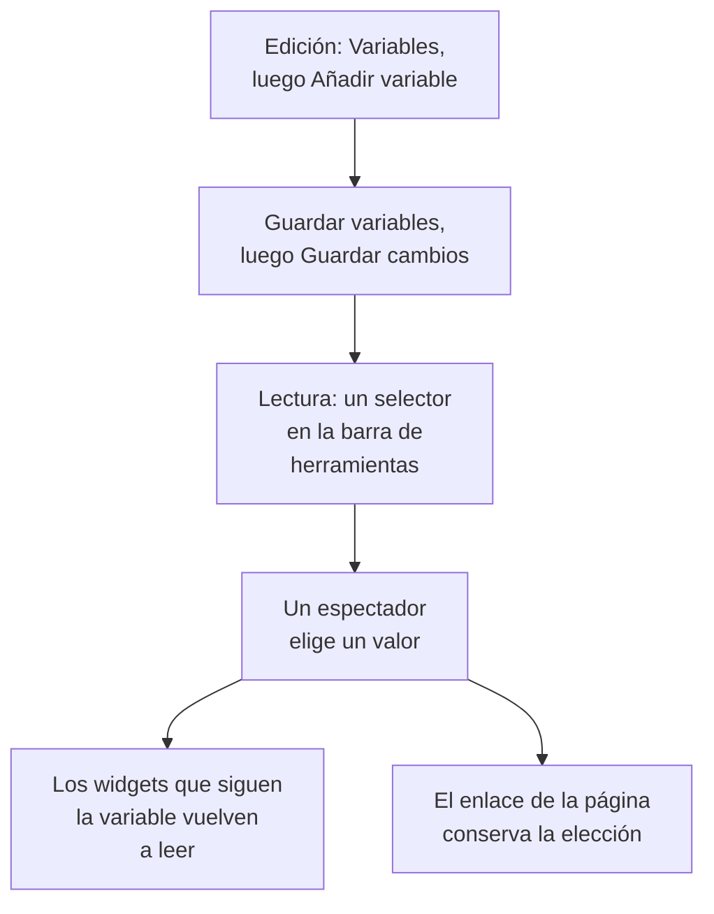

# Variables y filtros del panel

Una variable es un selector en la barra de herramientas del panel. Añade una variable `service` y los mismos gráficos muestran `checkout`, `payments` o `search`: los espectadores eligen en la barra de herramientas en lugar de que tú construyas tres paneles casi idénticos.

:::cards
- [Añadir una variable](#añadir-una-variable): Ponle nombre, elige de dónde vienen sus valores y guarda.
- [Orígenes de las variables](#orígenes-de-las-variables): Telemetry Attribute, Project Labels, Custom List y Text Input.
- [Cómo usan los widgets una variable](#cómo-usan-los-widgets-una-variable): Qué widgets siguen qué variables.
- [Enlaces que conservan la selección](#enlaces-que-conservan-la-selección): Envía un enlace que se abre en el mismo servicio.
:::

## Cómo funciona una variable

Defines las variables mientras editas el panel, y se guardan con él. En modo de lectura, cada una es un selector en la barra de herramientas. Cuando un espectador elige un valor, cada widget que sigue la variable vuelve a leer sus datos, y el enlace de la página conserva la elección.



## Añadir una variable

:::steps
### Abrir el cuadro de diálogo de variables

Abre el panel, elige **⋯ → Editar panel** y haz clic en **Variables** en la barra de herramientas. El cuadro de diálogo **Variables del panel** enumera las variables del panel; el botón de la barra de herramientas las cuenta.

### Añadir una

Haz clic en **Añadir variable**. Una variable nueva lee un atributo de telemetría; elige otro **Origen** si lo necesitas.

### Rellenarla

Dale un **Nombre**, que usan los widgets y los enlaces, como `service`: letras, dígitos y guiones bajos, empezando por una letra o un guion bajo, y distinto de los demás nombres del panel. Añade una **Etiqueta** para la barra de herramientas si quieres, un valor **Predeterminado** con el que empezar, y marca **Permitir selección múltiple** para que los espectadores puedan elegir varios valores.

### Guardarla

Haz clic en **Guardar variables** y luego en **Guardar cambios** en la barra de herramientas. El selector de la variable aparece en la barra de herramientas cuando el panel vuelve al modo de lectura.
:::

Para cambiar o quitar una variable más tarde, vuelve a abrir el cuadro de diálogo: cambia sus campos, o haz clic en la papelera que tiene al lado.

## Orígenes de las variables

El **Origen** decide de dónde vienen los valores de una variable, y qué widgets la siguen.

| Origen | De dónde vienen sus valores | Selección múltiple |
| --- | --- | --- |
| Telemetry Attribute | Los valores de una clave de atributo en tus métricas, como `service.name` | Sí |
| Project Labels | Las etiquetas del proyecto que permites, de 1 a 1000 | Sí |
| Custom List | Valores que escribes, separados por comas, como `prod, staging` | Sí |
| Text Input | Lo que escriba el espectador | No |

### Telemetry Attribute

Define la **Clave del atributo**, como `service.name`, `host.name` o `k8s.namespace.name`; el campo sugiere las claves que lleva tu telemetría. El selector ofrece hasta 100 valores de esa clave, leídos de tus métricas del último día, así que un servicio nuevo aparece en él sin que tengas que editar el panel.

Es el origen más habitual, porque no necesita una lista propia: los valores son los que ya envías.

### Project Labels

Elige etiquetas de proyecto existentes para ofrecerlas como un desplegable del panel. Por ejemplo, crea una variable llamada `UNIT`, pon su origen en **Etiquetas del proyecto** y elige las etiquetas `0660` y `0661`.

El panel guarda los ID y los nombres visibles de las etiquetas elegidas. El filtrado usa los ID, así que cambiar el nombre de una etiqueta del proyecto no rompe su vínculo. Los nombres visibles se guardan con el panel; vuelve a seleccionar una etiqueta renombrada en el editor de variables para actualizar su nombre visible. Los paneles públicos muestran estas mismas opciones guardadas.

En un widget **Lista de monitores**, abre **Filtros → Variable de etiqueta** y selecciona `UNIT`. Al elegir `0660`, se muestran los monitores que llevan esa etiqueta. Los demás widgets no se ven afectados salvo que admitan y vinculen la variable de forma explícita: la **Lista de SLO** tiene el mismo ajuste **Variable de etiqueta**.

Los filtros fijos del widget siguen aplicándose. Por ejemplo, con una etiqueta fija `network` y `UNIT` en `0660`, un monitor debe llevar las dos etiquetas. Varias unidades seleccionadas coinciden con cualquiera de ellas. Elegir **Todos** solo quita la condición de la variable, y mantiene los filtros fijos de etiqueta, estado y tipo de monitor.

Una variable que falta o una selección fuera de sus opciones configuradas muestra un error. Una etiqueta elegida sin monitores que coincidan muestra la lista vacía. Quita explícitamente el vínculo del widget cuando ya no lo necesites.

### Custom List y Text Input

Una Custom List ofrece los valores que escribes, separados por comas. Un Text Input permite al espectador escribir cualquier valor, como una dirección IP o un ID de petición. Ninguno de los dos filtra un widget por sí solo: sus valores van donde escribes `{{name}}` (consulta más abajo).

Una variable Query de un panel antiguo se conserva y muestra un cuadro de texto en la barra de herramientas: OneUptime ya no carga sus valores desde una consulta.

## Selección múltiple y valores predeterminados

Con **Permitir selección múltiple** marcado, los espectadores eligen uno o varios valores, y los widgets muestran cualquiera de ellos. Una selección vacía significa **Todos**, y una variable de selección múltiple siempre empieza en **Todos**, por lo que su valor **Predeterminado** aparece atenuado.

Una variable de selección única empieza en su valor **Predeterminado**, o en **Todos** si no tiene ninguno. **Todos** quita el filtro de la variable, así que los widgets lo muestran todo.

Usa la selección múltiple para comparar "checkout y payments juntos" sin salir del panel. Evítala cuando los números no se suman entre valores, como en una media de medias.

## Cómo usan los widgets una variable

Cada origen llega a los widgets a su manera:

- Las variables **Atributo de telemetría** filtran widgets sin que tengas que configurar nada en ellos: cada gráfico, valor, indicador y tabla de métricas; el **Gráfico de registros**, el **Flujo de registros**, el **Gráfico de trazas** y la **Tabla de trazas**; y las listas de infraestructura cuyos recursos llevan el atributo, como `host.name` en las listas de hosts y `k8s.namespace.name` en las listas de Kubernetes. El gráfico de una métrica sin ese atributo no muestra datos mientras haya un valor elegido: elige **Todos** para volver a verlo. La **Lista de trazas** y las listas de incidentes y alertas no las siguen.
- Las variables **Etiquetas del proyecto** filtran una **Lista de monitores** o una **Lista de SLO** cuya **Variable de etiqueta** las nombra.
- **Cualquier variable** puede escribirse en un texto como `{{name}}`: en un [widget HTML](/docs/dashboards/widgets#html), en la consulta de una [fuente de datos externa](/docs/dashboards/data-sources), y en el título de una **Lista de monitores** o una **Lista de SLO**. Un título como `{{UNIT}} NETWORK` muestra `0660 NETWORK`, `0660, 0661 NETWORK` o `All NETWORK`. Un título solo controla el texto que se muestra; configura **Variable de etiqueta** para filtrar la consulta de monitores.

El [widget SLO](/docs/dashboards/widgets#slo) puede seguir una variable Telemetry Attribute sobre la clave `sloName`, para que los espectadores elijan qué SLO muestra.

## Enlaces que conservan la selección

El enlace de la página lleva la elección de cada variable como `?var-<name>=<value>`, con varios valores separados por comas, así que un enlace que copias se abre con la misma selección, incluido un **Todos** explícito. Un enlace como este se abre en el servicio payments:

```text title="A dashboard link with a variable"
https://oneuptime.com/dashboard/<project-id>/dashboards/<dashboard-id>?var-service=payments
```

El enlace lleva también el intervalo de tiempo y la actualización automática que elegiste, como `range` y `refresh`, para que quienes lo reciban vean lo que tú ves. [Enviar un enlace](/docs/dashboards/sharing#enviar-un-enlace) enumera sus valores.

## Un ejemplo: un panel para cada servicio

Un panel de servicio suele tener:

1. Una variable `service`, con origen Telemetry Attribute, clave de atributo `service.name` y tu servicio con más tráfico como valor predeterminado. Deja la selección múltiple desactivada, para que los gráficos muestren un servicio cada vez.
2. Una variable `namespace`, con origen Telemetry Attribute, clave de atributo `k8s.namespace.name` y la selección múltiple activada para comparar espacios de nombres.
3. Una variable `environment`, con origen Custom List y valores `prod, staging`, usada como `{{environment}}` en la consulta de una fuente de datos.
4. Widgets que leen esos atributos: gráficos y valores de las métricas del servicio, un flujo de registros y una lista de pods de Kubernetes.

El resultado: un panel para cada servicio, con tres selectores arriba.

## Próximos pasos

:::cards
- [Widgets del panel](/docs/dashboards/widgets): Qué widgets siguen qué variables.
- [Fuentes de datos externas](/docs/dashboards/data-sources): Pon una variable en una consulta PromQL o SQL.
- [Compartir y paneles públicos](/docs/dashboards/sharing): Las variables en un panel público.
- [Crear un panel](/docs/dashboards/authoring): El modo de edición, el guardado y el intervalo de tiempo.
:::
