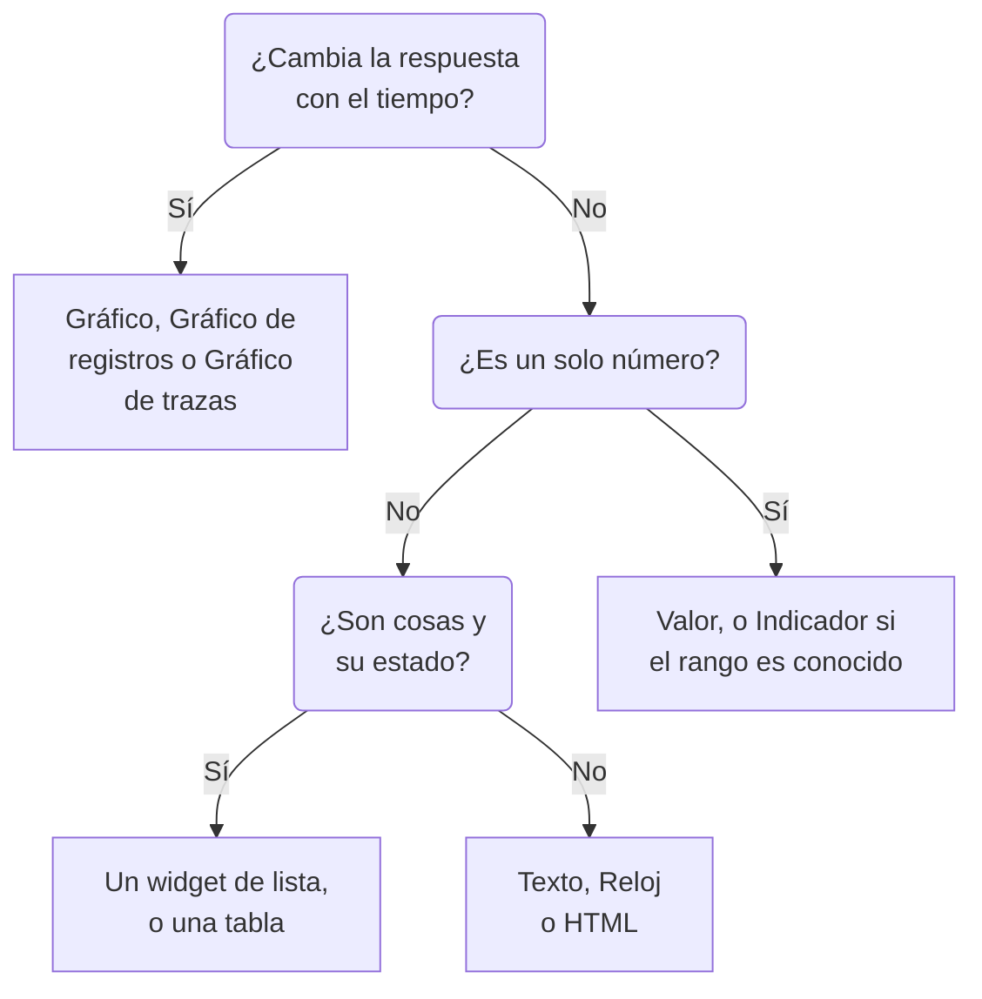

# Widgets del panel

Un widget es una casilla de un panel. Esta página enumera cada widget del catálogo **Añadir widget**, lo que muestra y los ajustes que importan, en los mismos grupos que el catálogo. Para colocar widgets en la cuadrícula y guardarlos, consulta [Crear un panel](/docs/dashboards/authoring).

:::cards
- [¿Qué widget debo usar?](#qué-widget-debo-usar): Elige según la pregunta que responde la casilla.
- [Gráficos y números](#gráficos-y-números): Gráfico, Valor, Indicador y Tabla, a partir de una consulta de métricas.
- [Registros, trazas y seguridad](#registros-trazas-y-seguridad): Gráficos de volumen, flujos en vivo y listas.
- [Ordenar listas y tablas](#ordenar-listas-y-tablas): Ordena por una columna y fija el orden que ven todos.
- [Cuando un widget no se puede mostrar](#cuando-un-widget-no-se-puede-mostrar): Qué muestra un widget roto y cómo arreglarlo.
:::

## ¿Qué widget debo usar?

Parte de la pregunta que tiene que responder la casilla:

| La pregunta | El widget |
| --- | --- |
| ¿Cómo ha cambiado una métrica con el tiempo? | **Gráfico** |
| ¿Cuántos registros, de qué gravedad, a lo largo del tiempo? | **Gráfico de registros** |
| ¿Qué tan rápidas son las peticiones, y cuántas fallan, a lo largo del tiempo? | **Gráfico de trazas** |
| ¿Cuál es un número concreto ahora mismo? | **Valor**, o **Indicador** cuando tiene un rango conocido |
| ¿Qué hosts, servicios o endpoints destacan? | **Tabla** o **Tabla de trazas** |
| ¿Qué está pasando ahora mismo? | **Flujo de registros**, **Lista de trazas**, **Lista de incidentes** o **Lista de alertas** |
| ¿Están todos nuestros sitios en funcionamiento? | **Lista de monitores** |
| ¿Mantenemos la fiabilidad que prometimos? | **SLO** o **Lista de SLO** |
| ¿En qué estado están nuestros clústeres y hosts? | Un widget del grupo Infraestructura |
| ¿Dónde está nuestra red en el mundo, y qué está caído? | **Mapa de red** |
| ¿Un encabezado, una nota, la hora en otra oficina? | **Texto** o **Reloj** |
| ¿Datos guardados fuera de OneUptime? | Un widget del grupo Fuentes de datos externas |
| ¿Algo que ningún widget cubre? | **HTML**, una vez que estés seguro de que ningún otro widget lo hace |



La mayoría de los paneles combinan unos pocos: un gráfico arriba, uno o dos valores al lado, un encabezado de texto y una o dos listas debajo.

## Gráficos y números

Estos cuatro widgets leen una consulta de métricas, construida igual que en el explorador de métricas: elige una métrica y una agregación, añade filtros de atributos, y agrupa por un atributo para obtener una serie por valor.

### Gráfico

Una serie temporal de una o varias consultas de métricas a lo largo del intervalo de tiempo del panel. **Chart Type** la dibuja como un gráfico de líneas, de barras, de áreas, de áreas apiladas o circular. **Additional Queries** superpone más métricas en los mismos ejes, y **Fórmulas** las combina con `+`, `-`, `*`, `/`, `%`, `^` y paréntesis, como en `(1 - a) * 100`. Los ajustes de visualización de cada consulta añaden una leyenda y una unidad, un color, líneas de advertencia y críticas, y una tasa por segundo para los contadores que solo crecen.

Úsalo cuando la forma de la línea cuenta la historia: latencia, errores, rendimiento o profundidad de una cola.

### Valor

Un número grande con un minigráfico: el valor de la consulta en todo el intervalo de tiempo, sumado para una suma o un recuento, el más alto para un máximo, el más bajo para un mínimo, y la media en los demás casos. Una flecha compara la segunda mitad del intervalo con la primera, cada mitad calculada del mismo modo, coloreada según **Trend Direction**: si un valor más alto es mejor o peor, o deducido del nombre de la métrica. Señala la flecha para ver el valor de cada mitad, y el minigráfico para leer el valor y la hora de cualquier punto. **Umbral de advertencia** pone el fondo amarillo y **Umbral crítico** rojo en cuanto el valor los alcanza.

Úsalo cuando un número responde a la pregunta: la tasa de errores, la latencia P95 o las peticiones atendidas hoy.

### Indicador

Un dial entre un mínimo y un máximo, 0 y 100 si no los defines, con una zona amarilla a partir de **Umbral de advertencia** y una zona roja a partir de **Umbral crítico**.

Úsalo cuando el valor vive en un rango conocido: el uso de CPU o de disco en porcentaje, o la capacidad de una cola.

### Tabla

Valores de métricas como filas. **Agrupar por atributos** da una fila por valor, por ejemplo una por `host.name`; sin ello, cada fila es un intervalo de tiempo. **Metrics & Columns** define las columnas: métricas, y fórmulas sobre ellas, como la disponibilidad en porcentaje. Cuando agrupas, **Reduce across time** convierte la serie de cada fila en un solo valor: el último valor, la media, la suma, el mínimo o el máximo.

Activa **Colorear por umbrales** en una columna para colorear sus valores: un valor que alcanza el **Umbral de advertencia** se vuelve ámbar, con un triángulo, y uno que alcanza el **Umbral crítico** se vuelve rojo y en negrita, con un círculo. Una columna de porcentaje empieza en 80 y 90. Para una columna en la que los valores bajos son el problema, como el espacio libre en disco, elige **Más bajo es peor** en **Dirección**.

Los umbrales leen el número que muestra la tabla, así que una métrica de uso enviada como una fracción de 1, como `system.cpu.utilization`, se muestra y se compara como porcentaje. En **Colores de los umbrales**, **Fondo de color** rellena toda la celda en lugar de colorear el número.

Úsala para un desglose en lugar de una tendencia: los hosts más ruidosos, los errores por servicio, las peticiones por endpoint.

## Texto, reloj y HTML

Estos widgets no necesitan ninguna fuente de datos.

### Texto

Una línea o un bloque de texto, para un encabezado, una nota o enlaces a tus runbooks. Activa **Markdown** para dibujar encabezados, enlaces, listas, código y tablas; si no, el texto se muestra tal como lo escribes, en negrita, cursiva o subrayado si quieres.

### Reloj

La hora actual en cualquier zona horaria, en dígitos o en una esfera analógica, con una etiqueta como "Oficina de Sídney". Sin zona horaria, muestra la de cada espectador. Añade uno por oficina para ver quién está despierto.

### HTML

Tu propio HTML, CSS y JavaScript, dibujado como un widget. Sus ajustes son el cuerpo HTML, una hoja de estilos opcional, un script opcional y tres interruptores de permisos.

Úsalo cuando necesites algo que ningún widget integrado cubre: una insignia incrustada de un tercero, una tabla obtenida de una API interna, una leyenda personalizada o un conjunto de enlaces con estilo a tus propias herramientas.

#### Qué puede y qué no puede hacer

El widget se renderiza en un marco aislado (sandbox) en su propio origen aislado. Dentro de ese marco tu código puede hacer más o menos cualquier cosa: construir el DOM, ejecutar temporizadores, hacer peticiones a cualquier URL, dibujar en un canvas.

Lo que no puede hacer es llegar a la página de OneUptime que lo rodea. No tiene acceso al DOM del panel, a las cookies, al almacenamiento local ni a la sesión de la API, y no puede hacer que la pestaña del navegador navegue a otra página. Eso se cumple tanto si el panel es privado como si se comparte públicamente.

Dos consecuencias que conviene conocer antes de pegar algo:

- Un `fetch` desde el widget es una petición entre orígenes desde un origen opaco, así que el servidor al que llamas tiene que permitirla con CORS. Llamar a la API de OneUptime desde aquí no está soportado.
- El widget empieza transparente. Define un fondo en `body` en tu CSS si quieres que llene la tarjeta. En el tema oscuro su texto empieza claro y su elemento `<html>` tiene la clase `dark`: empieza una regla CSS con `html.dark` para dar estilo solo al tema oscuro.

#### Usar las variables del panel

Escribe `{{variableName}}` en cualquier parte del HTML, el CSS o el JavaScript y se sustituye por el valor actual de esa variable antes de que el widget se renderice. Elegir un valor nuevo vuelve a renderizar el widget. Un marcador que nombra una variable que no existe se deja tal cual.

Los scripts reciben los mismos valores, más el intervalo de tiempo del panel, en `window.ONEUPTIME`:

```javascript title="window.ONEUPTIME"
window.ONEUPTIME.variables.environment; // current value, or "" if unset
window.ONEUPTIME.startDate; // ISO 8601 string, start of the dashboard's time range
window.ONEUPTIME.endDate; // ISO 8601 string, end of it
```

El widget se recarga cada vez que el panel se actualiza, así que un widget que obtiene sus propios datos sigue el ritmo del intervalo de actualización.

#### Permisos

**Run JavaScript** (activado por defecto) ejecuta tu script. Desactívalo para renderizar solo el marcado y los estilos: el script se deja entonces totalmente fuera del widget, en lugar de simplemente bloquearse.

**Open links in a new tab** (activado por defecto) permite que los enlaces y `window.open` abran una pestaña del navegador. Los enlaces siempre se abren en una pestaña nueva; el widget nunca puede hacer navegar al propio panel.

**Allow forms to submit** (desactivado por defecto) permite que un `<form>` dentro del widget se envíe.

Quien puede editar el panel decide lo que ejecuta este widget, y todos los que ven el panel lo ejecutan: en un panel público, eso incluye a los visitantes anónimos. Trata el acceso de edición a un panel con un widget HTML como tratarías el acceso a cualquier otro código que publicas.

## Registros, trazas y seguridad

| Widget | Qué muestra | Ajustes que importan |
| --- | --- | --- |
| **Gráfico de registros** | El volumen de registros a lo largo del tiempo, una serie por gravedad, como barras, líneas o áreas. | Gravedades, texto que contiene el cuerpo, filtros de atributos. |
| **Flujo de registros** | Las últimas líneas de registro que cumplen un filtro. | Gravedad, texto que contiene el cuerpo, filtros de atributos como `@service.name:checkout`, cuántas filas. |
| **Gráfico de trazas** | Número de peticiones, número de errores o tiempo de respuesta (medio, mínimo, máximo, de P50 a P99) a lo largo del tiempo. | La métrica, qué spans contar, y un atributo por el que dividir las series. |
| **Lista de trazas** | Las últimas trazas, con su duración y su estado. | Estado, cuántas filas. |
| **Tabla de trazas** | Los principales nombres de span, estados o valores de atributo por número de peticiones, con los tiempos de respuesta mediano, medio, mínimo y máximo. | Por qué agrupar las filas, y qué spans contar. |
| **Eventos de seguridad** | Los últimos eventos de seguridad, con su gravedad, su clase de evento y su host. | Gravedades, clases de evento, texto que contiene el mensaje. |
| **Flujo de eventos de seguridad** | Un flujo de eventos de seguridad desde su origen, pasando por su clase de evento, hasta su gravedad. | Gravedades, cuántos eventos. |

Los widgets de trazas solo cuentan los spans raíz, como hace el explorador de trazas, salvo que incluyas los spans hijos en sus ajustes. Un patrón habitual es un gráfico de latencia arriba con una lista de trazas lentas debajo.

## Incidentes, alertas y monitores

| Widget | Qué muestra | Filtros |
| --- | --- | --- |
| **Lista de incidentes** | Los incidentes con su estado y su gravedad. | Sin resolver, reconocidos o resueltos; gravedad, estado, monitores y etiquetas. |
| **Lista de alertas** | Las alertas con su estado y su gravedad. | Sin resolver, reconocidas o resueltas; gravedad, estado, monitores y etiquetas. |
| **Lista de monitores** | Los monitores con su estado actual. | Operativos o no, estado, tipo de monitor y etiquetas, o una **Variable de etiqueta** que los espectadores eligen en la barra de herramientas. |

Como la mayoría de los widgets de lista, estos tres pueden dibujar un panal de celdas coloreadas por estado en lugar de una tabla: elígelo en **Modo de visualización**. Muestran el estado actual, sea cual sea el intervalo de tiempo del panel.

## Objetivos de nivel de servicio

### SLO

Un único objetivo de nivel de servicio, dibujado como un solo número o como una línea a lo largo del tiempo.

**Ajustes**: qué SLO, o el SLO elegido en una variable del panel; cuál de sus tres números (SLI, Error Budget Remaining o Burn Rate); la visualización Tile o Gráfico; y un título opcional.

- **Tile** muestra el número actual, más una segunda línea cuando la hay: el objetivo bajo el SLI, los minutos restantes bajo el presupuesto de errores. Una etiqueta de estado colorea el conjunto.
- **Gráfico** dibuja el mismo número a lo largo del intervalo de tiempo del panel, con el objetivo marcado como una línea discontinua en la serie del SLI. El worker de evaluación escribe el historial cada pocos minutos, así que un SLO recién creado aparece vacío en el gráfico hasta que se evalúa por primera vez.

Úsalo cuando el panel responde a "¿cumplimos lo que prometimos?" más que a "¿qué está pasando ahora mismo?".

El widget SLO funciona en los [paneles públicos](/docs/dashboards/sharing). Lo que se publica son las cifras principales del SLO (su nombre, su objetivo, el SLI actual, el presupuesto de errores restante, la tasa de consumo y el estado), sea cual sea la que dibuja el widget. Su definición sigue siendo privada: los monitores que vigila, sus etiquetas, su descripción, su consulta y su calendario de evaluación nunca se envían a un visitante público. Un widget Tile solo publica esas cifras actuales; un widget Gráfico publica además el historial de la única serie que dibuja, y nada más.

### Lista de SLO

Cada SLO con su estado, su SLI, su presupuesto de errores y su tasa de consumo, primero los que tienen menos presupuesto. Fíltrala por estado o etiquetas, o por una **Variable de etiqueta** que los espectadores eligen en la barra de herramientas. [Métricas y paneles de SLO](/docs/slo/metrics) muestra los dos widgets de SLO en acción.

## Infraestructura

Cada uno de estos widgets lista los recursos que un agente o un colector comunica a OneUptime. Acótalos por clúster, host o espacio de nombres en sus filtros, y muéstralos como una lista o como un panal.

| Grupo | Widgets | Los alimenta |
| --- | --- | --- |
| **Hosts** | **Hosts**, con su estado de conexión, su sistema operativo, su CPU y su memoria | Cualquier colector de OpenTelemetry que envíe `host.name` |
| **Kubernetes** | **Pods**, **Nodos**, **Espacios de nombres**, **Despliegues**, **StatefulSets**, **DaemonSets**, **Trabajos**, **CronJobs** | El [Agente de Kubernetes](/docs/monitor/kubernetes-agent) |
| **Docker** | **Hosts**, **Contenedores**, **Imágenes**, **Redes**, **Volúmenes** | El agente de Docker |
| **Docker Swarm** | **Nodos**, **Servicios** | El agente de Docker Swarm |
| **Podman** | **Hosts**, **Contenedores**, **Imágenes**, **Redes**, **Volúmenes** | El agente de Podman |
| **Proxmox** | **Nodos**, **Invitados** | El agente de Proxmox |
| **VMware** | **Hosts**, **Máquinas virtuales** | El agente de VMware, o un vCenter que conectes |
| **Ceph** | **OSD**, como un muro coloreado por estado, y **Pools** | El agente de Ceph |
| **Cabinas de almacenamiento** | **Volúmenes**, y **Hardware** como un muro coloreado por estado | El agente de cabinas de almacenamiento |

Úsalos para tener una página que combine el estado de tu infraestructura con la telemetría de las cargas de trabajo que corren en ella.

### Mapa de red

Tus sitios de red dibujados en el mapa del mundo, cada uno fijado en su propia latitud y longitud y coloreado por el estado de monitor que se le agrega. Los sitios cercanos comparten un marcador con el recuento impreso dentro; un marcador que representa exactamente un sitio abre ese sitio al hacer clic en él.

El mapa se encuadra en los sitios que dibujó: una red dentro de un solo país llena el encuadre con ese país, y una repartida entre continentes se abre sobre el mundo. No hay controles de zoom ni de desplazamiento: una casilla de panel es una imagen, y la página Mapa de red, en Red, es donde se recorre la jerarquía.

Encima del mapa indica cuántos sitios están caídos, porque nadie distingue un punto rojo de dos píxeles entre doscientos verdes a la distancia a la que se mira un panel. Debajo, una línea de cobertura dice lo que el mapa no muestra: los sitios sin coordenadas, y si se alcanzó el límite de filas.

**Ajustes**: título, vista de mapa o de lista, número máximo de sitios dibujados, si se imprimen los nombres de los sitios, y filtros por tipo de sitio y por estado. Los nombres de los sitios se ocultan automáticamente cuando el mapa está demasiado cargado para poder leerlos; la información emergente sigue nombrando cada marcador.

Un sitio solo aparece si tiene coordenadas. Añade la latitud y la longitud en el sitio (o impórtalas desde un CSV) para fijarlo.

## Fuentes de datos externas

El grupo Fuentes de datos externas dibuja un **Gráfico**, un **Valor**, un **Indicador** o una **Tabla** a partir de un sistema que no es de OneUptime: Prometheus, PostgreSQL, MySQL, SQL Server, ClickHouse, Loki, Elasticsearch o cualquier API REST. Conectas el sistema una vez, y luego escribes la consulta de cada widget en el propio lenguaje de ese sistema. [Fuentes de datos externas](/docs/dashboards/data-sources) explica cómo.

## Ordenar listas y tablas

Haz clic en el encabezado de una columna para ordenar una lista o una tabla por ella: un primer clic la ordena como dice la tabla de abajo, el siguiente clic al revés, y el de después devuelve el widget a su propio orden. En la columna por la que el widget ya está ordenado, un clic invierte el orden. Una flecha marca la columna por la que están ordenadas las filas.

| Columna | Primer clic | Siguiente clic |
| --- | --- | --- |
| Un estado o una gravedad | Peores primero | Mejores primero |
| Una hora | Más recientes primero | Más antiguos primero |
| Un número | Más altos primero | Más bajos primero |
| Texto | De la A a la Z | De la Z a la A |

Lo peor sigue el orden propio de tu proyecto: el estado de un monitor según su prioridad, la gravedad y el estado de un incidente o una alerta según el orden en que los tienes, y un recurso caído, no preparado o apagado antes que uno sano. La fase de un pod se ordena Failed, luego Unknown, luego Pending y luego Running y Succeeded. El SLI y el presupuesto de errores de un SLO, y el VMID de un invitado de Proxmox, se ordenan de menor a mayor.

Se ordena la lista entera, no solo las filas de la pantalla: una lista que muestra 25 filas, ordenada con los peores primero, muestra los 25 peores de todos. Las filas empatadas conservan el orden propio del widget. Una columna por la que una lista no se puede ordenar entera, como el mensaje de un evento de seguridad, no ordena.

### Tu propio orden

Tu orden es solo tuyo: tu navegador lo recuerda para ese widget en ese panel, así que una recarga o el reinicio de una pantalla mural lo conservan, y nadie más lo ve. El clic que devuelve el widget a su propio orden olvida tu orden, y el widget sigue entonces su propio orden, aunque un editor lo cambie después.

### El orden que ven todos

Para fijar el orden en que un widget se abre para todos, edítalo y elige el orden en **Ordenar**, o haz clic en el encabezado de una columna en su **Vista previa en vivo**, y luego haz clic en **Guardar cambios**. Ves el nuevo orden al instante; quien haya ordenado el widget a su manera conserva su orden.

Las plantillas de panel abren sus listas de hosts, nodos, pods, servicios de Swarm y dispositivos de red con los peores primero.

Mediante la API y Terraform, el orden es el `arguments.sort` del widget: una columna y una dirección, por ejemplo `status:desc`. Un widget de lista rechaza una columna que no tiene, y el error enumera los órdenes que tiene.

## En un panel público

Un [panel público](/docs/dashboards/sharing) dibuja la mayoría de los widgets para sus visitantes, y cada uno muestra solo lo que se configuró para mostrar. Algunos no pueden mostrarse sin una sesión iniciada:

- **Gráfico de registros**, **Gráfico de trazas**, **Tabla de trazas**, **Eventos de seguridad** y **Flujo de eventos de seguridad** indican en su lugar que no están disponibles en los paneles públicos.
- Los widgets de Fuentes de datos externas se quedan totalmente fuera de un panel público, porque sus ajustes son la propia consulta.

## Cuando un widget no se puede mostrar

Un widget que no se puede dibujar muestra **No se pudo mostrar este widget** en su propio lugar, y el resto del panel sigue funcionando. Eso ocurre cuando OneUptime no tiene ningún widget de su tipo (uno que se eliminó, que se escribió mal cuando el panel se creó a través de la API, o que añadió una versión más reciente), o cuando el widget falla al dibujarse, por ejemplo porque sus ajustes guardados están incompletos.

Si puedes editar el panel, haz clic en **Editar widget** sobre él. El panel pasa al modo de edición con los ajustes de ese widget abiertos: corrígelos, o haz clic en **Eliminar widget**, y luego en **Guardar cambios**. Un widget que falló al dibujarse ofrece además **Volver a intentar**, y se vuelve a dibujar en la siguiente actualización automática o cuando cambias el intervalo de tiempo.

A los visitantes de un panel público solo se les dice que el widget no se pudo mostrar.

## Próximos pasos

:::cards
- [Variables y filtros del panel](/docs/dashboards/variables): Deja que los espectadores apunten los widgets a un servicio, un host o un cliente.
- [Fuentes de datos externas](/docs/dashboards/data-sources): Grafica Prometheus, SQL, Loki y más junto a tus propios datos.
- [Crear un panel](/docs/dashboards/authoring): Añade, organiza y guarda widgets.
- [Compartir y paneles públicos](/docs/dashboards/sharing): Comparte el panel fuera de tu equipo.
:::
